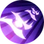

[Тир-лист](https://boostmlbb.ru/heroes/)[Новости и гайды](https://boostmlbb.ru/news/)

# Кэрри

C

СтрелокЛиния золота

Победы

49,0%

Выбор

0,6%

Баны

0,7%

[Обзор](https://boostmlbb.ru/#overview)[Сборка](https://boostmlbb.ru/#build)[Навыки](https://boostmlbb.ru/#skills)[Контрпики](https://boostmlbb.ru/#draft)[История](https://boostmlbb.ru/#lore)

## Обзор

### Характеристики

-   Живучесть**30**
-   Атака**80**
-   Эффекты**10**
-   Сложность**40**

-   Добивание
-   Урон

### Победы по рангам, 30 дней

1.  **48,6%**Эпик
2.  **48,3%**Легенда
3.  **49,0%**Мифик
4.  **49,5%**Честь
5.  **48,7%**Слава

Пунктир: 50% побед

### Другие стрелки этой линии

[Обсидия](https://boostmlbb.ru/heroes/obsidia.html)[Бруно](https://boostmlbb.ru/heroes/bruno.html)[Клинт](https://boostmlbb.ru/heroes/clint.html)[Броуди](https://boostmlbb.ru/heroes/brody.html)[Ханаби](https://boostmlbb.ru/heroes/hanabi.html)[Москов](https://boostmlbb.ru/heroes/moskov.html)[Клауд](https://boostmlbb.ru/heroes/claude.html)[Мия](https://boostmlbb.ru/heroes/miya.html)

## Сборка

Сборка 1Сборка 2Сборка 3

Победы

55,9%

Выбор

12,0%

#### Основные предметы

-   

    Коса коррозии

-   

    Золотой посох

-   

    Меч охотника на демонов

#### Заклинание

Вспышка

#### Эмблема и таланты

Эмблема бойца

-   

    Проворность

-   

    Кровавое пиршество

-   

    Квантовый заряд

Победы

54,2%

Выбор

10,2%

#### Основные предметы

-   

    Коса коррозии

-   

    Золотой посох

-   

    Меч охотника на демонов

#### Заклинание

Вспышка

#### Эмблема и таланты

Эмблема бойца

-   

    Трепет

-   

    Кровавое пиршество

-   

    Квантовый заряд

Победы

54,5%

Выбор

3,6%

#### Основные предметы

-   

    Коса коррозии

-   

    Золотой посох

-   

    Меч охотника на демонов

#### Заклинание

Очищение

#### Эмблема и таланты

Эмблема бойца

-   

    Трепет

-   

    Кровавое пиршество

-   

    Квантовый заряд

## Навыки

Прокачка**Проворный огонь**_›_**Фантомный шаг**_›_**Вращающийся огонь**

Пассивный**Световое клеймо**1-й навык**Вращающийся огонь**2-й навык**Фантомный шаг**Ультимейт**Проворный огонь**

Пассивный

### Световое клеймо

Базовые атаки и навыки Кэрри при попадании отмечают цель зарядом светового клейма.

Как только количество световых клейм на ней достигнет 5, они превратятся в световой диск, который нанесет чистый урон, равный 5 от цели (максимум 5 урона против монстров).

1-й навык

### Вращающийся огонь

Перезарядка **8 Mana Cost: 65 с**

Кэрри выпускает сферу бушующей энергии в указанном направлении, нанося 250 (+20% общей физической атаки) единиц физического урона врагам на пути. Сфера остановится при контакте с врагом или по достижении максимальной дистанции и будет непрерывно наносить 150 (+10% общей физической атаки) единиц физического урона врагам поблизости и замедлять их на 80%. Длится 1 сек.

2-й навык

### Фантомный шаг

Перезарядка **4.5 Mana Cost: 35 с**

Кэрри прыгает в указанном направлении, бросая световой диск в ближайшего врага, нанося 150 (+70% общей физической атаки) единиц физического урона и накладывая на него заряд светового клейма.

В состоянии двойного вооружения Кэрри бросает два световых диска.

Ультимейт

### Проворный огонь

Перезарядка **35 Mana Cost: 100 с**

Кэрри входит в состояние двойного вооружения на 10 сек., получая 30% скорости передвижения. Каждая базовая атака наносит 50 (+50% общей физической атаки) ед. физического урона и выпускает 2 световых диска, которые наследуют часть эффектов атаки.

## Контрпики

### Контрпики

Побеждают этого героя

[Алиса](https://boostmlbb.ru/heroes/alice.html)[Баксий](https://boostmlbb.ru/heroes/baxia.html)[Эсмеральда](https://boostmlbb.ru/heroes/esmeralda.html)[Бальмонд](https://boostmlbb.ru/heroes/balmond.html)[Хилос](https://boostmlbb.ru/heroes/hylos.html)

### Слабые цели

Этот герой побеждает их

[Сан](https://boostmlbb.ru/heroes/sun.html)[Гвиневра](https://boostmlbb.ru/heroes/guinevere.html)[Хаябуса](https://boostmlbb.ru/heroes/hayabusa.html)[Минситтар](https://boostmlbb.ru/heroes/minsitthar.html)[Аргус](https://boostmlbb.ru/heroes/argus.html)

## История

> Безразличный и могущественный Яссон.

[Читать полную историю ↗](https://kazukiofficial.com/stories/karrie)Kazuki Official, английский [Характеристики на сайте игры ↗](https://www.mobilelegends.com/hero/detail?heroid=40)

**Поднимем ранг на герое «Кэрри»**Цена считается в калькуляторе

[Рассчитать цену](https://boostmlbb.ru/order.html?type=hero)

## Частые вопросы

Кто контрпик для героя «Кэрри» в MLBB?

За последние 30 дней чаще всего героя обыгрывают Алиса, Баксий, Эсмеральда, Бальмонд и Хилос.

Какой процент побед у героя «Кэрри» сейчас?

49,03% в Мифической славе за последние 7 дней и 48,87% на всех рангах за 30 дней, данные на 23 ноября 2026 года.

Какая роль и линия у героя «Кэрри»?

Стрелок, играет на линии золота.

Силён ли герой «Кэрри» в текущей мете?

Тир C, 88-е место из 133 героев и 17-е среди стрелков. Тир учитывает, как часто героя берут и банят и как он выигрывает в Мифической славе за 7 дней: бан в 0,7% матчей, 49,0% побед. В профессиональных матчах за месяц героя драфтуют в 1,1% катков.

Какая сборка на героя «Кэрри» лучшая?

Самая популярная сборка в рейтинге: ключевые предметы «Коса коррозии», «Золотой посох» и «Меч охотника на демонов», эмблема бойца с талантами «Проворность», «Кровавое пиршество» и «Квантовый заряд» и заклинание «Вспышка». С ней выигрывают 55,89% матчей.
