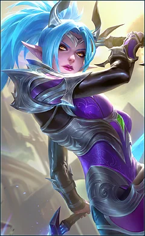

[Тир-лист](https://boostmlbb.ru/heroes/)[Предметы](https://boostmlbb.ru/items/)[Новости и гайды](https://boostmlbb.ru/news/)

# Кимми

A

МагСтрелокЛиния золотаСредняя линия

Победы

48,1%

Выбор

0,9%

Баны

0,5%

[Обзор](https://boostmlbb.ru/#overview)[Сборка](https://boostmlbb.ru/#build)[Навыки](https://boostmlbb.ru/#skills)[Контрпики](https://boostmlbb.ru/#draft)[История](https://boostmlbb.ru/#lore)

## Обзор

### Характеристики

-   Живучесть**30**
-   Атака**80**
-   Эффекты**50**
-   Сложность**60**

-   Урон
-   Магический урон

### Победы по рангам, 30 дней

1.  **48,7%**Эпик
2.  **48,1%**Легенда
3.  **48,0%**Мифик
4.  **48,9%**Честь
5.  **48,9%**Слава

Пунктир: 50% побед

### Другие маги этой линии

[Эйдора](https://boostmlbb.ru/heroes/eudora.html)[Чжусинь](https://boostmlbb.ru/heroes/zhuxin.html)[Валир](https://boostmlbb.ru/heroes/valir.html)[Цзэтянь](https://boostmlbb.ru/heroes/zetian.html)[Лилия](https://boostmlbb.ru/heroes/lylia.html)[Ксавьер](https://boostmlbb.ru/heroes/xavier.html)[Люнокс](https://boostmlbb.ru/heroes/lunox.html)[Валентина](https://boostmlbb.ru/heroes/valentina.html)

### Места в рейтингах

-   [Лучшие стрелки MLBB**2 из 23**](https://boostmlbb.ru/heroes/best-marksman.html)
-   [Лучшие маги MLBB**3 из 32**](https://boostmlbb.ru/heroes/best-mage.html)
-   [Лучшие мидеры MLBB**1 из 29**](https://boostmlbb.ru/heroes/best-mid.html)

## Сборка

Сборка 1Сборка 2Сборка 3

Победы

54,3%

Выбор

10,0%

#### Основные предметы

-   [

    

    Райское перо

    ](https://boostmlbb.ru/items/feather-of-heaven.html)
-   [

    

    Пронзающий небеса

    ](https://boostmlbb.ru/items/sky-piercer.html)
-   [

    

    Концентрированная энергия

    ](https://boostmlbb.ru/items/concentrated-energy.html)

#### Заклинание

Очищение

#### Эмблема и таланты

Эмблема мага

-   

    Трепет

-   

    Охотник за скидками

-   

    Точно в цель

Победы

49,0%

Выбор

8,6%

#### Основные предметы

-   [

    

    Райское перо

    ](https://boostmlbb.ru/items/feather-of-heaven.html)
-   [

    

    Пронзающий небеса

    ](https://boostmlbb.ru/items/sky-piercer.html)
-   [

    

    Божественный меч

    ](https://boostmlbb.ru/items/divine-glaive.html)

#### Заклинание

Очищение

#### Эмблема и таланты

Эмблема мага

-   

    Трепет

-   

    Охотник за скидками

-   

    Точно в цель

Победы

51,9%

Выбор

8,2%

#### Основные предметы

-   [

    

    Райское перо

    ](https://boostmlbb.ru/items/feather-of-heaven.html)
-   [

    

    Пронзающий небеса

    ](https://boostmlbb.ru/items/sky-piercer.html)
-   [

    

    Концентрированная энергия

    ](https://boostmlbb.ru/items/concentrated-energy.html)

#### Заклинание

Вспышка

#### Эмблема и таланты

Эмблема мага

-   

    Трепет

-   

    Охотник за скидками

-   

    Точно в цель

## Навыки

Прокачка**Импульс притяжения**_›_**Луч старлиума**_›_**Антигравитационный двигатель**

Пассивный**Воздушное превосходство**1-й навык**Антигравитационный двигатель**2-й навык**Луч старлиума**Ультимейт**Импульс притяжения**

Пассивный

### Воздушное превосходство

Кимми может двигаться и целиться в разных направлениях при использовании пушки-распылителя, но не может зафиксироваться на конкретной цели. Каждый химический снаряд наносит (+18% общей физической атаки) (+24% общей магической силы) единиц магического урона. Попадание по вражеским героям или юнитам не-героям восстанавливает 6 / 3 старлиума соответственно. При максимальном уровне старлиума она постоянно расходует его для усиления базовых атак, которые наносят (+22.5% общей физической атаки) (+30% общей магической силы) единиц урона и пробивают цели (усиленные базовые атаки получают только 50% вампиризма от навыков).

Кимми может продолжать движение во время стрельбы и не получает бонус к скорости атаки. Кажд. получ. 1% скорости атаки преобраз. в 1 .

Базовые атаки Кимми наносят башням только 60% урона.

1-й навык

### Антигравитационный двигатель

Перезарядка **14 с**

Кимми взлетает с помощью рюкзака, снимая эффекты замедления и получая к ним иммунитет. Она может проходить сквозь препятствия и получает 120% дополнительной скорости передвижения, которая спадает в течение 1 сек. Во время полета она непрерывно стреляет 4 химическими снарядами в ближайших врагов, каждый из которых наносит 20 (+25% общей физической атаки) (+30% общей магической силы) единиц магического урона и замедляет их на 50% на 0.5 сек.

Кимми не расходует старлиум во время полета.

2-й навык

### Луч старлиума

Перезарядка **12 с**

Кимми выпускает "Луч старлиума" в указанном направлении, обездвиживая врагов на пути и нанося 300 (+50% общей физической атаки) (+60% общей магической силы) единиц магического урона в течение 1 сек.

Каждый пораженный вражеский герой дает 20 старлиума.

Ультимейт

### Импульс притяжения

Перезарядка **50 с**

Кимми заряжает и выпускает "Импульс притяжения" в указанном направлении. При попадании во врага или достижении максимальной дальности он взрывается, нанося 150 (+45% общей физической атаки) (+54% общей магической силы) единиц магического урона ближайшим врагам и создавая силовое поле, которое замедляет врагов внутри на 50%.

Через 1 сек. поле сужается, притягивая находящихся в нем вражеских героев к своему центру и нанося магический урон в размере 15% от их текущих . Оно также замедляет их на 50% на 2 сек. Каждый пораженный вражеский герой дает Кимми 40 старлиума.

## Контрпики

### Контрпики

Побеждают этого героя

[Сан](https://boostmlbb.ru/heroes/sun.html)[Хилос](https://boostmlbb.ru/heroes/hylos.html)[Атлас](https://boostmlbb.ru/heroes/atlas.html)[Уранус](https://boostmlbb.ru/heroes/uranus.html)[Хильда](https://boostmlbb.ru/heroes/hilda.html)

### Слабые цели

Этот герой побеждает их

[Карина](https://boostmlbb.ru/heroes/karina.html)[Арлотт](https://boostmlbb.ru/heroes/arlott.html)

## История

> Родившись в семье военного, она заслужила признание как смелая, но беззаботная "крутая девчонка" из пограничной стражи.

[Читать полную историю ↗](https://kazukiofficial.com/stories/kimmy)Kazuki Official, английский [Характеристики на сайте игры ↗](https://www.mobilelegends.com/hero/detail?heroid=71)

**Поднимем ранг на герое «Кимми»**Цена считается в калькуляторе

[Рассчитать цену](https://boostmlbb.ru/order.html?type=hero)

## Частые вопросы

Кто контрпик для героя «Кимми» в MLBB?

За последние 30 дней чаще всего героя обыгрывают Сан, Хилос, Атлас, Уранус и Хильда.

Какой процент побед у героя «Кимми» сейчас?

48,09% в Мифической славе за последние 7 дней и 48,63% на всех рангах за 30 дней, данные на 25 ноября 2026 года.

Какая роль и линия у героя «Кимми»?

Маг и стрелок, играет на линии золота или на средней линии.

Силён ли герой «Кимми» в текущей мете?

Тир A, 15-е место из 133 героев и 3-е среди магов. Тир учитывает, как часто героя берут и банят и как он выигрывает в Мифической славе за 7 дней: бан в 0,5% матчей, 48,1% побед. В профессиональных матчах за месяц героя драфтуют в 73,1% катков.

Какая сборка на героя «Кимми» лучшая?

Самая популярная сборка в рейтинге: ключевые предметы «Райское перо», «Пронзающий небеса» и «Концентрированная энергия», эмблема мага с талантами «Трепет», «Охотник за скидками» и «Точно в цель» и заклинание «Очищение». С ней выигрывают 54,26% матчей.
