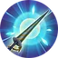

[Главная](https://boostmlbb.ru/) / [Герои](https://boostmlbb.ru/heroes/)

Тир D

# Ланселот в Mobile Legends: сборка, контрпики и статистика

Убийца, лес. Выигрывает 43,13% матчей за последние 30 дней — 130-е место из 133 героев.

[Буст на этом герое](https://boostmlbb.ru/order.html?type=hero)[Все герои](https://boostmlbb.ru/heroes/)

Статистика герояТир D

**Ланселот**Бан 0,47% · Выбор 0,51%

Контрпики

Победы за 30 дней**43,13%**

**43,13%**побед за 30 дней

**0,51%**выбирают в матчах

**0,47%**банят в матчах

**42,31%**побед в Мифической славе

## Сборка на героя «Ланселот»

Самая популярная сборка для героя «Ланселот» на роли леса в рейтинговых матчах на всех рангах — по данным «Академии» в игре. Процент побед — в матчах именно с этой сборкой.

Ключевые предметы

Топор войныКираса грубой силыБесконечная битва

Эмблема и таланты

Эмблема бойцаТрепетОпытный охотникУбийственный пир

Боевое заклинание

Возмездие

Побед с этой сборкой **48,19%**Выбирают в **6,70%** матчей

### Другие популярные варианты

-   ВозмездиеЭмблема убийцыТрепет · Опытный охотник · Убийственный пир**50,05%**
-   ВозмездиеЭмблема убийцыТрепет · Опытный охотник · Убийственный пир**49,02%**

## Навыки героя «Ланселот»

Официальные описания навыков от MOONTON с перезарядкой и типом навыка.

Порядок прокачки: **Призрачная казнь** → **Шипованная роза** → **Прокол**

-   

    **Порез души**Пассивный

    Каждый раз, когда Ланселот совершает рывок, его урон увеличивается на 7.5% на 4 сек., вплоть до 30%.

-   

    **Прокол**1-й навыкПерезарядка 14 Mana Cost: 40 с

    Ланселот совершает рывок в указанном направлении, нанося 150 (+50% общей физической атаки) единиц физического урона врагам на пути и накладывая "Метку меча" на первого пораженного врага без метки на 3 сек.
    При наложении новой "Метки меча" перезарядка этого навыка сбрасывается.

-   

    **Шипованная роза**2-й навыкПерезарядка 11 Mana Cost: 60 с

    Ланселот совершает 3 удара в указанном направлении, каждый раз нанося 220 (+120% дополнительной физической атаки) единиц физического урона пораженным врагам (урон уменьшается, если поражено несколько врагов). Во время этого процесса он неуловим для прицела. Враги в центре области получают все 3 удара и замедляются на 20% на 0.5 сек. Эффект замедления может складываться.

-   

    **Призрачная казнь**УльтимейтПерезарядка 36 Mana Cost: 100 с

    После небольшой задержки Ланселот совершает карающий удар в указанном направлении, нанося 350 (+170% общей физической атаки) единиц физического урона пораженным врагам. Во время этого процесса он неуязвим.

## Роль и линия

Место считается по проценту побед за 30 дней среди героев той же роли или линии.

-   Роль**Убийца**
-   Линия**Лес**
-   Среди убийц**28-е из 29**
-   В лесу**36-е из 37**
-   Специализация**Преследование, Разрушительный урон**
-   Сложность**Средняя (50/100)**

## Кто контрит этого героя

Против этих героев «Ланселот» проигрывает чаще всего. Под иконкой — их собственный процент побед. 3 из 5 контрпиков — бойцы.

[Атлас51,42%](https://boostmlbb.ru/heroes/atlas.html)[Инь49,62%](https://boostmlbb.ru/heroes/yin.html)[Альфа48,85%](https://boostmlbb.ru/heroes/alpha.html)[Джонсон49,25%](https://boostmlbb.ru/heroes/johnson.html)[Икс.Борг49,96%](https://boostmlbb.ru/heroes/x-borg.html)

## Против кого силён

Для этих героев «Ланселот» — один из самых неудобных соперников.

[Ангела49,99%](https://boostmlbb.ru/heroes/angela.html)

## С кем играть в команде

С этими героями в одной команде «Ланселот» выигрывает чаще. Число — прибавка к проценту побед в процентных пунктах.

[Ангела+3,22 п. п.](https://boostmlbb.ru/heroes/angela.html)[Дариус+1,17 п. п.](https://boostmlbb.ru/heroes/dyrroth.html)[Аргус+1,11 п. п.](https://boostmlbb.ru/heroes/argus.html)[Ханаби+0,75 п. п.](https://boostmlbb.ru/heroes/hanabi.html)

## Процент побед по рангам

Лучший результат — на ранге «Эпик» (45,34%), слабее всего — «Мифическая слава» (42,31%). Данные за последние 30 дней.

-   Эпик**45,34%**
-   Легенда**44,12%**
-   Мифический**43,14%**
-   Мифическая честь**43,19%**
-   Мифическая слава**42,31%**

## Место в мете

«Ланселот» — тир D в нашем тир-листе по проценту побед, 130-е место из 133 героев. В Мифической славе процент побед ниже: 42,31% против 43,13% на всех рангах, разница 0,82 п. п. Полный [тир-лист ноября](https://boostmlbb.ru/news/mlbb-meta-tier-list/) и [разбор патча](https://boostmlbb.ru/news/mlbb-current-patch/).

## Другие герои леса

Самые сильные по проценту побед за последние 30 дней.

[Сан53,72%](https://boostmlbb.ru/heroes/sun.html)[Аулус53,46%](https://boostmlbb.ru/heroes/aulus.html)[Линг52,54%](https://boostmlbb.ru/heroes/ling.html)[Пополь и Купа52,09%](https://boostmlbb.ru/heroes/popol-and-kupa.html)[Лукас51,97%](https://boostmlbb.ru/heroes/lukas.html)[Бэйн51,61%](https://boostmlbb.ru/heroes/bane.html)

## История героя

«Блудный сын и талантливый фехтовальщик Дома Барокко.»

Полная история героя «Ланселот» — на официальном сайте лора MOONTON. Карточка героя с навыками и советами разработчиков — на mobilelegends.com, реплики, облики и история изменений — в MLBB Wiki.

[Читать историю](https://play.mobilelegends.com/lore/hero/Lancelot)[Карточка героя](https://www.mobilelegends.com/hero/detail?heroid=47)[MLBB Wiki](https://mobile-legends.fandom.com/wiki/Lancelot)

## Буст на герое «Ланселот»

Бустер играет только этим героем: вместе с рангом растёт и рейтинг героя.

[Рассчитать стоимость](https://boostmlbb.ru/order.html?type=hero)

Статистика — официальный рейтинг героев MOONTON (mobilelegends.com/rank) за последние 30 дней, обновление 23 ноября 2026 года, страница обновляется каждый день. Роли и линии — с официальной страницы героев. Сборки, навыки и союзники — данные «Академии» MOONTON через Rone Arena API (ridwaanhall / RoneAI).

## Частые вопросы

Кто контрпик для героя «Ланселот» в MLBB?

За последние 30 дней чаще всего героя обыгрывают Атлас, Инь, Альфа, Джонсон и Икс.Борг.

Какой процент побед у героя «Ланселот» сейчас?

43,13% за последние 30 дней на всех рангах и 42,31% в Мифической славе, данные на 23 ноября 2026 года.

Какая роль и линия у героя «Ланселот»?

Убийца, играет в лесу.

Силён ли герой «Ланселот» в текущей мете?

Тир D: 130-е место из 133 героев по проценту побед за 30 дней и 28-е среди убийц.

Какая сборка на героя «Ланселот» лучшая?

Самая популярная сборка в рейтинге: ключевые предметы «Топор войны», «Кираса грубой силы» и «Бесконечная битва», эмблема бойца с талантами «Трепет», «Опытный охотник» и «Убийственный пир» и заклинание «Возмездие». С ней выигрывают 48,19% матчей.

Редакция MLBB Boost · Обновлено 23 ноября 2026
