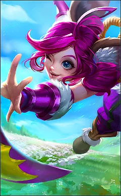

[Тир-лист](https://boostmlbb.ru/heroes/)[Предметы](https://boostmlbb.ru/items/)[Скины](https://boostmlbb.ru/skins/)[Новости и гайды](https://boostmlbb.ru/news/)

[Тир-лист](https://boostmlbb.ru/heroes/)

# Лолита

D

ТанкПоддержкаРоум

Победы

52,5%

Выбор

0,1%

Баны

0,2%

[Обзор](https://boostmlbb.ru/#overview)[Сборка](https://boostmlbb.ru/#build)[Как играть](https://boostmlbb.ru/#howto)[Навыки](https://boostmlbb.ru/#skills)[Контрпики](https://boostmlbb.ru/#draft)[Скины](https://boostmlbb.ru/#skins)[История](https://boostmlbb.ru/#lore)

## Обзор

### Характеристики

-   Живучесть**100**
-   Атака**10**
-   Эффекты**90**
-   Сложность**50**

-   Защита
-   Массовый контроль

### Победы по рангам, 30 дней

1.  **54,0%**Эпик
2.  **55,2%**Легенда
3.  **54,9%**Мифик
4.  **53,9%**Честь
5.  **51,9%**Слава

Пунктир: 50% побед

### Другие танки этой линии

[Кармилла](https://boostmlbb.ru/heroes/carmilla.html)[Белерик](https://boostmlbb.ru/heroes/belerick.html)[Атлас](https://boostmlbb.ru/heroes/atlas.html)[Глу](https://boostmlbb.ru/heroes/gloo.html)[Минотавр](https://boostmlbb.ru/heroes/minotaur.html)[Хуфра](https://boostmlbb.ru/heroes/khufra.html)[Тигрил](https://boostmlbb.ru/heroes/tigreal.html)[Хильда](https://boostmlbb.ru/heroes/hilda.html)

### Места в рейтингах

-   [Лучшие танки MLBB**22 из 25**](https://boostmlbb.ru/heroes/best-tank.html)
-   [Лучшие роумеры MLBB**30 из 34**](https://boostmlbb.ru/heroes/best-roam.html)

## Сборка

Сборка 1Сборка 2Сборка 3

Победы

58,4%

Выбор

2,6%

#### Основные предметы

-   [

    

    Фляга Оазиса

    ](https://boostmlbb.ru/items/flask-of-the-oasis.html)
-   [

    

    Наплечник наказания

    ](https://boostmlbb.ru/items/chastise-pauldron.html)
-   [

    

    Защитный шлем

    ](https://boostmlbb.ru/items/guardian-helmet.html)

#### Заклинание

Восстановление

#### Эмблема и таланты

Эмблема танка

-   

    Прочность

-   

    Второе дыхание

-   

    Фокус-метка

Победы

60,4%

Выбор

2,1%

#### Основные предметы

-   [

    

    Фляга Оазиса

    ](https://boostmlbb.ru/items/flask-of-the-oasis.html)
-   [

    

    Господство льда

    ](https://boostmlbb.ru/items/dominance-ice.html)
-   [

    

    Сияющая броня

    ](https://boostmlbb.ru/items/radiant-armor.html)

#### Заклинание

Восстановление

#### Эмблема и таланты

Эмблема поддержки

-   

    Прочность

-   

    Стойкость

-   

    Ударная волна

Победы

59,0%

Выбор

1,8%

#### Основные предметы

-   [

    

    Фляга Оазиса

    ](https://boostmlbb.ru/items/flask-of-the-oasis.html)
-   [

    

    Наплечник наказания

    ](https://boostmlbb.ru/items/chastise-pauldron.html)
-   [

    

    Защитный шлем

    ](https://boostmlbb.ru/items/guardian-helmet.html)

#### Заклинание

Восстановление

#### Эмблема и таланты

Эмблема танка

-   

    Живучесть

-   

    Стойкость

-   

    Фокус-метка

## Как играть за Лолиту

### Комбо Лолиты

#### В драке

1.  2
2.  1
3.  Атака
4.  Ульт

В драке отразите дальние атаки вторым навыком, влетите первым в гущу врагов, оглушите усиленной атакой и добавьте ульт для урона и контроля. Добивайте вместе с командой.

#### На линии

1.  1
2.  Атака
3.  2

На линии оглушите врага первым навыком и усиленной атакой, затем вторым отражайте дальние атаки.

### Когда сильнее всего

Сила ровная всю игру, от 52,0% до 54,3%. Выбирайте драки по готовым предметам, а не по минутам.

1.  **53,7**10–12
2.  **53,9**12–14
3.  **54,3**14–16
4.  **53,9**16–18
5.  **53,6**18–20
6.  **52,0**20+

Проценты побед по длине матча в минутах, все ранги. Пунктир: 50%

### Приоритет прокачки

1.  Взрыв Ноумена
2.  Мощный рывок
3.  Отражающий щит

## Навыки

Пассивный**Энергетическое ядро Ноумена**1-й навык**Мощный рывок**2-й навык**Отражающий щит**Ультимейт**Взрыв Ноумена**

Пассивный

### Энергетическое ядро Ноумена

Кажд. 6-3 сек. (зависит от уровня "Взрыва Ноумена"), энергетическое ядро Ноумена дает 20 (+2.5% Макс. ОЗ) (+20% общей магической силы) ед. щита Лолите. Когда Лолита применяет навык, энергетическое ядро Ноумена дает Лолите и ближайшим союзным героям дополнительный щит. Этот щит длится 30 сек. и может складываться до 3 р.

1-й навык

### Мощный рывок

Перезарядка **10 Mana Cost: 70 с**

Лолита бросается в указанном направлении. При следующей базовой атаке в течение 4 сек. она совершит короткий рывок к цели, нанося 400 (+100% общей физической атаки) единиц физического урона и оглушая ее на 0.5 сек. Этот урон удваивается против миньонов.

2-й навык

### Отражающий щит

Перезарядка **15 Mana Cost: 90 с**

Лолита поднимает щит и отражает все входящие дальние базовые атаки и снаряды в направлении щита в течение 3 сек. Щит разрушится, когда будет получено 1000 (+15% Макс. ОЗ) единиц урона.

Урон и эффекты от уникальных пассивных навыков снаряжения атакующего не применяются к щиту и не отражаются. Этот навык могут прервать эффекты контроля высокого уровня.

Ультимейт

### Взрыв Ноумена

Перезарядка **55 Mana Cost: 100 с**

**Пассивный:** сокращает интервал "Энергетического ядра Ноумена" на 1 сек. при каждом улучшении этого навыка.

**Активный:** Лолита начинает подготовку на 2 сек., в то же время замедляя врагов в веерообразной области на 60%. Когда подготовка завершена или остановлена, Лолита бьет молотом по земле, нанося до 600 (+100% общей физической атаки) единиц физического урона врагам в области и оглушая их на время до 2 сек. (урон и длительность оглушения зависят от времени подготовки).

**Повторное использование:** Лолита немедленно прекращает подготовку и бьет молотом по земле.

## Контрпики Лолиты

### Кто контрит Лолиту

[Циклоп](https://boostmlbb.ru/heroes/cyclops.html)[Эдит](https://boostmlbb.ru/heroes/edith.html)[Чан'Э](https://boostmlbb.ru/heroes/change.html)[Бэйн](https://boostmlbb.ru/heroes/bane.html)[Харли](https://boostmlbb.ru/heroes/harley.html)

### Кого контрит Лолита

[Нана](https://boostmlbb.ru/heroes/nana.html)[Цзэтянь](https://boostmlbb.ru/heroes/zetian.html)[Вексана](https://boostmlbb.ru/heroes/vexana.html)[Минотавр](https://boostmlbb.ru/heroes/minotaur.html)[Фрейя](https://boostmlbb.ru/heroes/freya.html)[Атлас](https://boostmlbb.ru/heroes/atlas.html)[Эсмеральда](https://boostmlbb.ru/heroes/esmeralda.html)[Кадита](https://boostmlbb.ru/heroes/kadita.html)[Кагура](https://boostmlbb.ru/heroes/kagura.html)[Иксия](https://boostmlbb.ru/heroes/ixia.html)

## Скины Лолиты

[Ангельский веерИсключительный · 2025](https://boostmlbb.ru/skins/lolita/angelic-fan.html)[ЗвездочётДелюкс · 2024](https://boostmlbb.ru/skins/lolita/starwatcher.html)[АстромолотИсключительный · 2024](https://boostmlbb.ru/skins/lolita/astro-mallet.html)[Удар генкиИсключительный · 2023](https://boostmlbb.ru/skins/lolita/genki-slam.html)[Спецопе­рацияОбычный · 2020](https://boostmlbb.ru/skins/lolita/special-op.html)[Танец льваИсключительный · 2019](https://boostmlbb.ru/skins/lolita/lion-dance.html)[ПроказницаИсключительный · 2017](https://boostmlbb.ru/skins/lolita/impish-trickster.html)[Солдат-новобранецОбычный · 2016](https://boostmlbb.ru/skins/lolita/soldier-in-training.html)

[Все 8 скинов Лолиты: цены и как получить](https://boostmlbb.ru/skins/lolita.html)

## История

> Член Рейнджеров Эрудитио и защитница мастерской Левиафана.

[Читать полную историю ↗](https://play.mobilelegends.com/lore/hero/Lolita)Официальный сайт Mobile Legends [Характеристики на сайте игры ↗](https://www.mobilelegends.com/hero/detail?heroid=20)

**Поднимем ранг на герое «Лолита»**Цена считается в калькуляторе

[Рассчитать цену](https://boostmlbb.ru/order.html?type=hero)

## Частые вопросы

Кто контрит Лолиту в MLBB?

За последние 30 дней Лолиту чаще всего обыгрывают Циклоп, Эдит, Чан'Э, Бэйн и Харли.

Как играть за Лолиту?

В первую очередь качайте «Мощный рывок», ульт берите, как только доступен. Сила ровная всю игру, от 52,0% до 54,3%. Выбирайте драки по готовым предметам, а не по минутам. Комбо для драки: В драке отразите дальние атаки вторым навыком, влетите первым в гущу врагов, оглушите усиленной атакой и добавьте ульт для урона и контроля. Добивайте вместе с командой.

Какой процент побед у Лолиты сейчас?

52,45% в Мифической славе за последние 7 дней и 53,32% на всех рангах за 30 дней, данные на 27 ноября 2026 года.

Какая роль и линия у Лолиты?

Танк и поддержка, играет в роуме.

Стоит ли брать Лолиту в текущей мете?

Тир D, 122-е место из 133 героев и 22-е среди танков. Тир учитывает, как часто героя берут и банят и как он выигрывает в Мифической славе за 7 дней: бан в 0,2% матчей, 52,5% побед. В профессиональных матчах за месяц героя драфтуют в 0,0% катков.

Какая сборка на Лолиту лучшая?

Самая популярная сборка в рейтинге: ключевые предметы «Фляга Оазиса», «Наплечник наказания» и «Защитный шлем», эмблема танка с талантами «Прочность», «Второе дыхание» и «Фокус-метка» и заклинание «Восстановление». С ней выигрывают 58,35% матчей.
