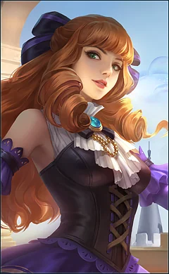
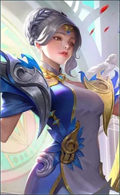

[Тир-лист](https://boostmlbb.ru/heroes/)[Предметы](https://boostmlbb.ru/items/)[Скины](https://boostmlbb.ru/skins/)[Новости и гайды](https://boostmlbb.ru/news/)

[Тир-лист](https://boostmlbb.ru/heroes/)

# Люнокс

B

МагСредняя линия

Победы

51,9%

Выбор

0,9%

Баны

1,9%

[Обзор](https://boostmlbb.ru/#overview)[Сборка](https://boostmlbb.ru/#build)[Как играть](https://boostmlbb.ru/#howto)[Навыки](https://boostmlbb.ru/#skills)[Контрпики](https://boostmlbb.ru/#draft)[Скины](https://boostmlbb.ru/#skins)[История](https://boostmlbb.ru/#lore)

## Обзор

### Характеристики

-   Живучесть**30**
-   Атака**90**
-   Эффекты**20**
-   Сложность**90**

-   Разрушительный урон
-   Урон

### Победы по рангам, 30 дней

1.  **50,0%**Эпик
2.  **50,1%**Легенда
3.  **50,4%**Мифик
4.  **51,0%**Честь
5.  **51,1%**Слава

Пунктир: 50% побед

### Другие маги этой линии

[Кимми](https://boostmlbb.ru/heroes/kimmy.html)[Эйдора](https://boostmlbb.ru/heroes/eudora.html)[Чжусинь](https://boostmlbb.ru/heroes/zhuxin.html)[Валир](https://boostmlbb.ru/heroes/valir.html)[Цзэтянь](https://boostmlbb.ru/heroes/zetian.html)[Лилия](https://boostmlbb.ru/heroes/lylia.html)[Ксавьер](https://boostmlbb.ru/heroes/xavier.html)[Валентина](https://boostmlbb.ru/heroes/valentina.html)

### Места в рейтингах

-   [Лучшие маги MLBB**12 из 32**](https://boostmlbb.ru/heroes/best-mage.html)
-   [Лучшие мидеры MLBB**10 из 29**](https://boostmlbb.ru/heroes/best-mid.html)

## Сборка

Сборка 1Сборка 2Сборка 3

Победы

53,4%

Выбор

6,3%

#### Основные предметы

-   [

    

    Пронзающий небеса

    ](https://boostmlbb.ru/items/sky-piercer.html)
-   [

    

    Божественный меч

    ](https://boostmlbb.ru/items/divine-glaive.html)
-   [

    

    Палочка гения

    ](https://boostmlbb.ru/items/genius-wand.html)

#### Заклинание

Вспышка

#### Эмблема и таланты

Эмблема убийцы

-   

    Разрыв

-   

    Охотник за скидками

-   

    Нечестивая ярость

Победы

55,4%

Выбор

3,9%

#### Основные предметы

-   [

    

    Пронзающий небеса

    ](https://boostmlbb.ru/items/sky-piercer.html)
-   [

    

    Пылающий жезл

    ](https://boostmlbb.ru/items/glowing-wand.html)
-   [

    

    Божественный меч

    ](https://boostmlbb.ru/items/divine-glaive.html)

#### Заклинание

Вспышка

#### Эмблема и таланты

Эмблема мага

-   

    Разрыв

-   

    Охотник за скидками

-   

    Нечестивая ярость

Победы

55,5%

Выбор

2,4%

#### Основные предметы

-   [

    

    Пронзающий небеса

    ](https://boostmlbb.ru/items/sky-piercer.html)
-   [

    

    Пылающий жезл

    ](https://boostmlbb.ru/items/glowing-wand.html)
-   [

    

    Божественный меч

    ](https://boostmlbb.ru/items/divine-glaive.html)

#### Заклинание

Вспышка

#### Эмблема и таланты

Эмблема убийцы

-   

    Разрыв

-   

    Охотник за скидками

-   

    Нечестивая ярость

## Как играть за Люнокс

### Комбо Люнокс

#### На линии

1.  3
2.  2
3.  1

На линии замедляйте третьим навыком, бейте вторым, а получив урон, лечитесь первым.

#### В драке

1.  3
2.  2
3.  Ульт
4.  2
5.  1
6.  Ульт

В драке замедлите третьим и вторым навыком накопите силу хаоса, включите тёмный ульт и спамьте второй. Потом первым накопите силу порядка и включите светлый ульт: неуязвимость и урон вокруг.

### Когда сильнее всего

Сильнее в долгой игре: на 16–18 минутах выигрывает 53,1%. Не рискуйте в начале, фармите и ввязывайтесь в драки вместе с командой.

1.  **49,9**10–12
2.  **51,3**12–14
3.  **52,3**14–16
4.  **53,1**16–18
5.  **53,1**18–20
6.  **52,6**20+

Проценты побед по длине матча в минутах, все ранги. Пунктир: 50%

### Приоритет прокачки

1.  Хаос и порядок
2.  Звездный пульс
3.  Нападение хаоса
4.  Космическое деление

## Навыки

Пассивный**Поворот мечты**1-й навык**Звездный пульс**2-й навык**Нападение хаоса** 3-й навык**Космическое деление**Ультимейт**Хаос и порядок**

Пассивный

### Поворот мечты

Люнокс искажена силами хаоса и порядка.

Используя силу порядка, Люнокс получает 10% вампиризма от навыков. Используя силу хаоса, она получает 10% магического проникновения.

1-й навык

### Звездный пульс

Перезарядка **2 Mana Cost: 30 с**

Люнокс призывает дождь звездного света на ближайших врагов, нанося 200 (+110% общей магической силы) единиц магического урона. Затем звездный свет возвращается к ней, каждой частицей восстанавливая ей 75 (+30% общей магической силы) ОЗ (удваивается при попадании по вражеским героям).

Этот навык имеет общую перезарядку с "Нападением хаоса". Он дает силу порядка и прерывает состояние силы хаоса.

2-й навык

### Нападение хаоса

Перезарядка **2 Mana Cost: 30 с**

Люнокс обрушивает энергию хаоса на указанного врага, нанося 250 (+120% общей магической силы) (+3.5% от цели) единиц магического урона (+2.1% по монстрам).

У этого навыка общая перезарядка со "Звездным пульсом". Его применение дает силу хаоса и завершает состояние силы порядка.

3-й навык

### Космическое деление

Перезарядка **10 Mana Cost: 70 с**

Люнокс направляет силу порядка и хаоса в указанном направлении, нанося 300 (+150% общей магической силы) единиц магического урона врагам на пути и замедляя их на 40% на 2 сек.

Ультимейт

### Хаос и порядок

Перезарядка **30 Mana Cost: 120 с**

Люнокс искажена силами хаоса и порядка.

Когда доминирует сила порядка, она может применить "Блеск", чтобы стать неуязвимой и наносить продолжительный урон ближайшим врагам.

Когда доминирует сила хаоса, она может применить "Тьму", чтобы переместиться в указанном направлении и на короткое время значительно сократить перезарядку "Нападения хаоса".

## Контрпики Люнокс

### Кто контрит Люнокс

[Глу](https://boostmlbb.ru/heroes/gloo.html)[Кайя](https://boostmlbb.ru/heroes/kaja.html)[Ванван](https://boostmlbb.ru/heroes/wanwan.html)[Эсмеральда](https://boostmlbb.ru/heroes/esmeralda.html)[Карина](https://boostmlbb.ru/heroes/karina.html)

### Кого контрит Люнокс

[Сабер](https://boostmlbb.ru/heroes/saber.html)[Гвиневра](https://boostmlbb.ru/heroes/guinevere.html)[Аргус](https://boostmlbb.ru/heroes/argus.html)[Фредрин](https://boostmlbb.ru/heroes/fredrinn.html)[Руби](https://boostmlbb.ru/heroes/ruby.html)

## Скины Люнокс

[Квантовая полярностьИсключительный · 2025](https://boostmlbb.ru/skins/lunox/quantum-polarity.html)[Серафим-бабочкаИзысканный · 2025](https://boostmlbb.ru/skins/lunox/butterfly-seraphim.html)[Гармония природыОбычный · 2023](https://boostmlbb.ru/skins/lunox/nature-s-harmony.html)[Божествен­ная богиняВысший · 2023](https://boostmlbb.ru/skins/lunox/divine-goddess.html)[Кровавая МэриОбычный · 2022](https://boostmlbb.ru/skins/lunox/bloody-mary.html)[ВесыДелюкс · 2019](https://boostmlbb.ru/skins/lunox/libra.html)[Откровение зариДелюкс · 2019](https://boostmlbb.ru/skins/lunox/dawn-revelation.html)[Глаза вечностиДелюкс · 2019](https://boostmlbb.ru/skins/lunox/eyes-of-eternity.html)[Пепельный цветИсключительный · 2019](https://boostmlbb.ru/skins/lunox/ash-blossom.html)[Косми­ческая гармонияОбычный · 2019](https://boostmlbb.ru/skins/lunox/cosmic-harmony.html)

[Все 10 скинов Люнокс: цены и как получить](https://boostmlbb.ru/skins/lunox.html)

## История

> Чудесное создание, рожденное в сумеречной сфере.

[Читать полную историю ↗](https://kazukiofficial.com/stories/lunox)Kazuki Official, английский [Характеристики на сайте игры ↗](https://www.mobilelegends.com/hero/detail?heroid=68)

**Поднимем ранг на герое «Люнокс»**Цена считается в калькуляторе

[Рассчитать цену](https://boostmlbb.ru/order.html?type=hero)

## Частые вопросы

Кто контрит Люнокс в MLBB?

За последние 30 дней Люнокс чаще всего обыгрывают Глу, Кайя, Ванван, Эсмеральда и Карина.

Как играть за Люнокс?

В первую очередь качайте «Звездный пульс», ульт берите, как только доступен. Сильнее в долгой игре: на 16–18 минутах выигрывает 53,1%. Не рискуйте в начале, фармите и ввязывайтесь в драки вместе с командой. Комбо для драки: В драке замедлите третьим и вторым навыком накопите силу хаоса, включите тёмный ульт и спамьте второй. Потом первым накопите силу порядка и включите светлый ульт: неуязвимость и урон вокруг.

Какой процент побед у Люнокс сейчас?

51,90% в Мифической славе за последние 7 дней и 50,95% на всех рангах за 30 дней, данные на 25 ноября 2026 года.

Какая роль и линия у Люнокс?

Маг, играет на средней линии.

Стоит ли брать Люнокс в текущей мете?

Тир B, 51-е место из 133 героев и 12-е среди магов. Тир учитывает, как часто героя берут и банят и как он выигрывает в Мифической славе за 7 дней: бан в 1,9% матчей, 51,9% побед. В профессиональных матчах за месяц героя драфтуют в 5,2% катков.

Какая сборка на Люнокс лучшая?

Самая популярная сборка в рейтинге: ключевые предметы «Пронзающий небеса», «Божественный меч» и «Палочка гения», эмблема убийцы с талантами «Разрыв», «Охотник за скидками» и «Нечестивая ярость» и заклинание «Вспышка». С ней выигрывают 53,43% матчей.
