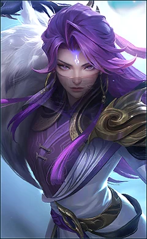
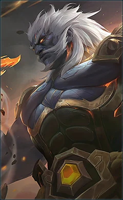

[Тир-лист](https://boostmlbb.ru/heroes/)[Предметы](https://boostmlbb.ru/items/)[Скины](https://boostmlbb.ru/skins/)[Новости и гайды](https://boostmlbb.ru/news/)

# Ло Йи

D

МагСредняя линия

Победы

46,2%

Выбор

0,1%

Баны

0,0%

[Обзор](https://boostmlbb.ru/#overview)[Сборка](https://boostmlbb.ru/#build)[Как играть](https://boostmlbb.ru/#howto)[Навыки](https://boostmlbb.ru/#skills)[Контрпики](https://boostmlbb.ru/#draft)[Скины](https://boostmlbb.ru/#skins)[История](https://boostmlbb.ru/#lore)

## Обзор

### Характеристики

-   Живучесть**20**
-   Атака**100**
-   Эффекты**40**
-   Сложность**80**

-   Поддержка
-   Массовый контроль

### Победы по рангам, 30 дней

1.  **48,8%**Эпик
2.  **47,9%**Легенда
3.  **47,4%**Мифик
4.  **47,5%**Честь
5.  **46,5%**Слава

Пунктир: 50% побед

### Другие маги этой линии

[Кимми](https://boostmlbb.ru/heroes/kimmy.html)[Эйдора](https://boostmlbb.ru/heroes/eudora.html)[Чжусинь](https://boostmlbb.ru/heroes/zhuxin.html)[Валир](https://boostmlbb.ru/heroes/valir.html)[Цзэтянь](https://boostmlbb.ru/heroes/zetian.html)[Лилия](https://boostmlbb.ru/heroes/lylia.html)[Ксавьер](https://boostmlbb.ru/heroes/xavier.html)[Люнокс](https://boostmlbb.ru/heroes/lunox.html)

### Места в рейтингах

-   [Лучшие маги MLBB**32 из 32**](https://boostmlbb.ru/heroes/best-mage.html)
-   [Лучшие мидеры MLBB**29 из 29**](https://boostmlbb.ru/heroes/best-mid.html)

## Сборка

Сборка 1Сборка 2Сборка 3

Победы

49,1%

Выбор

5,7%

#### Основные предметы

-   [

    

    Пронзающий небеса

    ](https://boostmlbb.ru/items/sky-piercer.html)
-   [

    

    Зачарованный талисман

    ](https://boostmlbb.ru/items/enchanted-talisman.html)
-   [

    

    Пылающий жезл

    ](https://boostmlbb.ru/items/glowing-wand.html)

#### Заклинание

Вспышка

#### Эмблема и таланты

Эмблема мага

-   

    Разрыв

-   

    Мастер оружий

-   

    Смертельное воспламенение

Победы

50,4%

Выбор

2,0%

#### Основные предметы

-   [

    

    Пронзающий небеса

    ](https://boostmlbb.ru/items/sky-piercer.html)
-   [

    

    Зачарованный талисман

    ](https://boostmlbb.ru/items/enchanted-talisman.html)
-   [

    

    Палочка гения

    ](https://boostmlbb.ru/items/genius-wand.html)

#### Заклинание

Вспышка

#### Эмблема и таланты

Эмблема мага

-   

    Вдохновение

-   

    Охотник за скидками

-   

    Смертельное воспламенение

Победы

49,9%

Выбор

1,6%

#### Основные предметы

-   [

    

    Зачарованный талисман

    ](https://boostmlbb.ru/items/enchanted-talisman.html)
-   [

    

    Пылающий жезл

    ](https://boostmlbb.ru/items/glowing-wand.html)
-   [

    

    Божественный меч

    ](https://boostmlbb.ru/items/divine-glaive.html)

#### Заклинание

Вспышка

#### Эмблема и таланты

Эмблема мага

-   

    Разрыв

-   

    Мастер оружий

-   

    Смертельное воспламенение

## Как играть за Ло Йи

### Комбо Ло Йи

#### В драке

1.  1
2.  1
3.  2

В драке первым наложите метку инь или ян и вторым применением на соседа наложите противоположную: сработает реакция. Если враг один, вызывайте реакции вторым.

#### На линии

1.  1
2.  2

На линии пометьте первым, вторым призовите огонь ян или воду инь рядом, чтобы сработала реакция.

### Когда сильнее всего

Сильнее в долгой игре: после 20-й минуты выигрывает 48,1%. Не рискуйте в начале, фармите и ввязывайтесь в драки вместе с командой.

1.  **46,5**10–12
2.  **46,3**12–14
3.  **46,8**14–16
4.  **46,9**16–18
5.  **47,2**18–20
6.  **48,1**20+

Проценты побед по длине матча в минутах, все ранги. Пунктир: 50%

### Приоритет прокачки

1.  Отвлекающий маневр
2.  Дисперсия
3.  Ротация

## Навыки

Пассивный**Двойственность**1-й навык**Дисперсия**2-й навык**Ротация**Ультимейт**Отвлекающий маневр**

Пассивный

### Двойственность

Навыки Ло Йи создают метки инь/ян на поле боя. Каждая метка длится до 6 сек.

Противоположные метки могут вызвать реакцию инь-ян на определенном расстоянии, нанося отмеченным врагам 300 (+25 × ур. героя) (+190% общей магической силы) единиц магического урона, оглушая их на 0.3 сек. и притягивая друг к другу.

Каждый раз, когда Ло Йи наносит новую метку на отмеченного врага, она получает 300 (+10 × ур. героя) (+150% общей магической силы) единиц щита (до 3 зарядов) и 50% дополнительной скорости передвижения, которая спадает за 2 сек.

1-й навык

### Дисперсия

Перезарядка **1.2 Mana Cost: 50 с**

Ло Йи атакует энергией инь/ян в указанном направлении, нанося 285 (+135% общей магической силы) единиц магического урона первому пораженному врагу и врагам позади в веерообразной области. Пораженные вражеские герои получат метку инь/ян.

Ло Йи накапливает до 4 зарядов дисперсии и получает 1 заряд каждые 8 сек. Также она сразу получает 1 заряд каждый раз, когда срабатывает реакция инь-ян.

Тип навыка меняется при каждом использовании.

2-й навык

### Ротация

Перезарядка **12 Mana Cost: 75 с**

Ло Йи призывает огонь ян / воду инь в указанном месте, нанося 250 (+50% общей магической силы) единиц магического урона пораженным врагам и замедляя их на 60% на 0.5 сек.

Затем огонь ян / вода инь остается на месте в течение 6 сек., нанося ближайшим врагам 50 (+10% общей магической силы) единиц магического урона каждые 0.7 сек. Это также может вызвать реакцию инь-ян с метками противоположных показателей.

Состояние этого навыка меняется при каждом использовании.

Ультимейт

### Отвлекающий маневр

**Пассивный:** сокращение перезарядки Ло Йи увеличивается на 6%.

**Активный:** Ло Йи создает телепортационный круг вокруг себя и отмечает указанную область (в пределах 28 ед.) в качестве места назначения. Через 3 сек. союзные герои внутри круга будут телепортированы в указанное место.

## Контрпики Ло Йи

### Кто контрит Ло Йи

[Эстес](https://boostmlbb.ru/heroes/estes.html)[Фарамис](https://boostmlbb.ru/heroes/faramis.html)[Баксий](https://boostmlbb.ru/heroes/baxia.html)[Фредрин](https://boostmlbb.ru/heroes/fredrinn.html)[Уранус](https://boostmlbb.ru/heroes/uranus.html)

### Кого контрит Ло Йи

[Новария](https://boostmlbb.ru/heroes/novaria.html)

## Скины Ло Йи

[Звёздная матронаДелюкс · 2025](https://boostmlbb.ru/skins/luo-yi/starborne-matron.html)[Оракул солнцаДелюкс · 2023](https://boostmlbb.ru/skins/luo-yi/oracle-of-sol.html)[Храни­тельница ЭлизиумаИзысканный · 2022](https://boostmlbb.ru/skins/luo-yi/elysium-guardian.html)[Жрица-сиренаИсключительный · 2021](https://boostmlbb.ru/skins/luo-yi/siren-priestess.html)[Рассветная удачаИсключительный · 2021](https://boostmlbb.ru/skins/luo-yi/dawning-fortune.html)[ТэнкоОбычный · 2020](https://boostmlbb.ru/skins/luo-yi/tenko.html)[Маг инь-янОбычный · 2020](https://boostmlbb.ru/skins/luo-yi/yin-yang-mage.html)

[Все 7 скинов Ло Йи: цены и как получить](https://boostmlbb.ru/skins/luo-yi.html)

## История

> В поисках пути к возрождению древнего прошлого, она стала единственной, кто овладел секретами инь и ян.

[Читать полную историю ↗](https://play.mobilelegends.com/lore/hero/LuoYi)Официальный сайт Mobile Legends [Характеристики на сайте игры ↗](https://www.mobilelegends.com/hero/detail?heroid=96)

**Поднимем ранг на герое «Ло Йи»**Цена считается в калькуляторе

[Рассчитать цену](https://boostmlbb.ru/order.html?type=hero)

## Частые вопросы

Кто контрит Ло Йи в MLBB?

За последние 30 дней Ло Йи чаще всего обыгрывают Эстес, Фарамис, Баксий, Фредрин и Уранус.

Как играть за Ло Йи?

В первую очередь качайте «Дисперсия», ульт берите, как только доступен. Сильнее в долгой игре: после 20-й минуты выигрывает 48,1%. Не рискуйте в начале, фармите и ввязывайтесь в драки вместе с командой. Комбо для драки: В драке первым наложите метку инь или ян и вторым применением на соседа наложите противоположную: сработает реакция. Если враг один, вызывайте реакции вторым.

Какой процент побед у Ло Йи сейчас?

46,24% в Мифической славе за последние 7 дней и 47,24% на всех рангах за 30 дней, данные на 25 ноября 2026 года.

Какая роль и линия у Ло Йи?

Маг, играет на средней линии.

Стоит ли брать Ло Йи в текущей мете?

Тир D, 131-е место из 133 героев и 32-е среди магов. Тир учитывает, как часто героя берут и банят и как он выигрывает в Мифической славе за 7 дней: бан в 0,0% матчей, 46,2% побед. В профессиональных матчах за месяц героя драфтуют в 0,0% катков.

Какая сборка на Ло Йи лучшая?

Самая популярная сборка в рейтинге: ключевые предметы «Пронзающий небеса», «Зачарованный талисман» и «Пылающий жезл», эмблема мага с талантами «Разрыв», «Мастер оружий» и «Смертельное воспламенение» и заклинание «Вспышка». С ней выигрывают 49,15% матчей.
