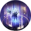

[Тир-лист](https://boostmlbb.ru/heroes/)[Новости и гайды](https://boostmlbb.ru/news/)

# Марсель

S

ПоддержкаРоум

Родом из дома Пэксли, он — элегантный, таинственный и причудливый художник, чья расколотая душа слилась с камерой.

Победы

57,1%

все ранги 57,5%

Выбор

0,4%

все ранги 0,3%

Баны

70,2%

все ранги 41,3%

№2 в тир-листе · №1 среди героев поддержки · Мифическая слава, 7 дней, по 23 ноября

[Обзор](https://boostmlbb.ru/#overview)[Сборка](https://boostmlbb.ru/#build)[Навыки](https://boostmlbb.ru/#skills)[Контрпики](https://boostmlbb.ru/#draft)[История](https://boostmlbb.ru/#lore)

## Обзор

### Характеристики

-   Живучесть**70**
-   Атака**30**
-   Эффекты**100**
-   Сложность**30**

-   Массовый контроль
-   Поддержка

### Победы по рангам, 30 дней

1.  **55,6%**Эпик
2.  **57,0%**Легенда
3.  **57,5%**Мифик
4.  **57,9%**Честь
5.  **57,4%**Слава

Пунктир: 50% побед

### Другие герои поддержки этой линии

[Эстес](https://boostmlbb.ru/heroes/estes.html)[Флорин](https://boostmlbb.ru/heroes/floryn.html)[Кайя](https://boostmlbb.ru/heroes/kaja.html)[Рафаэль](https://boostmlbb.ru/heroes/rafaela.html)[Ангела](https://boostmlbb.ru/heroes/angela.html)[Дигги](https://boostmlbb.ru/heroes/diggie.html)

## Сборка

Роум · по данным рейтинговых матчей

Сборка 164,6%Сборка 257,9%Сборка 364,1%

### Предметы

Штормовой пояс

Господство льда

Фляга Оазиса

### Эмблема

Эмблема поддержки

Ловкость

Благословение природы

Ударная волна

### Заклинание

Восстановление

Победы

64,6%

Выбор

11,7%

### Предметы

Штормовой пояс

Господство льда

Фляга Оазиса

### Эмблема

Эмблема поддержки

Ловкость

Благословение природы

Квантовый заряд

### Заклинание

Вспышка

Победы

57,9%

Выбор

10,8%

### Предметы

Штормовой пояс

Господство льда

Фляга Оазиса

### Эмблема

Эмблема поддержки

Ловкость

Благословение природы

Квантовый заряд

### Заклинание

Восстановление

Победы

64,1%

Выбор

9,3%

## Навыки

Прокачка**Золотой час**_›_**Запечатлеть момент**_›_**Сопровождающая съемка**

Пассивный1-й навык2-й навыкУльтимейт

Пассивный

### Редкий снимок

Отделившаяся душа Марселя, Клемар, входит в камеру, чтобы запечатлеть момент. Его базовые атаки наносят 50 (+40% общей физической атаки)(+40% общей магической защиты)(+40% общей физической защиты) единиц физического урона. Его дополнительные преобразуются в 1.5% .

Клемар автоматически делает снимки вражеских героев рядом с Марселем, вызывая краткую заморозку и нанося 20 (+5% от ) ед. чистого урона (активирует эффекты атаки). Он также дает щит той же величины Марселю и ближайшему союзному герою. Перезарядка: 12 сек. для каждой цели.

1-й навык

### Запечатлеть момент

Перезарядка **15 Mana Cost: 40 с**

Клемар фокусируется на области вокруг Марселя, замедляя вражеских героев в ней на 60%.

Через 2.5 сек. он делает снимок, нанося 300 (+50% общей физической атаки)(+120% общей магической защиты)(+120% общей физической защиты) единиц физического урона врагам внутри.

2-й навык

### Сопровождающая съемка

Перезарядка **15 Mana Cost: 70 с**

Время вдохновения художника! Марсель входит в состояние "Быстрого преследования" на 3 сек., получая 15% скорости передвижения. Бонус увеличивается до 75% при движении к вражескому герою.

**Повторное использование:** Марсель совершает рывок в указанном направлении, оставляя позади фантом кадра, в то время как область навыка "Запечатлеть момент" остается в исходном месте.

Ультимейт

### Золотой час

Перезарядка **90 Mana Cost: 150 с**

Марсель и Клемар проводят совместную съемку. После небольшой подготовки Клемар делает широкоугольный снимок указанной области в течение 2 сек. В это время Марсель входит в состояние "Быстрого преследования", находясь внутри области. Все другие юниты в области попадают в состояние краткой заморозки и невосприимчивы ко всем эффектам, кроме эффектов от Марселя. Все снаряды также замирают и продолжатся после задержки (нацеленные снаряды нанесут 50% урона).

"Золотой час" сбрасывает перезарядку "Редкого снимка" для каждого вражеского героя.

Союзные герои со щитом "Редкого снимка" могут свободно перемещаться в пределах области.

## Контрпики и союзники

### Контрпики

Побеждают этого героя

[Атлас](https://boostmlbb.ru/heroes/atlas.html)[Сан](https://boostmlbb.ru/heroes/sun.html)[Акай](https://boostmlbb.ru/heroes/akai.html)[Джонсон](https://boostmlbb.ru/heroes/johnson.html)[Пополь и Купа](https://boostmlbb.ru/heroes/popol-and-kupa.html)

### Слабые цели

Этот герой побеждает их

[Лесли](https://boostmlbb.ru/heroes/lesley.html)[Ангела](https://boostmlbb.ru/heroes/angela.html)[Флорин](https://boostmlbb.ru/heroes/floryn.html)[Карина](https://boostmlbb.ru/heroes/karina.html)[Рафаэль](https://boostmlbb.ru/heroes/rafaela.html)[Эсмеральда](https://boostmlbb.ru/heroes/esmeralda.html)[Циклоп](https://boostmlbb.ru/heroes/cyclops.html)[Эймон](https://boostmlbb.ru/heroes/aamon.html)[Бруно](https://boostmlbb.ru/heroes/bruno.html)[Иритель](https://boostmlbb.ru/heroes/irithel.html)

### Союзники

Рост побед в паре, п. п.

[Калеа**+5,6**](https://boostmlbb.ru/heroes/kalea.html)[Сабер**+4,5**](https://boostmlbb.ru/heroes/saber.html)[Атлас**+2,8**](https://boostmlbb.ru/heroes/atlas.html)[Кармилла**+2,8**](https://boostmlbb.ru/heroes/carmilla.html)

## История

> Родом из дома Пэксли, он — элегантный, таинственный и причудливый художник, чья расколотая душа слилась с камерой.

[Читать полную историю ↗](https://kazukiofficial.com/stories/marcel)Kazuki Official, английский

[Характеристики на сайте игры ↗](https://www.mobilelegends.com/hero/detail?heroid=132)

**Поднимем ранг на герое «Марсель»**Цена считается в калькуляторе

[Рассчитать цену](https://boostmlbb.ru/order.html?type=hero)

## Частые вопросы

Кто контрпик для героя «Марсель» в MLBB?

За последние 30 дней чаще всего героя обыгрывают Атлас, Сан, Акай, Джонсон и Пополь и Купа.

Какой процент побед у героя «Марсель» сейчас?

57,07% в Мифической славе за последние 7 дней и 57,46% на всех рангах за 30 дней, данные на 23 ноября 2026 года.

Какая роль и линия у героя «Марсель»?

Поддержка, играет в роуме.

Силён ли герой «Марсель» в текущей мете?

Тир S, 2-е место из 133 героев и 1-е среди героев поддержки. Тир учитывает, как часто героя берут и банят и как он выигрывает в Мифической славе за 7 дней: бан в 70,2% матчей, 57,1% побед.

Какая сборка на героя «Марсель» лучшая?

Самая популярная сборка в рейтинге: ключевые предметы «Штормовой пояс», «Господство льда» и «Фляга Оазиса», эмблема поддержки с талантами «Ловкость», «Благословение природы» и «Ударная волна» и заклинание «Восстановление». С ней выигрывают 64,63% матчей.
