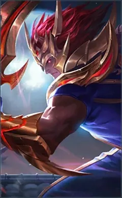

[Тир-лист](https://boostmlbb.ru/heroes/)[Предметы](https://boostmlbb.ru/items/)[Скины](https://boostmlbb.ru/skins/)[Новости и гайды](https://boostmlbb.ru/news/)

[Тир-лист](https://boostmlbb.ru/heroes/)

# Мартис

C

БоецЛиния опытаЛес

Победы

47,4%

Выбор

0,5%

Баны

0,2%

[Обзор](https://boostmlbb.ru/#overview)[Сборка](https://boostmlbb.ru/#build)[Как играть](https://boostmlbb.ru/#howto)[Навыки](https://boostmlbb.ru/#skills)[Контрпики](https://boostmlbb.ru/#draft)[Скины](https://boostmlbb.ru/#skins)[История](https://boostmlbb.ru/#lore)

## Обзор

### Характеристики

-   Живучесть**60**
-   Атака**30**
-   Эффекты**50**
-   Сложность**60**

-   Добивание
-   Рывок

### Победы по рангам, 30 дней

1.  **46,6%**Эпик
2.  **46,7%**Легенда
3.  **47,6%**Мифик
4.  **47,5%**Честь
5.  **47,5%**Слава

Пунктир: 50% побед

### Другие бойцы этой линии

[Фрейя](https://boostmlbb.ru/heroes/freya.html)[Аулус](https://boostmlbb.ru/heroes/aulus.html)[Пакито](https://boostmlbb.ru/heroes/paquito.html)[Сан](https://boostmlbb.ru/heroes/sun.html)[Лукас](https://boostmlbb.ru/heroes/lukas.html)[Су Ё](https://boostmlbb.ru/heroes/suyou.html)[Чичи](https://boostmlbb.ru/heroes/cici.html)[Сора](https://boostmlbb.ru/heroes/sora.html)

### Места в рейтингах

-   [Лучшие лесники MLBB**32 из 37**](https://boostmlbb.ru/heroes/best-jungle.html)
-   [Лучшие бойцы MLBB**37 из 44**](https://boostmlbb.ru/heroes/best-fighter.html)

## Сборка

Сборка 1Сборка 2Сборка 3

Победы

57,1%

Выбор

8,5%

#### Основные предметы

-   [

    

    Пронзающий небеса

    ](https://boostmlbb.ru/items/sky-piercer.html)
-   [

    

    Топор войны

    ](https://boostmlbb.ru/items/war-axe.html)
-   [

    

    Крылья королевы

    ](https://boostmlbb.ru/items/queens-wings.html)

#### Заклинание

Вспышка

#### Эмблема и таланты

Эмблема бойца

-   

    Трепет

-   

    Кровавое пиршество

-   

    Убийственный пир

Победы

51,0%

Выбор

1,9%

#### Основные предметы

-   [

    

    Пронзающий небеса

    ](https://boostmlbb.ru/items/sky-piercer.html)
-   [

    

    Трезубец

    ](https://boostmlbb.ru/items/sea-halberd.html)
-   [

    

    Бесконечная битва

    ](https://boostmlbb.ru/items/endless-battle.html)

#### Заклинание

Вспышка

#### Эмблема и таланты

Эмблема бойца

-   

    Трепет

-   

    Кровавое пиршество

-   

    Нечестивая ярость

Победы

48,8%

Выбор

1,8%

#### Основные предметы

-   [

    

    Пронзающий небеса

    ](https://boostmlbb.ru/items/sky-piercer.html)
-   [

    

    Трезубец

    ](https://boostmlbb.ru/items/sea-halberd.html)
-   [

    

    Топор войны

    ](https://boostmlbb.ru/items/war-axe.html)

#### Заклинание

Вспышка

#### Эмблема и таланты

Эмблема бойца

-   

    Ловкость

-   

    Опытный охотник

-   

    Убийственный пир

## Как играть за Мартиса

### Комбо Мартиса

#### В драке

1.  1
2.  2
3.  2
4.  Атака
5.  Ульт
6.  Атака
7.  Ульт

В драке первым соберите и замедлите врагов, вторым ударьте и подбросьте, добивайте атаками. Слабых казните ультом и повторяйте ульт на следующих.

#### На линии

1.  1
2.  2
3.  2
4.  Атака

На линии первым соберите и замедлите, вторым ударьте, ещё раз вторым не отставайте и подбросьте, добивайте атаками.

### Когда сильнее всего

Сильнее в начале: на 10–12 минутах выигрывает 49,1%. Давите на линии, забирайте объекты и заканчивайте, пока преимущество не растаяло.

1.  **49,1**10–12
2.  **48,3**12–14
3.  **48,2**14–16
4.  **47,8**16–18
5.  **47,3**18–20
6.  **47,7**20+

Проценты побед по длине матча в минутах, все ранги. Пунктир: 50%

### Приоритет прокачки

1.  Опустошение
2.  Аура Асуры
3.  Смертоносная катушка

## Навыки

Пассивный**Гнев Асуры**1-й навык**Аура Асуры**2-й навык**Смертоносная катушка**Ультимейт**Опустошение**

Пассивный

### Гнев Асуры

Каждый раз, когда Мартис использует навык, его скорость атаки увеличивается на 30%, максимум 120%. Длится 4 сек. Он получает (+8 × ур. героя) доп. атаки при полном заряде.

1-й навык

### Аура Асуры

Перезарядка **7 с**

Мартис стягивает врагов в веерообразной области перед собой и наносит 350 (+130% дополнительной физической атаки) единиц физического урона, замедляя их на 40% на 2 сек.

2-й навык

### Смертоносная катушка

Перезарядка **8 с**

Мартис совершает три удара в указанном направлении, каждым нанося 225 (+120% дополнительной физической атаки) единиц физического урона. Враги, пораженные первым и третьим ударами, отталкиваются. Направление атаки можно изменить один раз с помощью джойстика.

**Повторное использование:** Мартис прыгает в указанном направлении, нанося 300 (+150% дополнительной физической атаки) единиц физического урона врагам на пути и подбрасывая их.

При использовании навыка Мартис получает иммунитет к контролю и 60% снижения урона.

Ультимейт

### Опустошение

Перезарядка **36 с**

Мартис устремляется к выбранной цели, нанося 700 (+120% общей физической атаки) единиц физического урона. (Если ОЗ врага ниже 50%, он нанесет чистый урон.)

Если цель была убита этим навыком, Мартис может вновь использовать его в течение 10 сек. и получает 100% дополнительной скорости передвижения, которая постепенно снижается за 5 сек. Каждое успешное применение также увеличит урон от навыка на 15% (до 30%).

## Контрпики Мартиса

### Кто контрит Мартиса

[Сабер](https://boostmlbb.ru/heroes/saber.html)[Чип](https://boostmlbb.ru/heroes/chip.html)[Москов](https://boostmlbb.ru/heroes/moskov.html)[Хуфра](https://boostmlbb.ru/heroes/khufra.html)[Сора](https://boostmlbb.ru/heroes/sora.html)

### Кого контрит Мартис

[Бальмонд](https://boostmlbb.ru/heroes/balmond.html)[Минситтар](https://boostmlbb.ru/heroes/minsitthar.html)[Чан'Э](https://boostmlbb.ru/heroes/change.html)

## Скины Мартиса

[Король-воена­чальникОбычный · 2025](https://boostmlbb.ru/skins/martis/warlord-king.html)[Ужас тёмных водИсключительный · 2024](https://boostmlbb.ru/skins/martis/darkwater-terror.html)[ЛевиГрандиозный · 2024](https://boostmlbb.ru/skins/martis/levi.html)[КозерогДелюкс · 2022](https://boostmlbb.ru/skins/martis/capricorn.html)[ДэтрокИсключительный · 2022](https://boostmlbb.ru/skins/martis/deathrock.html)[Бог войныИзысканный · 2020](https://boostmlbb.ru/skins/martis/god-of-war.html)[Обжигающая пастьИсключительный · 2018](https://boostmlbb.ru/skins/martis/searing-maw.html)[ТиранОбычный · 2018](https://boostmlbb.ru/skins/martis/tyrant.html)[Дикий отступник](https://boostmlbb.ru/skins/martis/wild-renegade.html)

[Все 9 скинов Мартиса: цены и как получить](https://boostmlbb.ru/skins/martis.html)

## История

> Настойчивый и победоносный король Асура.

[Читать полную историю ↗](https://kazukiofficial.com/stories/martis)Kazuki Official, английский [Характеристики на сайте игры ↗](https://www.mobilelegends.com/hero/detail?heroid=58)

**Поднимем ранг на герое «Мартис»**Цена считается в калькуляторе

[Рассчитать цену](https://boostmlbb.ru/order.html?type=hero)

## Частые вопросы

Кто контрит Мартиса в MLBB?

За последние 30 дней Мартиса чаще всего обыгрывают Сабер, Чип, Москов, Хуфра и Сора.

Как играть за Мартиса?

В первую очередь качайте «Аура Асуры», ульт берите, как только доступен. Сильнее в начале: на 10–12 минутах выигрывает 49,1%. Давите на линии, забирайте объекты и заканчивайте, пока преимущество не растаяло. Комбо для драки: В драке первым соберите и замедлите врагов, вторым ударьте и подбросьте, добивайте атаками. Слабых казните ультом и повторяйте ульт на следующих.

Какой процент побед у Мартиса сейчас?

47,44% в Мифической славе за последние 7 дней и 47,21% на всех рангах за 30 дней, данные на 25 ноября 2026 года.

Какая роль и линия у Мартиса?

Боец, играет на линии опыта или в лесу.

Стоит ли брать Мартиса в текущей мете?

Тир C, 112-е место из 133 героев и 37-е среди бойцов. Тир учитывает, как часто героя берут и банят и как он выигрывает в Мифической славе за 7 дней: бан в 0,2% матчей, 47,4% побед. В профессиональных матчах за месяц героя драфтуют в 0,0% катков.

Какая сборка на Мартиса лучшая?

Самая популярная сборка в рейтинге: ключевые предметы «Пронзающий небеса», «Топор войны» и «Крылья королевы», эмблема бойца с талантами «Трепет», «Кровавое пиршество» и «Убийственный пир» и заклинание «Вспышка». С ней выигрывают 57,09% матчей.
