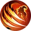

[Главная](https://boostmlbb.ru/) / [Герои](https://boostmlbb.ru/heroes/)

Тир S

# Маша

Танк и боец · Линия опыта

**№ 1 из 133 по доле побед**Все ранги · 30 дней по 23 ноября 2026 года

Победы

60,40%

Выбор

0,52%

Баны

40,89%

Пуш · Урон · Сложность 30/100

[Сборка](https://boostmlbb.ru/#build)[Контрпики и союзники](https://boostmlbb.ru/#draft)[Навыки](https://boostmlbb.ru/#skills)[Победы по рангам](https://boostmlbb.ru/#ranks)[История](https://boostmlbb.ru/#lore)

## Сборка

Самый частый выбор в рейтинге · Линия опыта

Ключевые предметы

Штормовой поясКоса коррозииЗащитный шлем

Эмблема и таланты

Эмблема танкаПроворностьБлагословение природыБоевой клич

Боевое заклинание

Окаменение

Побед с этой сборкой **63,70%**Выбирают в **6,35%** матчей

Другие сборки (2)

Ключевые предметы

Штормовой поясКоса коррозииЗащитный шлем

Эмблема и таланты

Эмблема танкаПроворностьБлагословение природыБоевой клич

Боевое заклинание

Вспышка

Побед с этой сборкой **64,66%**Выбирают в **1,89%** матчей

Ключевые предметы

Штормовой поясКоса коррозииЗащитный шлем

Эмблема и таланты

Эмблема танкаПроворностьОхотник за скидкамиБоевой клич

Боевое заклинание

Окаменение

Побед с этой сборкой **65,08%**Выбирают в **1,77%** матчей

## Контрпики и союзники

### Кто контрит

[Глу](https://boostmlbb.ru/heroes/gloo.html)[Эйдора](https://boostmlbb.ru/heroes/eudora.html)[Лесли](https://boostmlbb.ru/heroes/lesley.html)[Чичи](https://boostmlbb.ru/heroes/cici.html)[Броуди](https://boostmlbb.ru/heroes/brody.html)

### Против кого силён

[Фрейя](https://boostmlbb.ru/heroes/freya.html)[Бруно](https://boostmlbb.ru/heroes/bruno.html)

### Союзники

Прибавка к доле побед в одной команде

[Бэйн+1,86 п. п.](https://boostmlbb.ru/heroes/bane.html)[Гвиневра+1,66 п. п.](https://boostmlbb.ru/heroes/guinevere.html)[Икс.Борг+1,60 п. п.](https://boostmlbb.ru/heroes/x-borg.html)[Сабер+1,52 п. п.](https://boostmlbb.ru/heroes/saber.html)

## Навыки

Приоритет прокачки · Яростное растерзание → Взмах когтями → Свирепый взмах

Пассивный**Первобытный пакт**

"Благословение медведя": у Маши 3 шкалы ОЗ, каждая из которых наследует 50% от ее бонусов к ОЗ от снаряжения. Каждый раз, когда шкала ОЗ истощается, Маша снимает с себя эффекты контроля и один раз блокирует урон. Нанося урон вражеским героям или монстрам, Маша накапливает "Дикость", которая преобразуется в ОЗ после выхода из боя.
"Дикая сила": когда навыки Маши наносят урон вражескому герою, со случайной стороны от цели появляется "Рана". Разрыв "Раны" базовой атакой переводит Машу в состояние "Дикости".
Состояние "Дикости": на 3 сек. Маша получает 15 (+1\*Hero Level)% устойчивости, скорости атаки и скорости передвижения. Ее следующие 3 базовые атаки становятся веерообразными взмахами когтями, которые наносят врагам в области дополнительный физический урон в размере 3 (+0.5% дополнительной физической атаки) (+0.2\*Hero Level)% от (дополнительный урон не действует на башни) и восстанавливают 4 (+0.4\*Hero Level)% ОЗ.
Повторный разрыв "Раны" в состоянии "Дикости" обновляет длительность состояния. Можно накопить до 6 взмахов когтями.

1-й навык**Свирепый взмах**

**Перезарядка 8 с**

Маша выпускает энергию вперед, нанося 250 (+55% общей физической атаки) единиц физического урона врагам на своем пути. Она наносит миньонам 150% урона.

2-й навык**Взмах когтями**

**Перезарядка 9 с**

Маша совершает рывок в указанном направлении, нанося 120 (+80% дополнительной физической атаки) единиц физического урона и при попадании снижая скорость передвижения вражеских героев на 50% на 1 сек.
Когда шкала ОЗ истощается, перезарядка "Взмаха когтями" сбрасывается.

Ультимейт**Яростное растерзание**

**Перезарядка 42 с**

Маша совершает рывок к вражескому герою, нанося 300 (+50% доп. макс. ОЗ) единиц физического урона и оглушая его на 1 сек., одновременно отбрасывая ближайших врагов.

## Победы по рангам

-   Эпик**54,74%**
-   Легенда**58,09%**
-   Мифический**59,63%**
-   Мифическая честь**61,09%**
-   Мифическая слава**60,75%**

## История

Страж диких медведей.

[Читать историю](https://play.mobilelegends.com/lore/hero/Masha)[Карточка героя](https://www.mobilelegends.com/hero/detail?heroid=88)[MLBB Wiki](https://mobile-legends.fandom.com/wiki/Masha)

[Стоимость буста на герое](https://boostmlbb.ru/order.html?type=hero)

## Частые вопросы

Кто контрпик для героя «Маша» в MLBB?

За последние 30 дней чаще всего героя обыгрывают Глу, Эйдора, Лесли, Чичи и Броуди.

Какой процент побед у героя «Маша» сейчас?

60,40% за последние 30 дней на всех рангах и 60,75% в Мифической славе, данные на 23 ноября 2026 года.

Какая роль и линия у героя «Маша»?

Танк и боец, играет на линии опыта.

Силён ли герой «Маша» в текущей мете?

Тир S: 1-е место из 133 героев по проценту побед за 30 дней и 1-е среди танков.

Какая сборка на героя «Маша» лучшая?

Самая популярная сборка в рейтинге: ключевые предметы «Штормовой пояс», «Коса коррозии» и «Защитный шлем», эмблема танка с талантами «Проворность», «Благословение природы» и «Боевой клич» и заклинание «Окаменение». С ней выигрывают 63,70% матчей.
