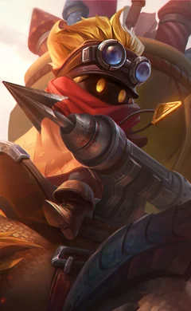

[Тир-лист](https://boostmlbb.ru/heroes/)[Предметы](https://boostmlbb.ru/items/)[Новости и гайды](https://boostmlbb.ru/news/)

# Маша

S

ТанкБоецЛиния опыта

Победы

58,8%

Выбор

0,7%

Баны

67,5%

[Обзор](https://boostmlbb.ru/#overview)[Сборка](https://boostmlbb.ru/#build)[Навыки](https://boostmlbb.ru/#skills)[Контрпики](https://boostmlbb.ru/#draft)[История](https://boostmlbb.ru/#lore)

## Обзор

### Характеристики

-   Живучесть**50**
-   Атака**70**
-   Эффекты**30**
-   Сложность**30**

-   Пуш
-   Урон

### Победы по рангам, 30 дней

1.  **54,6%**Эпик
2.  **57,9%**Легенда
3.  **59,5%**Мифик
4.  **61,0%**Честь
5.  **60,6%**Слава

Пунктир: 50% побед

### Другие танки этой линии

[Алиса](https://boostmlbb.ru/heroes/alice.html)[Эсмеральда](https://boostmlbb.ru/heroes/esmeralda.html)[Глу](https://boostmlbb.ru/heroes/gloo.html)[Бартс](https://boostmlbb.ru/heroes/barats.html)[Уранус](https://boostmlbb.ru/heroes/uranus.html)[Хильда](https://boostmlbb.ru/heroes/hilda.html)[Гатоткача](https://boostmlbb.ru/heroes/gatotkaca.html)[Эдит](https://boostmlbb.ru/heroes/edith.html)

### Места в рейтингах

-   [Лучшие бойцы MLBB**1 из 44**](https://boostmlbb.ru/heroes/best-fighter.html)
-   [Лучшие танки MLBB**1 из 25**](https://boostmlbb.ru/heroes/best-tank.html)

## Сборка

Сборка 1Сборка 2Сборка 3

Победы

63,7%

Выбор

6,3%

#### Основные предметы

-   [

    

    Штормовой пояс

    ](https://boostmlbb.ru/items/thunder-belt.html)
-   [

    

    Коса коррозии

    ](https://boostmlbb.ru/items/corrosion-scythe.html)
-   [

    

    Защитный шлем

    ](https://boostmlbb.ru/items/guardian-helmet.html)

#### Заклинание

Окаменение

#### Эмблема и таланты

Эмблема танка

-   

    Проворность

-   

    Благословение природы

-   

    Боевой клич

Победы

64,7%

Выбор

1,9%

#### Основные предметы

-   [

    

    Штормовой пояс

    ](https://boostmlbb.ru/items/thunder-belt.html)
-   [

    

    Коса коррозии

    ](https://boostmlbb.ru/items/corrosion-scythe.html)
-   [

    

    Защитный шлем

    ](https://boostmlbb.ru/items/guardian-helmet.html)

#### Заклинание

Вспышка

#### Эмблема и таланты

Эмблема танка

-   

    Проворность

-   

    Благословение природы

-   

    Боевой клич

Победы

65,1%

Выбор

1,8%

#### Основные предметы

-   [

    

    Штормовой пояс

    ](https://boostmlbb.ru/items/thunder-belt.html)
-   [

    

    Коса коррозии

    ](https://boostmlbb.ru/items/corrosion-scythe.html)
-   [

    

    Защитный шлем

    ](https://boostmlbb.ru/items/guardian-helmet.html)

#### Заклинание

Окаменение

#### Эмблема и таланты

Эмблема танка

-   

    Проворность

-   

    Охотник за скидками

-   

    Боевой клич

## Навыки

Прокачка**Яростное растерзание**_›_**Взмах когтями**_›_**Свирепый взмах**

Пассивный**Первобытный пакт**1-й навык**Свирепый взмах**2-й навык**Взмах когтями**Ультимейт**Яростное растерзание**

Пассивный

### Первобытный пакт

**Благословение медведя:** у Маши 3 шкалы ОЗ, каждая из которых наследует 50% от ее бонусов к ОЗ от снаряжения. Каждый раз, когда шкала ОЗ истощается, Маша снимает с себя эффекты контроля и один раз блокирует урон. Нанося урон вражеским героям или монстрам, Маша накапливает "Дикость", которая преобразуется в ОЗ после выхода из боя.

**Дикая сила:** когда навыки Маши наносят урон вражескому герою, со случайной стороны от цели появляется "Рана". Разрыв "Раны" базовой атакой переводит Машу в состояние "Дикости".

**Состояние Дикости:** на 3 сек. Маша получает 15 (+1 × ур. героя)% устойчивости, скорости атаки и скорости передвижения. Ее следующие 3 базовые атаки становятся веерообразными взмахами когтями, которые наносят врагам в области дополнительный физический урон в размере 3 (+0.5% дополнительной физической атаки) (+0.2 × ур. героя)% от (дополнительный урон не действует на башни) и восстанавливают 4 (+0.4 × ур. героя)% ОЗ.

Повторный разрыв "Раны" в состоянии "Дикости" обновляет длительность состояния. Можно накопить до 6 взмахов когтями.

1-й навык

### Свирепый взмах

Перезарядка **8 с**

Маша выпускает энергию вперед, нанося 250 (+55% общей физической атаки) единиц физического урона врагам на своем пути. Она наносит миньонам 150% урона.

2-й навык

### Взмах когтями

Перезарядка **9 с**

Маша совершает рывок в указанном направлении, нанося 120 (+80% дополнительной физической атаки) единиц физического урона и при попадании снижая скорость передвижения вражеских героев на 50% на 1 сек.

Когда шкала ОЗ истощается, перезарядка "Взмаха когтями" сбрасывается.

Ультимейт

### Яростное растерзание

Перезарядка **42 с**

Маша совершает рывок к вражескому герою, нанося 300 (+50% доп. макс. ОЗ) единиц физического урона и оглушая его на 1 сек., одновременно отбрасывая ближайших врагов.

## Контрпики

### Контрпики

Побеждают этого героя

[Глу](https://boostmlbb.ru/heroes/gloo.html)[Эйдора](https://boostmlbb.ru/heroes/eudora.html)[Лесли](https://boostmlbb.ru/heroes/lesley.html)[Чичи](https://boostmlbb.ru/heroes/cici.html)[Броуди](https://boostmlbb.ru/heroes/brody.html)

### Слабые цели

Этот герой побеждает их

[Фрейя](https://boostmlbb.ru/heroes/freya.html)[Бруно](https://boostmlbb.ru/heroes/bruno.html)

## История

> Страж диких медведей.

[Читать полную историю ↗](https://play.mobilelegends.com/lore/hero/Masha)Официальный сайт Mobile Legends [Характеристики на сайте игры ↗](https://www.mobilelegends.com/hero/detail?heroid=88)

**Поднимем ранг на герое «Маша»**Цена считается в калькуляторе

[Рассчитать цену](https://boostmlbb.ru/order.html?type=hero)

## Частые вопросы

Кто контрпик для героя «Маша» в MLBB?

За последние 30 дней чаще всего героя обыгрывают Глу, Эйдора, Лесли, Чичи и Броуди.

Какой процент побед у героя «Маша» сейчас?

58,76% в Мифической славе за последние 7 дней и 60,27% на всех рангах за 30 дней, данные на 25 ноября 2026 года.

Какая роль и линия у героя «Маша»?

Танк и боец, играет на линии опыта.

Силён ли герой «Маша» в текущей мете?

Тир S, 1-е место из 133 героев и 1-е среди танков. Тир учитывает, как часто героя берут и банят и как он выигрывает в Мифической славе за 7 дней: бан в 67,5% матчей, 58,8% побед. В профессиональных матчах за месяц героя драфтуют в 100,0% катков.

Какая сборка на героя «Маша» лучшая?

Самая популярная сборка в рейтинге: ключевые предметы «Штормовой пояс», «Коса коррозии» и «Защитный шлем», эмблема танка с талантами «Проворность», «Благословение природы» и «Боевой клич» и заклинание «Окаменение». С ней выигрывают 63,70% матчей.
