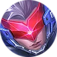

[Главная](https://boostmlbb.ru/) / [Герои](https://boostmlbb.ru/heroes/)

Тир S

# Маша в Mobile Legends: сборка, контрпики и статистика

Танк и боец, линия опыта. Выигрывает 60,40% матчей за последние 30 дней — 1-е место из 133 героев.

[Буст на этом герое](https://boostmlbb.ru/order.html?type=hero)[Все герои](https://boostmlbb.ru/heroes/)

Статистика герояТир S

**Маша**Бан 40,89% · Выбор 0,52%

Контрпики

Победы за 30 дней**60,40%**

**60,40%**побед за 30 дней

**0,52%**выбирают в матчах

**40,89%**банят в матчах

**60,75%**побед в Мифической славе

## Сборка на героя «Маша»

Самая популярная сборка для героя «Маша» на роли линии опыта в рейтинговых матчах на всех рангах — по данным «Академии» в игре. Процент побед — в матчах именно с этой сборкой.

Ключевые предметы

Штормовой поясКоса коррозииЗащитный шлем

Эмблема и таланты

Эмблема танкаПроворностьБлагословение природыБоевой клич

Боевое заклинание

Окаменение

Побед с этой сборкой **63,70%**Выбирают в **6,35%** матчей

### Другие популярные варианты

-   ВспышкаЭмблема танкаПроворность · Благословение природы · Боевой клич**64,66%**
-   ОкаменениеЭмблема танкаПроворность · Охотник за скидками · Боевой клич**65,08%**

## Навыки героя «Маша»

Официальные описания навыков от MOONTON с перезарядкой и типом навыка.

Порядок прокачки: **Яростное растерзание** → **Взмах когтями** → **Свирепый взмах**

-   

    **Первобытный пакт**Пассивный

    "Благословение медведя": у Маши 3 шкалы ОЗ, каждая из которых наследует 50% от ее бонусов к ОЗ от снаряжения. Каждый раз, когда шкала ОЗ истощается, Маша снимает с себя эффекты контроля и один раз блокирует урон. Нанося урон вражеским героям или монстрам, Маша накапливает "Дикость", которая преобразуется в ОЗ после выхода из боя.
    "Дикая сила": когда навыки Маши наносят урон вражескому герою, со случайной стороны от цели появляется "Рана". Разрыв "Раны" базовой атакой переводит Машу в состояние "Дикости".
    Состояние "Дикости": на 3 сек. Маша получает 15 (+1\*Hero Level)% устойчивости, скорости атаки и скорости передвижения. Ее следующие 3 базовые атаки становятся веерообразными взмахами когтями, которые наносят врагам в области дополнительный физический урон в размере 3 (+0.5% дополнительной физической атаки) (+0.2\*Hero Level)% от (дополнительный урон не действует на башни) и восстанавливают 4 (+0.4\*Hero Level)% ОЗ.
    Повторный разрыв "Раны" в состоянии "Дикости" обновляет длительность состояния. Можно накопить до 6 взмахов когтями.

-   

    **Свирепый взмах**1-й навыкПерезарядка 8 с

    Маша выпускает энергию вперед, нанося 250 (+55% общей физической атаки) единиц физического урона врагам на своем пути. Она наносит миньонам 150% урона.

-   

    **Взмах когтями**2-й навыкПерезарядка 9 с

    Маша совершает рывок в указанном направлении, нанося 120 (+80% дополнительной физической атаки) единиц физического урона и при попадании снижая скорость передвижения вражеских героев на 50% на 1 сек.
    Когда шкала ОЗ истощается, перезарядка "Взмаха когтями" сбрасывается.

-   

    **Яростное растерзание**УльтимейтПерезарядка 42 с

    Маша совершает рывок к вражескому герою, нанося 300 (+50% доп. макс. ОЗ) единиц физического урона и оглушая его на 1 сек., одновременно отбрасывая ближайших врагов.

## Роль и линия

Место считается по проценту побед за 30 дней среди героев той же роли или линии.

-   Роль**Танк и боец**
-   Линия**Линия опыта**
-   Среди танков**1-е из 25**
-   Среди бойцов**1-е из 44**
-   На линии опыта**1-е из 42**
-   Специализация**Пуш, Урон**
-   Сложность**Низкая (30/100)**

## Кто контрит этого героя

Против этих героев «Маша» проигрывает чаще всего. Под иконкой — их собственный процент побед. 2 из 5 контрпиков — стрелки.

[Глу53,45%](https://boostmlbb.ru/heroes/gloo.html)[Эйдора50,35%](https://boostmlbb.ru/heroes/eudora.html)[Лесли48,31%](https://boostmlbb.ru/heroes/lesley.html)[Чичи49,38%](https://boostmlbb.ru/heroes/cici.html)[Броуди49,99%](https://boostmlbb.ru/heroes/brody.html)

## Против кого силён

Для этих героев «Маша» — один из самых неудобных соперников.

[Фрейя49,32%](https://boostmlbb.ru/heroes/freya.html)[Бруно53,78%](https://boostmlbb.ru/heroes/bruno.html)

## С кем играть в команде

С этими героями в одной команде «Маша» выигрывает чаще. Число — прибавка к проценту побед в процентных пунктах.

[Бэйн+1,86 п. п.](https://boostmlbb.ru/heroes/bane.html)[Гвиневра+1,66 п. п.](https://boostmlbb.ru/heroes/guinevere.html)[Икс.Борг+1,60 п. п.](https://boostmlbb.ru/heroes/x-borg.html)[Сабер+1,52 п. п.](https://boostmlbb.ru/heroes/saber.html)

## Процент побед по рангам

Лучший результат — на ранге «Мифическая честь» (61,09%), слабее всего — «Эпик» (54,74%). Данные за последние 30 дней.

-   Эпик**54,74%**
-   Легенда**58,09%**
-   Мифический**59,63%**
-   Мифическая честь**61,09%**
-   Мифическая слава**60,75%**

## Место в мете

«Маша» — тир S в нашем тир-листе по проценту побед, 1-е место из 133 героев. В Мифической славе результат почти такой же: 60,75%. На этом ранге героя банят в 72,41% матчей. В патче 2.2.16 герой переработан к 10-летию игры. Полный [тир-лист ноября](https://boostmlbb.ru/news/mlbb-meta-tier-list/) и [разбор патча](https://boostmlbb.ru/news/mlbb-current-patch/).

## Другие герои линии опыта

Самые сильные по проценту побед за последние 30 дней.

[Аргус56,78%](https://boostmlbb.ru/heroes/argus.html)[Сан53,72%](https://boostmlbb.ru/heroes/sun.html)[Аулус53,46%](https://boostmlbb.ru/heroes/aulus.html)[Глу53,45%](https://boostmlbb.ru/heroes/gloo.html)[Эдит52,67%](https://boostmlbb.ru/heroes/edith.html)[Бенедетта52,10%](https://boostmlbb.ru/heroes/benedetta.html)

## История героя

«Страж диких медведей.»

Полная история героя «Маша» — на официальном сайте лора MOONTON. Карточка героя с навыками и советами разработчиков — на mobilelegends.com, реплики, облики и история изменений — в MLBB Wiki.

[Читать историю](https://play.mobilelegends.com/lore/hero/Masha)[Карточка героя](https://www.mobilelegends.com/hero/detail?heroid=88)[MLBB Wiki](https://mobile-legends.fandom.com/wiki/Masha)

## Буст на герое «Маша»

Бустер играет только этим героем: вместе с рангом растёт и рейтинг героя.

[Рассчитать стоимость](https://boostmlbb.ru/order.html?type=hero)

Статистика — официальный рейтинг героев MOONTON (mobilelegends.com/rank) за последние 30 дней, обновление 23 ноября 2026 года, страница обновляется каждый день. Роли и линии — с официальной страницы героев. Сборки, навыки и союзники — данные «Академии» MOONTON через Rone Arena API (ridwaanhall / RoneAI).

## Частые вопросы

Кто контрпик для героя «Маша» в MLBB?

За последние 30 дней чаще всего героя обыгрывают Глу, Эйдора, Лесли, Чичи и Броуди.

Какой процент побед у героя «Маша» сейчас?

60,40% за последние 30 дней на всех рангах и 60,75% в Мифической славе, данные на 23 ноября 2026 года.

Какая роль и линия у героя «Маша»?

Танк и боец, играет на линии опыта.

Силён ли герой «Маша» в текущей мете?

Тир S: 1-е место из 133 героев по проценту побед за 30 дней и 1-е среди танков.

Какая сборка на героя «Маша» лучшая?

Самая популярная сборка в рейтинге: ключевые предметы «Штормовой пояс», «Коса коррозии» и «Защитный шлем», эмблема танка с талантами «Проворность», «Благословение природы» и «Боевой клич» и заклинание «Окаменение». С ней выигрывают 63,70% матчей.

Редакция MLBB Boost · Обновлено 23 ноября 2026
