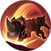

[Главная](https://boostmlbb.ru/) / [Герои](https://boostmlbb.ru/heroes/)

Тир S

# Минотавр в Mobile Legends: сборка, контрпики и статистика

Танк и поддержка, роум. Выигрывает 53,77% матчей за последние 30 дней — 10-е место из 133 героев.

[Буст на этом герое](https://boostmlbb.ru/order.html?type=hero)[Все герои](https://boostmlbb.ru/heroes/)

Статистика герояТир S

**Минотавр**Бан 8,43% · Выбор 1,00%

Контрпики

Победы за 30 дней**53,77%**

**53,77%**побед за 30 дней

**1,00%**выбирают в матчах

**8,43%**банят в матчах

**53,12%**побед в Мифической славе

## Сборка на героя «Минотавр»

Самая популярная сборка для героя «Минотавр» на роли роума в рейтинговых матчах на всех рангах — по данным «Академии» в игре. Процент побед — в матчах именно с этой сборкой.

Ключевые предметы

Фляга ОазисаГосподство льдаЩит Афины

Эмблема и таланты

Эмблема поддержкиЖивучестьБлагословение природыУдарная волна

Боевое заклинание

Восстановление

Побед с этой сборкой **60,47%**Выбирают в **4,33%** матчей

### Другие популярные варианты

-   ВспышкаЭмблема танкаПрочность · Второе дыхание · Ударная волна**57,83%**
-   ВосстановлениеЭмблема поддержкиЖивучесть · Второе дыхание · Ударная волна**63,50%**

## Навыки героя «Минотавр»

Официальные описания навыков от MOONTON с перезарядкой и типом навыка.

Порядок прокачки: **Гнев Минотавра** → **Топот отчаяния** → **Воодушевляющий рык**

-   

    **Режим Ярости**Пассивный

    После использования навыка Минотавр получает "Мотивацию", восстанавливая ОЗ в размере 5 (+1\*Hero Level)% от получаемого урона от вражеских героев в течение 3 сек.
    Состояние ярости: восстановление ОЗ от "Мотивации" увеличивается на 200%.

-   

    **Топот отчаяния**1-й навыкПерезарядка 12 с

    Минотавр прыгает в указанное место, нанося 325 (+60% общей физической атаки) единиц физического урона врагам в области и ненадолго подбрасывая их. Пораженные враги также замедляются на 40%, а Минотавр усиливает свои базовые атаки, чтобы наносить 25 (+5% Макс. ОЗ) единиц дополнительного физического урона в течение 2 сек.
    В ярости: увеличивает дальность массовых атак и наносимый урон на 25 (+5% Макс. ОЗ) единиц физического урона.

-   

    **Воодушевляющий рык**2-й навыкПерезарядка 10 с

    Минотавр лечит себя и ближайшего союзника с наименьшим количеством ОЗ, восстанавливая 220 (+60% общей магической силы) ОЗ обоим. Он также восстанавливает дополнительно 8% от своих потерянных .
    Ярость: Минотавр лечит себя и всех ближайших союзных героев.

-   

    **Гнев Минотавра**УльтимейтПерезарядка 60 с

    Минотавр входит в состояние ярости и 3 раза ударяет по земле. Первые 2 удара наносят 180 (+85% общей физической атаки) единиц физического урона ближайшим врагам и замедляют их на 60%, а последний удар наносит 200 (+85% общей физической атаки) единиц чистого урона и подбрасывает цели на 0.8 сек. Минотавр невосприимчив к эффектам контроля на время этой атаки.
    Состояние ярости длится 12 сек. и на время его действия усиливает навыки Минотавра.

## Роль и линия

Место считается по проценту побед за 30 дней среди героев той же роли или линии.

-   Роль**Танк и поддержка**
-   Линия**Роум**
-   Среди танков**3-е из 25**
-   Среди героев поддержки**5-е из 15**
-   В роуме**6-е из 34**
-   Специализация**Массовый контроль,**
-   Сложность**Низкая (30/100)**

## Кто контрит этого героя

Против этих героев «Минотавр» проигрывает чаще всего. Под иконкой — их собственный процент побед. 3 из 5 контрпиков — танки.

[Лолита53,30%](https://boostmlbb.ru/heroes/lolita.html)[Сильвана51,36%](https://boostmlbb.ru/heroes/silvanna.html)[Джонсон49,25%](https://boostmlbb.ru/heroes/johnson.html)[Циклоп51,68%](https://boostmlbb.ru/heroes/cyclops.html)[Хуфра54,72%](https://boostmlbb.ru/heroes/khufra.html)

## Против кого силён

Для этих героев «Минотавр» — один из самых неудобных соперников.

[Беатрис50,35%](https://boostmlbb.ru/heroes/beatrix.html)

## С кем играть в команде

С этими героями в одной команде «Минотавр» выигрывает чаще. Число — прибавка к проценту побед в процентных пунктах.

[Сабер+3,29 п. п.](https://boostmlbb.ru/heroes/saber.html)[Калеа+2,52 п. п.](https://boostmlbb.ru/heroes/kalea.html)[Наталья+2,04 п. п.](https://boostmlbb.ru/heroes/natalia.html)[Арлотт+1,87 п. п.](https://boostmlbb.ru/heroes/arlott.html)

## Процент побед по рангам

Лучший результат — на ранге «Легенда» (54,96%), слабее всего — «Мифическая слава» (53,12%). Данные за последние 30 дней.

-   Эпик**54,01%**
-   Легенда**54,96%**
-   Мифический**54,88%**
-   Мифическая честь**54,24%**
-   Мифическая слава**53,12%**

## Место в мете

«Минотавр» — тир S в нашем тир-листе по проценту побед, 10-е место из 133 героев. В Мифической славе процент побед ниже: 53,12% против 53,77% на всех рангах, разница 0,65 п. п. Полный [тир-лист ноября](https://boostmlbb.ru/news/mlbb-meta-tier-list/) и [разбор патча](https://boostmlbb.ru/news/mlbb-current-patch/).

## Другие герои роума

Самые сильные по проценту побед за последние 30 дней.

[Марсель57,46%](https://boostmlbb.ru/heroes/marcel.html)[Хуфра54,72%](https://boostmlbb.ru/heroes/khufra.html)[Рафаэль54,51%](https://boostmlbb.ru/heroes/rafaela.html)[Дигги54,30%](https://boostmlbb.ru/heroes/diggie.html)[Флорин54,07%](https://boostmlbb.ru/heroes/floryn.html)[Глу53,45%](https://boostmlbb.ru/heroes/gloo.html)

## История героя

«Минойский принц, решивший возродить свои родные земли.»

Полная история героя «Минотавр» — на официальном сайте лора MOONTON. Карточка героя с навыками и советами разработчиков — на mobilelegends.com, реплики, облики и история изменений — в MLBB Wiki.

[Читать историю](https://www.mobilelegends.com/hero/detail?heroid=19)[Карточка героя](https://www.mobilelegends.com/hero/detail?heroid=19)[MLBB Wiki](https://mobile-legends.fandom.com/wiki/Minotaur)

## Буст на герое «Минотавр»

Бустер играет только этим героем: вместе с рангом растёт и рейтинг героя.

[Рассчитать стоимость](https://boostmlbb.ru/order.html?type=hero)

Статистика — официальный рейтинг героев MOONTON (mobilelegends.com/rank) за последние 30 дней, обновление 23 ноября 2026 года, страница обновляется каждый день. Роли и линии — с официальной страницы героев. Сборки, навыки и союзники — данные «Академии» MOONTON через Rone Arena API (ridwaanhall / RoneAI).

## Частые вопросы

Кто контрпик для героя «Минотавр» в MLBB?

За последние 30 дней чаще всего героя обыгрывают Лолита, Сильвана, Джонсон, Циклоп и Хуфра.

Какой процент побед у героя «Минотавр» сейчас?

53,77% за последние 30 дней на всех рангах и 53,12% в Мифической славе, данные на 23 ноября 2026 года.

Какая роль и линия у героя «Минотавр»?

Танк и поддержка, играет в роуме.

Силён ли герой «Минотавр» в текущей мете?

Тир S: 10-е место из 133 героев по проценту побед за 30 дней и 3-е среди танков.

Какая сборка на героя «Минотавр» лучшая?

Самая популярная сборка в рейтинге: ключевые предметы «Фляга Оазиса», «Господство льда» и «Щит Афины», эмблема поддержки с талантами «Живучесть», «Благословение природы» и «Ударная волна» и заклинание «Восстановление». С ней выигрывают 60,47% матчей.

Редакция MLBB Boost · Обновлено 23 ноября 2026
