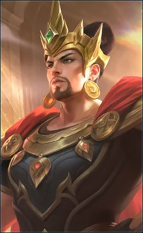

[Тир-лист](https://boostmlbb.ru/heroes/)[Предметы](https://boostmlbb.ru/items/)[Скины](https://boostmlbb.ru/skins/)[Новости и гайды](https://boostmlbb.ru/news/)

[Тир-лист](https://boostmlbb.ru/heroes/)

# Минситтар

B

БоецЛиния опыта

Победы

52,1%

Выбор

0,6%

Баны

2,8%

[Обзор](https://boostmlbb.ru/#overview)[Сборка](https://boostmlbb.ru/#build)[Как играть](https://boostmlbb.ru/#howto)[Навыки](https://boostmlbb.ru/#skills)[Контрпики](https://boostmlbb.ru/#draft)[Скины](https://boostmlbb.ru/#skins)[История](https://boostmlbb.ru/#lore)

## Обзор

### Характеристики

-   Живучесть**60**
-   Атака**40**
-   Эффекты**80**
-   Сложность**30**

-   Инициатор
-   Массовый контроль

### Победы по рангам, 30 дней

1.  **53,7%**Эпик
2.  **52,8%**Легенда
3.  **52,8%**Мифик
4.  **52,1%**Честь
5.  **51,5%**Слава

Пунктир: 50% побед

### Другие бойцы этой линии

[Фрейя](https://boostmlbb.ru/heroes/freya.html)[Аулус](https://boostmlbb.ru/heroes/aulus.html)[Пакито](https://boostmlbb.ru/heroes/paquito.html)[Сан](https://boostmlbb.ru/heroes/sun.html)[Лукас](https://boostmlbb.ru/heroes/lukas.html)[Чичи](https://boostmlbb.ru/heroes/cici.html)[Сора](https://boostmlbb.ru/heroes/sora.html)[Чонг](https://boostmlbb.ru/heroes/yu-zhong.html)

### Места в рейтингах

-   [Лучшие бойцы MLBB**20 из 44**](https://boostmlbb.ru/heroes/best-fighter.html)

## Сборка

Сборка 1Сборка 2Сборка 3

Победы

58,9%

Выбор

7,9%

#### Основные предметы

-   [

    

    Коса коррозии

    ](https://boostmlbb.ru/items/corrosion-scythe.html)
-   [

    

    Меч охотника на демонов

    ](https://boostmlbb.ru/items/demon-hunter-sword.html)
-   [

    

    Золотой посох

    ](https://boostmlbb.ru/items/golden-staff.html)

#### Заклинание

Вспышка

#### Эмблема и таланты

Эмблема бойца

-   

    Проворность

-   

    Мастер-убийца

-   

    Точно в цель

Победы

59,8%

Выбор

7,5%

#### Основные предметы

-   [

    

    Коса коррозии

    ](https://boostmlbb.ru/items/corrosion-scythe.html)
-   [

    

    Меч охотника на демонов

    ](https://boostmlbb.ru/items/demon-hunter-sword.html)
-   [

    

    Золотой посох

    ](https://boostmlbb.ru/items/golden-staff.html)

#### Заклинание

Вспышка

#### Эмблема и таланты

Эмблема стрелка

-   

    Проворность

-   

    Кровавое пиршество

-   

    Точно в цель

Победы

56,3%

Выбор

3,7%

#### Основные предметы

-   [

    

    Коса коррозии

    ](https://boostmlbb.ru/items/corrosion-scythe.html)
-   [

    

    Говорящий с ветром

    ](https://boostmlbb.ru/items/windtalker.html)
-   [

    

    Золотой посох

    ](https://boostmlbb.ru/items/golden-staff.html)

#### Заклинание

Вспышка

#### Эмблема и таланты

Эмблема стрелка

-   

    Проворность

-   

    Мастер-убийца

-   

    Точно в цель

## Как играть за Минситтара

### Комбо Минситтара

#### В драке

1.  1
2.  Ульт
3.  2
4.  Атака

В драке притяните нескольких первым навыком, ультом ограничьте их движение и бейте по площади усиленными атаками второго.

#### На линии

1.  1
2.  2
3.  Атака

На линии притяните врага первым навыком, замедлите вторым и бейте усиленными атаками.

### Когда сильнее всего

Сильнее в начале: на 10–12 минутах выигрывает 54,8%. Давите на линии, забирайте объекты и заканчивайте, пока преимущество не растаяло.

1.  **54,8**10–12
2.  **54,4**12–14
3.  **53,8**14–16
4.  **53,4**16–18
5.  **52,8**18–20
6.  **51,0**20+

Проценты побед по длине матча в минутах, все ранги. Пунктир: 50%

### Приоритет прокачки

1.  Призыв короля
2.  Натиск щитом
3.  Копье славы

## Навыки

Пассивный**Метка короля**1-й навык**Копье славы**2-й навык**Натиск щитом**Ультимейт**Призыв короля**

Пассивный

### Метка короля

Базовые атаки и навыки Минситтара накладывают заряд метки короля, до 5 зарядов. При достижении максимального количества зарядов следующая атака взрывает все заряды метки короля, нанося физический урон в размере 400 (+6% Макс. ОЗ) от макс. ОЗ Минситтара и оглушая цель на 0.8 сек., а также одновременно исцеляя Минситтара на 400 (+6% Макс. ОЗ) единиц ОЗ. Может срабатывать только один раз каждые 6 сек. на одну и ту же цель.

1-й навык

### Копье славы

Перезарядка **13 Mana Cost: 95 с**

Минситтар делает выпад Копьем славы вперед, нанося 175 (+40% общей физической атаки) единиц физического урона и замедляя пораженных врагов на 30%. Вражеские герои, попавшие под удар острия копья, оглушаются на 0.3 сек.

После небольшой задержки Минситтар возвращает копье, нанося 175 (+40% общей физической атаки) единиц физического урона всем врагам на пути и притягивая к себе пораженных вражеских героев. Притянутые герои оглушаются на срок до 0.8 сек. в зависимости от дистанции притягивания.

2-й навык

### Натиск щитом

Перезарядка **4 Mana Cost: 50 с**

Минситтар пробуждает силу в своем щите и высвобождает ее, нанося 100 (+45% общей физической атаки) единиц физического урона всем врагам в прямоугольной области и замедляя их на 80% (быстро спадает за 2 сек.). Тем временем он входит в состояние фаланги на 3 сек., на 25% снижая получаемый спереди урон и усиливая свою базовую атаку, чтобы быстро поразить область перед собой, нанося 100 (+45% общей физической атаки) единиц физического урона за удар.

Ультимейт

### Призыв короля

Перезарядка **45 Mana Cost: 150 с**

Минситтар бросается вперед и призывает 4 королевских стражей, чтобы сформировать вокруг себя поле. Королевские стражи не могут двигаться, но будут атаковать врагов в поле и наносить им (+30% общей физической атаки) единиц физического урона.

Враги в поле замедляются на 30% и не могут использовать навыки передвижения.

## Контрпики Минситтара

### Кто контрит Минситтара

[Фрейя](https://boostmlbb.ru/heroes/freya.html)[Фовиус](https://boostmlbb.ru/heroes/phoveus.html)[Харит](https://boostmlbb.ru/heroes/harith.html)[Мартис](https://boostmlbb.ru/heroes/martis.html)[Кэрри](https://boostmlbb.ru/heroes/karrie.html)

### Кого контрит Минситтар

[Аулус](https://boostmlbb.ru/heroes/aulus.html)[Чонг](https://boostmlbb.ru/heroes/yu-zhong.html)[Инь](https://boostmlbb.ru/heroes/yin.html)[Наталья](https://boostmlbb.ru/heroes/natalia.html)

## Скины Минситтара

[Символ доблестиОбычный · 2024](https://boostmlbb.ru/skins/minsitthar/symbol-of-valor.html)[Непобе­димое солнцеИзысканный · 2024](https://boostmlbb.ru/skins/minsitthar/sol-invictus.html)[Боевой левИсключительный · 2023](https://boostmlbb.ru/skins/minsitthar/war-lion.html)[Король войныОбычный · 2022](https://boostmlbb.ru/skins/minsitthar/king-of-war.html)[Позоло­ченный корольОбычный · 2018](https://boostmlbb.ru/skins/minsitthar/gilded-king.html)

[Все 5 скинов Минситтара: цены и как получить](https://boostmlbb.ru/skins/minsitthar.html)

## История

> Принц Города Песков, невероятный воин

[Читать полную историю ↗](https://play.mobilelegends.com/lore/hero/Minsitthar)Официальный сайт Mobile Legends [Характеристики на сайте игры ↗](https://www.mobilelegends.com/hero/detail?heroid=74)

**Поднимем ранг на герое «Минситтар»**Цена считается в калькуляторе

[Рассчитать цену](https://boostmlbb.ru/order.html?type=hero)

## Частые вопросы

Кто контрит Минситтара в MLBB?

За последние 30 дней Минситтара чаще всего обыгрывают Фрейя, Фовиус, Харит, Мартис и Кэрри.

Как играть за Минситтара?

В первую очередь качайте «Натиск щитом», ульт берите, как только доступен. Сильнее в начале: на 10–12 минутах выигрывает 54,8%. Давите на линии, забирайте объекты и заканчивайте, пока преимущество не растаяло. Комбо для драки: В драке притяните нескольких первым навыком, ультом ограничьте их движение и бейте по площади усиленными атаками второго.

Какой процент побед у Минситтара сейчас?

52,11% в Мифической славе за последние 7 дней и 52,18% на всех рангах за 30 дней, данные на 26 ноября 2026 года.

Какая роль и линия у Минситтара?

Боец, играет на линии опыта.

Стоит ли брать Минситтара в текущей мете?

Тир B, 67-е место из 133 героев и 20-е среди бойцов. Тир учитывает, как часто героя берут и банят и как он выигрывает в Мифической славе за 7 дней: бан в 2,8% матчей, 52,1% побед. В профессиональных матчах за месяц героя драфтуют в 0,0% катков.

Какая сборка на Минситтара лучшая?

Самая популярная сборка в рейтинге: ключевые предметы «Коса коррозии», «Меч охотника на демонов» и «Золотой посох», эмблема бойца с талантами «Проворность», «Мастер-убийца» и «Точно в цель» и заклинание «Вспышка». С ней выигрывают 58,92% матчей.
