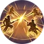

[Тир-лист](https://boostmlbb.ru/heroes/)[Новости и гайды](https://boostmlbb.ru/news/)

# Минситтар

B

БоецЛиния опыта

Принц Города Песков, невероятный воин

Победы

52,1%

все ранги 52,1%

Выбор

0,6%

все ранги 0,6%

Баны

2,8%

все ранги 4,2%

№42 в тир-листе · №14 среди бойцов · Мифическая слава, 7 дней, по 23 ноября

[Обзор](https://boostmlbb.ru/#overview)[Сборка](https://boostmlbb.ru/#build)[Навыки](https://boostmlbb.ru/#skills)[Контрпики](https://boostmlbb.ru/#draft)[История](https://boostmlbb.ru/#lore)

## Обзор

### Характеристики

-   Живучесть**60**
-   Атака**40**
-   Эффекты**80**
-   Сложность**30**

-   Инициатор
-   Массовый контроль

### Победы по рангам, 30 дней

1.  **53,5%**Эпик
2.  **52,7%**Легенда
3.  **52,6%**Мифик
4.  **51,9%**Честь
5.  **51,3%**Слава

Пунктир: 50% побед

### Другие бойцы этой линии

[Сан](https://boostmlbb.ru/heroes/sun.html)[Аулус](https://boostmlbb.ru/heroes/aulus.html)[Лукас](https://boostmlbb.ru/heroes/lukas.html)[Фрейя](https://boostmlbb.ru/heroes/freya.html)[Аргус](https://boostmlbb.ru/heroes/argus.html)[Пакито](https://boostmlbb.ru/heroes/paquito.html)[Баданг](https://boostmlbb.ru/heroes/badang.html)[Дариус](https://boostmlbb.ru/heroes/dyrroth.html)

## Сборка

Линия опыта · по данным рейтинговых матчей

Сборка 159,6%Сборка 258,9%Сборка 360,7%

### Предметы

Коса коррозии

Меч охотника на демонов

Золотой посох

### Эмблема

Эмблема стрелка

Проворность

Кровавое пиршество

Точно в цель

### Заклинание

Вспышка

Победы

59,6%

Выбор

9,5%

### Предметы

Коса коррозии

Меч охотника на демонов

Золотой посох

### Эмблема

Эмблема бойца

Проворность

Мастер-убийца

Точно в цель

### Заклинание

Вспышка

Победы

58,9%

Выбор

8,7%

### Предметы

Коса коррозии

Меч охотника на демонов

Золотой посох

### Эмблема

Эмблема стрелка

Проворность

Второе дыхание

Точно в цель

### Заклинание

Вспышка

Победы

60,7%

Выбор

2,5%

## Навыки

Прокачка**Призыв короля**_›_**Натиск щитом**_›_**Копье славы**

Пассивный1-й навык2-й навыкУльтимейт

Пассивный

### Метка короля

Базовые атаки и навыки Минситтара накладывают заряд метки короля, до 5 зарядов. При достижении максимального количества зарядов следующая атака взрывает все заряды метки короля, нанося физический урон в размере 400 (+6% Макс. ОЗ) от макс. ОЗ Минситтара и оглушая цель на 0.8 сек., а также одновременно исцеляя Минситтара на 400 (+6% Макс. ОЗ) единиц ОЗ. Может срабатывать только один раз каждые 6 сек. на одну и ту же цель.

1-й навык

### Копье славы

Перезарядка **13 Mana Cost: 95 с**

Минситтар делает выпад Копьем славы вперед, нанося 175 (+40% общей физической атаки) единиц физического урона и замедляя пораженных врагов на 30%. Вражеские герои, попавшие под удар острия копья, оглушаются на 0.3 сек.

После небольшой задержки Минситтар возвращает копье, нанося 175 (+40% общей физической атаки) единиц физического урона всем врагам на пути и притягивая к себе пораженных вражеских героев. Притянутые герои оглушаются на срок до 0.8 сек. в зависимости от дистанции притягивания.

2-й навык

### Натиск щитом

Перезарядка **4 Mana Cost: 50 с**

Минситтар пробуждает силу в своем щите и высвобождает ее, нанося 100 (+45% общей физической атаки) единиц физического урона всем врагам в прямоугольной области и замедляя их на 80% (быстро спадает за 2 сек.). Тем временем он входит в состояние фаланги на 3 сек., на 25% снижая получаемый спереди урон и усиливая свою базовую атаку, чтобы быстро поразить область перед собой, нанося 100 (+45% общей физической атаки) единиц физического урона за удар.

Ультимейт

### Призыв короля

Перезарядка **45 Mana Cost: 150 с**

Минситтар бросается вперед и призывает 4 королевских стражей, чтобы сформировать вокруг себя поле. Королевские стражи не могут двигаться, но будут атаковать врагов в поле и наносить им (+30% общей физической атаки) единиц физического урона.

Враги в поле замедляются на 30% и не могут использовать навыки передвижения.

## Контрпики и союзники

### Контрпики

Побеждают этого героя

[Фрейя](https://boostmlbb.ru/heroes/freya.html)[Фовиус](https://boostmlbb.ru/heroes/phoveus.html)[Харит](https://boostmlbb.ru/heroes/harith.html)[Мартис](https://boostmlbb.ru/heroes/martis.html)[Кэрри](https://boostmlbb.ru/heroes/karrie.html)

### Слабые цели

Этот герой побеждает их

[Аулус](https://boostmlbb.ru/heroes/aulus.html)[Чонг](https://boostmlbb.ru/heroes/yu-zhong.html)[Инь](https://boostmlbb.ru/heroes/yin.html)[Наталья](https://boostmlbb.ru/heroes/natalia.html)

### Союзники

Рост побед в паре, п. п.

[Хильда**+2,1**](https://boostmlbb.ru/heroes/hilda.html)[Халид**+1,9**](https://boostmlbb.ru/heroes/khaleed.html)[Сан**+1,5**](https://boostmlbb.ru/heroes/sun.html)[Эстес**+1,4**](https://boostmlbb.ru/heroes/estes.html)

## История

> Принц Города Песков, невероятный воин

[Читать полную историю ↗](https://play.mobilelegends.com/lore/hero/Minsitthar)Официальный сайт Mobile Legends

[Характеристики на сайте игры ↗](https://www.mobilelegends.com/hero/detail?heroid=74)

**Поднимем ранг на герое «Минситтар»**Цена считается в калькуляторе

[Рассчитать цену](https://boostmlbb.ru/order.html?type=hero)

## Частые вопросы

Кто контрпик для героя «Минситтар» в MLBB?

За последние 30 дней чаще всего героя обыгрывают Фрейя, Фовиус, Харит, Мартис и Кэрри.

Какой процент побед у героя «Минситтар» сейчас?

52,09% в Мифической славе за последние 7 дней и 52,08% на всех рангах за 30 дней, данные на 23 ноября 2026 года.

Какая роль и линия у героя «Минситтар»?

Боец, играет на линии опыта.

Силён ли герой «Минситтар» в текущей мете?

Тир B, 42-е место из 133 героев и 14-е среди бойцов. Тир учитывает, как часто героя берут и банят и как он выигрывает в Мифической славе за 7 дней: бан в 2,8% матчей, 52,1% побед.

Какая сборка на героя «Минситтар» лучшая?

Самая популярная сборка в рейтинге: ключевые предметы «Коса коррозии», «Меч охотника на демонов» и «Золотой посох», эмблема стрелка с талантами «Проворность», «Кровавое пиршество» и «Точно в цель» и заклинание «Вспышка». С ней выигрывают 59,59% матчей.
