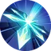

[Главная](https://boostmlbb.ru/) / [Герои](https://boostmlbb.ru/heroes/)

Тир B

# Мия

Стрелок · Линия золота

**№ 73 из 133 по доле побед**Все ранги · 30 дней по 23 ноября 2026 года

Победы

49,71%

Выбор

2,19%

Баны

4,58%

Добивание · Урон · Сложность 10/100

[Сборка](https://boostmlbb.ru/#build)[Контрпики и союзники](https://boostmlbb.ru/#draft)[Навыки](https://boostmlbb.ru/#skills)[Победы по рангам](https://boostmlbb.ru/#ranks)[История](https://boostmlbb.ru/#lore)

## Сборка

Самый частый выбор в рейтинге · Линия золота

Ключевые предметы

Говорящий с ветромКогти ХаасаЯрость берсерка

Эмблема и таланты

Эмблема стрелкаФатальностьОхотник за скидкамиКвантовый заряд

Боевое заклинание

Вдохновение

Побед с этой сборкой **56,21%**Выбирают в **3,75%** матчей

Другие сборки (2)

Ключевые предметы

Говорящий с ветромЯрость берсеркаКогти Хааса

Эмблема и таланты

Эмблема стрелкаФатальностьОхотник за скидкамиКвантовый заряд

Боевое заклинание

Вдохновение

Побед с этой сборкой **55,75%**Выбирают в **18,38%** матчей

Ключевые предметы

Говорящий с ветромЯрость берсеркаКогти Хааса

Эмблема и таланты

Эмблема стрелкаФатальностьОхотник за скидкамиТочно в цель

Боевое заклинание

Вдохновение

Побед с этой сборкой **56,20%**Выбирают в **3,05%** матчей

## Контрпики и союзники

### Кто контрит

[Сабер](https://boostmlbb.ru/heroes/saber.html)[Обсидия](https://boostmlbb.ru/heroes/obsidia.html)[Москов](https://boostmlbb.ru/heroes/moskov.html)[Иритель](https://boostmlbb.ru/heroes/irithel.html)[Гвиневра](https://boostmlbb.ru/heroes/guinevere.html)

### Против кого силён

[Белерик](https://boostmlbb.ru/heroes/belerick.html)[Гатоткача](https://boostmlbb.ru/heroes/gatotkaca.html)

### Союзники

Прибавка к доле побед в одной команде

[Глу+2,15 п. п.](https://boostmlbb.ru/heroes/gloo.html)[Пополь и Купа+1,78 п. п.](https://boostmlbb.ru/heroes/popol-and-kupa.html)[Роджер+1,57 п. п.](https://boostmlbb.ru/heroes/roger.html)[Белерик+1,40 п. п.](https://boostmlbb.ru/heroes/belerick.html)

## Навыки

Приоритет прокачки · Скрытый лунный свет → Лунная стрела → Стрела затмения

Пассивный**Благословение луны**

Каждый раз, когда базовая атака Мии поражает цель, она получает 5% скорости атаки на 4 сек. (до 5 зарядов).
При максимальном количестве зарядов каждая базовая атака также призывает лунную тень для атаки цели, которая наносит 25 (+20% общей физической атаки) единиц физического урона, наследуя 20% эффектов атаки.

1-й навык**Лунная стрела**

**Перезарядка 11 Mana Cost: 60 с**

Базовые атаки Мии выпускают 2 дополнительные разделенные стрелы, каждая из которых наследует 30% эффектов атаки. Они наносят 10 (+100% общей физической атаки) единиц физического урона основной цели и 30% урона другим целям.
Этот эффект длится 4 сек.

2-й навык**Стрела затмения**

**Перезарядка 8 Mana Cost: 90 с**

Мия призывает силу Лунного затмения в указанную область, нанося 270 (+45% общей физической атаки) единиц физического урона врагам внутри нее и обездвиживая их на 1.2 сек.
Затем атака разделяется на 6 стрел, которые разлетаются в разных направлениях. Каждая стрела наносит 40 (+20% общей физической атаки) единиц физического урона и замедляет пораженных врагов на 30% на 2 сек.

Ультимейт**Скрытый лунный свет**

**Перезарядка 30 Mana Cost: 120 с**

Мия снимает с себя все дебаффы и переходит в состояние маскировки, получая 65% скорости передвижения на время до 2 сек. (атака прерывает состояние досрочно).
При выходе из состояния маскировки Мия получает максимальное количество зарядов "Благословения луны".

## Победы по рангам

-   Эпик**48,43%**
-   Легенда**49,20%**
-   Мифический**50,26%**
-   Мифическая честь**50,12%**
-   Мифическая слава**50,30%**

## История

Жрица луны и защитница Лунного леса.

[Читать историю](https://play.mobilelegends.com/lore/hero/Miya)[Карточка героя](https://www.mobilelegends.com/hero/detail?heroid=1)[MLBB Wiki](https://mobile-legends.fandom.com/wiki/Miya)

[Стоимость буста на герое](https://boostmlbb.ru/order.html?type=hero)

## Частые вопросы

Кто контрпик для героя «Мия» в MLBB?

За последние 30 дней чаще всего героя обыгрывают Сабер, Обсидия, Москов, Иритель и Гвиневра.

Какой процент побед у героя «Мия» сейчас?

49,71% за последние 30 дней на всех рангах и 50,30% в Мифической славе, данные на 23 ноября 2026 года.

Какая роль и линия у героя «Мия»?

Стрелок, играет на линии золота.

Силён ли герой «Мия» в текущей мете?

Тир B: 73-е место из 133 героев по проценту побед за 30 дней и 14-е среди стрелков.

Какая сборка на героя «Мия» лучшая?

Самая популярная сборка в рейтинге: ключевые предметы «Говорящий с ветром», «Когти Хааса» и «Ярость берсерка», эмблема стрелка с талантами «Фатальность», «Охотник за скидками» и «Квантовый заряд» и заклинание «Вдохновение». С ней выигрывают 56,21% матчей.
