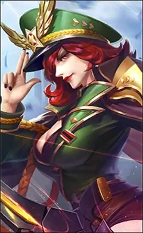

[Тир-лист](https://boostmlbb.ru/heroes/)[Предметы](https://boostmlbb.ru/items/)[Скины](https://boostmlbb.ru/skins/)[Новости и гайды](https://boostmlbb.ru/news/)

[Тир-лист](https://boostmlbb.ru/heroes/)

# Мия

B

СтрелокЛиния золота

Победы

50,0%

Выбор

1,4%

Баны

1,7%

[Обзор](https://boostmlbb.ru/#overview)[Сборка](https://boostmlbb.ru/#build)[Как играть](https://boostmlbb.ru/#howto)[Навыки](https://boostmlbb.ru/#skills)[Контрпики](https://boostmlbb.ru/#draft)[Скины](https://boostmlbb.ru/#skins)[История](https://boostmlbb.ru/#lore)

## Обзор

### Характеристики

-   Живучесть**10**
-   Атака**70**
-   Эффекты**40**
-   Сложность**10**

-   Добивание
-   Урон

### Победы по рангам, 30 дней

1.  **48,4%**Эпик
2.  **49,1%**Легенда
3.  **50,2%**Мифик
4.  **50,1%**Честь
5.  **50,2%**Слава

Пунктир: 50% побед

### Другие стрелки этой линии

[Обсидия](https://boostmlbb.ru/heroes/obsidia.html)[Бруно](https://boostmlbb.ru/heroes/bruno.html)[Клинт](https://boostmlbb.ru/heroes/clint.html)[Броуди](https://boostmlbb.ru/heroes/brody.html)[Ханаби](https://boostmlbb.ru/heroes/hanabi.html)[Москов](https://boostmlbb.ru/heroes/moskov.html)[Клауд](https://boostmlbb.ru/heroes/claude.html)[Мелисса](https://boostmlbb.ru/heroes/melissa.html)

### Места в рейтингах

-   [Лучшие стрелки MLBB**10 из 23**](https://boostmlbb.ru/heroes/best-marksman.html)

## Сборка

Сборка 1Сборка 2Сборка 3

Победы

55,8%

Выбор

16,5%

#### Основные предметы

-   [

    

    Говорящий с ветром

    ](https://boostmlbb.ru/items/windtalker.html)
-   [

    

    Ярость берсерка

    ](https://boostmlbb.ru/items/berserkers-fury.html)
-   [

    

    Когти Хааса

    ](https://boostmlbb.ru/items/haas-claws.html)

#### Заклинание

Вдохновение

#### Эмблема и таланты

Эмблема стрелка

-   

    Фатальность

-   

    Охотник за скидками

-   

    Квантовый заряд

Победы

52,9%

Выбор

3,9%

#### Основные предметы

-   [

    

    Говорящий с ветром

    ](https://boostmlbb.ru/items/windtalker.html)
-   [

    

    Ярость берсерка

    ](https://boostmlbb.ru/items/berserkers-fury.html)
-   [

    

    Когти Хааса

    ](https://boostmlbb.ru/items/haas-claws.html)

#### Заклинание

Вдохновение

#### Эмблема и таланты

Эмблема стрелка

-   

    Фатальность

-   

    Мастер-убийца

-   

    Боевой клич

Победы

56,2%

Выбор

3,5%

#### Основные предметы

-   [

    

    Говорящий с ветром

    ](https://boostmlbb.ru/items/windtalker.html)
-   [

    

    Когти Хааса

    ](https://boostmlbb.ru/items/haas-claws.html)
-   [

    

    Ярость берсерка

    ](https://boostmlbb.ru/items/berserkers-fury.html)

#### Заклинание

Вдохновение

#### Эмблема и таланты

Эмблема стрелка

-   

    Фатальность

-   

    Охотник за скидками

-   

    Квантовый заряд

## Как играть за Мию

### Комбо Мии

#### В драке

1.  Ульт
2.  2
3.  1
4.  Атака

В драке сначала ультом скройтесь, найдите удобную позицию и быстро накопите пассивку. Вторым обездвижьте врага и первым усильте атаки по нескольким целям.

#### На линии

1.  2
2.  1
3.  Атака

На линии обездвижьте вторым навыком, а первым бейте и врага, и крипов.

### Когда сильнее всего

Сильнее в долгой игре: на 18–20 минутах выигрывает 53,3%. Не рискуйте в начале, фармите и ввязывайтесь в драки вместе с командой.

1.  **46,2**10–12
2.  **48,2**12–14
3.  **50,6**14–16
4.  **52,2**16–18
5.  **53,3**18–20
6.  **53,3**20+

Проценты побед по длине матча в минутах, все ранги. Пунктир: 50%

### Приоритет прокачки

1.  Скрытый лунный свет
2.  Лунная стрела
3.  Стрела затмения

## Навыки

Пассивный**Благословение луны**1-й навык**Лунная стрела**2-й навык**Стрела затмения**Ультимейт**Скрытый лунный свет**

Пассивный

### Благословение луны

Каждый раз, когда базовая атака Мии поражает цель, она получает 5% скорости атаки на 4 сек. (до 5 зарядов).

При максимальном количестве зарядов каждая базовая атака также призывает лунную тень для атаки цели, которая наносит 25 (+20% общей физической атаки) единиц физического урона, наследуя 20% эффектов атаки.

1-й навык

### Лунная стрела

Перезарядка **11 Mana Cost: 60 с**

Базовые атаки Мии выпускают 2 дополнительные разделенные стрелы, каждая из которых наследует 30% эффектов атаки. Они наносят 10 (+100% общей физической атаки) единиц физического урона основной цели и 30% урона другим целям.

Этот эффект длится 4 сек.

2-й навык

### Стрела затмения

Перезарядка **8 Mana Cost: 90 с**

Мия призывает силу Лунного затмения в указанную область, нанося 270 (+45% общей физической атаки) единиц физического урона врагам внутри нее и обездвиживая их на 1.2 сек.

Затем атака разделяется на 6 стрел, которые разлетаются в разных направлениях. Каждая стрела наносит 40 (+20% общей физической атаки) единиц физического урона и замедляет пораженных врагов на 30% на 2 сек.

Ультимейт

### Скрытый лунный свет

Перезарядка **30 Mana Cost: 120 с**

Мия снимает с себя все дебаффы и переходит в состояние маскировки, получая 65% скорости передвижения на время до 2 сек. (атака прерывает состояние досрочно).

При выходе из состояния маскировки Мия получает максимальное количество зарядов "Благословения луны".

## Контрпики Мии

### Кто контрит Мию

[Сабер](https://boostmlbb.ru/heroes/saber.html)[Обсидия](https://boostmlbb.ru/heroes/obsidia.html)[Москов](https://boostmlbb.ru/heroes/moskov.html)[Иритель](https://boostmlbb.ru/heroes/irithel.html)[Харит](https://boostmlbb.ru/heroes/harith.html)

### Кого контрит Мия

[Белерик](https://boostmlbb.ru/heroes/belerick.html)[Гатоткача](https://boostmlbb.ru/heroes/gatotkaca.html)

## Скины Мии

[Стрела весныГрандиозный · 2026](https://boostmlbb.ru/skins/miya/arrow-of-springs.html)[Ночная охотницаИсключительный · 2025](https://boostmlbb.ru/skins/miya/nightowl-huntress.html)[Мия Atomic PopДелюкс · 2023](https://boostmlbb.ru/skins/miya/atomic-pop-miya.html)[Катали­затор гибелиИзысканный · 2022](https://boostmlbb.ru/skins/miya/doom-catalyst.html)[Лунная жрицаИсключительный · 2021](https://boostmlbb.ru/skins/miya/moon-priestess.html)[Лесная следопыткаОбычный · 2020](https://boostmlbb.ru/skins/miya/jungle-ranger.html)[СудзухимэИсключительный · 2018](https://boostmlbb.ru/skins/miya/suzuhime.html)[Сладкая фантазияИсключительный · 2018](https://boostmlbb.ru/skins/miya/sweet-fantasy.html)[ЧестьОбычный · 2017](https://boostmlbb.ru/skins/miya/honor.html)[Бабочка МоденыВысший · 2017](https://boostmlbb.ru/skins/miya/modena-butterfly.html)[Капитан ШиповИсключительный · 2017](https://boostmlbb.ru/skins/miya/captain-thorns.html)[Рож­дественский карнавалИзысканный · 2016](https://boostmlbb.ru/skins/miya/christmas-carnival.html)

[Все 13 скинов Мии: цены и как получить](https://boostmlbb.ru/skins/miya.html)

## История

> Жрица луны и защитница Лунного леса.

[Читать полную историю ↗](https://play.mobilelegends.com/lore/hero/Miya)Официальный сайт Mobile Legends [Характеристики на сайте игры ↗](https://www.mobilelegends.com/hero/detail?heroid=1)

**Поднимем ранг на герое «Мия»**Цена считается в калькуляторе

[Рассчитать цену](https://boostmlbb.ru/order.html?type=hero)

## Частые вопросы

Кто контрит Мию в MLBB?

За последние 30 дней Мию чаще всего обыгрывают Сабер, Обсидия, Москов, Иритель и Харит.

Как играть за Мию?

В первую очередь качайте «Лунная стрела», ульт берите, как только доступен. Сильнее в долгой игре: на 18–20 минутах выигрывает 53,3%. Не рискуйте в начале, фармите и ввязывайтесь в драки вместе с командой. Комбо для драки: В драке сначала ультом скройтесь, найдите удобную позицию и быстро накопите пассивку. Вторым обездвижьте врага и первым усильте атаки по нескольким целям.

Какой процент побед у Мии сейчас?

50,05% в Мифической славе за последние 7 дней и 49,68% на всех рангах за 30 дней, данные на 26 ноября 2026 года.

Какая роль и линия у Мии?

Стрелок, играет на линии золота.

Стоит ли брать Мию в текущей мете?

Тир B, 54-е место из 133 героев и 10-е среди стрелков. Тир учитывает, как часто героя берут и банят и как он выигрывает в Мифической славе за 7 дней: бан в 1,7% матчей, 50,0% побед. В профессиональных матчах за месяц героя драфтуют в 1,4% катков.

Какая сборка на Мию лучшая?

Самая популярная сборка в рейтинге: ключевые предметы «Говорящий с ветром», «Ярость берсерка» и «Когти Хааса», эмблема стрелка с талантами «Фатальность», «Охотник за скидками» и «Квантовый заряд» и заклинание «Вдохновение». С ней выигрывают 55,75% матчей.
