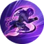
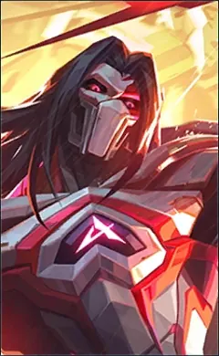

[Тир-лист](https://boostmlbb.ru/heroes/)[Предметы](https://boostmlbb.ru/items/)[Скины](https://boostmlbb.ru/skins/)[Новости и гайды](https://boostmlbb.ru/news/)

[Тир-лист](https://boostmlbb.ru/heroes/)

# Москов

B

СтрелокЛиния золота

Победы

51,4%

Выбор

1,1%

Баны

0,1%

[Обзор](https://boostmlbb.ru/#overview)[Сборка](https://boostmlbb.ru/#build)[Как играть](https://boostmlbb.ru/#howto)[Навыки](https://boostmlbb.ru/#skills)[Контрпики](https://boostmlbb.ru/#draft)[Скины](https://boostmlbb.ru/#skins)[История](https://boostmlbb.ru/#lore)

## Обзор

### Характеристики

-   Живучесть**20**
-   Атака**60**
-   Эффекты**60**
-   Сложность**40**

-   Добивание
-   Преследование

### Другие стрелки этой линии

[Обсидия](https://boostmlbb.ru/heroes/obsidia.html)[Бруно](https://boostmlbb.ru/heroes/bruno.html)[Клинт](https://boostmlbb.ru/heroes/clint.html)[Броуди](https://boostmlbb.ru/heroes/brody.html)[Ханаби](https://boostmlbb.ru/heroes/hanabi.html)[Клауд](https://boostmlbb.ru/heroes/claude.html)[Мия](https://boostmlbb.ru/heroes/miya.html)[Мелисса](https://boostmlbb.ru/heroes/melissa.html)

### Места в рейтингах

-   [Лучшие стрелки MLBB**8 из 23**](https://boostmlbb.ru/heroes/best-marksman.html)

## Сборка

Сборка 1Сборка 2Сборка 3

Победы

55,4%

Выбор

8,0%

#### Основные предметы

-   [

    

    Коса коррозии

    ](https://boostmlbb.ru/items/corrosion-scythe.html)
-   [

    

    Золотой посох

    ](https://boostmlbb.ru/items/golden-staff.html)
-   [

    

    Меч охотника на демонов

    ](https://boostmlbb.ru/items/demon-hunter-sword.html)

#### Заклинание

Вспышка

#### Эмблема и таланты

Эмблема стрелка

-   

    Проворность

-   

    Охотник за скидками

-   

    Квантовый заряд

Победы

56,2%

Выбор

6,6%

#### Основные предметы

-   [

    

    Коса коррозии

    ](https://boostmlbb.ru/items/corrosion-scythe.html)
-   [

    

    Золотой посох

    ](https://boostmlbb.ru/items/golden-staff.html)
-   [

    

    Меч охотника на демонов

    ](https://boostmlbb.ru/items/demon-hunter-sword.html)

#### Заклинание

Вспышка

#### Эмблема и таланты

Эмблема бойца

-   

    Проворность

-   

    Охотник за скидками

-   

    Квантовый заряд

Победы

52,8%

Выбор

4,7%

#### Основные предметы

-   [

    

    Коса коррозии

    ](https://boostmlbb.ru/items/corrosion-scythe.html)
-   [

    

    Золотой посох

    ](https://boostmlbb.ru/items/golden-staff.html)
-   [

    

    Меч охотника на демонов

    ](https://boostmlbb.ru/items/demon-hunter-sword.html)

#### Заклинание

Вспышка

#### Эмблема и таланты

Эмблема стрелка

-   

    Проворность

-   

    Мастер оружий

-   

    Квантовый заряд

## Как играть за Москова

### Комбо Москова

#### В драке

1.  Ульт
2.  2
3.  1
4.  Атака

В драке замедлите цель ультом, нажмите его ещё раз, чтобы прыгнуть за спину, вторым оглушите отбрасыванием и добейте атаками.

#### На линии

1.  1
2.  2
3.  Атака

На линии прыгните первым навыком на удобную позицию, оглушите вторым и бейте как можно больше: атаки сокращают перезарядку.

### Когда сильнее всего

Сильнее в долгой игре: на 16–18 минутах выигрывает 52,8%. Не рискуйте в начале, фармите и ввязывайтесь в драки вместе с командой.

1.  **46,3**10–12
2.  **50,0**12–14
3.  **51,5**14–16
4.  **52,8**16–18
5.  **52,7**18–20
6.  **52,0**20+

Проценты побед по длине матча в минутах, все ранги. Пунктир: 50%

### Приоритет прокачки

1.  Копье разрушения
2.  Ходок Бездны
3.  Копье страдания

## Навыки

Пассивный**Копье спокойствия**1-й навык**Ходок Бездны**2-й навык**Копье страдания**Ультимейт**Копье разрушения**

Пассивный

### Копье спокойствия

Базовая атака Москова может пробивать цель насквозь и наносить (+68% общей физической атаки)- (+110% общей физической атаки) единиц физического урона врагам позади (зависит от уровня героя).

Каждое попадание базовой атакой сокращает перезарядку навыков "Ходок бездны" на 0.8 сек. и "Копье страдания" на 0.8 сек.

1-й навык

### Ходок Бездны

Перезарядка **10 Mana Cost: 50 с**

Москов телепортируется в указанное место, увеличивая скорость атаки в 1.15 р. от обычной на 3 сек. В это время его базовые атаки наносят (+10% общей физической атаки) урона врагам позади основной цели.

2-й навык

### Копье страдания

Перезарядка **12 Mana Cost: 90 с**

Москов атакует указанного вражеского героя или монстра со всей силы, нанося 300 (+60% общей физической атаки) единиц физического урона, отбрасывая его назад и раскрывая его позицию на 2 сек.

Если отброшенная цель столкнется с другим вражеским героем, то они оба получат 200 (+30% общей физической атаки) единиц физического урона и будут оглушены на 1.2 сек. Если цель столкнется со стеной, то она также будет оглушена на ту же длительность.

Ультимейт

### Копье разрушения

Перезарядка **55 Mana Cost: 130 с**

После небольшой задержки Москов бросает "Копье разрушения" в указанном направлении, нанося 340 (+100% общей физической атаки) единиц физического урона врагам на его пути. Враги, находящиеся за первым пораженным вражеским героем, получают на 10% больше урона. Все пораженные враги замедляются на 50% на 1 сек. Длительность замедления увеличивается с расстоянием, пройденным копьем, вплоть до 3 сек.

Когда "Копье разрушения" поражает вражеского героя, за ним появляется тень, а перезарядка "Ходока Бездны" сбрасывается.

**Повторное использование:** Москов применяет "Ходока Бездны" из позиции тени (перезарядка общая с 1-м навыком).

## Контрпики Москова

### Кто контрит Москова

[Глу](https://boostmlbb.ru/heroes/gloo.html)[Джой](https://boostmlbb.ru/heroes/joy.html)[Фанни](https://boostmlbb.ru/heroes/fanny.html)[Беатрис](https://boostmlbb.ru/heroes/beatrix.html)[Атлас](https://boostmlbb.ru/heroes/atlas.html)

### Кого контрит Москов

[Ханаби](https://boostmlbb.ru/heroes/hanabi.html)[Мия](https://boostmlbb.ru/heroes/miya.html)[Дариус](https://boostmlbb.ru/heroes/dyrroth.html)[Мартис](https://boostmlbb.ru/heroes/martis.html)

## Скины Москова

[Адский повелитель змиевГрандиозный · 2024](https://boostmlbb.ru/skins/moskov/infernal-wrymlord.html)[Воплощение рокаГрандиозный · 2023](https://boostmlbb.ru/skins/moskov/doom-incarnate.html)[Фиолетовое копьёИсключительный · 2023](https://boostmlbb.ru/skins/moskov/violet-spear.html)[Сумеречный драконИзысканный · 2019](https://boostmlbb.ru/skins/moskov/twilight-dragon.html)[Обезглав­ливательОбычный · 2018](https://boostmlbb.ru/skins/moskov/decapitator.html)[Чемпион по метанию копьяИсключительный · 2018](https://boostmlbb.ru/skins/moskov/javelin-champion.html)[ЯкшаОбычный · 2018](https://boostmlbb.ru/skins/moskov/yasha.html)[Кровавое копьёДелюкс · 2017](https://boostmlbb.ru/skins/moskov/blood-spear.html)[Командир Змеиный ГлазИсключительный · 2017](https://boostmlbb.ru/skins/moskov/snake-eye-commander.html)[Копьё костяного драконаОбычный · 2017](https://boostmlbb.ru/skins/moskov/spear-of-bone-dragon.html)

[Все 10 скинов Москова: цены и как получить](https://boostmlbb.ru/skins/moskov.html)

## История

> Воин пустыни, принявший тьму в погоне за местью.

[Читать полную историю ↗](https://play.mobilelegends.com/lore/hero/Moskov)Официальный сайт Mobile Legends [Характеристики на сайте игры ↗](https://www.mobilelegends.com/hero/detail?heroid=31)

**Поднимем ранг на герое «Москов»**Цена считается в калькуляторе

[Рассчитать цену](https://boostmlbb.ru/order.html?type=hero)

## Частые вопросы

Кто контрит Москова в MLBB?

За последние 30 дней Москова чаще всего обыгрывают Глу, Джой, Фанни, Беатрис и Атлас.

Как играть за Москова?

В первую очередь качайте «Ходок Бездны», ульт берите, как только доступен. Сильнее в долгой игре: на 16–18 минутах выигрывает 52,8%. Не рискуйте в начале, фармите и ввязывайтесь в драки вместе с командой. Комбо для драки: В драке замедлите цель ультом, нажмите его ещё раз, чтобы прыгнуть за спину, вторым оглушите отбрасыванием и добейте атаками.

Какой процент побед у Москова сейчас?

51,36% в Мифической славе за последние 7 дней и 50,32% на всех рангах за 30 дней, данные на 27 ноября 2026 года.

Какая роль и линия у Москова?

Стрелок, играет на линии золота.

Стоит ли брать Москова в текущей мете?

Тир B, 49-е место из 133 героев и 8-е среди стрелков. Тир учитывает, как часто героя берут и банят и как он выигрывает в Мифической славе за 7 дней: бан в 0,1% матчей, 51,4% побед. В профессиональных матчах за месяц героя драфтуют в 7,5% катков.

Какая сборка на Москова лучшая?

Самая популярная сборка в рейтинге: ключевые предметы «Коса коррозии», «Золотой посох» и «Меч охотника на демонов», эмблема стрелка с талантами «Проворность», «Охотник за скидками» и «Квантовый заряд» и заклинание «Вспышка». С ней выигрывают 55,42% матчей.
