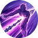

[Главная](https://boostmlbb.ru/) / [Герои](https://boostmlbb.ru/heroes/)

Тир B

# Москов

Стрелок · Линия золота

**№ 56 из 133 по доле побед**Все ранги · 30 дней по 23 ноября 2026 года

Победы

50,31%

Выбор

0,90%

Баны

0,28%

Добивание · Преследование · Сложность 40/100

[Сборка](https://boostmlbb.ru/#build)[Контрпики и союзники](https://boostmlbb.ru/#draft)[Навыки](https://boostmlbb.ru/#skills)[Победы по рангам](https://boostmlbb.ru/#ranks)[История](https://boostmlbb.ru/#lore)

## Сборка

Самый частый выбор в рейтинге · Линия золота

Ключевые предметы

Коса коррозииЗолотой посохМеч охотника на демонов

Эмблема и таланты

Эмблема стрелкаПроворностьМастер оружийКвантовый заряд

Боевое заклинание

Вспышка

Побед с этой сборкой **52,77%**Выбирают в **4,42%** матчей

Другие сборки (2)

Ключевые предметы

Коса коррозииЗолотой посохМеч охотника на демонов

Эмблема и таланты

Эмблема стрелкаПроворностьОхотник за скидкамиКвантовый заряд

Боевое заклинание

Вспышка

Побед с этой сборкой **55,51%**Выбирают в **8,58%** матчей

Ключевые предметы

Коса коррозииЗолотой посохМеч охотника на демонов

Эмблема и таланты

Эмблема бойцаПроворностьОхотник за скидкамиКвантовый заряд

Боевое заклинание

Вспышка

Побед с этой сборкой **56,55%**Выбирают в **5,72%** матчей

## Контрпики и союзники

### Кто контрит

[Глу](https://boostmlbb.ru/heroes/gloo.html)[Джой](https://boostmlbb.ru/heroes/joy.html)[Фанни](https://boostmlbb.ru/heroes/fanny.html)[Беатрис](https://boostmlbb.ru/heroes/beatrix.html)[Атлас](https://boostmlbb.ru/heroes/atlas.html)

### Против кого силён

[Ханаби](https://boostmlbb.ru/heroes/hanabi.html)[Мия](https://boostmlbb.ru/heroes/miya.html)[Мартис](https://boostmlbb.ru/heroes/martis.html)

### Союзники

Прибавка к доле побед в одной команде

[Харит+2,67 п. п.](https://boostmlbb.ru/heroes/harith.html)[Фарамис+2,07 п. п.](https://boostmlbb.ru/heroes/faramis.html)[Маша+1,23 п. п.](https://boostmlbb.ru/heroes/masha.html)[Марсель+1,12 п. п.](https://boostmlbb.ru/heroes/marcel.html)

## Навыки

Приоритет прокачки · Копье разрушения → Ходок Бездны → Копье страдания

Пассивный**Копье спокойствия**

Базовая атака Москова может пробивать цель насквозь и наносить (+68% общей физической атаки)- (+110% общей физической атаки) единиц физического урона врагам позади (зависит от уровня героя).
Каждое попадание базовой атакой сокращает перезарядку навыков "Ходок бездны" на 0.8 сек. и "Копье страдания" на 0.8 сек.

1-й навык**Ходок Бездны**

**Перезарядка 10 Mana Cost: 50 с**

Москов телепортируется в указанное место, увеличивая скорость атаки в 1.15 р. от обычной на 3 сек. В это время его базовые атаки наносят (+10% общей физической атаки) урона врагам позади основной цели.

2-й навык**Копье страдания**

**Перезарядка 12 Mana Cost: 90 с**

Москов атакует указанного вражеского героя или монстра со всей силы, нанося 300 (+60% общей физической атаки) единиц физического урона, отбрасывая его назад и раскрывая его позицию на 2 сек.
Если отброшенная цель столкнется с другим вражеским героем, то они оба получат 200 (+30% общей физической атаки) единиц физического урона и будут оглушены на 1.2 сек. Если цель столкнется со стеной, то она также будет оглушена на ту же длительность.

Ультимейт**Копье разрушения**

**Перезарядка 55 Mana Cost: 130 с**

После небольшой задержки Москов бросает "Копье разрушения" в указанном направлении, нанося 340 (+100% общей физической атаки) единиц физического урона врагам на его пути. Враги, находящиеся за первым пораженным вражеским героем, получают на 10% больше урона. Все пораженные враги замедляются на 50% на 1 сек. Длительность замедления увеличивается с расстоянием, пройденным копьем, вплоть до 3 сек.
Когда "Копье разрушения" поражает вражеского героя, за ним появляется тень, а перезарядка "Ходока Бездны" сбрасывается.
Повторное использование: Москов применяет "Ходока Бездны" из позиции тени (перезарядка общая с 1-м навыком).

## Победы по рангам

-   Эпик**46,77%**
-   Легенда**47,84%**
-   Мифический**49,49%**
-   Мифическая честь**50,94%**
-   Мифическая слава**51,31%**

## История

Воин пустыни, принявший тьму в погоне за местью.

[Читать историю](https://play.mobilelegends.com/lore/hero/Moskov)[Карточка героя](https://www.mobilelegends.com/hero/detail?heroid=31)[MLBB Wiki](https://mobile-legends.fandom.com/wiki/Moskov)

[Стоимость буста на герое](https://boostmlbb.ru/order.html?type=hero)

## Частые вопросы

Кто контрпик для героя «Москов» в MLBB?

За последние 30 дней чаще всего героя обыгрывают Глу, Джой, Фанни, Беатрис и Атлас.

Какой процент побед у героя «Москов» сейчас?

50,31% за последние 30 дней на всех рангах и 51,31% в Мифической славе, данные на 23 ноября 2026 года.

Какая роль и линия у героя «Москов»?

Стрелок, играет на линии золота.

Силён ли герой «Москов» в текущей мете?

Тир B: 56-е место из 133 героев по проценту побед за 30 дней и 10-е среди стрелков.

Какая сборка на героя «Москов» лучшая?

Самая популярная сборка в рейтинге: ключевые предметы «Коса коррозии», «Золотой посох» и «Меч охотника на демонов», эмблема стрелка с талантами «Проворность», «Мастер оружий» и «Квантовый заряд» и заклинание «Вспышка». С ней выигрывают 52,77% матчей.
