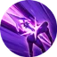

[Главная](https://boostmlbb.ru/) / [Герои](https://boostmlbb.ru/heroes/)

Тир B

# Москов в Mobile Legends: сборка, контрпики и статистика

Стрелок, линия золота. Выигрывает 50,31% матчей за последние 30 дней — 56-е место из 133 героев.

[Буст на этом герое](https://boostmlbb.ru/order.html?type=hero)[Все герои](https://boostmlbb.ru/heroes/)

Статистика герояТир B

**Москов**Бан 0,28% · Выбор 0,90%

Контрпики

Победы за 30 дней**50,31%**

**50,31%**побед за 30 дней

**0,90%**выбирают в матчах

**0,28%**банят в матчах

**51,31%**побед в Мифической славе

## Сборка на героя «Москов»

Самая популярная сборка для героя «Москов» на роли линии золота в рейтинговых матчах на всех рангах — по данным «Академии» в игре. Процент побед — в матчах именно с этой сборкой.

Ключевые предметы

Коса коррозииЗолотой посохМеч охотника на демонов

Эмблема и таланты

Эмблема стрелкаПроворностьМастер оружийКвантовый заряд

Боевое заклинание

Вспышка

Побед с этой сборкой **52,77%**Выбирают в **4,42%** матчей

### Другие популярные варианты

-   ВспышкаЭмблема стрелкаПроворность · Охотник за скидками · Квантовый заряд**55,51%**
-   ВспышкаЭмблема бойцаПроворность · Охотник за скидками · Квантовый заряд**56,55%**

## Навыки героя «Москов»

Официальные описания навыков от MOONTON с перезарядкой и типом навыка.

Порядок прокачки: **Копье разрушения** → **Ходок Бездны** → **Копье страдания**

-   

    **Копье спокойствия**Пассивный

    Базовая атака Москова может пробивать цель насквозь и наносить (+68% общей физической атаки)- (+110% общей физической атаки) единиц физического урона врагам позади (зависит от уровня героя).
    Каждое попадание базовой атакой сокращает перезарядку навыков "Ходок бездны" на 0.8 сек. и "Копье страдания" на 0.8 сек.

-   

    **Ходок Бездны**1-й навыкПерезарядка 10 Mana Cost: 50 с

    Москов телепортируется в указанное место, увеличивая скорость атаки в 1.15 р. от обычной на 3 сек. В это время его базовые атаки наносят (+10% общей физической атаки) урона врагам позади основной цели.

-   

    **Копье страдания**2-й навыкПерезарядка 12 Mana Cost: 90 с

    Москов атакует указанного вражеского героя или монстра со всей силы, нанося 300 (+60% общей физической атаки) единиц физического урона, отбрасывая его назад и раскрывая его позицию на 2 сек.
    Если отброшенная цель столкнется с другим вражеским героем, то они оба получат 200 (+30% общей физической атаки) единиц физического урона и будут оглушены на 1.2 сек. Если цель столкнется со стеной, то она также будет оглушена на ту же длительность.

-   

    **Копье разрушения**УльтимейтПерезарядка 55 Mana Cost: 130 с

    После небольшой задержки Москов бросает "Копье разрушения" в указанном направлении, нанося 340 (+100% общей физической атаки) единиц физического урона врагам на его пути. Враги, находящиеся за первым пораженным вражеским героем, получают на 10% больше урона. Все пораженные враги замедляются на 50% на 1 сек. Длительность замедления увеличивается с расстоянием, пройденным копьем, вплоть до 3 сек.
    Когда "Копье разрушения" поражает вражеского героя, за ним появляется тень, а перезарядка "Ходока Бездны" сбрасывается.
    Повторное использование: Москов применяет "Ходока Бездны" из позиции тени (перезарядка общая с 1-м навыком).

## Роль и линия

Место считается по проценту побед за 30 дней среди героев той же роли или линии.

-   Роль**Стрелок**
-   Линия**Линия золота**
-   Среди стрелков**10-е из 23**
-   На линии золота**9-е из 21**
-   Специализация**Добивание, Преследование**
-   Сложность**Низкая (40/100)**

## Кто контрит этого героя

Против этих героев «Москов» проигрывает чаще всего. Под иконкой — их собственный процент побед. 2 из 5 контрпиков — танки.

[Глу53,45%](https://boostmlbb.ru/heroes/gloo.html)[Джой48,79%](https://boostmlbb.ru/heroes/joy.html)[Фанни42,64%](https://boostmlbb.ru/heroes/fanny.html)[Беатрис50,35%](https://boostmlbb.ru/heroes/beatrix.html)[Атлас51,42%](https://boostmlbb.ru/heroes/atlas.html)

## Против кого силён

Для этих героев «Москов» — один из самых неудобных соперников.

[Ханаби52,66%](https://boostmlbb.ru/heroes/hanabi.html)[Мия49,71%](https://boostmlbb.ru/heroes/miya.html)[Мартис47,23%](https://boostmlbb.ru/heroes/martis.html)

## С кем играть в команде

С этими героями в одной команде «Москов» выигрывает чаще. Число — прибавка к проценту побед в процентных пунктах.

[Харит+2,67 п. п.](https://boostmlbb.ru/heroes/harith.html)[Фарамис+2,07 п. п.](https://boostmlbb.ru/heroes/faramis.html)[Маша+1,23 п. п.](https://boostmlbb.ru/heroes/masha.html)[Марсель+1,12 п. п.](https://boostmlbb.ru/heroes/marcel.html)

## Процент побед по рангам

Лучший результат — на ранге «Мифическая слава» (51,31%), слабее всего — «Эпик» (46,77%). Данные за последние 30 дней.

-   Эпик**46,77%**
-   Легенда**47,84%**
-   Мифический**49,49%**
-   Мифическая честь**50,94%**
-   Мифическая слава**51,31%**

## Место в мете

«Москов» — тир B в нашем тир-листе по проценту побед, 56-е место из 133 героев. В Мифической славе процент побед выше: 51,31% против 50,31% на всех рангах, разница 1,00 п. п. Полный [тир-лист ноября](https://boostmlbb.ru/news/mlbb-meta-tier-list/) и [разбор патча](https://boostmlbb.ru/news/mlbb-current-patch/).

## Другие герои линии золота

Самые сильные по проценту побед за последние 30 дней.

[Бруно53,78%](https://boostmlbb.ru/heroes/bruno.html)[Обсидия53,20%](https://boostmlbb.ru/heroes/obsidia.html)[Иритель52,74%](https://boostmlbb.ru/heroes/irithel.html)[Ханаби52,66%](https://boostmlbb.ru/heroes/hanabi.html)[Пополь и Купа52,09%](https://boostmlbb.ru/heroes/popol-and-kupa.html)[Натан51,32%](https://boostmlbb.ru/heroes/natan.html)

## История героя

«Воин пустыни, принявший тьму в погоне за местью.»

Полная история героя «Москов» — на официальном сайте лора MOONTON. Карточка героя с навыками и советами разработчиков — на mobilelegends.com, реплики, облики и история изменений — в MLBB Wiki.

[Читать историю](https://play.mobilelegends.com/lore/hero/Moskov)[Карточка героя](https://www.mobilelegends.com/hero/detail?heroid=31)[MLBB Wiki](https://mobile-legends.fandom.com/wiki/Moskov)

## Буст на герое «Москов»

Бустер играет только этим героем: вместе с рангом растёт и рейтинг героя.

[Рассчитать стоимость](https://boostmlbb.ru/order.html?type=hero)

Статистика — официальный рейтинг героев MOONTON (mobilelegends.com/rank) за последние 30 дней, обновление 23 ноября 2026 года, страница обновляется каждый день. Роли и линии — с официальной страницы героев. Сборки, навыки и союзники — данные «Академии» MOONTON через Rone Arena API (ridwaanhall / RoneAI).

## Частые вопросы

Кто контрпик для героя «Москов» в MLBB?

За последние 30 дней чаще всего героя обыгрывают Глу, Джой, Фанни, Беатрис и Атлас.

Какой процент побед у героя «Москов» сейчас?

50,31% за последние 30 дней на всех рангах и 51,31% в Мифической славе, данные на 23 ноября 2026 года.

Какая роль и линия у героя «Москов»?

Стрелок, играет на линии золота.

Силён ли герой «Москов» в текущей мете?

Тир B: 56-е место из 133 героев по проценту побед за 30 дней и 10-е среди стрелков.

Какая сборка на героя «Москов» лучшая?

Самая популярная сборка в рейтинге: ключевые предметы «Коса коррозии», «Золотой посох» и «Меч охотника на демонов», эмблема стрелка с талантами «Проворность», «Мастер оружий» и «Квантовый заряд» и заклинание «Вспышка». С ней выигрывают 52,77% матчей.

Редакция MLBB Boost · Обновлено 23 ноября 2026
