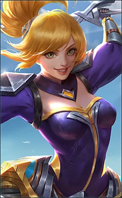
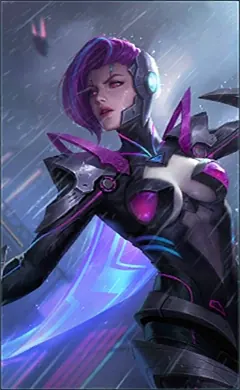

[Тир-лист](https://boostmlbb.ru/heroes/)[Предметы](https://boostmlbb.ru/items/)[Скины](https://boostmlbb.ru/skins/)[Новости и гайды](https://boostmlbb.ru/news/)

# Наталья

D

УбийцаЛесРоум

Победы

50,3%

Выбор

0,2%

Баны

1,1%

[Обзор](https://boostmlbb.ru/#overview)[Сборка](https://boostmlbb.ru/#build)[Как играть](https://boostmlbb.ru/#howto)[Навыки](https://boostmlbb.ru/#skills)[Контрпики](https://boostmlbb.ru/#draft)[Скины](https://boostmlbb.ru/#skins)[История](https://boostmlbb.ru/#lore)

## Обзор

### Характеристики

-   Живучесть**10**
-   Атака**60**
-   Эффекты**60**
-   Сложность**90**

-   Преследование
-   Добивание

### Победы по рангам, 30 дней

1.  **52,0%**Эпик
2.  **52,1%**Легенда
3.  **51,8%**Мифик
4.  **50,8%**Честь
5.  **50,0%**Слава

Пунктир: 50% побед

### Другие убийцы этой линии

[Нолан](https://boostmlbb.ru/heroes/nolan.html)[Хирара](https://boostmlbb.ru/heroes/hirara.html)[Сабер](https://boostmlbb.ru/heroes/saber.html)[Харли](https://boostmlbb.ru/heroes/harley.html)[Фанни](https://boostmlbb.ru/heroes/fanny.html)[Линг](https://boostmlbb.ru/heroes/ling.html)[Карина](https://boostmlbb.ru/heroes/karina.html)[Ли Сун-Син](https://boostmlbb.ru/heroes/yi-sun-shin.html)

### Места в рейтингах

-   [Лучшие лесники MLBB**27 из 37**](https://boostmlbb.ru/heroes/best-jungle.html)
-   [Лучшие убийцы MLBB**23 из 29**](https://boostmlbb.ru/heroes/best-assassin.html)
-   [Лучшие роумеры MLBB**23 из 34**](https://boostmlbb.ru/heroes/best-roam.html)

## Сборка

Сборка 1Сборка 2Сборка 3

Победы

60,3%

Выбор

7,7%

#### Основные предметы

-   [

    

    Клинок семи морей

    ](https://boostmlbb.ru/items/blade-of-the-heptaseas.html)
-   [

    

    Ярость берсерка

    ](https://boostmlbb.ru/items/berserkers-fury.html)
-   [

    

    Злобный рык

    ](https://boostmlbb.ru/items/malefic-roar.html)

#### Заклинание

Возмездие

#### Эмблема и таланты

Эмблема убийцы

-   

    Фатальность

-   

    Мастер-убийца

-   

    Смертельное воспламенение

Победы

60,7%

Выбор

6,7%

#### Основные предметы

-   [

    

    Клинок семи морей

    ](https://boostmlbb.ru/items/blade-of-the-heptaseas.html)
-   [

    

    Ярость берсерка

    ](https://boostmlbb.ru/items/berserkers-fury.html)
-   [

    

    Копье Великого дракона

    ](https://boostmlbb.ru/items/great-dragon-spear.html)

#### Заклинание

Возмездие

#### Эмблема и таланты

Эмблема убийцы

-   

    Фатальность

-   

    Мастер-убийца

-   

    Смертельное воспламенение

Победы

55,3%

Выбор

5,3%

#### Основные предметы

-   [

    

    Клинок семи морей

    ](https://boostmlbb.ru/items/blade-of-the-heptaseas.html)
-   [

    

    Ярость берсерка

    ](https://boostmlbb.ru/items/berserkers-fury.html)
-   [

    

    Трезубец

    ](https://boostmlbb.ru/items/sea-halberd.html)

#### Заклинание

Возмездие

#### Эмблема и таланты

Эмблема убийцы

-   

    Разрыв

-   

    Мастер-убийца

-   

    Смертельное воспламенение

## Как играть за Наталью

### Комбо Натальи

#### В драке

1.  Атака
2.  2
3.  1
4.  Ульт
5.  Атака
6.  1
7.  Ульт

В драке подкрадитесь за счёт пассивки и усиленной атаки, вторым навыком повысьте живучесть, затем первый, ульт и обычная атака на добивание.

#### На линии

1.  Атака
2.  2
3.  1
4.  1

При ганке спрячьтесь в кустах, чтобы сработала пассивка, зайдите сзади и прыгните усиленной атакой. Замедлите вторым и догоняйте первым.

### Когда сильнее всего

Сильнее в долгой игре: на 18–20 минутах выигрывает 56,8%. Не рискуйте в начале, фармите и ввязывайтесь в драки вместе с командой.

1.  **46,9**10–12
2.  **51,7**12–14
3.  **54,4**14–16
4.  **56,3**16–18
5.  **56,8**18–20
6.  **56,3**20+

Проценты побед по длине матча в минутах, все ранги. Пунктир: 50%

### Приоритет прокачки

1.  Охота
2.  Удар когтями
3.  Дымовая шашка

## Навыки

Пассивный**Инстинкт ассасина**1-й навык**Удар когтями**2-й навык**Дымовая шашка**Ультимейт**Охота**

Пассивный

### Инстинкт ассасина

Если Наталья останется в кустах и ​​не получит урона в течение 1 сек., она войдет в состояние камуфляжа и получит 15% скорости передвижения. В этом состоянии следующая базовая атака Натальи переместит ее за спину цели, нанося 200 (+110% общей физической атаки) единиц физического урона и накладывая немоту на 0.25 сек.

Нанесение урона, получение урона и использование навыков немедленно прекращает состояние камуфляжа, но ее следующая базовая атака останется усиленной еще на 1 сек.

Базовый критический урон Натальи снижен до 150%, но урон монстрам увеличен до 150%.

1-й навык

### Удар когтями

Перезарядка **10 с**

Наталья бросается в указанном направлении, нанося 250 (+50% общей физической атаки) единиц физического урона врагам на пути.

**Повторное использование:** попав во врага, Наталья может использовать этот навык снова в течение 5 сек.

2-й навык

### Дымовая шашка

Перезарядка **12 с**

Наталья кидает дымовую шашку на своем месте, замедляя врагов внутри на 25%, а сама становится невосприимчивой к базовым атакам на 4 сек.

Ультимейт

### Охота

Перезарядка **3 с**

**Пассивный:** Наталья получает 15% шанса крита.

**Активный:** Наталья мгновенно входит в состояние "Инстинкта ассасина". Она может накопить до 2 зарядов своего ультимейта, время накопления каждого составляет 30 сек. Убийства монстров снижают оставшееся время накопления на 50% от общего времени.

## Контрпики Натальи

### Кто контрит Наталью

[Линг](https://boostmlbb.ru/heroes/ling.html)[Ханзо](https://boostmlbb.ru/heroes/hanzo.html)[Ксавьер](https://boostmlbb.ru/heroes/xavier.html)[Минситтар](https://boostmlbb.ru/heroes/minsitthar.html)[Нолан](https://boostmlbb.ru/heroes/nolan.html)

### Кого контрит Наталья

[Обсидия](https://boostmlbb.ru/heroes/obsidia.html)[Эйдора](https://boostmlbb.ru/heroes/eudora.html)[Цзэтянь](https://boostmlbb.ru/heroes/zetian.html)[Госсен](https://boostmlbb.ru/heroes/gusion.html)[Пакито](https://boostmlbb.ru/heroes/paquito.html)[Су Ё](https://boostmlbb.ru/heroes/suyou.html)[Чу](https://boostmlbb.ru/heroes/chou.html)[Сабер](https://boostmlbb.ru/heroes/saber.html)[Карина](https://boostmlbb.ru/heroes/karina.html)[Рафаэль](https://boostmlbb.ru/heroes/rafaela.html)

## Скины Натальи

[Охотница за душамиДелюкс · 2025](https://boostmlbb.ru/skins/natalia/soul-huntress.html)[Образцовая вои­тельницаИзысканный · 2024](https://boostmlbb.ru/skins/natalia/warrioress-paragon.html)[Кибер-призракИсключительный · 2020](https://boostmlbb.ru/skins/natalia/cyber-spectre.html)[Мрачная души­тельницаИсключительный · 2020](https://boostmlbb.ru/skins/natalia/grim-strangler.html)[Полуночный воронИсключительный · 2018](https://boostmlbb.ru/skins/natalia/midnight-raven.html)[Смерто­носная мамбаОбычный · 2018](https://boostmlbb.ru/skins/natalia/deadly-mamba.html)[Призрачная танцовщицаИсключительный · 2017](https://boostmlbb.ru/skins/natalia/phantom-dancer.html)[Стеклянный клинокОбычный · 2016](https://boostmlbb.ru/skins/natalia/glass-blade.html)

[Все 8 скинов Натальи: цены и как получить](https://boostmlbb.ru/skins/natalia.html)

## История

> Убийца, изгнанный из империи.

[Читать полную историю ↗](https://kazukiofficial.com/stories/natalia)Kazuki Official, английский [Характеристики на сайте игры ↗](https://www.mobilelegends.com/hero/detail?heroid=24)

**Поднимем ранг на герое «Наталья»**Цена считается в калькуляторе

[Рассчитать цену](https://boostmlbb.ru/order.html?type=hero)

## Частые вопросы

Кто контрит Наталью в MLBB?

За последние 30 дней Наталью чаще всего обыгрывают Линг, Ханзо, Ксавьер, Минситтар и Нолан.

Как играть за Наталью?

В первую очередь качайте «Удар когтями», ульт берите, как только доступен. Сильнее в долгой игре: на 18–20 минутах выигрывает 56,8%. Не рискуйте в начале, фармите и ввязывайтесь в драки вместе с командой. Комбо для драки: В драке подкрадитесь за счёт пассивки и усиленной атаки, вторым навыком повысьте живучесть, затем первый, ульт и обычная атака на добивание.

Какой процент побед у Натальи сейчас?

50,33% в Мифической славе за последние 7 дней и 51,11% на всех рангах за 30 дней, данные на 25 ноября 2026 года.

Какая роль и линия у Натальи?

Убийца, играет в лесу или в роуме.

Стоит ли брать Наталью в текущей мете?

Тир D, 103-е место из 133 героев и 23-е среди убийц. Тир учитывает, как часто героя берут и банят и как он выигрывает в Мифической славе за 7 дней: бан в 1,1% матчей, 50,3% побед. В профессиональных матчах за месяц героя драфтуют в 0,0% катков.

Какая сборка на Наталью лучшая?

Самая популярная сборка в рейтинге: ключевые предметы «Клинок семи морей», «Ярость берсерка» и «Злобный рык», эмблема убийцы с талантами «Фатальность», «Мастер-убийца» и «Смертельное воспламенение» и заклинание «Возмездие». С ней выигрывают 60,31% матчей.
