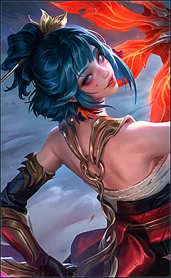

[Тир-лист](https://boostmlbb.ru/heroes/)[Новости и гайды](https://boostmlbb.ru/news/)

# Наталья

D

УбийцаЛесРоум

Победы

50,3%

Выбор

0,2%

Баны

1,1%

[Обзор](https://boostmlbb.ru/#overview)[Сборка](https://boostmlbb.ru/#build)[Навыки](https://boostmlbb.ru/#skills)[Контрпики](https://boostmlbb.ru/#draft)[История](https://boostmlbb.ru/#lore)

## Обзор

### Характеристики

-   Живучесть**10**
-   Атака**60**
-   Эффекты**60**
-   Сложность**90**

-   Преследование
-   Добивание

### Победы по рангам, 30 дней

1.  **52,0%**Эпик
2.  **52,0%**Легенда
3.  **51,7%**Мифик
4.  **50,7%**Честь
5.  **50,0%**Слава

Пунктир: 50% побед

### Другие убийцы этой линии

[Нолан](https://boostmlbb.ru/heroes/nolan.html)[Хирара](https://boostmlbb.ru/heroes/hirara.html)[Сабер](https://boostmlbb.ru/heroes/saber.html)[Харли](https://boostmlbb.ru/heroes/harley.html)[Фанни](https://boostmlbb.ru/heroes/fanny.html)[Линг](https://boostmlbb.ru/heroes/ling.html)[Ли Сун-Син](https://boostmlbb.ru/heroes/yi-sun-shin.html)[Карина](https://boostmlbb.ru/heroes/karina.html)

### Места в рейтингах

-   [Лучшие лесники MLBB**29 из 37**](https://boostmlbb.ru/heroes/best-jungle.html)
-   [Лучшие убийцы MLBB**23 из 29**](https://boostmlbb.ru/heroes/best-assassin.html)
-   [Лучшие роумеры MLBB**23 из 34**](https://boostmlbb.ru/heroes/best-roam.html)

## Сборка

Сборка 1Сборка 2Сборка 3

Победы

60,3%

Выбор

7,7%

#### Основные предметы

-   

    Клинок семи морей

-   

    Ярость берсерка

-   

    Злобный рык

#### Заклинание

Возмездие

#### Эмблема и таланты

Эмблема убийцы

-   

    Фатальность

-   

    Мастер-убийца

-   

    Смертельное воспламенение

Победы

60,7%

Выбор

6,7%

#### Основные предметы

-   

    Клинок семи морей

-   

    Ярость берсерка

-   

    Копье Великого дракона

#### Заклинание

Возмездие

#### Эмблема и таланты

Эмблема убийцы

-   

    Фатальность

-   

    Мастер-убийца

-   

    Смертельное воспламенение

Победы

55,3%

Выбор

5,3%

#### Основные предметы

-   

    Клинок семи морей

-   

    Ярость берсерка

-   

    Трезубец

#### Заклинание

Возмездие

#### Эмблема и таланты

Эмблема убийцы

-   

    Разрыв

-   

    Мастер-убийца

-   

    Смертельное воспламенение

## Навыки

Прокачка**Охота**_›_**Удар когтями**_›_**Дымовая шашка**

Пассивный**Инстинкт ассасина**1-й навык**Удар когтями**2-й навык**Дымовая шашка**Ультимейт**Охота**

Пассивный

### Инстинкт ассасина

Если Наталья останется в кустах и ​​не получит урона в течение 1 сек., она войдет в состояние камуфляжа и получит 15% скорости передвижения. В этом состоянии следующая базовая атака Натальи переместит ее за спину цели, нанося 200 (+110% общей физической атаки) единиц физического урона и накладывая немоту на 0.25 сек.

Нанесение урона, получение урона и использование навыков немедленно прекращает состояние камуфляжа, но ее следующая базовая атака останется усиленной еще на 1 сек.

Базовый критический урон Натальи снижен до 150%, но урон монстрам увеличен до 150%.

1-й навык

### Удар когтями

Перезарядка **10 с**

Наталья бросается в указанном направлении, нанося 250 (+50% общей физической атаки) единиц физического урона врагам на пути.

**Повторное использование:** попав во врага, Наталья может использовать этот навык снова в течение 5 сек.

2-й навык

### Дымовая шашка

Перезарядка **12 с**

Наталья кидает дымовую шашку на своем месте, замедляя врагов внутри на 25%, а сама становится невосприимчивой к базовым атакам на 4 сек.

Ультимейт

### Охота

Перезарядка **3 с**

**Пассивный:** Наталья получает 15% шанса крита.

**Активный:** Наталья мгновенно входит в состояние "Инстинкта ассасина". Она может накопить до 2 зарядов своего ультимейта, время накопления каждого составляет 30 сек. Убийства монстров снижают оставшееся время накопления на 50% от общего времени.

## Контрпики

### Контрпики

Побеждают этого героя

[Линг](https://boostmlbb.ru/heroes/ling.html)[Ханзо](https://boostmlbb.ru/heroes/hanzo.html)[Ксавьер](https://boostmlbb.ru/heroes/xavier.html)[Минситтар](https://boostmlbb.ru/heroes/minsitthar.html)[Нолан](https://boostmlbb.ru/heroes/nolan.html)

### Слабые цели

Этот герой побеждает их

[Эйдора](https://boostmlbb.ru/heroes/eudora.html)[Цзэтянь](https://boostmlbb.ru/heroes/zetian.html)[Госсен](https://boostmlbb.ru/heroes/gusion.html)[Пакито](https://boostmlbb.ru/heroes/paquito.html)[Су Ё](https://boostmlbb.ru/heroes/suyou.html)[Чу](https://boostmlbb.ru/heroes/chou.html)[Сабер](https://boostmlbb.ru/heroes/saber.html)[Карина](https://boostmlbb.ru/heroes/karina.html)[Рафаэль](https://boostmlbb.ru/heroes/rafaela.html)[Броуди](https://boostmlbb.ru/heroes/brody.html)

## История

> Убийца, изгнанный из империи.

[Читать полную историю ↗](https://kazukiofficial.com/stories/natalia)Kazuki Official, английский [Характеристики на сайте игры ↗](https://www.mobilelegends.com/hero/detail?heroid=24)

**Поднимем ранг на герое «Наталья»**Цена считается в калькуляторе

[Рассчитать цену](https://boostmlbb.ru/order.html?type=hero)

## Частые вопросы

Кто контрпик для героя «Наталья» в MLBB?

За последние 30 дней чаще всего героя обыгрывают Линг, Ханзо, Ксавьер, Минситтар и Нолан.

Какой процент побед у героя «Наталья» сейчас?

50,32% в Мифической славе за последние 7 дней и 51,07% на всех рангах за 30 дней, данные на 24 ноября 2026 года.

Какая роль и линия у героя «Наталья»?

Убийца, играет в лесу или в роуме.

Силён ли герой «Наталья» в текущей мете?

Тир D, 105-е место из 133 героев и 23-е среди убийц. Тир учитывает, как часто героя берут и банят и как он выигрывает в Мифической славе за 7 дней: бан в 1,1% матчей, 50,3% побед. В профессиональных матчах за месяц героя драфтуют в 0,0% катков.

Какая сборка на героя «Наталья» лучшая?

Самая популярная сборка в рейтинге: ключевые предметы «Клинок семи морей», «Ярость берсерка» и «Злобный рык», эмблема убийцы с талантами «Фатальность», «Мастер-убийца» и «Смертельное воспламенение» и заклинание «Возмездие». С ней выигрывают 60,31% матчей.
