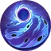

[Тир-лист](https://boostmlbb.ru/heroes/)[Новости и гайды](https://boostmlbb.ru/news/)

Тир B

# Новария

Маг · Средняя линия

Победы

49,52%

Выбор

1,21%

Баны

3,89%

**№ 78 из 133 по доле побед**Все ранги · 30 дней по 23 ноября 2026 года

[Сборка](https://boostmlbb.ru/#build)[Контрпики](https://boostmlbb.ru/#draft)[Навыки](https://boostmlbb.ru/#skills)[Статистика](https://boostmlbb.ru/#ranks)[История](https://boostmlbb.ru/#lore)

Разрушительный урон · Поук · Сложность 70/100

## Сборка

Самый частый выбор в рейтинге · Средняя линия

Ключевые предметы

Пылающий жезлЖезл молнийБожественный меч

Эмблема и таланты

Эмблема магаВдохновениеБлагословение природыНечестивая ярость

Боевое заклинание

Вспышка

Побед с этой сборкой **55,99%**Выбирают в **4,46%** матчей

Другие сборки (2)

Ключевые предметы

Пронзающий небесаЖезл молнийСвященный кристалл

Эмблема и таланты

Эмблема убийцыРазрывБлагословение природыНечестивая ярость

Боевое заклинание

Вспышка

Побед с этой сборкой **55,25%**Выбирают в **2,30%** матчей

Ключевые предметы

Пронзающий небесаЖезл молнийСвященный кристалл

Эмблема и таланты

Эмблема убийцыРазрывБлагословение природыНечестивая ярость

Боевое заклинание

Огненный выстрел

Побед с этой сборкой **54,03%**Выбирают в **3,81%** матчей

## Контрпики и союзники

### Кто контрит

[Дигги](https://boostmlbb.ru/heroes/diggie.html)[Валир](https://boostmlbb.ru/heroes/valir.html)[Бэйн](https://boostmlbb.ru/heroes/bane.html)[Ханаби](https://boostmlbb.ru/heroes/hanabi.html)[Ло Йи](https://boostmlbb.ru/heroes/luo-yi.html)

### Союзники

Изменение винрейта в паре

[Циклоп+2,63 п. п.](https://boostmlbb.ru/heroes/cyclops.html)[Хуфра+1,28 п. п.](https://boostmlbb.ru/heroes/khufra.html)[Харли+1,23 п. п.](https://boostmlbb.ru/heroes/harley.html)[Акай+1,15 п. п.](https://boostmlbb.ru/heroes/akai.html)

## Навыки

Приоритет прокачки · Астральное эхо → Астральное возвращение → Астральный метеорит

Пассивный**Звездный путь**

Астральная сфера непрерывно замедляет ближайших врагов на 20% и раскрывает их местоположение.

1-й навык**Астральный метеорит**

**Перезарядка 8 Mana Cost: 60 с**

Новария призывает астральную сферу в указанное место, нанося 75 (+25% общей магической силы) единиц магического урона кажд. 0.33 сек. и непрерывно замедляя врагов (до 2.5 р.). Через 2 сек. астральная сфера взрывается, нанося 260 (+50% общей магической силы) (+4% от цели) магического урона и замедляя врагов в 2.5 р.

2-й навык**Астральное возвращение**

**Перезарядка 20 Mana Cost: 60 с**

Первое использование: Новария призывает астральную сферу на расстоянии и притягивает ее к себе. Она получает 80% скорости передвижения (спадает до 30%) и может проходить сквозь препятствия.
Повторное использование: когда астральная сфера достигает Новарии, она может использовать "Звездный осколок", чтобы запустить ее в указанном направлении в течение 5 сек. При попадании во вражеского героя она наносит 260 (+95% общей магической силы) (+5% от цели) единиц магического урона ему и ближайшим героям. Урон будет увеличиваться в зависимости от расстояния полета астральной сферы (во время притягивания и запуска), до 2.2 р. от первоначального урона.

Ультимейт**Астральное эхо**

**Перезарядка 48 Mana Cost: 100 с**

Новария распространяет "Астральное эхо" в указанном направлении, ненадолго замедляя пораженных вражеских героев на 50% и накладывая на них астральное кольцо. Это увеличивает их хитбокс в 2.5 р. и раскрывает их местоположение на 5 сек.

## Победы по рангам

-   Эпик**50,29%**
-   Легенда**50,07%**
-   Мифический**49,80%**
-   Мифическая честь**49,79%**
-   Мифическая слава**48,89%**

## История

Молодая девушка, которая стремится восстановить Звездный атлас, чтобы разгадать тайны звезд.

[Читать полную историю ↗](https://play.mobilelegends.com/lore/hero/Novaria)Официальный сайт Mobile Legends

[Характеристики на сайте игры](https://www.mobilelegends.com/hero/detail?heroid=119)

[Стоимость буста на герое](https://boostmlbb.ru/order.html?type=hero)

## Частые вопросы

Кто контрпик для героя «Новария» в MLBB?

За последние 30 дней чаще всего героя обыгрывают Дигги, Валир, Бэйн, Ханаби и Ло Йи.

Какой процент побед у героя «Новария» сейчас?

49,52% за последние 30 дней на всех рангах и 48,89% в Мифической славе, данные на 23 ноября 2026 года.

Какая роль и линия у героя «Новария»?

Маг, играет на средней линии.

Силён ли герой «Новария» в текущей мете?

Тир B: 78-е место из 133 героев по проценту побед за 30 дней и 19-е среди магов.

Какая сборка на героя «Новария» лучшая?

Самая популярная сборка в рейтинге: ключевые предметы «Пылающий жезл», «Жезл молний» и «Божественный меч», эмблема мага с талантами «Вдохновение», «Благословение природы» и «Нечестивая ярость» и заклинание «Вспышка». С ней выигрывают 55,99% матчей.
