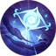

[Тир-лист](https://boostmlbb.ru/heroes/)[Предметы](https://boostmlbb.ru/items/)[Скины](https://boostmlbb.ru/skins/)[Новости и гайды](https://boostmlbb.ru/news/)

[Тир-лист](https://boostmlbb.ru/heroes/)

# Новария

B

МагСредняя линия

Победы

48,3%

Выбор

1,1%

Баны

1,9%

[Обзор](https://boostmlbb.ru/#overview)[Сборка](https://boostmlbb.ru/#build)[Как играть](https://boostmlbb.ru/#howto)[Навыки](https://boostmlbb.ru/#skills)[Контрпики](https://boostmlbb.ru/#draft)[Скины](https://boostmlbb.ru/#skins)[История](https://boostmlbb.ru/#lore)

## Обзор

### Характеристики

-   Живучесть**30**
-   Атака**90**
-   Эффекты**30**
-   Сложность**70**

-   Разрушительный урон
-   Поук

### Победы по рангам, 30 дней

1.  **50,2%**Эпик
2.  **50,0%**Легенда
3.  **49,7%**Мифик
4.  **49,7%**Честь
5.  **48,8%**Слава

Пунктир: 50% побед

### Другие маги этой линии

[Кимми](https://boostmlbb.ru/heroes/kimmy.html)[Эйдора](https://boostmlbb.ru/heroes/eudora.html)[Чжусинь](https://boostmlbb.ru/heroes/zhuxin.html)[Валир](https://boostmlbb.ru/heroes/valir.html)[Цзэтянь](https://boostmlbb.ru/heroes/zetian.html)[Лилия](https://boostmlbb.ru/heroes/lylia.html)[Ксавьер](https://boostmlbb.ru/heroes/xavier.html)[Люнокс](https://boostmlbb.ru/heroes/lunox.html)

### Места в рейтингах

-   [Лучшие маги MLBB**15 из 32**](https://boostmlbb.ru/heroes/best-mage.html)
-   [Лучшие мидеры MLBB**13 из 29**](https://boostmlbb.ru/heroes/best-mid.html)

## Сборка

Сборка 1Сборка 2Сборка 3

Победы

56,0%

Выбор

4,5%

#### Основные предметы

-   [

    

    Пылающий жезл

    ](https://boostmlbb.ru/items/glowing-wand.html)
-   [

    

    Жезл молний

    ](https://boostmlbb.ru/items/lightning-truncheon.html)
-   [

    

    Божественный меч

    ](https://boostmlbb.ru/items/divine-glaive.html)

#### Заклинание

Вспышка

#### Эмблема и таланты

Эмблема мага

-   

    Вдохновение

-   

    Благословение природы

-   

    Нечестивая ярость

Победы

54,0%

Выбор

3,8%

#### Основные предметы

-   [

    

    Пронзающий небеса

    ](https://boostmlbb.ru/items/sky-piercer.html)
-   [

    

    Жезл молний

    ](https://boostmlbb.ru/items/lightning-truncheon.html)
-   [

    

    Священный кристалл

    ](https://boostmlbb.ru/items/holy-crystal.html)

#### Заклинание

Огненный выстрел

#### Эмблема и таланты

Эмблема убийцы

-   

    Разрыв

-   

    Благословение природы

-   

    Нечестивая ярость

Победы

55,3%

Выбор

2,3%

#### Основные предметы

-   [

    

    Пронзающий небеса

    ](https://boostmlbb.ru/items/sky-piercer.html)
-   [

    

    Жезл молний

    ](https://boostmlbb.ru/items/lightning-truncheon.html)
-   [

    

    Священный кристалл

    ](https://boostmlbb.ru/items/holy-crystal.html)

#### Заклинание

Вспышка

#### Эмблема и таланты

Эмблема убийцы

-   

    Разрыв

-   

    Благословение природы

-   

    Нечестивая ярость

## Как играть за Новарию

### Комбо Новарии

#### В драке

1.  Ульт
2.  2
3.  2
4.  1

В драке ультом откройте обзор, вторым создайте звёздную сферу, поймайте и запустите во врага. Первым не подпускайте близко.

#### На линии

1.  2
2.  1
3.  2

На линии вторым навыком ускорьтесь и создайте сферу, первым замедлите и повторным вторым запустите её.

### Когда сильнее всего

Сильнее в долгой игре: после 20-й минуты выигрывает 51,7%. Не рискуйте в начале, фармите и ввязывайтесь в драки вместе с командой.

1.  **47,6**10–12
2.  **48,0**12–14
3.  **48,3**14–16
4.  **49,6**16–18
5.  **50,8**18–20
6.  **51,7**20+

Проценты побед по длине матча в минутах, все ранги. Пунктир: 50%

### Приоритет прокачки

1.  Астральное эхо
2.  Астральное возвращение
3.  Астральный метеорит

## Навыки

Пассивный**Звездный путь**1-й навык**Астральный метеорит**2-й навык**Астральное возвращение**Ультимейт**Астральное эхо**

Пассивный

### Звездный путь

Астральная сфера непрерывно замедляет ближайших врагов на 20% и раскрывает их местоположение.

1-й навык

### Астральный метеорит

Перезарядка **8 Mana Cost: 60 с**

Новария призывает астральную сферу в указанное место, нанося 75 (+25% общей магической силы) единиц магического урона кажд. 0.33 сек. и непрерывно замедляя врагов (до 2.5 р.). Через 2 сек. астральная сфера взрывается, нанося 260 (+50% общей магической силы) (+4% от цели) магического урона и замедляя врагов в 2.5 р.

2-й навык

### Астральное возвращение

Перезарядка **20 Mana Cost: 60 с**

**Первое использование:** Новария призывает астральную сферу на расстоянии и притягивает ее к себе. Она получает 80% скорости передвижения (спадает до 30%) и может проходить сквозь препятствия.

**Повторное использование:** когда астральная сфера достигает Новарии, она может использовать "Звездный осколок", чтобы запустить ее в указанном направлении в течение 5 сек. При попадании во вражеского героя она наносит 260 (+95% общей магической силы) (+5% от цели) единиц магического урона ему и ближайшим героям. Урон будет увеличиваться в зависимости от расстояния полета астральной сферы (во время притягивания и запуска), до 2.2 р. от первоначального урона.

Ультимейт

### Астральное эхо

Перезарядка **48 Mana Cost: 100 с**

Новария распространяет "Астральное эхо" в указанном направлении, ненадолго замедляя пораженных вражеских героев на 50% и накладывая на них астральное кольцо. Это увеличивает их хитбокс в 2.5 р. и раскрывает их местоположение на 5 сек.

## Контрпики Новарии

### Кто контрит Новарию

[Дигги](https://boostmlbb.ru/heroes/diggie.html)[Валир](https://boostmlbb.ru/heroes/valir.html)[Бэйн](https://boostmlbb.ru/heroes/bane.html)[Ханаби](https://boostmlbb.ru/heroes/hanabi.html)[Ло Йи](https://boostmlbb.ru/heroes/luo-yi.html)

## Скины Новарии

[Присяг­нувшая драконуИзысканный · 2025](https://boostmlbb.ru/skins/novaria/dragonsworn.html)[Сахарная глазурьИсключительный · 2024](https://boostmlbb.ru/skins/novaria/sugar-glaze.html)[Тёмная звездаОбычный · 2023](https://boostmlbb.ru/skins/novaria/dark-star.html)

[Все 3 скина Новарии: цены и как получить](https://boostmlbb.ru/skins/novaria.html)

## История

> Молодая девушка, которая стремится восстановить Звездный атлас, чтобы разгадать тайны звезд.

[Читать полную историю ↗](https://play.mobilelegends.com/lore/hero/Novaria)Официальный сайт Mobile Legends [Характеристики на сайте игры ↗](https://www.mobilelegends.com/hero/detail?heroid=119)

**Поднимем ранг на герое «Новария»**Цена считается в калькуляторе

[Рассчитать цену](https://boostmlbb.ru/order.html?type=hero)

## Частые вопросы

Кто контрит Новарию в MLBB?

За последние 30 дней Новарию чаще всего обыгрывают Дигги, Валир, Бэйн, Ханаби и Ло Йи.

Как играть за Новарию?

В первую очередь качайте «Астральное возвращение», ульт берите, как только доступен. Сильнее в долгой игре: после 20-й минуты выигрывает 51,7%. Не рискуйте в начале, фармите и ввязывайтесь в драки вместе с командой. Комбо для драки: В драке ультом откройте обзор, вторым создайте звёздную сферу, поймайте и запустите во врага. Первым не подпускайте близко.

Какой процент побед у Новарии сейчас?

48,29% в Мифической славе за последние 7 дней и 49,43% на всех рангах за 30 дней, данные на 25 ноября 2026 года.

Какая роль и линия у Новарии?

Маг, играет на средней линии.

Стоит ли брать Новарию в текущей мете?

Тир B, 60-е место из 133 героев и 15-е среди магов. Тир учитывает, как часто героя берут и банят и как он выигрывает в Мифической славе за 7 дней: бан в 1,9% матчей, 48,3% побед. В профессиональных матчах за месяц героя драфтуют в 4,5% катков.

Какая сборка на Новарию лучшая?

Самая популярная сборка в рейтинге: ключевые предметы «Пылающий жезл», «Жезл молний» и «Божественный меч», эмблема мага с талантами «Вдохновение», «Благословение природы» и «Нечестивая ярость» и заклинание «Вспышка». С ней выигрывают 55,99% матчей.
