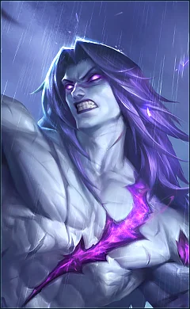

[Тир-лист](https://boostmlbb.ru/heroes/)[Предметы](https://boostmlbb.ru/items/)[Новости и гайды](https://boostmlbb.ru/news/)

# Обсидия

S

СтрелокЛиния золота

Победы

52,6%

Выбор

2,4%

Баны

65,4%

[Обзор](https://boostmlbb.ru/#overview)[Сборка](https://boostmlbb.ru/#build)[Как играть](https://boostmlbb.ru/#howto)[Навыки](https://boostmlbb.ru/#skills)[Контрпики](https://boostmlbb.ru/#draft)[История](https://boostmlbb.ru/#lore)

## Обзор

### Характеристики

-   Живучесть**30**
-   Атака**80**
-   Эффекты**10**
-   Сложность**30**

-   Добивание
-   Урон

### Победы по рангам, 30 дней

1.  **51,7%**Эпик
2.  **52,8%**Легенда
3.  **53,7%**Мифик
4.  **53,8%**Честь
5.  **52,8%**Слава

Пунктир: 50% побед

### Другие стрелки этой линии

[Бруно](https://boostmlbb.ru/heroes/bruno.html)[Клинт](https://boostmlbb.ru/heroes/clint.html)[Броуди](https://boostmlbb.ru/heroes/brody.html)[Ханаби](https://boostmlbb.ru/heroes/hanabi.html)[Москов](https://boostmlbb.ru/heroes/moskov.html)[Клауд](https://boostmlbb.ru/heroes/claude.html)[Мия](https://boostmlbb.ru/heroes/miya.html)[Мелисса](https://boostmlbb.ru/heroes/melissa.html)

### Места в рейтингах

-   [Лучшие стрелки MLBB**1 из 23**](https://boostmlbb.ru/heroes/best-marksman.html)

## Сборка

Сборка 1Сборка 2Сборка 3

Победы

55,3%

Выбор

6,9%

#### Основные предметы

-   [

    

    Говорящий с ветром

    ](https://boostmlbb.ru/items/windtalker.html)
-   [

    

    Когти Хааса

    ](https://boostmlbb.ru/items/haas-claws.html)
-   [

    

    Пронзающий небеса

    ](https://boostmlbb.ru/items/sky-piercer.html)

#### Заклинание

Вспышка

#### Эмблема и таланты

Эмблема бойца

-   

    Проворность

-   

    Охотник за скидками

-   

    Точно в цель

Победы

57,8%

Выбор

4,4%

#### Основные предметы

-   [

    

    Говорящий с ветром

    ](https://boostmlbb.ru/items/windtalker.html)
-   [

    

    Когти Хааса

    ](https://boostmlbb.ru/items/haas-claws.html)
-   [

    

    Пронзающий небеса

    ](https://boostmlbb.ru/items/sky-piercer.html)

#### Заклинание

Эгида

#### Эмблема и таланты

Эмблема бойца

-   

    Проворность

-   

    Охотник за скидками

-   

    Точно в цель

Победы

57,6%

Выбор

2,6%

#### Основные предметы

-   [

    

    Коса коррозии

    ](https://boostmlbb.ru/items/corrosion-scythe.html)
-   [

    

    Пронзающий небеса

    ](https://boostmlbb.ru/items/sky-piercer.html)
-   [

    

    Меч охотника на демонов

    ](https://boostmlbb.ru/items/demon-hunter-sword.html)

#### Заклинание

Вспышка

#### Эмблема и таланты

Эмблема бойца

-   

    Проворность

-   

    Охотник за скидками

-   

    Точно в цель

## Как играть за Обсидию

### Комбо Обсидии

#### В драке

1.  Атака
2.  1
3.  2
4.  Ульт
5.  Атака

В драке тревожьте врага обычными атаками и первым навыком, вторым меняйте позицию. Ищите момент зайти на цель с ультом и забрать её вместе с командой, а потом добивайте остальных за счёт подвижности.

#### На линии

1.  1
2.  2
3.  Ульт
4.  Атака

На линии часто бейте первым навыком по крипам и героям, чтобы быстрее накопить пассивку. Когда у врага мало здоровья, используйте второй навык и ульт и добейте обычными атаками.

### Когда сильнее всего

Сильнее в начале: на 12–14 минутах выигрывает 54,4%. Давите на линии, забирайте объекты и заканчивайте, пока преимущество не растаяло.

1.  **53,6**10–12
2.  **54,4**12–14
3.  **54,0**14–16
4.  **52,7**16–18
5.  **51,5**18–20
6.  **51,5**20+

Проценты побед по длине матча в минутах, все ранги. Пунктир: 50%

### Приоритет прокачки

1.  Охота костей
2.  Призрачное слияние
3.  Игла Бездны

## Навыки

Пассивный**До костей**1-й навык**Игла Бездны**2-й навык**Призрачное слияние**Ультимейт**Охота костей**

Пассивный

### До костей

Обсидия получает энергию костей при нанесении урона. Базовые атаки по юнитам не-героям дают 1 ед. энергии, а по героям или башням — 2 ед. энергии. Навыки дают в 3 р. больше энергии, чем дается от базовых атак против того же типа юнитов. При попадании по монстрам энергия не дается.

Когда энергия костей достигает 30, формируется осколок костей, до 25 штук. Когда Обсидия использует базовые атаки, все осколки костей поражают цель, и каждый наносит (+6% общей физической атаки) единиц физического урона, наследуя 6% эффектов атаки.

Убийство вражеского героя напрямую дает осколки костей (1).

Базовые атаки Обсидии наносят 70 (+70% общей физической атаки) единиц физического урона, наследуя 100% эффектов атаки.

1-й навык

### Игла Бездны

Перезарядка **4.5 Mana Cost: 35 с**

Обсидия запускает "Иглу Бездны", нанося 325 (+80% общей физической атаки) единиц физического урона пораженным врагам и активируя "До костей" на первом пораженном вражеском герое.

2-й навык

### Призрачное слияние

Перезарядка **4.5 Mana Cost: 40 с**

Обсидия погружается в Бездну и входит в форму "Слияния с тенью", получая 500% скорости передвижения на 0.3 сек.

Ультимейт

### Охота костей

Перезарядка **40 Mana Cost: 100 с**

Обсидия стреляет "Костями гнева" в указанном направлении, нанося 125 (+60% дополнительной физической атаки) единиц физического урона, ненадолго оглушая первого пораженного вражеского героя и подтягивая себя к цели. "Кости гнева" привязывают Обсидию к врагу, не позволяя ей отдаляться более чем на 4 ед. Привязанный враг не может использовать навыки мобильности, а его передвижение тащит за собой Обсидию. Обсидия также получает временные заряды осколков костей (5) и щит, равный 200 ед. (+ 25 за каждый заряд осколков костей). Этот эффект длится 3 сек.

Находясь в связке, Обсидия может проходить сквозь препятствия и использовать базовые атаки во время движения. "Призрачное слияние" также усиливается: длительность увеличивается до 1 сек., а перезарядка уменьшается до 33%.

## Контрпики Обсидии

### Кто контрит Обсидию

[Бенедетта](https://boostmlbb.ru/heroes/benedetta.html)[Хелкарт](https://boostmlbb.ru/heroes/helcurt.html)[Алдос](https://boostmlbb.ru/heroes/aldous.html)[Инь](https://boostmlbb.ru/heroes/yin.html)[Наталья](https://boostmlbb.ru/heroes/natalia.html)

### Кого контрит Обсидия

[Мия](https://boostmlbb.ru/heroes/miya.html)[Баксий](https://boostmlbb.ru/heroes/baxia.html)

## История

> Древняя Владычица Бездны, возродившаяся из останков, жаждет сразить Бога тьмы и истребить его Порождения разложения.

[Читать полную историю ↗](https://kazukiofficial.com/stories/obsidia)Kazuki Official, английский [Характеристики на сайте игры ↗](https://www.mobilelegends.com/hero/detail?heroid=130)

**Поднимем ранг на герое «Обсидия»**Цена считается в калькуляторе

[Рассчитать цену](https://boostmlbb.ru/order.html?type=hero)

## Частые вопросы

Кто контрит Обсидию в MLBB?

За последние 30 дней Обсидию чаще всего обыгрывают Бенедетта, Хелкарт, Алдос, Инь и Наталья.

Как играть за Обсидию?

В первую очередь качайте «Призрачное слияние», ульт берите, как только доступен. Сильнее в начале: на 12–14 минутах выигрывает 54,4%. Давите на линии, забирайте объекты и заканчивайте, пока преимущество не растаяло. Комбо для драки: В драке тревожьте врага обычными атаками и первым навыком, вторым меняйте позицию. Ищите момент зайти на цель с ультом и забрать её вместе с командой, а потом добивайте остальных за счёт подвижности.

Какой процент побед у Обсидии сейчас?

52,58% в Мифической славе за последние 7 дней и 53,14% на всех рангах за 30 дней, данные на 25 ноября 2026 года.

Какая роль и линия у Обсидии?

Стрелок, играет на линии золота.

Стоит ли брать Обсидию в текущей мете?

Тир S, 7-е место из 133 героев и 1-е среди стрелков. Тир учитывает, как часто героя берут и банят и как он выигрывает в Мифической славе за 7 дней: бан в 65,4% матчей, 52,6% побед. В профессиональных матчах за месяц героя драфтуют в 44,8% катков.

Какая сборка на Обсидию лучшая?

Самая популярная сборка в рейтинге: ключевые предметы «Говорящий с ветром», «Когти Хааса» и «Пронзающий небеса», эмблема бойца с талантами «Проворность», «Охотник за скидками» и «Точно в цель» и заклинание «Вспышка». С ней выигрывают 55,31% матчей.
