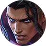
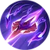
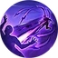

[Тир-лист](https://boostmlbb.ru/heroes/)[Новости и гайды](https://boostmlbb.ru/news/)

# Обсидия

S

СтрелокЛиния золота

Древняя Владычица Бездны, возродившаяся из останков, жаждет сразить Бога тьмы и истребить его Порождения разложения.

Победы

52,6%

все ранги 53,2%

Выбор

2,4%

все ранги 2,2%

Баны

64,8%

все ранги 48,5%

№3 в тир-листе · №1 среди стрелков · Мифическая слава, 7 дней, по 23 ноября

[Обзор](https://boostmlbb.ru/#overview)[Сборка](https://boostmlbb.ru/#build)[Навыки](https://boostmlbb.ru/#skills)[Контрпики](https://boostmlbb.ru/#draft)[История](https://boostmlbb.ru/#lore)

## Обзор

### Характеристики

-   Живучесть**30**
-   Атака**80**
-   Эффекты**10**
-   Сложность**30**

-   Добивание
-   Урон

### Победы по рангам, 30 дней

1.  **51,8%**Эпик
2.  **52,9%**Легенда
3.  **53,8%**Мифик
4.  **53,8%**Честь
5.  **52,9%**Слава

Пунктир: 50% побед

### Другие стрелки этой линии

[Бруно](https://boostmlbb.ru/heroes/bruno.html)[Ханаби](https://boostmlbb.ru/heroes/hanabi.html)[Москов](https://boostmlbb.ru/heroes/moskov.html)[Мия](https://boostmlbb.ru/heroes/miya.html)[Иритель](https://boostmlbb.ru/heroes/irithel.html)[Броуди](https://boostmlbb.ru/heroes/brody.html)[Клинт](https://boostmlbb.ru/heroes/clint.html)[Беатрис](https://boostmlbb.ru/heroes/beatrix.html)

## Сборка

Линия золота · по данным рейтинговых матчей

Сборка 155,3%Сборка 257,8%Сборка 357,6%

### Предметы

Говорящий с ветром

Когти Хааса

Пронзающий небеса

### Эмблема

Эмблема бойца

Проворность

Охотник за скидками

Точно в цель

### Заклинание

Вспышка

Победы

55,3%

Выбор

6,9%

### Предметы

Говорящий с ветром

Когти Хааса

Пронзающий небеса

### Эмблема

Эмблема бойца

Проворность

Охотник за скидками

Точно в цель

### Заклинание

Эгида

Победы

57,8%

Выбор

4,4%

### Предметы

Коса коррозии

Пронзающий небеса

Меч охотника на демонов

### Эмблема

Эмблема бойца

Проворность

Охотник за скидками

Точно в цель

### Заклинание

Вспышка

Победы

57,6%

Выбор

2,6%

## Навыки

Прокачка**Охота костей**_›_**Призрачное слияние**_›_**Игла Бездны**

Пассивный1-й навык2-й навыкУльтимейт

Пассивный

### До костей

Обсидия получает энергию костей при нанесении урона. Базовые атаки по юнитам не-героям дают 1 ед. энергии, а по героям или башням — 2 ед. энергии. Навыки дают в 3 р. больше энергии, чем дается от базовых атак против того же типа юнитов. При попадании по монстрам энергия не дается.

Когда энергия костей достигает 30, формируется осколок костей, до 25 штук. Когда Обсидия использует базовые атаки, все осколки костей поражают цель, и каждый наносит (+6% общей физической атаки) единиц физического урона, наследуя 6% эффектов атаки.

Убийство вражеского героя напрямую дает осколки костей (1).

Базовые атаки Обсидии наносят 70 (+70% общей физической атаки) единиц физического урона, наследуя 100% эффектов атаки.

1-й навык

### Игла Бездны

Перезарядка **4.5 Mana Cost: 35 с**

Обсидия запускает "Иглу Бездны", нанося 325 (+80% общей физической атаки) единиц физического урона пораженным врагам и активируя "До костей" на первом пораженном вражеском герое.

2-й навык

### Призрачное слияние

Перезарядка **4.5 Mana Cost: 40 с**

Обсидия погружается в Бездну и входит в форму "Слияния с тенью", получая 500% скорости передвижения на 0.3 сек.

Ультимейт

### Охота костей

Перезарядка **40 Mana Cost: 100 с**

Обсидия стреляет "Костями гнева" в указанном направлении, нанося 125 (+60% дополнительной физической атаки) единиц физического урона, ненадолго оглушая первого пораженного вражеского героя и подтягивая себя к цели. "Кости гнева" привязывают Обсидию к врагу, не позволяя ей отдаляться более чем на 4 ед. Привязанный враг не может использовать навыки мобильности, а его передвижение тащит за собой Обсидию. Обсидия также получает временные заряды осколков костей (5) и щит, равный 200 ед. (+ 25 за каждый заряд осколков костей). Этот эффект длится 3 сек.

Находясь в связке, Обсидия может проходить сквозь препятствия и использовать базовые атаки во время движения. "Призрачное слияние" также усиливается: длительность увеличивается до 1 сек., а перезарядка уменьшается до 33%.

## Контрпики и союзники

### Контрпики

Побеждают этого героя

[Бенедетта](https://boostmlbb.ru/heroes/benedetta.html)[Хелкарт](https://boostmlbb.ru/heroes/helcurt.html)[Алдос](https://boostmlbb.ru/heroes/aldous.html)[Инь](https://boostmlbb.ru/heroes/yin.html)[Ханзо](https://boostmlbb.ru/heroes/hanzo.html)

### Слабые цели

Этот герой побеждает их

[Мия](https://boostmlbb.ru/heroes/miya.html)[Баксий](https://boostmlbb.ru/heroes/baxia.html)

### Союзники

Рост побед в паре, п. п.

[Харит**+3,6**](https://boostmlbb.ru/heroes/harith.html)[Пополь и Купа**+1,2**](https://boostmlbb.ru/heroes/popol-and-kupa.html)[Фанни**+0,9**](https://boostmlbb.ru/heroes/fanny.html)[Ханзо**+0,6**](https://boostmlbb.ru/heroes/hanzo.html)

## История

> Древняя Владычица Бездны, возродившаяся из останков, жаждет сразить Бога тьмы и истребить его Порождения разложения.

[Читать полную историю ↗](https://kazukiofficial.com/stories/obsidia)Kazuki Official, английский

[Характеристики на сайте игры ↗](https://www.mobilelegends.com/hero/detail?heroid=130)

**Поднимем ранг на герое «Обсидия»**Цена считается в калькуляторе

[Рассчитать цену](https://boostmlbb.ru/order.html?type=hero)

## Частые вопросы

Кто контрпик для героя «Обсидия» в MLBB?

За последние 30 дней чаще всего героя обыгрывают Бенедетта, Хелкарт, Алдос, Инь и Ханзо.

Какой процент побед у героя «Обсидия» сейчас?

52,61% в Мифической славе за последние 7 дней и 53,20% на всех рангах за 30 дней, данные на 23 ноября 2026 года.

Какая роль и линия у героя «Обсидия»?

Стрелок, играет на линии золота.

Силён ли герой «Обсидия» в текущей мете?

Тир S, 3-е место из 133 героев и 1-е среди стрелков. Тир учитывает, как часто героя берут и банят и как он выигрывает в Мифической славе за 7 дней: бан в 64,8% матчей, 52,6% побед.

Какая сборка на героя «Обсидия» лучшая?

Самая популярная сборка в рейтинге: ключевые предметы «Говорящий с ветром», «Когти Хааса» и «Пронзающий небеса», эмблема бойца с талантами «Проворность», «Охотник за скидками» и «Точно в цель» и заклинание «Вспышка». С ней выигрывают 55,31% матчей.
