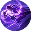

[Главная](https://boostmlbb.ru/) / [Герои](https://boostmlbb.ru/heroes/)

Тир S

# Обсидия

Стрелок · Линия золота

**№ 16 из 133 по доле побед**Все ранги · 30 дней по 23 ноября 2026 года

Победы

53,20%

Выбор

2,20%

Баны

48,46%

Добивание · Урон · Сложность 30/100

[Сборка](https://boostmlbb.ru/#build)[Контрпики и союзники](https://boostmlbb.ru/#draft)[Навыки](https://boostmlbb.ru/#skills)[Победы по рангам](https://boostmlbb.ru/#ranks)[История](https://boostmlbb.ru/#lore)

## Сборка

Самый частый выбор в рейтинге · Линия золота

Ключевые предметы

Говорящий с ветромКогти ХаасаПронзающий небеса

Эмблема и таланты

Эмблема бойцаПроворностьОхотник за скидкамиТочно в цель

Боевое заклинание

Вспышка

Побед с этой сборкой **55,31%**Выбирают в **6,94%** матчей

Другие сборки (2)

Ключевые предметы

Коса коррозииПронзающий небесаМеч охотника на демонов

Эмблема и таланты

Эмблема бойцаПроворностьОхотник за скидкамиТочно в цель

Боевое заклинание

Вспышка

Побед с этой сборкой **57,63%**Выбирают в **2,64%** матчей

Ключевые предметы

Говорящий с ветромКогти ХаасаПронзающий небеса

Эмблема и таланты

Эмблема бойцаПроворностьОхотник за скидкамиТочно в цель

Боевое заклинание

Эгида

Побед с этой сборкой **57,84%**Выбирают в **4,41%** матчей

## Контрпики и союзники

### Кто контрит

[Бенедетта](https://boostmlbb.ru/heroes/benedetta.html)[Хелкарт](https://boostmlbb.ru/heroes/helcurt.html)[Алдос](https://boostmlbb.ru/heroes/aldous.html)[Инь](https://boostmlbb.ru/heroes/yin.html)[Ханзо](https://boostmlbb.ru/heroes/hanzo.html)

### Против кого силён

[Мия](https://boostmlbb.ru/heroes/miya.html)[Баксий](https://boostmlbb.ru/heroes/baxia.html)

### Союзники

Прибавка к доле побед в одной команде

[Харит+3,57 п. п.](https://boostmlbb.ru/heroes/harith.html)[Пополь и Купа+1,23 п. п.](https://boostmlbb.ru/heroes/popol-and-kupa.html)[Фанни+0,86 п. п.](https://boostmlbb.ru/heroes/fanny.html)[Ханзо+0,63 п. п.](https://boostmlbb.ru/heroes/hanzo.html)

## Навыки

Приоритет прокачки · Охота костей → Призрачное слияние → Игла Бездны

Пассивный**До костей**

Обсидия получает энергию костей при нанесении урона. Базовые атаки по юнитам не-героям дают 1 ед. энергии, а по героям или башням — 2 ед. энергии. Навыки дают в 3 р. больше энергии, чем дается от базовых атак против того же типа юнитов. При попадании по монстрам энергия не дается.
Когда энергия костей достигает 30, формируется осколок костей, до 25 штук. Когда Обсидия использует базовые атаки, все осколки костей поражают цель, и каждый наносит (+6% общей физической атаки) единиц физического урона, наследуя 6% эффектов атаки.
Убийство вражеского героя напрямую дает осколки костей (1).
Базовые атаки Обсидии наносят 70 (+70% общей физической атаки) единиц физического урона, наследуя 100% эффектов атаки.

1-й навык**Игла Бездны**

**Перезарядка 4.5 Mana Cost: 35 с**

Обсидия запускает "Иглу Бездны", нанося 325 (+80% общей физической атаки) единиц физического урона пораженным врагам и активируя "До костей" на первом пораженном вражеском герое.

2-й навык**Призрачное слияние**

**Перезарядка 4.5 Mana Cost: 40 с**

Обсидия погружается в Бездну и входит в форму "Слияния с тенью", получая 500% скорости передвижения на 0.3 сек.

Ультимейт**Охота костей**

**Перезарядка 40 Mana Cost: 100 с**

Обсидия стреляет "Костями гнева" в указанном направлении, нанося 125 (+60% дополнительной физической атаки) единиц физического урона, ненадолго оглушая первого пораженного вражеского героя и подтягивая себя к цели. "Кости гнева" привязывают Обсидию к врагу, не позволяя ей отдаляться более чем на 4 ед. Привязанный враг не может использовать навыки мобильности, а его передвижение тащит за собой Обсидию. Обсидия также получает временные заряды осколков костей (5) и щит, равный 200 ед. (+ 25 за каждый заряд осколков костей). Этот эффект длится 3 сек.
Находясь в связке, Обсидия может проходить сквозь препятствия и использовать базовые атаки во время движения. "Призрачное слияние" также усиливается: длительность увеличивается до 1 сек., а перезарядка уменьшается до 33%.

## Победы по рангам

-   Эпик**51,80%**
-   Легенда**52,91%**
-   Мифический**53,79%**
-   Мифическая честь**53,82%**
-   Мифическая слава**52,89%**

## История

Древняя Владычица Бездны, возродившаяся из останков, жаждет сразить Бога тьмы и истребить его Порождения разложения.

[Карточка героя](https://www.mobilelegends.com/hero/detail?heroid=130)[MLBB Wiki](https://mobile-legends.fandom.com/wiki/Obsidia)

[Стоимость буста на герое](https://boostmlbb.ru/order.html?type=hero)

## Частые вопросы

Кто контрпик для героя «Обсидия» в MLBB?

За последние 30 дней чаще всего героя обыгрывают Бенедетта, Хелкарт, Алдос, Инь и Ханзо.

Какой процент побед у героя «Обсидия» сейчас?

53,20% за последние 30 дней на всех рангах и 52,89% в Мифической славе, данные на 23 ноября 2026 года.

Какая роль и линия у героя «Обсидия»?

Стрелок, играет на линии золота.

Силён ли герой «Обсидия» в текущей мете?

Тир S: 16-е место из 133 героев по проценту побед за 30 дней и 2-е среди стрелков.

Какая сборка на героя «Обсидия» лучшая?

Самая популярная сборка в рейтинге: ключевые предметы «Говорящий с ветром», «Когти Хааса» и «Пронзающий небеса», эмблема бойца с талантами «Проворность», «Охотник за скидками» и «Точно в цель» и заклинание «Вспышка». С ней выигрывают 55,31% матчей.
