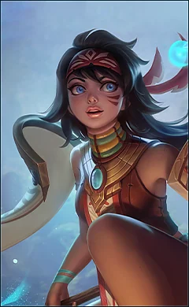

[Тир-лист](https://boostmlbb.ru/heroes/)[Предметы](https://boostmlbb.ru/items/)[Скины](https://boostmlbb.ru/skins/)[Новости и гайды](https://boostmlbb.ru/news/)

# Одетта

C

МагСредняя линия

Победы

51,1%

Выбор

0,4%

Баны

0,1%

[Обзор](https://boostmlbb.ru/#overview)[Сборка](https://boostmlbb.ru/#build)[Как играть](https://boostmlbb.ru/#howto)[Навыки](https://boostmlbb.ru/#skills)[Контрпики](https://boostmlbb.ru/#draft)[Скины](https://boostmlbb.ru/#skins)[История](https://boostmlbb.ru/#lore)

## Обзор

### Характеристики

-   Живучесть**30**
-   Атака**100**
-   Эффекты**70**
-   Сложность**30**

-   Разрушительный урон
-   Поук

### Победы по рангам, 30 дней

1.  **47,9%**Эпик
2.  **48,5%**Легенда
3.  **49,5%**Мифик
4.  **49,5%**Честь
5.  **51,5%**Слава

Пунктир: 50% побед

### Другие маги этой линии

[Кимми](https://boostmlbb.ru/heroes/kimmy.html)[Эйдора](https://boostmlbb.ru/heroes/eudora.html)[Чжусинь](https://boostmlbb.ru/heroes/zhuxin.html)[Валир](https://boostmlbb.ru/heroes/valir.html)[Цзэтянь](https://boostmlbb.ru/heroes/zetian.html)[Лилия](https://boostmlbb.ru/heroes/lylia.html)[Ксавьер](https://boostmlbb.ru/heroes/xavier.html)[Люнокс](https://boostmlbb.ru/heroes/lunox.html)

### Места в рейтингах

-   [Лучшие маги MLBB**23 из 32**](https://boostmlbb.ru/heroes/best-mage.html)
-   [Лучшие мидеры MLBB**21 из 29**](https://boostmlbb.ru/heroes/best-mid.html)

## Сборка

Сборка 1Сборка 2Сборка 3

Победы

52,3%

Выбор

5,6%

#### Основные предметы

-   [

    

    Палочка гения

    ](https://boostmlbb.ru/items/genius-wand.html)
-   [

    

    Божественный меч

    ](https://boostmlbb.ru/items/divine-glaive.html)
-   [

    

    Зимняя корона

    ](https://boostmlbb.ru/items/winter-crown.html)

#### Заклинание

Вспышка

#### Эмблема и таланты

Эмблема убийцы

-   

    Разрыв

-   

    Мастер оружий

-   

    Нечестивая ярость

Победы

57,2%

Выбор

3,7%

#### Основные предметы

-   [

    

    Палочка гения

    ](https://boostmlbb.ru/items/genius-wand.html)
-   [

    

    Пронзающий небеса

    ](https://boostmlbb.ru/items/sky-piercer.html)
-   [

    

    Священный кристалл

    ](https://boostmlbb.ru/items/holy-crystal.html)

#### Заклинание

Вспышка

#### Эмблема и таланты

Эмблема убийцы

-   

    Разрыв

-   

    Охотник за скидками

-   

    Смертельное воспламенение

Победы

56,1%

Выбор

1,4%

#### Основные предметы

-   [

    

    Палочка гения

    ](https://boostmlbb.ru/items/genius-wand.html)
-   [

    

    Пылающий жезл

    ](https://boostmlbb.ru/items/glowing-wand.html)
-   [

    

    Священный кристалл

    ](https://boostmlbb.ru/items/holy-crystal.html)

#### Заклинание

Вспышка

#### Эмблема и таланты

Эмблема мага

-   

    Разрыв

-   

    Мастер оружий

-   

    Смертельное воспламенение

## Как играть за Одетту

### Комбо Одетты

#### В драке

1.  2
2.  Ульт
3.  Ульт
4.  1

В драке обездвижьте вторым навыком и ультом бейте удерживаемые цели. Когда враги убегают, рывком из ульта смените позицию, после него добейте первым.

#### На линии

1.  1
2.  2
3.  Ульт

На линии тревожьте первым, в нужный момент обездвижьте вторым и добейте ультом.

### Когда сильнее всего

Сила ровная всю игру, от 49,3% до 51,0%. Выбирайте драки по готовым предметам, а не по минутам.

1.  **49,3**10–12
2.  **50,0**12–14
3.  **51,0**14–16
4.  **50,3**16–18
5.  **50,1**18–20
6.  **49,8**20+

Проценты побед по длине матча в минутах, все ранги. Пунктир: 50%

### Приоритет прокачки

1.  Лебединая песня
2.  Лебединое крыло
3.  Синяя звезда

## Навыки

Пассивный**Песня озера**1-й навык**Лебединое крыло**2-й навык**Синяя звезда**Ультимейт**Лебединая песня**

Пассивный

### Песня озера

В течение 8 сек. после применения навыка следующая базовая атака Одетты получает дополнительную дальность и отскакивает между врагами (или врагом и ею самой), нанося 144-200 (+50% общей магической силы) единиц магического урона за каждое попадание.

Навыки Одетты также активируют этот эффект при попадании (до 3 зарядов).

1-й навык

### Лебединое крыло

Перезарядка **6 Mana Cost: 65 с**

Одетта выпускает волшебного лебедя в указанном направлении, нанося 300 (+150% общей магической силы) единиц магического урона пораженным врагам и замедляя их на 30% на 2 сек.

2-й навык

### Синяя звезда

Перезарядка **12 Mana Cost: 75 с**

Одетта выпускает группу энергетических шаров в указанном направлении, нанося 250 (+50% общей магической силы) единиц магического урона первому пораженному врагу и обездвиживая его на 1.5 сек.

При попадании во врага шар создает еще один шар, который атакует ближайшего врага (приоритет — вражеские герои), нанося 250 (+50% общей магической силы) единиц магического урона и обездвиживая его на 1.5 сек.

Ультимейт

### Лебединая песня

Перезарядка **50 Mana Cost: 160 с**

Одетта исполняет танец, получая щит, равный 1200 (+150% общей магической силы), и нанося до 2000 (+750% общей магической силы) единиц магического урона ближайшим врагам в большой области в течение 5 сек. В это время ее скорость передвижения снижена на 40%, но она может свободно перемещаться.

Используйте снова, чтобы отменить. Только эффекты контроля высокого уровня могут прервать этот навык.

## Контрпики Одетты

### Кто контрит Одетту

[Кайя](https://boostmlbb.ru/heroes/kaja.html)[Матильда](https://boostmlbb.ru/heroes/mathilda.html)[Фарамис](https://boostmlbb.ru/heroes/faramis.html)[Чип](https://boostmlbb.ru/heroes/chip.html)[Марсель](https://boostmlbb.ru/heroes/marcel.html)

### Кого контрит Одетта

[Лейла](https://boostmlbb.ru/heroes/layla.html)[Нана](https://boostmlbb.ru/heroes/nana.html)[Вексана](https://boostmlbb.ru/heroes/vexana.html)[Альфа](https://boostmlbb.ru/heroes/alpha.html)[Тамуз](https://boostmlbb.ru/heroes/thamuz.html)[Джулиан](https://boostmlbb.ru/heroes/julian.html)[Аврора](https://boostmlbb.ru/heroes/aurora.html)[Гатоткача](https://boostmlbb.ru/heroes/gatotkaca.html)[Вэйл](https://boostmlbb.ru/heroes/vale.html)[Тэризла](https://boostmlbb.ru/heroes/terizla.html)

## Скины Одетты

[Песнь предан­ностиИзысканный · 2026](https://boostmlbb.ru/skins/odette/song-of-devotion.html)[Мудрость звёздИсключительный · 2024](https://boostmlbb.ru/skins/odette/wisdom-of-the-stars.html)[Мудрица теченийДелюкс · 2020](https://boostmlbb.ru/skins/odette/sage-of-the-currents.html)[Благая удачаИсключительный · 2019](https://boostmlbb.ru/skins/odette/auspicious-charm.html)[ДеваДелюкс · 2019](https://boostmlbb.ru/skins/odette/virgo.html)[Принцесса-русалкаИзысканный · 2018](https://boostmlbb.ru/skins/odette/mermaid-princess.html)[Богиня-бабочкаИсключительный · 2018](https://boostmlbb.ru/skins/odette/butterfly-goddess.html)[Рож­дественский карнавалИсключительный · 2018](https://boostmlbb.ru/skins/odette/christmas-carnival.html)[Чёрный лебедьОбычный · 2017](https://boostmlbb.ru/skins/odette/black-swan.html)

[Все 9 скинов Одетты: цены и как получить](https://boostmlbb.ru/skins/odette.html)

## История

> Невинная принцесса, выросшая в Лебедином замке, и гениальная волшебница, превосходно владеющая мечом и скипетром.

[Читать полную историю ↗](https://play.mobilelegends.com/lore/hero/Odette)Официальный сайт Mobile Legends [Характеристики на сайте игры ↗](https://www.mobilelegends.com/hero/detail?heroid=46)

**Поднимем ранг на герое «Одетта»**Цена считается в калькуляторе

[Рассчитать цену](https://boostmlbb.ru/order.html?type=hero)

## Частые вопросы

Кто контрит Одетту в MLBB?

За последние 30 дней Одетту чаще всего обыгрывают Кайя, Матильда, Фарамис, Чип и Марсель.

Как играть за Одетту?

В первую очередь качайте «Лебединое крыло», ульт берите, как только доступен. Сила ровная всю игру, от 49,3% до 51,0%. Выбирайте драки по готовым предметам, а не по минутам. Комбо для драки: В драке обездвижьте вторым навыком и ультом бейте удерживаемые цели. Когда враги убегают, рывком из ульта смените позицию, после него добейте первым.

Какой процент побед у Одетты сейчас?

51,15% в Мифической славе за последние 7 дней и 49,73% на всех рангах за 30 дней, данные на 25 ноября 2026 года.

Какая роль и линия у Одетты?

Маг, играет на средней линии.

Стоит ли брать Одетту в текущей мете?

Тир C, 96-е место из 133 героев и 23-е среди магов. Тир учитывает, как часто героя берут и банят и как он выигрывает в Мифической славе за 7 дней: бан в 0,1% матчей, 51,1% побед. В профессиональных матчах за месяц героя драфтуют в 0,0% катков.

Какая сборка на Одетту лучшая?

Самая популярная сборка в рейтинге: ключевые предметы «Палочка гения», «Божественный меч» и «Зимняя корона», эмблема убийцы с талантами «Разрыв», «Мастер оружий» и «Нечестивая ярость» и заклинание «Вспышка». С ней выигрывают 52,27% матчей.
