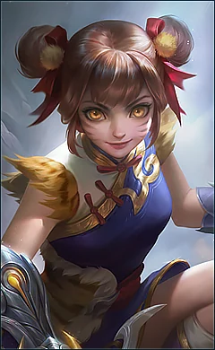

[Тир-лист](https://boostmlbb.ru/heroes/)

# Пакито

A

БоецУбийцаЛиния опытаЛес

Победы

50,2%

Выбор

1,4%

Баны

10,3%

[Обзор](https://boostmlbb.ru/#overview)[Сборка](https://boostmlbb.ru/#build)[Как играть](https://boostmlbb.ru/#howto)[Навыки](https://boostmlbb.ru/#skills)[Контрпики](https://boostmlbb.ru/#draft)[Скины](https://boostmlbb.ru/#skins)[История](https://boostmlbb.ru/#lore)

## Обзор

### Характеристики

-   Живучесть**60**
-   Атака**50**
-   Эффекты**40**
-   Сложность**90**

-   Преследование
-   Урон

### Другие бойцы этой линии

[Фрейя](https://boostmlbb.ru/heroes/freya.html)[Аулус](https://boostmlbb.ru/heroes/aulus.html)[Сан](https://boostmlbb.ru/heroes/sun.html)[Су Ё](https://boostmlbb.ru/heroes/suyou.html)[Лукас](https://boostmlbb.ru/heroes/lukas.html)[Чичи](https://boostmlbb.ru/heroes/cici.html)[Сора](https://boostmlbb.ru/heroes/sora.html)[Чонг](https://boostmlbb.ru/heroes/yu-zhong.html)

### Места в рейтингах

-   [Лучшие лесники MLBB**5 из 37**](https://boostmlbb.ru/heroes/best-jungle.html)
-   [Лучшие бойцы MLBB**5 из 44**](https://boostmlbb.ru/heroes/best-fighter.html)
-   [Лучшие убийцы MLBB**3 из 29**](https://boostmlbb.ru/heroes/best-assassin.html)

## Сборка

Сборка 1Сборка 2Сборка 3

Победы

53,5%

Выбор

5,7%

#### Основные предметы

-   [

    

    Удар охотника

    ](https://boostmlbb.ru/items/hunter-strike.html)
-   [

    

    Трезубец

    ](https://boostmlbb.ru/items/sea-halberd.html)
-   [

    

    Злобный рык

    ](https://boostmlbb.ru/items/malefic-roar.html)

#### Заклинание

Вспышка

#### Эмблема и таланты

Эмблема убийцы

-   

    Разрыв

-   

    Мастер-убийца

-   

    Смертельное воспламенение

Победы

56,2%

Выбор

5,7%

#### Основные предметы

-   [

    

    Удар охотника

    ](https://boostmlbb.ru/items/hunter-strike.html)
-   [

    

    Пронзающий небеса

    ](https://boostmlbb.ru/items/sky-piercer.html)
-   [

    

    Злобный рык

    ](https://boostmlbb.ru/items/malefic-roar.html)

#### Заклинание

Вспышка

#### Эмблема и таланты

Эмблема убийцы

-   

    Разрыв

-   

    Мастер-убийца

-   

    Смертельное воспламенение

Победы

58,2%

Выбор

2,6%

#### Основные предметы

-   [

    

    Удар охотника

    ](https://boostmlbb.ru/items/hunter-strike.html)
-   [

    

    Пронзающий небеса

    ](https://boostmlbb.ru/items/sky-piercer.html)
-   [

    

    Злобный рык

    ](https://boostmlbb.ru/items/malefic-roar.html)

#### Заклинание

Вспышка

#### Эмблема и таланты

Эмблема убийцы

-   

    Разрыв

-   

    Кровавое пиршество

-   

    Смертельное воспламенение

## Как играть за Пакито

### Комбо Пакито

#### В драке

1.  2
2.  1
3.  Ульт
4.  2

В драке подойдите вторым навыком, ударьте первым и ультом отбросьте врага, перейдя в стойку чемпиона. Закончите усиленным вторым.

#### На линии

1.  1
2.  2
3.  1
4.  2

На линии первым навыком накопите заряд стойки, вторым подойдите, снова первым наберите стойку и ударьте усиленным вторым.

### Когда сильнее всего

Сильнее в начале: на 10–12 минутах выигрывает 51,3%. Давите на линии, забирайте объекты и заканчивайте, пока преимущество не растаяло.

1.  **51,3**10–12
2.  **50,2**12–14
3.  **49,4**14–16
4.  **49,4**16–18
5.  **49,0**18–20
6.  **49,4**20+

Проценты побед по длине матча в минутах, все ранги. Пунктир: 50%

### Приоритет прокачки

1.  Нокаутирующий удар
2.  Внезапный удар
3.  Мощный удар левой

## Навыки

Пассивный**Стойка чемпиона**1-й навык**Мощный удар левой**2-й навык**Внезапный удар**Ультимейт**Нокаутирующий удар**

Пассивный

### Стойка чемпиона

Каждый раз при применении навыка Пакито получает заряд. При накоплении 3 зарядов он переходит в "Стойку чемпиона" и усиливает свой следующий навык.

Усиленные навыки Пакито не имеют перезарядки и наносят на (+2 × ур. героя)% больше урона миньонам.

После применения любого усиленного навыка Пакито получает 60% скорости передвижения и (+2 × ур. героя)% снижения урона на 1.2 сек.

1-й навык

### Мощный удар левой

Перезарядка **7 с**

Пакито совершает удар в указанном направлении, нанося 210 (+50% общей физической атаки) единиц физического урона пораженным врагам и получая 150 (+135% общей физической атаки) ед. щита.

**Стойка чемпиона:** урон увеличивается до 350 (+100% общей физической атаки) единиц физического урона, а величина щита увеличивается до 140% на 2.5 сек. (обычный и усиленный щиты могут складываться).

2-й навык

### Внезапный удар

Перезарядка **7 с**

Пакито совершает рывок вперед и наносит внезапный удар, нанося 200 (+165% общей физической атаки) единиц физического урона врагам на своем пути и в точке назначения.

**Стойка чемпиона:** внезапный удар Пакито становится свирепее, нанося 300 (+210% общей физической атаки) единиц физического урона пораженным врагам.

Внезапный удар останавливается при попадании по герою или монстру.

Ультимейт

### Нокаутирующий удар

Перезарядка **15 с**

Пакито совершает удар локтем по врагам в указанном направлении, нанося 250 (+50% общей физической атаки) единиц физического урона и отталкивая их в точку назначения.

Затем он совершает финальный удар, нанося 300 (+90% общей физической атаки) единиц физического урона и замедляя их на 75% на 1 сек., прежде чем отпрыгнуть назад.

**Стойка чемпиона:** после отталкивания врагов в точку назначения Пакито вместо финального удара бьет апперкотом, нанося 400 (+120% общей физической атаки) единиц физического урона и подбрасывая их на 0.5 сек.

## Контрпики Пакито

### Кто контрит Пакито

[Наталья](https://boostmlbb.ru/heroes/natalia.html)[Икс.Борг](https://boostmlbb.ru/heroes/x-borg.html)[Карина](https://boostmlbb.ru/heroes/karina.html)[Бенедетта](https://boostmlbb.ru/heroes/benedetta.html)[Ванван](https://boostmlbb.ru/heroes/wanwan.html)

## Скины Пакито

[Кулак славыДелюкс · 2024](https://boostmlbb.ru/skins/paquito/fist-of-glory.html)[Терри БогардГрандиозный · 2024](https://boostmlbb.ru/skins/paquito/terry-bogard.html)[Пылающий тигрИзысканный · 2023](https://boostmlbb.ru/skins/paquito/blazing-tiger.html)[Кулак светаИсключительный · 2022](https://boostmlbb.ru/skins/paquito/fist-of-light.html)[Сверкающий ударИсключительный · 2022](https://boostmlbb.ru/skins/paquito/fulgent-punch.html)[Подпольный боксёрИсключительный · 2021](https://boostmlbb.ru/skins/paquito/underground-boxer.html)[Мэнни ПакьяоДелюкс · 2021](https://boostmlbb.ru/skins/paquito/manny-pacquiao.html)[Смер­тельный ударОбычный · 2021](https://boostmlbb.ru/skins/paquito/death-blow.html)

[Все 8 скинов Пакито: цены и как получить](https://boostmlbb.ru/skins/paquito.html)

## История

> Смертный герой, сражающийся с демонами одними лишь кулаками и стальной волей, чтобы защитить свое племя.

[Читать полную историю ↗](https://play.mobilelegends.com/lore/hero/Paquito)Официальный сайт Mobile Legends [Характеристики на сайте игры ↗](https://www.mobilelegends.com/hero/detail?heroid=103)

**Поднимем ранг на герое «Пакито»**Цена считается в калькуляторе

[Рассчитать цену](https://boostmlbb.ru/order.html?type=hero)

## Частые вопросы

Кто контрит Пакито в MLBB?

За последние 30 дней Пакито чаще всего обыгрывают Наталья, Икс.Борг, Карина, Бенедетта и Ванван.

Как играть за Пакито?

В первую очередь качайте «Внезапный удар», ульт берите, как только доступен. Сильнее в начале: на 10–12 минутах выигрывает 51,3%. Давите на линии, забирайте объекты и заканчивайте, пока преимущество не растаяло. Комбо для драки: В драке подойдите вторым навыком, ударьте первым и ультом отбросьте врага, перейдя в стойку чемпиона. Закончите усиленным вторым.

Какой процент побед у Пакито сейчас?

50,16% в Мифической славе за последние 7 дней и 49,99% на всех рангах за 30 дней, данные на 27 ноября 2026 года.

Какая роль и линия у Пакито?

Боец и убийца, играет на линии опыта или в лесу.

Стоит ли брать Пакито в текущей мете?

Тир A, 11-е место из 133 героев и 5-е среди бойцов. Тир учитывает, как часто героя берут и банят и как он выигрывает в Мифической славе за 7 дней: бан в 10,3% матчей, 50,2% побед. В профессиональных матчах за месяц героя драфтуют в 69,3% катков.

Какая сборка на Пакито лучшая?

Самая популярная сборка в рейтинге: ключевые предметы «Удар охотника», «Трезубец» и «Злобный рык», эмблема убийцы с талантами «Разрыв», «Мастер-убийца» и «Смертельное воспламенение» и заклинание «Вспышка». С ней выигрывают 53,54% матчей.
