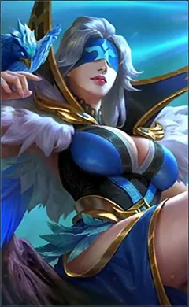

[Тир-лист](https://boostmlbb.ru/heroes/)[Предметы](https://boostmlbb.ru/items/)[Скины](https://boostmlbb.ru/skins/)[Новости и гайды](https://boostmlbb.ru/news/)

[Тир-лист](https://boostmlbb.ru/heroes/)

# Фаша

D

МагСредняя линия

Победы

46,6%

Выбор

0,2%

Баны

0,0%

[Обзор](https://boostmlbb.ru/#overview)[Сборка](https://boostmlbb.ru/#build)[Как играть](https://boostmlbb.ru/#howto)[Навыки](https://boostmlbb.ru/#skills)[Контрпики](https://boostmlbb.ru/#draft)[Скины](https://boostmlbb.ru/#skins)[История](https://boostmlbb.ru/#lore)

## Обзор

### Характеристики

-   Живучесть**20**
-   Атака**90**
-   Эффекты**50**
-   Сложность**50**

-   Разрушительный урон
-   Поук

### Победы по рангам, 30 дней

1.  **48,0%**Эпик
2.  **47,4%**Легенда
3.  **47,1%**Мифик
4.  **46,9%**Честь
5.  **47,0%**Слава

Пунктир: 50% побед

### Другие маги этой линии

[Кимми](https://boostmlbb.ru/heroes/kimmy.html)[Эйдора](https://boostmlbb.ru/heroes/eudora.html)[Чжусинь](https://boostmlbb.ru/heroes/zhuxin.html)[Валир](https://boostmlbb.ru/heroes/valir.html)[Цзэтянь](https://boostmlbb.ru/heroes/zetian.html)[Лилия](https://boostmlbb.ru/heroes/lylia.html)[Ксавьер](https://boostmlbb.ru/heroes/xavier.html)[Люнокс](https://boostmlbb.ru/heroes/lunox.html)

### Места в рейтингах

-   [Лучшие маги MLBB**31 из 32**](https://boostmlbb.ru/heroes/best-mage.html)
-   [Лучшие мидеры MLBB**28 из 29**](https://boostmlbb.ru/heroes/best-mid.html)

## Сборка

Сборка 1Сборка 2Сборка 3

Победы

51,8%

Выбор

4,7%

#### Основные предметы

-   [

    

    Божественный меч

    ](https://boostmlbb.ru/items/divine-glaive.html)
-   [

    

    Жезл молний

    ](https://boostmlbb.ru/items/lightning-truncheon.html)
-   [

    

    Пылающий жезл

    ](https://boostmlbb.ru/items/glowing-wand.html)

#### Заклинание

Вспышка

#### Эмблема и таланты

Эмблема убийцы

-   

    Разрыв

-   

    Мастер оружий

-   

    Смертельное воспламенение

Победы

53,1%

Выбор

3,2%

#### Основные предметы

-   [

    

    Пылающий жезл

    ](https://boostmlbb.ru/items/glowing-wand.html)
-   [

    

    Жезл молний

    ](https://boostmlbb.ru/items/lightning-truncheon.html)
-   [

    

    Кровавые крылья

    ](https://boostmlbb.ru/items/blood-wings.html)

#### Заклинание

Вспышка

#### Эмблема и таланты

Эмблема мага

-   

    Разрыв

-   

    Мастер оружий

-   

    Смертельное воспламенение

Победы

52,2%

Выбор

2,4%

#### Основные предметы

-   [

    

    Пылающий жезл

    ](https://boostmlbb.ru/items/glowing-wand.html)
-   [

    

    Жезл молний

    ](https://boostmlbb.ru/items/lightning-truncheon.html)
-   [

    

    Кровавые крылья

    ](https://boostmlbb.ru/items/blood-wings.html)

#### Заклинание

Огненный выстрел

#### Эмблема и таланты

Эмблема мага

-   

    Разрыв

-   

    Мастер оружий

-   

    Смертельное воспламенение

## Как играть за Фашу

### Комбо Фаши

#### В драке

1.  Ульт
2.  1
3.  3
4.  2
5.  3

Четвёртым навыком займите удобную позицию для начала драки, затем связка первого и третьего, а второй добавляйте для урона.

#### На линии

1.  1
2.  2
3.  3

Начните с первого навыка с меткой, вторым дайте контроль и ультом нанесите огромный магический урон.

### Когда сильнее всего

Сильнее в долгой игре: после 20-й минуты выигрывает 48,9%. Не рискуйте в начале, фармите и ввязывайтесь в драки вместе с командой.

1.  **44,5**10–12
2.  **46,3**12–14
3.  **47,5**14–16
4.  **47,7**16–18
5.  **48,0**18–20
6.  **48,9**20+

Проценты побед по длине матча в минутах, все ранги. Пунктир: 50%

### Приоритет прокачки

1.  Удар с воздуха
2.  Энергетический импульс
3.  Проклятие вороны

## Навыки

Пассивный**Духовное единство**1-й навык**Проклятие вороны**2-й навык**Энергетический импульс** 3-й навык**Удар с воздуха**Ультимейт**Крылом к крылу**

Пассивный

### Духовное единство

Кажд. 5-8 сек. (в зависимости от уровня "Удара с воздуха") Верри переходит в режим охотника. При следующей атаке Фаши против вражеского героя Верри наносит дополнительный магический урон, равный 8% от цели (+1% за каждые 200 ), и замедляет ее на 60% на 1 сек.

1-й навык

### Проклятие вороны

Перезарядка **8 Mana Cost: 60 с**

Фаша совершает магический удар по указанной области, нанося 300 (+120% общей магической силы) единиц магического урона пораженным врагам и отмечая их на 4 сек.

Когда Фаша попадает по отмеченному врагу базовой атакой или активным навыком, метка расходуется, оглушая его на 1 сек.

Местоположение отмеченных врагов будет раскрыто.

2-й навык

### Энергетический импульс

Перезарядка **6.5 Mana Cost: 60 с**

Фаша высвобождает магическую энергию в указанном направлении, нанося 475 (+145% общей магической силы) единиц магического урона пораженным врагам.

3-й навык

### Удар с воздуха

Перезарядка **36 Mana Cost: 120 с**

**Пассивный:** Каждое повышение уровня уменьшает интервал "Духовного единства" на 1 сек.

**Активный:** Фаша взлетает на 8 сек. и атакует указанную область, нанося 530 (+160% общей магической силы) единиц магического урона врагам в ней. Этот навык можно использовать до 4 раз за время полета.

Ультимейт

### Крылом к крылу

Перезарядка **23 с**

Фаша превращается в туман вокруг Верри, получая дополнительно 150% скорости передвижения (спадает со временем) и способность летать над ландшафтом в течение 5 сек.

Это состояние немедленно заканчивается, если она попадает под контроль, использует базовую атаку или навык.

## Контрпики Фаши

### Кто контрит Фашу

[Лолита](https://boostmlbb.ru/heroes/lolita.html)[Дигги](https://boostmlbb.ru/heroes/diggie.html)[Мелисса](https://boostmlbb.ru/heroes/melissa.html)[Ив](https://boostmlbb.ru/heroes/yve.html)[Валир](https://boostmlbb.ru/heroes/valir.html)

## Скины Фаши

[Фаша NeobeastГрандиозный · 2025](https://boostmlbb.ru/skins/pharsa/neobeast-pharsa.html)[Неоновое новолуниеДелюкс · 2023](https://boostmlbb.ru/skins/pharsa/neon-shingetsu.html)[ИерофантДелюкс · 2022](https://boostmlbb.ru/skins/pharsa/hierophant.html)[Муза самбыИсключительный · 2022](https://boostmlbb.ru/skins/pharsa/samba-muse.html)[Цветение пионаИсключительный · 2021](https://boostmlbb.ru/skins/pharsa/peony-bloom.html)[Импе­ратрица-фениксИзысканный · 2020](https://boostmlbb.ru/skins/pharsa/empress-phoenix.html)[Чарующая ведьмаОбычный · 2019](https://boostmlbb.ru/skins/pharsa/enchanting-witch.html)[Лётчица индигоОбычный · 2019](https://boostmlbb.ru/skins/pharsa/indigo-aviatrix.html)[Танец павлинаОбычный · 2018](https://boostmlbb.ru/skins/pharsa/peafowl-s-dance.html)[Крылья небесОбычный · 2017](https://boostmlbb.ru/skins/pharsa/wings-of-heaven.html)

[Все 10 скинов Фаши: цены и как получить](https://boostmlbb.ru/skins/pharsa.html)

## История

> Принцесса ворон из леса Аскати.

[Читать полную историю ↗](https://kazukiofficial.com/stories/pharsa)Kazuki Official, английский [Характеристики на сайте игры ↗](https://www.mobilelegends.com/hero/detail?heroid=52)

**Поднимем ранг на герое «Фаша»**Цена считается в калькуляторе

[Рассчитать цену](https://boostmlbb.ru/order.html?type=hero)

## Частые вопросы

Кто контрит Фашу в MLBB?

За последние 30 дней Фашу чаще всего обыгрывают Лолита, Дигги, Мелисса, Ив и Валир.

Как играть за Фашу?

В первую очередь качайте «Удар с воздуха», ульт берите, как только доступен. Сильнее в долгой игре: после 20-й минуты выигрывает 48,9%. Не рискуйте в начале, фармите и ввязывайтесь в драки вместе с командой. Комбо для драки: Четвёртым навыком займите удобную позицию для начала драки, затем связка первого и третьего, а второй добавляйте для урона.

Какой процент побед у Фаши сейчас?

46,65% в Мифической славе за последние 7 дней и 47,18% на всех рангах за 30 дней, данные на 26 ноября 2026 года.

Какая роль и линия у Фаши?

Маг, играет на средней линии.

Стоит ли брать Фашу в текущей мете?

Тир D, 123-е место из 133 героев и 31-е среди магов. Тир учитывает, как часто героя берут и банят и как он выигрывает в Мифической славе за 7 дней: бан в 0,0% матчей, 46,6% побед. В профессиональных матчах за месяц героя драфтуют в 0,6% катков.

Какая сборка на Фашу лучшая?

Самая популярная сборка в рейтинге: ключевые предметы «Божественный меч», «Жезл молний» и «Пылающий жезл», эмблема убийцы с талантами «Разрыв», «Мастер оружий» и «Смертельное воспламенение» и заклинание «Вспышка». С ней выигрывают 51,81% матчей.
