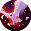
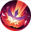
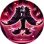

[Главная](https://boostmlbb.ru/) / [Герои](https://boostmlbb.ru/heroes/)

Тир C

# Фаша

Маг · Средняя линия

**№ 117 из 133 по доле побед**Все ранги · 30 дней по 23 ноября 2026 года

Победы

47,26%

Выбор

0,32%

Баны

0,18%

Разрушительный урон · Поук · Сложность 50/100

[Сборка](https://boostmlbb.ru/#build)[Контрпики и союзники](https://boostmlbb.ru/#draft)[Навыки](https://boostmlbb.ru/#skills)[Победы по рангам](https://boostmlbb.ru/#ranks)[История](https://boostmlbb.ru/#lore)

## Сборка

Самый частый выбор в рейтинге · Средняя линия

Ключевые предметы

Пылающий жезлЖезл молнийКровавые крылья

Эмблема и таланты

Эмблема магаРазрывМастер оружийСмертельное воспламенение

Боевое заклинание

Вспышка

Побед с этой сборкой **53,44%**Выбирают в **2,95%** матчей

Другие сборки (2)

Ключевые предметы

Божественный мечЖезл молнийПылающий жезл

Эмблема и таланты

Эмблема убийцыРазрывМастер оружийСмертельное воспламенение

Боевое заклинание

Вспышка

Побед с этой сборкой **52,00%**Выбирают в **4,25%** матчей

Ключевые предметы

Пылающий жезлЖезл молнийКровавые крылья

Эмблема и таланты

Эмблема магаРазрывМастер оружийСмертельное воспламенение

Боевое заклинание

Огненный выстрел

Побед с этой сборкой **52,25%**Выбирают в **1,90%** матчей

## Контрпики и союзники

### Кто контрит

[Лолита](https://boostmlbb.ru/heroes/lolita.html)[Дигги](https://boostmlbb.ru/heroes/diggie.html)[Мелисса](https://boostmlbb.ru/heroes/melissa.html)[Валир](https://boostmlbb.ru/heroes/valir.html)[Ханаби](https://boostmlbb.ru/heroes/hanabi.html)

### Союзники

Прибавка к доле побед в одной команде

[Чжусинь+1,90 п. п.](https://boostmlbb.ru/heroes/zhuxin.html)[Циклоп+1,68 п. п.](https://boostmlbb.ru/heroes/cyclops.html)[Харли+1,19 п. п.](https://boostmlbb.ru/heroes/harley.html)[Марсель+1,07 п. п.](https://boostmlbb.ru/heroes/marcel.html)

## Навыки

Приоритет прокачки · Удар с воздуха → Энергетический импульс → Проклятие вороны

Пассивный**Духовное единство**

Кажд. 5-8 сек. (в зависимости от уровня "Удара с воздуха") Верри переходит в режим охотника. При следующей атаке Фаши против вражеского героя Верри наносит дополнительный магический урон, равный 8% от цели (+1% за каждые 200 ), и замедляет ее на 60% на 1 сек.

1-й навык**Проклятие вороны**

**Перезарядка 8 Mana Cost: 60 с**

Фаша совершает магический удар по указанной области, нанося 300 (+120% общей магической силы) единиц магического урона пораженным врагам и отмечая их на 4 сек.
Когда Фаша попадает по отмеченному врагу базовой атакой или активным навыком, метка расходуется, оглушая его на 1 сек.
Местоположение отмеченных врагов будет раскрыто.

2-й навык**Энергетический импульс**

**Перезарядка 6.5 Mana Cost: 60 с**

Фаша высвобождает магическую энергию в указанном направлении, нанося 475 (+145% общей магической силы) единиц магического урона пораженным врагам.

3-й навык**Удар с воздуха**

**Перезарядка 36 Mana Cost: 120 с**

Пассивный: Каждое повышение уровня уменьшает интервал "Духовного единства" на 1 сек.
Активный: Фаша взлетает на 8 сек. и атакует указанную область, нанося 530 (+160% общей магической силы) единиц магического урона врагам в ней. Этот навык можно использовать до 4 раз за время полета.

Ультимейт**Крылом к крылу**

**Перезарядка 23 с**

Фаша превращается в туман вокруг Верри, получая дополнительно 150% скорости передвижения (спадает со временем) и способность летать над ландшафтом в течение 5 сек.
Это состояние немедленно заканчивается, если она попадает под контроль, использует базовую атаку или навык.

## Победы по рангам

-   Эпик**47,98%**
-   Легенда**47,40%**
-   Мифический**47,09%**
-   Мифическая честь**47,05%**
-   Мифическая слава**47,11%**

## История

Принцесса ворон из леса Аскати.

[Карточка героя](https://www.mobilelegends.com/hero/detail?heroid=52)[MLBB Wiki](https://mobile-legends.fandom.com/wiki/Pharsa)

[Стоимость буста на герое](https://boostmlbb.ru/order.html?type=hero)

## Частые вопросы

Кто контрпик для героя «Фаша» в MLBB?

За последние 30 дней чаще всего героя обыгрывают Лолита, Дигги, Мелисса, Валир и Ханаби.

Какой процент побед у героя «Фаша» сейчас?

47,26% за последние 30 дней на всех рангах и 47,11% в Мифической славе, данные на 23 ноября 2026 года.

Какая роль и линия у героя «Фаша»?

Маг, играет на средней линии.

Силён ли герой «Фаша» в текущей мете?

Тир C: 117-е место из 133 героев по проценту побед за 30 дней и 29-е среди магов.

Какая сборка на героя «Фаша» лучшая?

Самая популярная сборка в рейтинге: ключевые предметы «Пылающий жезл», «Жезл молний» и «Кровавые крылья», эмблема мага с талантами «Разрыв», «Мастер оружий» и «Смертельное воспламенение» и заклинание «Вспышка». С ней выигрывают 53,44% матчей.
