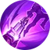

[Тир-лист](https://boostmlbb.ru/heroes/)[Новости и гайды](https://boostmlbb.ru/news/)

Тир C

# Фовиус

Боец · Линия опыта

Победы

48,21%

Выбор

0,27%

Баны

0,80%

**№ 105 из 133 по доле побед**Все ранги · 30 дней по 23 ноября 2026 года

[Сборка](https://boostmlbb.ru/#build)[Контрпики](https://boostmlbb.ru/#draft)[Навыки](https://boostmlbb.ru/#skills)[Статистика](https://boostmlbb.ru/#ranks)[История](https://boostmlbb.ru/#lore)

Регенерация · Урон · Сложность 40/100

## Сборка

Самый частый выбор в рейтинге · Линия опыта

Ключевые предметы

Топор войныОракулКрылья королевы

Эмблема и таланты

Эмблема бойцаТрепетКровавое пиршествоОтвага

Боевое заклинание

Месть

Побед с этой сборкой **57,13%**Выбирают в **5,97%** матчей

Другие сборки (2)

Ключевые предметы

Штормовой поясГосподство льдаДревняя кираса

Эмблема и таланты

Эмблема бойцаТрепетКровавое пиршествоОтвага

Боевое заклинание

Месть

Побед с этой сборкой **56,19%**Выбирают в **1,88%** матчей

Ключевые предметы

Топор войныКрылья королевыОракул

Эмблема и таланты

Эмблема бойцаТрепетКровавое пиршествоОтвага

Боевое заклинание

Месть

Побед с этой сборкой **57,45%**Выбирают в **2,38%** матчей

## Контрпики и союзники

### Кто контрит

[Ванван](https://boostmlbb.ru/heroes/wanwan.html)[Харит](https://boostmlbb.ru/heroes/harith.html)[Фрейя](https://boostmlbb.ru/heroes/freya.html)[Бенедетта](https://boostmlbb.ru/heroes/benedetta.html)[Руби](https://boostmlbb.ru/heroes/ruby.html)

### Против кого силён

[Лейла](https://boostmlbb.ru/heroes/layla.html)[Альфа](https://boostmlbb.ru/heroes/alpha.html)[Бартс](https://boostmlbb.ru/heroes/barats.html)[Сесилион](https://boostmlbb.ru/heroes/cecilion.html)[Джулиан](https://boostmlbb.ru/heroes/julian.html)[Минситтар](https://boostmlbb.ru/heroes/minsitthar.html)[Икс.Борг](https://boostmlbb.ru/heroes/x-borg.html)[Горд](https://boostmlbb.ru/heroes/gord.html)[Тэризла](https://boostmlbb.ru/heroes/terizla.html)[Бэйн](https://boostmlbb.ru/heroes/bane.html)

### Союзники

Изменение винрейта в паре

[Сан+1,86 п. п.](https://boostmlbb.ru/heroes/sun.html)[Лукас+1,65 п. п.](https://boostmlbb.ru/heroes/lukas.html)[Сабер+1,49 п. п.](https://boostmlbb.ru/heroes/saber.html)[Баданг+1,33 п. п.](https://boostmlbb.ru/heroes/badang.html)

## Навыки

Приоритет прокачки · Адская погоня → Демонический натиск → Темная волна

Пассивный**Демоническая сила**

При следующей базовой атаке Фовиус совершает рывок к врагу, отбрасывая его, нанося дополнительный магический урон, равный 4% - 6% от врага (зависит от уровня), и получая щит в размере 8% - 12% от . Перезарядка: 26 сек. - 14 сек. (зависит от уровня "Адской погони").
"Взгляд Астароса": каждый раз, когда вражеский герой совершает рывок, перемещение или его смещают в пределах 8 ед. расстояния, сокращается перезарядка "Демонической силы" на 20%, а остальных навыков — на 0.5 сек.

1-й навык**Демонический натиск**

**Перезарядка 6 с**

Фовиус ударяет по земле монолитом, нанося 200 (+120% общей физической атаки) единиц физического урона врагам в области и замедляя их на 70% на 0.5 сек. Если этот навык попадает по врагу, следующее применение "Демонического натиска" оставит позади "Глаз Астароса".
"Глаз Астароса": взрывается после небольшой задержки, нанося врагам 100 (+60% общей физической атаки) единиц магического урона.

2-й навык**Темная волна**

**Перезарядка 10 с**

Фовиус обрушивает монолит и высвобождает свою демоническую силу в указанном направлении, подбрасывая врагов, утягивая их за собой и нанося 250 (+100% дополнительной физической атаки) единиц магического урона.

Ультимейт**Адская погоня**

Пассивный: при попадании по вражескому герою "Демоническая сила", "Глаз Астароса" и "Темная волна" накладывают метку грешника.
Активный: Фовиус прыгает и обрушивает свой монолит на вражеского героя с меткой грешника, нанося 250 (+100% общей физической атаки) (+ 5% от цели) единиц физического урона врагам в зоне поражения и восстанавливая 50 (+6% от его ).
"Адскую погоню" можно использовать, только если рядом есть враги с меткой грешника. Восстановление ОЗ уменьшается на 80% при попадании по нескольким врагам.

## Победы по рангам

-   Эпик**49,35%**
-   Легенда**48,38%**
-   Мифический**48,27%**
-   Мифическая честь**47,92%**
-   Мифическая слава**48,22%**

## История

Бывший солдат с границы империи, принявший на себя греховные цепи, чтобы защитить свой народ.

[Читать полную историю ↗](https://play.mobilelegends.com/lore/hero/PhoveusRE)Официальный сайт Mobile Legends

[Характеристики на сайте игры](https://www.mobilelegends.com/hero/detail?heroid=106)

[Стоимость буста на герое](https://boostmlbb.ru/order.html?type=hero)

## Частые вопросы

Кто контрпик для героя «Фовиус» в MLBB?

За последние 30 дней чаще всего героя обыгрывают Ванван, Харит, Фрейя, Бенедетта и Руби.

Какой процент побед у героя «Фовиус» сейчас?

48,21% за последние 30 дней на всех рангах и 48,22% в Мифической славе, данные на 23 ноября 2026 года.

Какая роль и линия у героя «Фовиус»?

Боец, играет на линии опыта.

Силён ли герой «Фовиус» в текущей мете?

Тир C: 105-е место из 133 героев по проценту побед за 30 дней и 35-е среди бойцов.

Какая сборка на героя «Фовиус» лучшая?

Самая популярная сборка в рейтинге: ключевые предметы «Топор войны», «Оракул» и «Крылья королевы», эмблема бойца с талантами «Трепет», «Кровавое пиршество» и «Отвага» и заклинание «Месть». С ней выигрывают 57,13% матчей.
