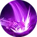

[Тир-лист](https://boostmlbb.ru/heroes/)[Предметы](https://boostmlbb.ru/items/)[Скины](https://boostmlbb.ru/skins/)[Новости и гайды](https://boostmlbb.ru/news/)

# Фовиус

B

БоецЛиния опыта

Победы

48,5%

Выбор

0,3%

Баны

0,5%

[Обзор](https://boostmlbb.ru/#overview)[Сборка](https://boostmlbb.ru/#build)[Как играть](https://boostmlbb.ru/#howto)[Навыки](https://boostmlbb.ru/#skills)[Контрпики](https://boostmlbb.ru/#draft)[Скины](https://boostmlbb.ru/#skins)[История](https://boostmlbb.ru/#lore)

## Обзор

### Характеристики

-   Живучесть**60**
-   Атака**80**
-   Эффекты**50**
-   Сложность**40**

-   Регенерация
-   Урон

### Победы по рангам, 30 дней

1.  **49,3%**Эпик
2.  **48,4%**Легенда
3.  **48,2%**Мифик
4.  **47,9%**Честь
5.  **48,3%**Слава

Пунктир: 50% побед

### Другие бойцы этой линии

[Фрейя](https://boostmlbb.ru/heroes/freya.html)[Аулус](https://boostmlbb.ru/heroes/aulus.html)[Пакито](https://boostmlbb.ru/heroes/paquito.html)[Сан](https://boostmlbb.ru/heroes/sun.html)[Лукас](https://boostmlbb.ru/heroes/lukas.html)[Чичи](https://boostmlbb.ru/heroes/cici.html)[Сора](https://boostmlbb.ru/heroes/sora.html)[Чонг](https://boostmlbb.ru/heroes/yu-zhong.html)

### Места в рейтингах

-   [Лучшие бойцы MLBB**19 из 44**](https://boostmlbb.ru/heroes/best-fighter.html)

## Сборка

Сборка 1Сборка 2Сборка 3

Победы

57,1%

Выбор

6,0%

#### Основные предметы

-   [

    

    Топор войны

    ](https://boostmlbb.ru/items/war-axe.html)
-   [

    

    Оракул

    ](https://boostmlbb.ru/items/oracle.html)
-   [

    

    Крылья королевы

    ](https://boostmlbb.ru/items/queens-wings.html)

#### Заклинание

Месть

#### Эмблема и таланты

Эмблема бойца

-   

    Трепет

-   

    Кровавое пиршество

-   

    Отвага

Победы

57,5%

Выбор

2,4%

#### Основные предметы

-   [

    

    Топор войны

    ](https://boostmlbb.ru/items/war-axe.html)
-   [

    

    Крылья королевы

    ](https://boostmlbb.ru/items/queens-wings.html)
-   [

    

    Оракул

    ](https://boostmlbb.ru/items/oracle.html)

#### Заклинание

Месть

#### Эмблема и таланты

Эмблема бойца

-   

    Трепет

-   

    Кровавое пиршество

-   

    Отвага

Победы

56,2%

Выбор

1,9%

#### Основные предметы

-   [

    

    Штормовой пояс

    ](https://boostmlbb.ru/items/thunder-belt.html)
-   [

    

    Господство льда

    ](https://boostmlbb.ru/items/dominance-ice.html)
-   [

    

    Древняя кираса

    ](https://boostmlbb.ru/items/antique-cuirass.html)

#### Заклинание

Месть

#### Эмблема и таланты

Эмблема бойца

-   

    Трепет

-   

    Кровавое пиршество

-   

    Отвага

## Как играть за Фовиуса

### Комбо Фовиуса

#### В драке

1.  Атака
2.  Ульт
3.  1
4.  2

В драке усиленной атакой влетите, отбросьте и пометьте, сразу ультуйте. Затем первый, второй и снова ульт. Усиленным первым пометьте ещё раз и ультуйте.

#### На линии

1.  1
2.  1
3.  Атака
4.  2

На линии усиленной атакой ударьте и получите щит, добавьте первый, затем усиленный первый для урона и замедления и закончите вторым.

### Когда сильнее всего

Сила ровная всю игру, от 45,7% до 50,7%. Выбирайте драки по готовым предметам, а не по минутам.

1.  **45,7**10–12
2.  **49,2**12–14
3.  **50,7**14–16
4.  **49,5**16–18
5.  **48,9**18–20
6.  **48,1**20+

Проценты побед по длине матча в минутах, все ранги. Пунктир: 50%

### Приоритет прокачки

1.  Адская погоня
2.  Демонический натиск
3.  Темная волна

## Навыки

Пассивный**Демоническая сила**1-й навык**Демонический натиск**2-й навык**Темная волна**Ультимейт**Адская погоня**

Пассивный

### Демоническая сила

При следующей базовой атаке Фовиус совершает рывок к врагу, отбрасывая его, нанося дополнительный магический урон, равный 4% - 6% от врага (зависит от уровня), и получая щит в размере 8% - 12% от . Перезарядка: 26 сек. - 14 сек. (зависит от уровня "Адской погони").

**Взгляд Астароса:** каждый раз, когда вражеский герой совершает рывок, перемещение или его смещают в пределах 8 ед. расстояния, сокращается перезарядка "Демонической силы" на 20%, а остальных навыков — на 0.5 сек.

1-й навык

### Демонический натиск

Перезарядка **6 с**

Фовиус ударяет по земле монолитом, нанося 200 (+120% общей физической атаки) единиц физического урона врагам в области и замедляя их на 70% на 0.5 сек. Если этот навык попадает по врагу, следующее применение "Демонического натиска" оставит позади "Глаз Астароса".

**Глаз Астароса:** взрывается после небольшой задержки, нанося врагам 100 (+60% общей физической атаки) единиц магического урона.

2-й навык

### Темная волна

Перезарядка **10 с**

Фовиус обрушивает монолит и высвобождает свою демоническую силу в указанном направлении, подбрасывая врагов, утягивая их за собой и нанося 250 (+100% дополнительной физической атаки) единиц магического урона.

Ультимейт

### Адская погоня

**Пассивный:** при попадании по вражескому герою "Демоническая сила", "Глаз Астароса" и "Темная волна" накладывают метку грешника.

**Активный:** Фовиус прыгает и обрушивает свой монолит на вражеского героя с меткой грешника, нанося 250 (+100% общей физической атаки) (+ 5% от цели) единиц физического урона врагам в зоне поражения и восстанавливая 50 (+6% от его ).

"Адскую погоню" можно использовать, только если рядом есть враги с меткой грешника. Восстановление ОЗ уменьшается на 80% при попадании по нескольким врагам.

## Контрпики Фовиуса

### Кто контрит Фовиуса

[Ванван](https://boostmlbb.ru/heroes/wanwan.html)[Харит](https://boostmlbb.ru/heroes/harith.html)[Фрейя](https://boostmlbb.ru/heroes/freya.html)[Бенедетта](https://boostmlbb.ru/heroes/benedetta.html)[Руби](https://boostmlbb.ru/heroes/ruby.html)

### Кого контрит Фовиус

[Лейла](https://boostmlbb.ru/heroes/layla.html)[Альфа](https://boostmlbb.ru/heroes/alpha.html)[Бартс](https://boostmlbb.ru/heroes/barats.html)[Сесилион](https://boostmlbb.ru/heroes/cecilion.html)[Джулиан](https://boostmlbb.ru/heroes/julian.html)[Минситтар](https://boostmlbb.ru/heroes/minsitthar.html)[Икс.Борг](https://boostmlbb.ru/heroes/x-borg.html)[Горд](https://boostmlbb.ru/heroes/gord.html)[Тэризла](https://boostmlbb.ru/heroes/terizla.html)[Бэйн](https://boostmlbb.ru/heroes/bane.html)

## Скины Фовиуса

[Бунтарь матрицыИсключительный · 2025](https://boostmlbb.ru/skins/phoveus/matrix-maverick.html)[Страж монолитаОбычный · 2021](https://boostmlbb.ru/skins/phoveus/monolith-watcher.html)

[Все 2 скина Фовиуса: цены и как получить](https://boostmlbb.ru/skins/phoveus.html)

## История

> Бывший солдат с границы империи, принявший на себя греховные цепи, чтобы защитить свой народ.

[Читать полную историю ↗](https://play.mobilelegends.com/lore/hero/PhoveusRE)Официальный сайт Mobile Legends [Характеристики на сайте игры ↗](https://www.mobilelegends.com/hero/detail?heroid=106)

**Поднимем ранг на герое «Фовиус»**Цена считается в калькуляторе

[Рассчитать цену](https://boostmlbb.ru/order.html?type=hero)

## Частые вопросы

Кто контрит Фовиуса в MLBB?

За последние 30 дней Фовиуса чаще всего обыгрывают Ванван, Харит, Фрейя, Бенедетта и Руби.

Как играть за Фовиуса?

В первую очередь качайте «Демонический натиск», ульт берите, как только доступен. Сила ровная всю игру, от 45,7% до 50,7%. Выбирайте драки по готовым предметам, а не по минутам. Комбо для драки: В драке усиленной атакой влетите, отбросьте и пометьте, сразу ультуйте. Затем первый, второй и снова ульт. Усиленным первым пометьте ещё раз и ультуйте.

Какой процент побед у Фовиуса сейчас?

48,55% в Мифической славе за последние 7 дней и 48,22% на всех рангах за 30 дней, данные на 25 ноября 2026 года.

Какая роль и линия у Фовиуса?

Боец, играет на линии опыта.

Стоит ли брать Фовиуса в текущей мете?

Тир B, 65-е место из 133 героев и 19-е среди бойцов. Тир учитывает, как часто героя берут и банят и как он выигрывает в Мифической славе за 7 дней: бан в 0,5% матчей, 48,5% побед. В профессиональных матчах за месяц героя драфтуют в 18,3% катков.

Какая сборка на Фовиуса лучшая?

Самая популярная сборка в рейтинге: ключевые предметы «Топор войны», «Оракул» и «Крылья королевы», эмблема бойца с талантами «Трепет», «Кровавое пиршество» и «Отвага» и заклинание «Месть». С ней выигрывают 57,13% матчей.
