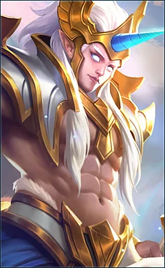

[Тир-лист](https://boostmlbb.ru/heroes/)[Новости и гайды](https://boostmlbb.ru/news/)

# Рафаэль

B

ПоддержкаРоум

Победы

53,2%

Выбор

0,8%

Баны

9,4%

[Обзор](https://boostmlbb.ru/#overview)[Сборка](https://boostmlbb.ru/#build)[Навыки](https://boostmlbb.ru/#skills)[Контрпики](https://boostmlbb.ru/#draft)[История](https://boostmlbb.ru/#lore)

## Обзор

### Характеристики

-   Живучесть**60**
-   Атака**20**
-   Эффекты**70**
-   Сложность**40**

-   Регенерация
-   Защита

### Победы по рангам, 30 дней

1.  **53,1%**Эпик
2.  **54,7%**Легенда
3.  **55,2%**Мифик
4.  **55,2%**Честь
5.  **53,9%**Слава

Пунктир: 50% побед

### Другие герои поддержки этой линии

[Марсель](https://boostmlbb.ru/heroes/marcel.html)[Эстес](https://boostmlbb.ru/heroes/estes.html)[Кайя](https://boostmlbb.ru/heroes/kaja.html)[Флорин](https://boostmlbb.ru/heroes/floryn.html)[Ангела](https://boostmlbb.ru/heroes/angela.html)[Дигги](https://boostmlbb.ru/heroes/diggie.html)

### Места в рейтингах

-   [Лучшие роумеры MLBB**12 из 34**](https://boostmlbb.ru/heroes/best-roam.html)

## Сборка

Сборка 1Сборка 2Сборка 3

Победы

57,2%

Выбор

4,0%

#### Основные предметы

-   

    Фляга Оазиса

-   

    Зачарованный талисман

-   

    Жезл снежной королевы

#### Заклинание

Вспышка

#### Эмблема и таланты

Эмблема поддержки

-   

    Вдохновение

-   

    Благословение природы

-   

    Фокус-метка

Победы

62,4%

Выбор

3,5%

#### Основные предметы

-   

    Фляга Оазиса

-   

    Зачарованный талисман

-   

    Крылья королевы

#### Заклинание

Восстановление

#### Эмблема и таланты

Эмблема поддержки

-   

    Ловкость

-   

    Второе дыхание

-   

    Фокус-метка

Победы

59,7%

Выбор

2,7%

#### Основные предметы

-   

    Фляга Оазиса

-   

    Зачарованный талисман

-   

    Жезл снежной королевы

#### Заклинание

Восстановление

#### Эмблема и таланты

Эмблема поддержки

-   

    Вдохновение

-   

    Благословение природы

-   

    Фокус-метка

## Навыки

Прокачка**Святое крещение**_›_**Свет возмездия**_›_**Святое исцеление**

Пассивный**Божественное воскрешение**1-й навык**Свет возмездия**2-й навык**Святое исцеление**Ультимейт**Святое крещение**

Пассивный

### Божественное воскрешение

Рафаэль может использовать особый навык каждые 10 сек. После 2.5 сек. подготовки она мгновенно воскрешает союзника и увеличивает его скорость передвижения на 30% на 5 сек. (получение урона от героев и легендарных монстров прерывает подготовку, а сам навык уходит на базовую перезарядку).

Перезарядка этого навыка увеличивается на 600% от оставшегося времени возрождения цели, максимум 240 сек. На этот навык не действует сокращение перезарядки.

1-й навык

### Свет возмездия

Перезарядка **5 Mana Cost: 45 с**

Рафаэль атакует трех ближайших врагов "Светом возмездия", нанося им 350 (+120% общей магической силы) единиц магического урона, ненадолго раскрывая их позиции и замедляя их на 40% на 1.5 сек. Враги, вновь пораженные "Светом возмездия" в течение 6 сек., получат 20% дополнительного урона (этот эффект складывается до 3 раз).

2-й навык

### Святое исцеление

Перезарядка **10.5 Mana Cost: 75 с**

Рафаэль призывает священный свет, восстанавливая 100 (+35% общей магической силы) ОЗ ближайшим союзным героям, а также дополнительно 150 (+65% общей магической силы) ОЗ себе и наиболее раненному союзному герою в радиусе действия. Она также увеличивает скорость передвижения ближайших союзных героев на 30% и дает иммунитет к замедлению на 1 сек.

Кажд. 10 ед. увеличивают бонус к скорости передвижения на 1%.

Ультимейт

### Святое крещение

Перезарядка **38 Mana Cost: 120 с**

Рафаэль атакует истинной силой священного света в указанном направлении, нанося 460 (+120% общей магической силы) единиц магического урона врагам по прямой и оглушая их на 1.2 сек.

## Контрпики

### Контрпики

Побеждают этого героя

[Валир](https://boostmlbb.ru/heroes/valir.html)[Наталья](https://boostmlbb.ru/heroes/natalia.html)[Марсель](https://boostmlbb.ru/heroes/marcel.html)[Хилос](https://boostmlbb.ru/heroes/hylos.html)[Чичи](https://boostmlbb.ru/heroes/cici.html)

### Слабые цели

Этот герой побеждает их

[Лейла](https://boostmlbb.ru/heroes/layla.html)[Сильвана](https://boostmlbb.ru/heroes/silvanna.html)[Иксия](https://boostmlbb.ru/heroes/ixia.html)[Сора](https://boostmlbb.ru/heroes/sora.html)[Вэйл](https://boostmlbb.ru/heroes/vale.html)

## История

> Ангел, почитаемый всеми людьми этого мира.

[Читать полную историю ↗](https://play.mobilelegends.com/lore/hero/Rafaela)Официальный сайт Mobile Legends [Характеристики на сайте игры ↗](https://www.mobilelegends.com/hero/detail?heroid=14)

**Поднимем ранг на герое «Рафаэль»**Цена считается в калькуляторе

[Рассчитать цену](https://boostmlbb.ru/order.html?type=hero)

## Частые вопросы

Кто контрпик для героя «Рафаэль» в MLBB?

За последние 30 дней чаще всего героя обыгрывают Валир, Наталья, Марсель, Хилос и Чичи.

Какой процент побед у героя «Рафаэль» сейчас?

53,21% в Мифической славе за последние 7 дней и 54,46% на всех рангах за 30 дней, данные на 24 ноября 2026 года.

Какая роль и линия у героя «Рафаэль»?

Поддержка, играет в роуме.

Силён ли герой «Рафаэль» в текущей мете?

Тир B, 33-е место из 133 героев и 8-е среди героев поддержки. Тир учитывает, как часто героя берут и банят и как он выигрывает в Мифической славе за 7 дней: бан в 9,4% матчей, 53,2% побед. В профессиональных матчах за месяц героя драфтуют в 7,7% катков.

Какая сборка на героя «Рафаэль» лучшая?

Самая популярная сборка в рейтинге: ключевые предметы «Фляга Оазиса», «Зачарованный талисман» и «Жезл снежной королевы», эмблема поддержки с талантами «Вдохновение», «Благословение природы» и «Фокус-метка» и заклинание «Вспышка». С ней выигрывают 57,20% матчей.
