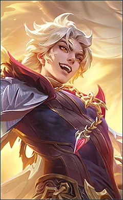
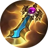
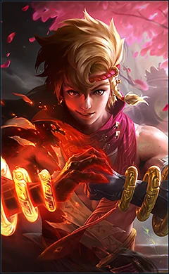
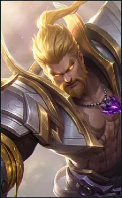
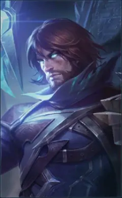
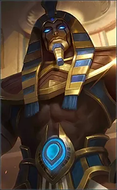

[Тир-лист](https://boostmlbb.ru/heroes/)[Предметы](https://boostmlbb.ru/items/)[Скины](https://boostmlbb.ru/skins/)[Новости и гайды](https://boostmlbb.ru/news/)

[Тир-лист](https://boostmlbb.ru/heroes/)

# Роджер

D

БоецСтрелокЛес

Победы

46,4%

Выбор

0,2%

Баны

0,1%

[Обзор](https://boostmlbb.ru/#overview)[Сборка](https://boostmlbb.ru/#build)[Как играть](https://boostmlbb.ru/#howto)[Навыки](https://boostmlbb.ru/#skills)[Контрпики](https://boostmlbb.ru/#draft)[Скины](https://boostmlbb.ru/#skins)[История](https://boostmlbb.ru/#lore)

## Обзор

### Характеристики

-   Живучесть**60**
-   Атака**40**
-   Эффекты**10**
-   Сложность**60**

-   Добивание
-   Разрушительный урон

### Другие бойцы этой линии

[Фрейя](https://boostmlbb.ru/heroes/freya.html)[Аулус](https://boostmlbb.ru/heroes/aulus.html)[Пакито](https://boostmlbb.ru/heroes/paquito.html)[Сан](https://boostmlbb.ru/heroes/sun.html)[Су Ё](https://boostmlbb.ru/heroes/suyou.html)[Лукас](https://boostmlbb.ru/heroes/lukas.html)[Дариус](https://boostmlbb.ru/heroes/dyrroth.html)[Альфа](https://boostmlbb.ru/heroes/alpha.html)

### Места в рейтингах

-   [Лучшие лесники MLBB**35 из 37**](https://boostmlbb.ru/heroes/best-jungle.html)
-   [Лучшие стрелки MLBB**23 из 23**](https://boostmlbb.ru/heroes/best-marksman.html)
-   [Лучшие бойцы MLBB**43 из 44**](https://boostmlbb.ru/heroes/best-fighter.html)

## Сборка

Сборка 1Сборка 2Сборка 3

Победы

55,3%

Выбор

13,9%

#### Основные предметы

-   [

    

    Говорящий с ветром

    ](https://boostmlbb.ru/items/windtalker.html)
-   [

    

    Пронзающий небеса

    ](https://boostmlbb.ru/items/sky-piercer.html)
-   [

    

    Золотой метеор

    ](https://boostmlbb.ru/items/rose-gold-meteor.html)

#### Заклинание

Возмездие

#### Эмблема и таланты

Эмблема убийцы

-   

    Проворность

-   

    Опытный охотник

-   

    Убийственный пир

Победы

56,5%

Выбор

5,7%

#### Основные предметы

-   [

    

    Говорящий с ветром

    ](https://boostmlbb.ru/items/windtalker.html)
-   [

    

    Пронзающий небеса

    ](https://boostmlbb.ru/items/sky-piercer.html)
-   [

    

    Когти Хааса

    ](https://boostmlbb.ru/items/haas-claws.html)

#### Заклинание

Возмездие

#### Эмблема и таланты

Эмблема убийцы

-   

    Трепет

-   

    Опытный охотник

-   

    Убийственный пир

Победы

56,5%

Выбор

4,0%

#### Основные предметы

-   [

    

    Говорящий с ветром

    ](https://boostmlbb.ru/items/windtalker.html)
-   [

    

    Пронзающий небеса

    ](https://boostmlbb.ru/items/sky-piercer.html)
-   [

    

    Когти Хааса

    ](https://boostmlbb.ru/items/haas-claws.html)

#### Заклинание

Возмездие

#### Эмблема и таланты

Эмблема убийцы

-   

    Проворность

-   

    Опытный охотник

-   

    Убийственный пир

## Как играть за Роджера

### Комбо Роджера

#### В драке

1.  1
2.  2
3.  Ульт
4.  2
5.  1

В драке первым подтачивайте издалека и вторым держите позицию. Когда замес начался, ультом идите в тыл: второй даст скорость атаки, первым добивайте.

#### На линии

1.  2
2.  1
3.  Ульт
4.  2
5.  Атака
6.  1

На линии тревожьте в человеческой форме, вторым ускорьтесь для выстрела первым. Ультом подойдите, вторым включите скорость атаки, рвите атаками и добейте первым.

### Когда сильнее всего

Сила ровная всю игру, от 47,5% до 51,1%. Выбирайте драки по готовым предметам, а не по минутам.

1.  **47,5**10–12
2.  **50,6**12–14
3.  **51,1**14–16
4.  **50,7**16–18
5.  **50,2**18–20
6.  **50,0**20+

Проценты побед по длине матча в минутах, все ранги. Пунктир: 50%

### Приоритет прокачки

1.  Волчье перевоплощение
2.  Открыть огонь
3.  Шаги охотника

## Навыки

Пассивный**Проклятие полной луны**1-й навык**Открыть огонь** 2-й навык**Шаги охотника**Ультимейт**Волчье перевоплощение**

Пассивный

### Проклятие полной луны

Роджер может свободно переключаться между человеческой и волчьей формами.

В человеческой форме атаки Роджера наносят дополнительный урон, равный 4% от текущих цели. В волчьей форме его атаки наносят дополнительный урон, равный 4% от \[потерянных C6 цели.

Дополнительный урон монстрам ограничен 60.

1-й навык

### Открыть огонь

Перезарядка **7 Mana Cost: 50 с**

Роджер делает два быстрых выстрела в указанном направлении, нанося в сумме 250 (+125% общей физической атаки) единиц физического урона пораженному врагу.

Первый выстрел — это охотничья сеть, которая замедляет врага на 80% на 1.5 сек.

Второй выстрел — пуля, которая уменьшает врага на 10 на 5 сек.

2-й навык

### Шаги охотника

Перезарядка **10 Mana Cost: 50 с**

Роджер получает 20% скорости передвижения и 20% скорости атаки на 2.5 сек.

Ультимейт

### Волчье перевоплощение

Перезарядка **7.5 с**

Роджер прыгает в указанном направлении и превращается в волчью форму, нанося 150 (+100% дополнительной физической атаки) единиц физического урона пораженным врагам и замедляя их на 90% на 0.8 сек.

**Пассивный:** в волчьей форме Роджер получает 20 и 25 скорости передвижения.

## Контрпики Роджера

### Кто контрит Роджера

[Харли](https://boostmlbb.ru/heroes/harley.html)[Госсен](https://boostmlbb.ru/heroes/gusion.html)[Сильвана](https://boostmlbb.ru/heroes/silvanna.html)[Инь](https://boostmlbb.ru/heroes/yin.html)[Хелкарт](https://boostmlbb.ru/heroes/helcurt.html)

## Скины Роджера

[ГримлокГрандиозный · 2022](https://boostmlbb.ru/skins/roger/grimlock.html)[Призрачный рейнджерДелюкс · 2021](https://boostmlbb.ru/skins/roger/phantom-ranger.html)[Охотник на нечистьГрандиозный · 2021](https://boostmlbb.ru/skins/roger/fiend-hunter.html)[Киборг-оборотеньДелюкс · 2021](https://boostmlbb.ru/skins/roger/cyborg-werewolf.html)[Призрачный охотникДелюкс · 2018](https://boostmlbb.ru/skins/roger/phantom-hunter.html)[АнубисИсключительный · 2018](https://boostmlbb.ru/skins/roger/anubis.html)[Доктор ЗверьИзысканный · 2017](https://boostmlbb.ru/skins/roger/dr-beast.html)[Тёмный джентльменОбычный · 2017](https://boostmlbb.ru/skins/roger/dark-gent.html)

[Все 8 скинов Роджера: цены и как получить](https://boostmlbb.ru/skins/roger.html)

## История

> Оборотень, бродящий по темному лесу и ищущий мести.

[Читать полную историю ↗](https://kazukiofficial.com/stories/roger)Kazuki Official, английский [Характеристики на сайте игры ↗](https://www.mobilelegends.com/hero/detail?heroid=39)

**Поднимем ранг на герое «Роджер»**Цена считается в калькуляторе

[Рассчитать цену](https://boostmlbb.ru/order.html?type=hero)

## Частые вопросы

Кто контрит Роджера в MLBB?

За последние 30 дней Роджера чаще всего обыгрывают Харли, Госсен, Сильвана, Инь и Хелкарт.

Как играть за Роджера?

В первую очередь качайте «Открыть огонь », ульт берите, как только доступен. Сила ровная всю игру, от 47,5% до 51,1%. Выбирайте драки по готовым предметам, а не по минутам. Комбо для драки: В драке первым подтачивайте издалека и вторым держите позицию. Когда замес начался, ультом идите в тыл: второй даст скорость атаки, первым добивайте.

Какой процент побед у Роджера сейчас?

46,35% в Мифической славе за последние 7 дней и 48,27% на всех рангах за 30 дней, данные на 27 ноября 2026 года.

Какая роль и линия у Роджера?

Боец и стрелок, играет в лесу.

Стоит ли брать Роджера в текущей мете?

Тир D, 126-е место из 133 героев и 43-е среди бойцов. Тир учитывает, как часто героя берут и банят и как он выигрывает в Мифической славе за 7 дней: бан в 0,1% матчей, 46,4% побед. В профессиональных матчах за месяц героя драфтуют в 0,0% катков.

Какая сборка на Роджера лучшая?

Самая популярная сборка в рейтинге: ключевые предметы «Говорящий с ветром», «Пронзающий небеса» и «Золотой метеор», эмблема убийцы с талантами «Проворность», «Опытный охотник» и «Убийственный пир» и заклинание «Возмездие». С ней выигрывают 55,26% матчей.
