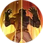
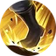

[Главная](https://boostmlbb.ru/) / [Герои](https://boostmlbb.ru/heroes/)

Тир C

# Роджер

Боец и стрелок · Лес

**№ 103 из 133 по доле побед**Все ранги · 30 дней по 23 ноября 2026 года

Победы

48,33%

Выбор

0,27%

Баны

0,09%

Добивание · Разрушительный урон · Сложность 60/100

[Сборка](https://boostmlbb.ru/#build)[Контрпики и союзники](https://boostmlbb.ru/#draft)[Навыки](https://boostmlbb.ru/#skills)[Победы по рангам](https://boostmlbb.ru/#ranks)[История](https://boostmlbb.ru/#lore)

## Сборка

Самый частый выбор в рейтинге · Лес

Ключевые предметы

Говорящий с ветромПронзающий небесаКогти Хааса

Эмблема и таланты

Эмблема убийцыПроворностьОпытный охотникУбийственный пир

Боевое заклинание

Возмездие

Побед с этой сборкой **56,45%**Выбирают в **4,25%** матчей

Другие сборки (2)

Ключевые предметы

Говорящий с ветромПронзающий небесаКогти Хааса

Эмблема и таланты

Эмблема убийцыТрепетОпытный охотникУбийственный пир

Боевое заклинание

Возмездие

Побед с этой сборкой **56,72%**Выбирают в **6,15%** матчей

Ключевые предметы

Говорящий с ветромПронзающий небесаЗолотой метеор

Эмблема и таланты

Эмблема убийцыПроворностьОпытный охотникУбийственный пир

Боевое заклинание

Возмездие

Побед с этой сборкой **55,25%**Выбирают в **13,81%** матчей

## Контрпики и союзники

### Кто контрит

[Харли](https://boostmlbb.ru/heroes/harley.html)[Госсен](https://boostmlbb.ru/heroes/gusion.html)[Сильвана](https://boostmlbb.ru/heroes/silvanna.html)[Хелкарт](https://boostmlbb.ru/heroes/helcurt.html)[Инь](https://boostmlbb.ru/heroes/yin.html)

### Союзники

Прибавка к доле побед в одной команде

[Лейла+2,19 п. п.](https://boostmlbb.ru/heroes/layla.html)[Иксия+2,16 п. п.](https://boostmlbb.ru/heroes/ixia.html)[Ханаби+1,98 п. п.](https://boostmlbb.ru/heroes/hanabi.html)[Лесли+1,94 п. п.](https://boostmlbb.ru/heroes/lesley.html)

## Навыки

Приоритет прокачки · Волчье перевоплощение → Открыть огонь → Шаги охотника

Пассивный**Проклятие полной луны**

Роджер может свободно переключаться между человеческой и волчьей формами.
В человеческой форме атаки Роджера наносят дополнительный урон, равный 4% от текущих цели. В волчьей форме его атаки наносят дополнительный урон, равный 4% от \[потерянных C6 цели.
Дополнительный урон монстрам ограничен 60.

1-й навык**Открыть огонь**

**Перезарядка 7 Mana Cost: 50 с**

Роджер делает два быстрых выстрела в указанном направлении, нанося в сумме 250 (+125% общей физической атаки) единиц физического урона пораженному врагу.
Первый выстрел — это охотничья сеть, которая замедляет врага на 80% на 1.5 сек.
Второй выстрел — пуля, которая уменьшает врага на 10 на 5 сек.

2-й навык**Шаги охотника**

**Перезарядка 10 Mana Cost: 50 с**

Роджер получает 20% скорости передвижения и 20% скорости атаки на 2.5 сек.

Ультимейт**Волчье перевоплощение**

**Перезарядка 7.5 с**

Роджер прыгает в указанном направлении и превращается в волчью форму, нанося 150 (+100% дополнительной физической атаки) единиц физического урона пораженным врагам и замедляя их на 90% на 0.8 сек.
Пассивный: в волчьей форме Роджер получает 20 и 25 скорости передвижения.

## Победы по рангам

-   Эпик**50,73%**
-   Легенда**50,29%**
-   Мифический**49,67%**
-   Мифическая честь**48,49%**
-   Мифическая слава**45,96%**

## История

Оборотень, бродящий по темному лесу и ищущий мести.

[Карточка героя](https://www.mobilelegends.com/hero/detail?heroid=39)[MLBB Wiki](https://mobile-legends.fandom.com/wiki/Roger)

[Стоимость буста на герое](https://boostmlbb.ru/order.html?type=hero)

## Частые вопросы

Кто контрпик для героя «Роджер» в MLBB?

За последние 30 дней чаще всего героя обыгрывают Харли, Госсен, Сильвана, Хелкарт и Инь.

Какой процент побед у героя «Роджер» сейчас?

48,33% за последние 30 дней на всех рангах и 45,96% в Мифической славе, данные на 23 ноября 2026 года.

Какая роль и линия у героя «Роджер»?

Боец и стрелок, играет в лесу.

Силён ли герой «Роджер» в текущей мете?

Тир C: 103-е место из 133 героев по проценту побед за 30 дней и 34-е среди бойцов.

Какая сборка на героя «Роджер» лучшая?

Самая популярная сборка в рейтинге: ключевые предметы «Говорящий с ветром», «Пронзающий небеса» и «Когти Хааса», эмблема убийцы с талантами «Проворность», «Опытный охотник» и «Убийственный пир» и заклинание «Возмездие». С ней выигрывают 56,45% матчей.
