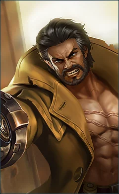
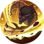

[Тир-лист](https://boostmlbb.ru/heroes/)[Новости и гайды](https://boostmlbb.ru/news/)

# Роджер

D

БоецСтрелокЛес

Оборотень, бродящий по темному лесу и ищущий мести.

Победы

46,2%

все ранги 48,3%

Выбор

0,2%

все ранги 0,3%

Баны

0,1%

все ранги 0,1%

№122 в тир-листе · №40 среди бойцов · Мифическая слава, 7 дней, по 23 ноября

[Обзор](https://boostmlbb.ru/#overview)[Сборка](https://boostmlbb.ru/#build)[Навыки](https://boostmlbb.ru/#skills)[Контрпики](https://boostmlbb.ru/#draft)[История](https://boostmlbb.ru/#lore)

## Обзор

### Характеристики

-   Живучесть**60**
-   Атака**40**
-   Эффекты**10**
-   Сложность**60**

-   Добивание
-   Разрушительный урон

### Победы по рангам, 30 дней

1.  **50,7%**Эпик
2.  **50,3%**Легенда
3.  **49,7%**Мифик
4.  **48,5%**Честь
5.  **46,0%**Слава

Пунктир: 50% побед

### Другие бойцы этой линии

[Сан](https://boostmlbb.ru/heroes/sun.html)[Аулус](https://boostmlbb.ru/heroes/aulus.html)[Лукас](https://boostmlbb.ru/heroes/lukas.html)[Фрейя](https://boostmlbb.ru/heroes/freya.html)[Пакито](https://boostmlbb.ru/heroes/paquito.html)[Дариус](https://boostmlbb.ru/heroes/dyrroth.html)[Су Ё](https://boostmlbb.ru/heroes/suyou.html)[Джулиан](https://boostmlbb.ru/heroes/julian.html)

## Сборка

Лес · по данным рейтинговых матчей

Сборка 155,3%Сборка 256,7%Сборка 356,5%

### Предметы

Говорящий с ветром

Пронзающий небеса

Золотой метеор

### Эмблема

Эмблема убийцы

Проворность

Опытный охотник

Убийственный пир

### Заклинание

Возмездие

Победы

55,3%

Выбор

13,8%

### Предметы

Говорящий с ветром

Пронзающий небеса

Когти Хааса

### Эмблема

Эмблема убийцы

Трепет

Опытный охотник

Убийственный пир

### Заклинание

Возмездие

Победы

56,7%

Выбор

6,2%

### Предметы

Говорящий с ветром

Пронзающий небеса

Когти Хааса

### Эмблема

Эмблема убийцы

Проворность

Опытный охотник

Убийственный пир

### Заклинание

Возмездие

Победы

56,5%

Выбор

4,3%

## Навыки

Прокачка**Волчье перевоплощение**_›_**Открыть огонь** _›_**Шаги охотника**

Пассивный1-й навык2-й навыкУльтимейт

Пассивный

### Проклятие полной луны

Роджер может свободно переключаться между человеческой и волчьей формами.

В человеческой форме атаки Роджера наносят дополнительный урон, равный 4% от текущих цели. В волчьей форме его атаки наносят дополнительный урон, равный 4% от \[потерянных C6 цели.

Дополнительный урон монстрам ограничен 60.

1-й навык

### Открыть огонь

Перезарядка **7 Mana Cost: 50 с**

Роджер делает два быстрых выстрела в указанном направлении, нанося в сумме 250 (+125% общей физической атаки) единиц физического урона пораженному врагу.

Первый выстрел — это охотничья сеть, которая замедляет врага на 80% на 1.5 сек.

Второй выстрел — пуля, которая уменьшает врага на 10 на 5 сек.

2-й навык

### Шаги охотника

Перезарядка **10 Mana Cost: 50 с**

Роджер получает 20% скорости передвижения и 20% скорости атаки на 2.5 сек.

Ультимейт

### Волчье перевоплощение

Перезарядка **7.5 с**

Роджер прыгает в указанном направлении и превращается в волчью форму, нанося 150 (+100% дополнительной физической атаки) единиц физического урона пораженным врагам и замедляя их на 90% на 0.8 сек.

**Пассивный:** в волчьей форме Роджер получает 20 и 25 скорости передвижения.

## Контрпики и союзники

### Контрпики

Побеждают этого героя

[Харли](https://boostmlbb.ru/heroes/harley.html)[Госсен](https://boostmlbb.ru/heroes/gusion.html)[Сильвана](https://boostmlbb.ru/heroes/silvanna.html)[Хелкарт](https://boostmlbb.ru/heroes/helcurt.html)[Инь](https://boostmlbb.ru/heroes/yin.html)

### Союзники

Рост побед в паре, п. п.

[Лейла**+2,2**](https://boostmlbb.ru/heroes/layla.html)[Иксия**+2,2**](https://boostmlbb.ru/heroes/ixia.html)[Ханаби**+2,0**](https://boostmlbb.ru/heroes/hanabi.html)[Лесли**+1,9**](https://boostmlbb.ru/heroes/lesley.html)

## История

> Оборотень, бродящий по темному лесу и ищущий мести.

[Читать полную историю ↗](https://kazukiofficial.com/stories/roger)Kazuki Official, английский

[Характеристики на сайте игры ↗](https://www.mobilelegends.com/hero/detail?heroid=39)

**Поднимем ранг на герое «Роджер»**Цена считается в калькуляторе

[Рассчитать цену](https://boostmlbb.ru/order.html?type=hero)

## Частые вопросы

Кто контрпик для героя «Роджер» в MLBB?

За последние 30 дней чаще всего героя обыгрывают Харли, Госсен, Сильвана, Хелкарт и Инь.

Какой процент побед у героя «Роджер» сейчас?

46,21% в Мифической славе за последние 7 дней и 48,33% на всех рангах за 30 дней, данные на 23 ноября 2026 года.

Какая роль и линия у героя «Роджер»?

Боец и стрелок, играет в лесу.

Силён ли герой «Роджер» в текущей мете?

Тир D, 122-е место из 133 героев и 40-е среди бойцов. Тир учитывает, как часто героя берут и банят и как он выигрывает в Мифической славе за 7 дней: бан в 0,1% матчей, 46,2% побед.

Какая сборка на героя «Роджер» лучшая?

Самая популярная сборка в рейтинге: ключевые предметы «Говорящий с ветром», «Пронзающий небеса» и «Золотой метеор», эмблема убийцы с талантами «Проворность», «Опытный охотник» и «Убийственный пир» и заклинание «Возмездие». С ней выигрывают 55,25% матчей.
