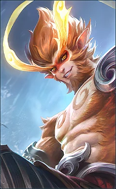
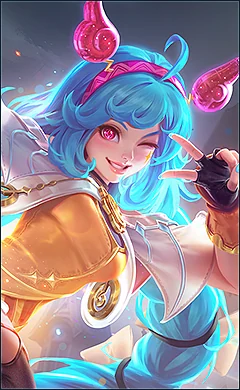

[Тир-лист](https://boostmlbb.ru/heroes/)[Предметы](https://boostmlbb.ru/items/)[Скины](https://boostmlbb.ru/skins/)[Новости и гайды](https://boostmlbb.ru/news/)

[Тир-лист](https://boostmlbb.ru/heroes/)

# Руби

C

БоецЛиния опыта

Победы

49,0%

Выбор

0,4%

Баны

0,1%

[Обзор](https://boostmlbb.ru/#overview)[Сборка](https://boostmlbb.ru/#build)[Как играть](https://boostmlbb.ru/#howto)[Навыки](https://boostmlbb.ru/#skills)[Контрпики](https://boostmlbb.ru/#draft)[Скины](https://boostmlbb.ru/#skins)[История](https://boostmlbb.ru/#lore)

## Обзор

### Характеристики

-   Живучесть**90**
-   Атака**20**
-   Эффекты**90**
-   Сложность**40**

-   Массовый контроль
-   Регенерация

### Победы по рангам, 30 дней

1.  **49,5%**Эпик
2.  **49,6%**Легенда
3.  **49,4%**Мифик
4.  **49,4%**Честь
5.  **48,7%**Слава

Пунктир: 50% побед

### Другие бойцы этой линии

[Фрейя](https://boostmlbb.ru/heroes/freya.html)[Аулус](https://boostmlbb.ru/heroes/aulus.html)[Пакито](https://boostmlbb.ru/heroes/paquito.html)[Сан](https://boostmlbb.ru/heroes/sun.html)[Лукас](https://boostmlbb.ru/heroes/lukas.html)[Чичи](https://boostmlbb.ru/heroes/cici.html)[Сора](https://boostmlbb.ru/heroes/sora.html)[Чонг](https://boostmlbb.ru/heroes/yu-zhong.html)

### Места в рейтингах

-   [Лучшие бойцы MLBB**35 из 44**](https://boostmlbb.ru/heroes/best-fighter.html)

## Сборка

Сборка 1Сборка 2Сборка 3

Победы

56,7%

Выбор

8,9%

#### Основные предметы

-   [

    

    Топор войны

    ](https://boostmlbb.ru/items/war-axe.html)
-   [

    

    Крылья королевы

    ](https://boostmlbb.ru/items/queens-wings.html)
-   [

    

    Оракул

    ](https://boostmlbb.ru/items/oracle.html)

#### Заклинание

Вспышка

#### Эмблема и таланты

Эмблема бойца

-   

    Трепет

-   

    Кровавое пиршество

-   

    Отвага

Победы

58,9%

Выбор

6,2%

#### Основные предметы

-   [

    

    Топор войны

    ](https://boostmlbb.ru/items/war-axe.html)
-   [

    

    Крылья королевы

    ](https://boostmlbb.ru/items/queens-wings.html)
-   [

    

    Бесконечная битва

    ](https://boostmlbb.ru/items/endless-battle.html)

#### Заклинание

Вспышка

#### Эмблема и таланты

Эмблема бойца

-   

    Трепет

-   

    Кровавое пиршество

-   

    Отвага

Победы

58,3%

Выбор

3,9%

#### Основные предметы

-   [

    

    Топор войны

    ](https://boostmlbb.ru/items/war-axe.html)
-   [

    

    Бесконечная битва

    ](https://boostmlbb.ru/items/endless-battle.html)
-   [

    

    Крылья королевы

    ](https://boostmlbb.ru/items/queens-wings.html)

#### Заклинание

Вспышка

#### Эмблема и таланты

Эмблема бойца

-   

    Трепет

-   

    Кровавое пиршество

-   

    Отвага

## Как играть за Руби

### Комбо Руби

#### В драке

1.  1
2.  2
3.  Ульт

В драке замедлите первым издалека и сблизьтесь рывком пассивки. Вторым оглушите всех рядом, ультом притяните тех, кто уходит.

#### На линии

1.  1
2.  Ульт
3.  2
4.  Атака

На линии замедлите первым, сблизьтесь пассивкой, ультом притяните в ближний бой, вторым держите в стане и добейте атаками.

### Когда сильнее всего

Сильнее в начале: на 10–12 минутах выигрывает 52,7%. Давите на линии, забирайте объекты и заканчивайте, пока преимущество не растаяло.

1.  **52,7**10–12
2.  **50,7**12–14
3.  **49,2**14–16
4.  **47,6**16–18
5.  **47,9**18–20
6.  **47,6**20+

Проценты побед по длине матча в минутах, все ранги. Пунктир: 50%

### Приоритет прокачки

1.  Я обиделась!
2.  Не шали!
3.  Не убегай, король волков!

## Навыки

Пассивный**Давай потанцуем!**1-й навык**Не шали!**2-й навык**Не убегай, король волков!**Ультимейт**Я обиделась!**

Пассивный

### Давай потанцуем!

Навыки Руби имеют процент вампиризма от навыков в размере 75% (ее базовые атаки не могут активировать вампиризм). За каждые потерянные 1% ОЗ ее процент вампиризма от навыков увеличивается на 1%, вплоть до 150%.

После каждого применения навыка Руби может совершить рывок в другое место и получить 8-25 ед. (зависит от уровня) на 4 сек. (складывается до 3 раз).

1-й навык

### Не шали!

Перезарядка **4 Mana Cost: 25 с**

Руби взмахивает косой, нанося 280 (+110% общей физической атаки) единиц физического урона пораженным врагам. Затем она выпускает ударную волну в том же направлении, нанося 140 (+55% общей физической атаки) единиц физического урона пораженным врагам и замедляя их на 40% на 1 сек.

2-й навык

### Не убегай, король волков!

Перезарядка **7 Mana Cost: 50 с**

Руби дважды взмахивает гигантской косой вокруг себя, каждый раз нанося 60 (+55% общей физической атаки) единиц физического урона ближайшим врагам, оглушая их на 0.5 сек. и медленно притягивая к себе.

Ультимейт

### Я обиделась!

Перезарядка **40 Mana Cost: 80 с**

Руби атакует косой в указанном направлении, нанося 600 (+200% общей физической атаки) единиц физического урона пораженным врагам, притягивая их к себе и оглушая на 0.5 сек.

## Контрпики Руби

### Кто контрит Руби

[Сан](https://boostmlbb.ru/heroes/sun.html)[Глу](https://boostmlbb.ru/heroes/gloo.html)[Аргус](https://boostmlbb.ru/heroes/argus.html)[Карина](https://boostmlbb.ru/heroes/karina.html)[Люнокс](https://boostmlbb.ru/heroes/lunox.html)

### Кого контрит Руби

[Фовиус](https://boostmlbb.ru/heroes/phoveus.html)

## Скины Руби

[Неоновый клинокИсключительный · 2025](https://boostmlbb.ru/skins/ruby/neon-edge.html)[Дервиш полумесяцаИсключительный · 2025](https://boostmlbb.ru/skins/ruby/crescent-dervish.html)[Жнец душИсключительный · 2024](https://boostmlbb.ru/skins/ruby/soul-reaper.html)[Меха-деваГрандиозный · 2023](https://boostmlbb.ru/skins/ruby/mecha-maiden.html)[Призмати­ческое пероИзысканный · 2023](https://boostmlbb.ru/skins/ruby/prismatic-plume.html)[Пиратский попугайИсключительный · 2021](https://boostmlbb.ru/skins/ruby/pirate-parrot.html)[Леди-зомбиИзысканный · 2019](https://boostmlbb.ru/skins/ruby/lady-zombie.html)[ЭдельвейсОбычный · 2018](https://boostmlbb.ru/skins/ruby/edelweiss.html)[КошечкаОбычный · 2017](https://boostmlbb.ru/skins/ruby/cat-girl.html)[Бабочка тайной орхидеиОбычный · 2017](https://boostmlbb.ru/skins/ruby/hidden-orchid-butterfly.html)

[Все 10 скинов Руби: цены и как получить](https://boostmlbb.ru/skins/ruby.html)

## История

> Девушка, воспитанная Роджером.

[Читать полную историю ↗](https://kazukiofficial.com/stories/ruby)Kazuki Official, английский [Характеристики на сайте игры ↗](https://www.mobilelegends.com/hero/detail?heroid=29)

**Поднимем ранг на герое «Руби»**Цена считается в калькуляторе

[Рассчитать цену](https://boostmlbb.ru/order.html?type=hero)

## Частые вопросы

Кто контрит Руби в MLBB?

За последние 30 дней Руби чаще всего обыгрывают Сан, Глу, Аргус, Карина и Люнокс.

Как играть за Руби?

В первую очередь качайте «Не шали!», ульт берите, как только доступен. Сильнее в начале: на 10–12 минутах выигрывает 52,7%. Давите на линии, забирайте объекты и заканчивайте, пока преимущество не растаяло. Комбо для драки: В драке замедлите первым издалека и сблизьтесь рывком пассивки. Вторым оглушите всех рядом, ультом притяните тех, кто уходит.

Какой процент побед у Руби сейчас?

48,98% в Мифической славе за последние 7 дней и 49,09% на всех рангах за 30 дней, данные на 26 ноября 2026 года.

Какая роль и линия у Руби?

Боец, играет на линии опыта.

Стоит ли брать Руби в текущей мете?

Тир C, 109-е место из 133 героев и 35-е среди бойцов. Тир учитывает, как часто героя берут и банят и как он выигрывает в Мифической славе за 7 дней: бан в 0,1% матчей, 49,0% побед. В профессиональных матчах за месяц героя драфтуют в 0,8% катков.

Какая сборка на Руби лучшая?

Самая популярная сборка в рейтинге: ключевые предметы «Топор войны», «Крылья королевы» и «Оракул», эмблема бойца с талантами «Трепет», «Кровавое пиршество» и «Отвага» и заклинание «Вспышка». С ней выигрывают 56,69% матчей.
