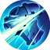
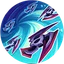

[Главная](https://boostmlbb.ru/) / [Герои](https://boostmlbb.ru/heroes/)

Тир A

# Сабер в Mobile Legends: сборка, контрпики и статистика

Убийца, лес или роум. Выигрывает 51,21% матчей за последние 30 дней — 41-е место из 133 героев.

[Буст на этом герое](https://boostmlbb.ru/order.html?type=hero)[Все герои](https://boostmlbb.ru/heroes/)

Статистика герояТир A

**Сабер**Бан 25,07% · Выбор 1,02%

Контрпики

Победы за 30 дней**51,21%**

**51,21%**побед за 30 дней

**1,02%**выбирают в матчах

**25,07%**банят в матчах

**53,51%**побед в Мифической славе

## Сборка на героя «Сабер»

Самая популярная сборка для героя «Сабер» на роли леса в рейтинговых матчах на всех рангах — по данным «Академии» в игре. Процент побед — в матчах именно с этой сборкой.

Ключевые предметы

Удар охотникаТопор войныБесконечная битва

Эмблема и таланты

Эмблема бойцаТрепетОпытный охотникВременное правление

Боевое заклинание

Возмездие

Побед с этой сборкой **60,38%**Выбирают в **2,00%** матчей

### Другие популярные варианты

-   ВозмездиеЭмблема бойцаТрепет · Опытный охотник · Временное правление**57,04%**
-   ВозмездиеЭмблема убийцыТрепет · Опытный охотник · Временное правление**59,67%**

## Навыки героя «Сабер»

Официальные описания навыков от MOONTON с перезарядкой и типом навыка.

Порядок прокачки: **Тройной удар** → **Летающие мечи** → **Рывок**

-   

    **Погибель врагам**Пассивный

    Каждый раз, когда Сабер наносит урон, он снижает цели на 3-8 на 5 сек. (до 5 зарядов).

-   

    **Летающие мечи**1-й навыкПерезарядка 10 Mana Cost: 60 с

    Сабер выпускает 5 мечей, которые вращаются вокруг него и наносят 75 (+25% дополнительной физической атаки) единиц физического урона ближайшим врагам при попадании. По истечении времени действия мечи возвращаются обратно.
    Пока они активны, атаки мечом наносят 200 (+50% дополнительной физической атаки) единиц физического урона цели и 50% урона врагам на пути (урон против миньонов снижается до 50%). Каждая атака мечом сокращает перезарядку "Летающих мечей" на 0.5 сек. и "Рывка" на 1 сек.

-   

    **Рывок**2-й навыкПерезарядка 7 Mana Cost: 40 с

    Сабер совершает рывок в указанном направлении, нанося 75 (+50% дополнительной физической атаки) единиц физического урона врагам на пути.
    После рывка он получает усиленную базовую атаку, которая позволяет ему совершить рывок к цели, нанося 75 (+120% общей физической атаки) единиц физического урона и замедляя ее на 60% на 1 сек.

-   

    **Тройной удар**УльтимейтПерезарядка 44 Mana Cost: 100 с

    Сабер бросается к указанному вражескому герою, подбрасывая его на 1.2 сек. (на это не влияет "Устойчивость"). В течение этого времени он наносит по нему 3 быстрых удара: первые 2 удара наносят 120 (+80% дополнительной физической атаки) единиц физического урона, а третий удар наносит 240 (+160% дополнительной физической атаки) единиц физического урона.

## Роль и линия

Место считается по проценту побед за 30 дней среди героев той же роли или линии.

-   Роль**Убийца**
-   Линия**Лес или роум**
-   Среди убийц**4-е из 29**
-   В лесу**8-е из 37**
-   В роуме**13-е из 34**
-   Специализация**Рывок, Добивание**
-   Сложность**Низкая (30/100)**

## Кто контрит этого героя

Против этих героев «Сабер» проигрывает чаще всего. Под иконкой — их собственный процент побед. 3 из 5 контрпиков — убийцы.

[Линг52,54%](https://boostmlbb.ru/heroes/ling.html)[Нолан49,71%](https://boostmlbb.ru/heroes/nolan.html)[Наталья51,05%](https://boostmlbb.ru/heroes/natalia.html)[Люнокс50,64%](https://boostmlbb.ru/heroes/lunox.html)[Ив52,26%](https://boostmlbb.ru/heroes/yve.html)

## Против кого силён

Для этих героев «Сабер» — один из самых неудобных соперников.

[Ханаби52,66%](https://boostmlbb.ru/heroes/hanabi.html)[Мия49,71%](https://boostmlbb.ru/heroes/miya.html)[Сан53,72%](https://boostmlbb.ru/heroes/sun.html)[Нана47,27%](https://boostmlbb.ru/heroes/nana.html)[Альфа48,85%](https://boostmlbb.ru/heroes/alpha.html)[Тамуз48,91%](https://boostmlbb.ru/heroes/thamuz.html)[Джонсон49,25%](https://boostmlbb.ru/heroes/johnson.html)[Бальмонд46,66%](https://boostmlbb.ru/heroes/balmond.html)[Мартис47,23%](https://boostmlbb.ru/heroes/martis.html)[Хильда51,07%](https://boostmlbb.ru/heroes/hilda.html)

## С кем играть в команде

С этими героями в одной команде «Сабер» выигрывает чаще. Число — прибавка к проценту побед в процентных пунктах.

[Дигги+6,13 п. п.](https://boostmlbb.ru/heroes/diggie.html)[Марсель+4,45 п. п.](https://boostmlbb.ru/heroes/marcel.html)[Эстес+3,46 п. п.](https://boostmlbb.ru/heroes/estes.html)[Минотавр+3,29 п. п.](https://boostmlbb.ru/heroes/minotaur.html)

## Процент побед по рангам

Лучший результат — на ранге «Мифическая слава» (53,51%), слабее всего — «Эпик» (48,42%). Данные за последние 30 дней.

-   Эпик**48,42%**
-   Легенда**50,03%**
-   Мифический**51,12%**
-   Мифическая честь**51,13%**
-   Мифическая слава**53,51%**

## Место в мете

«Сабер» — тир A в нашем тир-листе по проценту побед, 41-е место из 133 героев. В Мифической славе процент побед выше: 53,51% против 51,21% на всех рангах, разница 2,30 п. п. Полный [тир-лист ноября](https://boostmlbb.ru/news/mlbb-meta-tier-list/) и [разбор патча](https://boostmlbb.ru/news/mlbb-current-patch/).

## Другие герои леса

Самые сильные по проценту побед за последние 30 дней.

[Сан53,72%](https://boostmlbb.ru/heroes/sun.html)[Аулус53,46%](https://boostmlbb.ru/heroes/aulus.html)[Линг52,54%](https://boostmlbb.ru/heroes/ling.html)[Пополь и Купа52,09%](https://boostmlbb.ru/heroes/popol-and-kupa.html)[Лукас51,97%](https://boostmlbb.ru/heroes/lukas.html)[Бэйн51,61%](https://boostmlbb.ru/heroes/bane.html)

## История героя

«Мечник, искавший непобедимости, подопытный Лаборатории 1718.»

Полная история героя «Сабер» — на официальном сайте лора MOONTON. Карточка героя с навыками и советами разработчиков — на mobilelegends.com, реплики, облики и история изменений — в MLBB Wiki.

[Читать историю](https://play.mobilelegends.com/lore/hero/Saber)[Карточка героя](https://www.mobilelegends.com/hero/detail?heroid=3)[MLBB Wiki](https://mobile-legends.fandom.com/wiki/Saber)

## Буст на герое «Сабер»

Бустер играет только этим героем: вместе с рангом растёт и рейтинг героя.

[Рассчитать стоимость](https://boostmlbb.ru/order.html?type=hero)

Статистика — официальный рейтинг героев MOONTON (mobilelegends.com/rank) за последние 30 дней, обновление 23 ноября 2026 года, страница обновляется каждый день. Роли и линии — с официальной страницы героев. Сборки, навыки и союзники — данные «Академии» MOONTON через Rone Arena API (ridwaanhall / RoneAI).

## Частые вопросы

Кто контрпик для героя «Сабер» в MLBB?

За последние 30 дней чаще всего героя обыгрывают Линг, Нолан, Наталья, Люнокс и Ив.

Какой процент побед у героя «Сабер» сейчас?

51,21% за последние 30 дней на всех рангах и 53,51% в Мифической славе, данные на 23 ноября 2026 года.

Какая роль и линия у героя «Сабер»?

Убийца, играет в лесу или в роуме.

Силён ли герой «Сабер» в текущей мете?

Тир A: 41-е место из 133 героев по проценту побед за 30 дней и 4-е среди убийц.

Какая сборка на героя «Сабер» лучшая?

Самая популярная сборка в рейтинге: ключевые предметы «Удар охотника», «Топор войны» и «Бесконечная битва», эмблема бойца с талантами «Трепет», «Опытный охотник» и «Временное правление» и заклинание «Возмездие». С ней выигрывают 60,38% матчей.

Редакция MLBB Boost · Обновлено 23 ноября 2026
