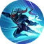

[Тир-лист](https://boostmlbb.ru/heroes/)[Новости и гайды](https://boostmlbb.ru/news/)

# Сабер

A

УбийцаЛесРоум

Мечник, искавший непобедимости, подопытный Лаборатории 1718.

Победы

53,7%

все ранги 51,2%

Выбор

0,8%

все ранги 1,0%

Баны

12,7%

все ранги 25,1%

№16 в тир-листе · №3 среди убийц · Мифическая слава, 7 дней, по 23 ноября

[Обзор](https://boostmlbb.ru/#overview)[Сборка](https://boostmlbb.ru/#build)[Навыки](https://boostmlbb.ru/#skills)[Контрпики](https://boostmlbb.ru/#draft)[История](https://boostmlbb.ru/#lore)

## Обзор

### Характеристики

-   Живучесть**20**
-   Атака**60**
-   Эффекты**60**
-   Сложность**30**

-   Рывок
-   Добивание

### Победы по рангам, 30 дней

1.  **48,4%**Эпик
2.  **50,0%**Легенда
3.  **51,1%**Мифик
4.  **51,1%**Честь
5.  **53,5%**Слава

Пунктир: 50% побед

### Другие убийцы этой линии

[Хирара](https://boostmlbb.ru/heroes/hirara.html)[Нолан](https://boostmlbb.ru/heroes/nolan.html)[Линг](https://boostmlbb.ru/heroes/ling.html)[Карина](https://boostmlbb.ru/heroes/karina.html)[Госсен](https://boostmlbb.ru/heroes/gusion.html)[Ли Сун-Син](https://boostmlbb.ru/heroes/yi-sun-shin.html)[Эймон](https://boostmlbb.ru/heroes/aamon.html)[Ханзо](https://boostmlbb.ru/heroes/hanzo.html)

## Сборка

Лес · по данным рейтинговых матчей

Сборка 159,7%Сборка 257,0%Сборка 360,4%

### Предметы

Удар охотника

Топор войны

Бесконечная битва

### Эмблема

Эмблема убийцы

Трепет

Опытный охотник

Временное правление

### Заклинание

Возмездие

Победы

59,7%

Выбор

18,4%

### Предметы

Удар охотника

Топор войны

Кираса грубой силы

### Эмблема

Эмблема бойца

Трепет

Опытный охотник

Временное правление

### Заклинание

Возмездие

Победы

57,0%

Выбор

4,7%

### Предметы

Удар охотника

Топор войны

Бесконечная битва

### Эмблема

Эмблема бойца

Трепет

Опытный охотник

Временное правление

### Заклинание

Возмездие

Победы

60,4%

Выбор

2,0%

## Навыки

Прокачка**Тройной удар**_›_**Летающие мечи**_›_**Рывок**

Пассивный1-й навык2-й навыкУльтимейт

Пассивный

### Погибель врагам

Каждый раз, когда Сабер наносит урон, он снижает цели на 3-8 на 5 сек. (до 5 зарядов).

1-й навык

### Летающие мечи

Перезарядка **10 Mana Cost: 60 с**

Сабер выпускает 5 мечей, которые вращаются вокруг него и наносят 75 (+25% дополнительной физической атаки) единиц физического урона ближайшим врагам при попадании. По истечении времени действия мечи возвращаются обратно.

Пока они активны, атаки мечом наносят 200 (+50% дополнительной физической атаки) единиц физического урона цели и 50% урона врагам на пути (урон против миньонов снижается до 50%). Каждая атака мечом сокращает перезарядку "Летающих мечей" на 0.5 сек. и "Рывка" на 1 сек.

2-й навык

### Рывок

Перезарядка **7 Mana Cost: 40 с**

Сабер совершает рывок в указанном направлении, нанося 75 (+50% дополнительной физической атаки) единиц физического урона врагам на пути.

После рывка он получает усиленную базовую атаку, которая позволяет ему совершить рывок к цели, нанося 75 (+120% общей физической атаки) единиц физического урона и замедляя ее на 60% на 1 сек.

Ультимейт

### Тройной удар

Перезарядка **44 Mana Cost: 100 с**

Сабер бросается к указанному вражескому герою, подбрасывая его на 1.2 сек. (на это не влияет "Устойчивость"). В течение этого времени он наносит по нему 3 быстрых удара: первые 2 удара наносят 120 (+80% дополнительной физической атаки) единиц физического урона, а третий удар наносит 240 (+160% дополнительной физической атаки) единиц физического урона.

## Контрпики и союзники

### Контрпики

Побеждают этого героя

[Линг](https://boostmlbb.ru/heroes/ling.html)[Нолан](https://boostmlbb.ru/heroes/nolan.html)[Наталья](https://boostmlbb.ru/heroes/natalia.html)[Люнокс](https://boostmlbb.ru/heroes/lunox.html)[Ив](https://boostmlbb.ru/heroes/yve.html)

### Слабые цели

Этот герой побеждает их

[Ханаби](https://boostmlbb.ru/heroes/hanabi.html)[Мия](https://boostmlbb.ru/heroes/miya.html)[Сан](https://boostmlbb.ru/heroes/sun.html)[Нана](https://boostmlbb.ru/heroes/nana.html)[Альфа](https://boostmlbb.ru/heroes/alpha.html)[Тамуз](https://boostmlbb.ru/heroes/thamuz.html)[Джонсон](https://boostmlbb.ru/heroes/johnson.html)[Бальмонд](https://boostmlbb.ru/heroes/balmond.html)[Мартис](https://boostmlbb.ru/heroes/martis.html)[Хильда](https://boostmlbb.ru/heroes/hilda.html)

### Союзники

Рост побед в паре, п. п.

[Дигги**+6,1**](https://boostmlbb.ru/heroes/diggie.html)[Марсель**+4,5**](https://boostmlbb.ru/heroes/marcel.html)[Эстес**+3,5**](https://boostmlbb.ru/heroes/estes.html)[Минотавр**+3,3**](https://boostmlbb.ru/heroes/minotaur.html)

## История

> Мечник, искавший непобедимости, подопытный Лаборатории 1718.

[Читать полную историю ↗](https://play.mobilelegends.com/lore/hero/Saber)Официальный сайт Mobile Legends

[Характеристики на сайте игры ↗](https://www.mobilelegends.com/hero/detail?heroid=3)

**Поднимем ранг на герое «Сабер»**Цена считается в калькуляторе

[Рассчитать цену](https://boostmlbb.ru/order.html?type=hero)

## Частые вопросы

Кто контрпик для героя «Сабер» в MLBB?

За последние 30 дней чаще всего героя обыгрывают Линг, Нолан, Наталья, Люнокс и Ив.

Какой процент побед у героя «Сабер» сейчас?

53,66% в Мифической славе за последние 7 дней и 51,21% на всех рангах за 30 дней, данные на 23 ноября 2026 года.

Какая роль и линия у героя «Сабер»?

Убийца, играет в лесу или в роуме.

Силён ли герой «Сабер» в текущей мете?

Тир A, 16-е место из 133 героев и 3-е среди убийц. Тир учитывает, как часто героя берут и банят и как он выигрывает в Мифической славе за 7 дней: бан в 12,7% матчей, 53,7% побед.

Какая сборка на героя «Сабер» лучшая?

Самая популярная сборка в рейтинге: ключевые предметы «Удар охотника», «Топор войны» и «Бесконечная битва», эмблема убийцы с талантами «Трепет», «Опытный охотник» и «Временное правление» и заклинание «Возмездие». С ней выигрывают 59,67% матчей.
