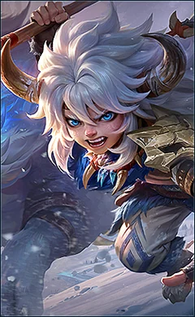

[Тир-лист](https://boostmlbb.ru/heroes/)[Предметы](https://boostmlbb.ru/items/)[Скины](https://boostmlbb.ru/skins/)[Новости и гайды](https://boostmlbb.ru/news/)

[Тир-лист](https://boostmlbb.ru/heroes/)

# Селена

A

УбийцаМагСредняя линия

Победы

48,3%

Выбор

1,4%

Баны

3,4%

[Обзор](https://boostmlbb.ru/#overview)[Сборка](https://boostmlbb.ru/#build)[Как играть](https://boostmlbb.ru/#howto)[Навыки](https://boostmlbb.ru/#skills)[Контрпики](https://boostmlbb.ru/#draft)[Скины](https://boostmlbb.ru/#skins)[История](https://boostmlbb.ru/#lore)

## Обзор

### Характеристики

-   Живучесть**30**
-   Атака**70**
-   Эффекты**100**
-   Сложность**80**

-   Инициатор
-   Добивание

### Другие убийцы этой линии

[Харли](https://boostmlbb.ru/heroes/harley.html)[Кадита](https://boostmlbb.ru/heroes/kadita.html)[Госсен](https://boostmlbb.ru/heroes/gusion.html)

### Места в рейтингах

-   [Лучшие маги MLBB**8 из 32**](https://boostmlbb.ru/heroes/best-mage.html)
-   [Лучшие убийцы MLBB**4 из 29**](https://boostmlbb.ru/heroes/best-assassin.html)
-   [Лучшие мидеры MLBB**6 из 29**](https://boostmlbb.ru/heroes/best-mid.html)

## Сборка

Сборка 1Сборка 2Сборка 3

Победы

53,2%

Выбор

4,8%

#### Основные предметы

-   [

    

    Старлиумовая коса

    ](https://boostmlbb.ru/items/starlium-scythe.html)
-   [

    

    Пылающий жезл

    ](https://boostmlbb.ru/items/glowing-wand.html)
-   [

    

    Фонарь желаний

    ](https://boostmlbb.ru/items/wishing-lantern.html)

#### Заклинание

Вспышка

#### Эмблема и таланты

Эмблема мага

-   

    Вдохновение

-   

    Благословение природы

-   

    Смертельное воспламенение

Победы

57,3%

Выбор

4,1%

#### Основные предметы

-   [

    

    Старлиумовая коса

    ](https://boostmlbb.ru/items/starlium-scythe.html)
-   [

    

    Жезл молний

    ](https://boostmlbb.ru/items/lightning-truncheon.html)
-   [

    

    Божественный меч

    ](https://boostmlbb.ru/items/divine-glaive.html)

#### Заклинание

Вспышка

#### Эмблема и таланты

Эмблема мага

-   

    Вдохновение

-   

    Благословение природы

-   

    Смертельное воспламенение

Победы

54,4%

Выбор

2,0%

#### Основные предметы

-   [

    

    Старлиумовая коса

    ](https://boostmlbb.ru/items/starlium-scythe.html)
-   [

    

    Пылающий жезл

    ](https://boostmlbb.ru/items/glowing-wand.html)
-   [

    

    Жезл молний

    ](https://boostmlbb.ru/items/lightning-truncheon.html)

#### Заклинание

Вспышка

#### Эмблема и таланты

Эмблема мага

-   

    Вдохновение

-   

    Охотник за скидками

-   

    Квантовый заряд

## Как играть за Селену

### Комбо Селены

#### В драке

1.  1
2.  2
3.  Ульт
4.  2
5.  1
6.  2

В форме эльфа связкой первого и второго навыков поймайте врага издалека. Ультом перейдите в форму бездны, связкой второго и первого подскочите и добейте, вторым уйдите.

#### На линии

1.  2
2.  1

В форме эльфа вторым оглушайте, первым тревожьте и наносите урон.

### Когда сильнее всего

Сильнее в долгой игре: на 16–18 минутах выигрывает 49,4%. Не рискуйте в начале, фармите и ввязывайтесь в драки вместе с командой.

1.  **46,2**10–12
2.  **48,9**12–14
3.  **49,4**14–16
4.  **49,4**16–18
5.  **48,8**18–20
6.  **49,4**20+

Проценты побед по длине матча в минутах, все ранги. Пунктир: 50%

### Приоритет прокачки

1.  Настоящая тьма
2.  Ловушка Бездны
3.  Стрела Бездны

## Навыки

Пассивный**Симбиоз**1-й навык**Ловушка Бездны**2-й навык**Стрела Бездны**Ультимейт**Настоящая тьма**

Пассивный

### Симбиоз

Селена может свободно переключаться между двумя формами.

**Форма эльфа:** Селена накладывает метку Бездны, когда ее навыки наносят урон. Метки длятся 8 сек. и могут складываться до 2 раз.

**Форма Бездны:** базовые атаки Селены становятся ближними и наносят (+25% общей магической силы) единиц дополнительного магического урона. Ее навыки наносят 240-450 (+40% общей магической силы) единиц дополнительного магического урона врагам с меткой Бездны и уменьшают их заряды метки на 1. Этот урон повышен до 250% против монстров и миньонов.

1-й навык

### Ловушка Бездны

Перезарядка **8 Mana Cost: 70 с**

Селена призывает дьявола Бездны, который скроется под землей. Дьявол Бездны прикрепляется к любому приблизившемуся врагу, накладывая на него заряд метки Бездны и снижая его скорость передвижения на 50% на 1 сек. Затем дьявол Бездны взорвется, нанося 350 (+150% общей магической силы) единиц магического урона врагам в области и снижая их скорость передвижения на 50% на 1 сек.

Каждый дополнительный дьявол Бездны на враге увеличивает финальный урон на 50%.

Каждый дьявол Бездны может скрываться до 60 сек. Одновременно может существовать до 3 дьяволов Бездны.

2-й навык

### Стрела Бездны

Перезарядка **12 Mana Cost: 80 с**

Селена выпускает дух Бездны в указанном направлении, который останавливается при попадании во вражеского героя, монстра или призванное существо, нанося от 250 (+20% общей магической силы) до 500 (+40% общей магической силы) единиц магического урона пораженной цели, оглушая ее на время от 0.5 до 2.5 сек. и раскрывая ее местоположение (урон и продолжительность оглушения увеличиваются с расстоянием полета духа).

Дух подберет ловушку Бездны, пролетая над ней, и применит ловушку к вражеской цели, оглушая ее.

Если дух оглушает врага на 0.9 сек. или дольше, Селена получает 60% скорости передвижения на 2 сек.

Ультимейт

### Настоящая тьма

Перезарядка **5.5 с**

**Пассивный:** Селена получает 5 .

**Активный:** Селена переходит в форму Бездны и получает 20% скорости передвижения на 0.8 сек. Это также немедленно сбрасывает перезарядку навыков "Пожиратель душ" и "Гаррота".

## Контрпики Селены

### Кто контрит Селену

[Бенедетта](https://boostmlbb.ru/heroes/benedetta.html)[Иксия](https://boostmlbb.ru/heroes/ixia.html)[Икс.Борг](https://boostmlbb.ru/heroes/x-borg.html)[Беатрис](https://boostmlbb.ru/heroes/beatrix.html)[Хелкарт](https://boostmlbb.ru/heroes/helcurt.html)

### Кого контрит Селена

[Пополь и Купа](https://boostmlbb.ru/heroes/popol-and-kupa.html)[Чип](https://boostmlbb.ru/heroes/chip.html)

## Скины Селены

[Райко Серебряная МолнияГрандиозный · 2026](https://boostmlbb.ru/skins/selena/silverbolt-raiko.html)[Пепельное проклятиеГрандиозный · 2025](https://boostmlbb.ru/skins/selena/curse-of-cinder.html)[Леди МестьГрандиозный · 2021](https://boostmlbb.ru/skins/selena/lady-vengeance.html)[Готическое проклятиеОбычный · 2021](https://boostmlbb.ru/skins/selena/gothic-curse.html)[Селена S.T.U.N.Делюкс · 2021](https://boostmlbb.ru/skins/selena/s-t-u-n-selena.html)[Громовая вспышкаИзысканный · 2020](https://boostmlbb.ru/skins/selena/thunder-flash.html)[Двойная личностьИсключительный · 2019](https://boostmlbb.ru/skins/selena/double-identity.html)[Близнецы: ТеньДелюкс · 2019](https://boostmlbb.ru/skins/selena/gemini-shadow.html)[ВирусДелюкс · 2019](https://boostmlbb.ru/skins/selena/virus.html)[Королева осОбычный · 2018](https://boostmlbb.ru/skins/selena/wasp-queen.html)

[Все 10 скинов Селены: цены и как получить](https://boostmlbb.ru/skins/selena.html)

## История

> Темная эльфийка, покоренная Бездной.

[Читать полную историю ↗](https://kazukiofficial.com/stories/selena)Kazuki Official, английский [Характеристики на сайте игры ↗](https://www.mobilelegends.com/hero/detail?heroid=63)

**Поднимем ранг на герое «Селена»**Цена считается в калькуляторе

[Рассчитать цену](https://boostmlbb.ru/order.html?type=hero)

## Частые вопросы

Кто контрит Селену в MLBB?

За последние 30 дней Селену чаще всего обыгрывают Бенедетта, Иксия, Икс.Борг, Беатрис и Хелкарт.

Как играть за Селену?

В первую очередь качайте «Ловушка Бездны», ульт берите, как только доступен. Сильнее в долгой игре: на 16–18 минутах выигрывает 49,4%. Не рискуйте в начале, фармите и ввязывайтесь в драки вместе с командой. Комбо для драки: В форме эльфа связкой первого и второго навыков поймайте врага издалека. Ультом перейдите в форму бездны, связкой второго и первого подскочите и добейте, вторым уйдите.

Какой процент побед у Селены сейчас?

48,34% в Мифической славе за последние 7 дней и 48,46% на всех рангах за 30 дней, данные на 27 ноября 2026 года.

Какая роль и линия у Селены?

Убийца и маг, играет на средней линии.

Стоит ли брать Селену в текущей мете?

Тир A, 25-е место из 133 героев и 4-е среди убийц. Тир учитывает, как часто героя берут и банят и как он выигрывает в Мифической славе за 7 дней: бан в 3,4% матчей, 48,3% побед. В профессиональных матчах за месяц героя драфтуют в 32,9% катков.

Какая сборка на Селену лучшая?

Самая популярная сборка в рейтинге: ключевые предметы «Старлиумовая коса», «Пылающий жезл» и «Фонарь желаний», эмблема мага с талантами «Вдохновение», «Благословение природы» и «Смертельное воспламенение» и заклинание «Вспышка». С ней выигрывают 53,21% матчей.
