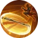

[Главная](https://boostmlbb.ru/) / [Герои](https://boostmlbb.ru/heroes/)

Тир S

# Сан

Боец · Линия опыта или лес

**№ 11 из 133 по доле побед**Все ранги · 30 дней по 23 ноября 2026 года

Победы

53,72%

Выбор

1,75%

Баны

35,31%

Пуш · Урон · Сложность 50/100

[Сборка](https://boostmlbb.ru/#build)[Контрпики и союзники](https://boostmlbb.ru/#draft)[Навыки](https://boostmlbb.ru/#skills)[Победы по рангам](https://boostmlbb.ru/#ranks)[История](https://boostmlbb.ru/#lore)

## Сборка

Самый частый выбор в рейтинге · Линия опыта

Ключевые предметы

Говорящий с ветромКоса коррозииКопье Великого дракона

Эмблема и таланты

Эмблема поддержкиВдохновениеБлагословение природыКвантовый заряд

Боевое заклинание

Окаменение

Побед с этой сборкой **58,06%**Выбирают в **1,35%** матчей

Другие сборки (2)

Ключевые предметы

Штормовой поясГосподство льдаОракул

Эмблема и таланты

Эмблема поддержкиЛовкостьБлагословение природыКвантовый заряд

Боевое заклинание

Восстановление

Побед с этой сборкой **59,72%**Выбирают в **1,88%** матчей

Ключевые предметы

Коса коррозииМеч охотника на демоновЗолотой посох

Эмблема и таланты

Эмблема убийцыТрепетОхотник за скидкамиКвантовый заряд

Боевое заклинание

Окаменение

Побед с этой сборкой **58,23%**Выбирают в **1,31%** матчей

## Контрпики и союзники

### Кто контрит

[Кусака](https://boostmlbb.ru/heroes/jawhead.html)[Дигги](https://boostmlbb.ru/heroes/diggie.html)[Харли](https://boostmlbb.ru/heroes/harley.html)[Сабер](https://boostmlbb.ru/heroes/saber.html)[Кэрри](https://boostmlbb.ru/heroes/karrie.html)

### Против кого силён

[Баданг](https://boostmlbb.ru/heroes/badang.html)[Су Ё](https://boostmlbb.ru/heroes/suyou.html)[Кимми](https://boostmlbb.ru/heroes/kimmy.html)[Алукард](https://boostmlbb.ru/heroes/alucard.html)[Руби](https://boostmlbb.ru/heroes/ruby.html)[Натан](https://boostmlbb.ru/heroes/natan.html)[Марсель](https://boostmlbb.ru/heroes/marcel.html)[Джой](https://boostmlbb.ru/heroes/joy.html)[Фарамис](https://boostmlbb.ru/heroes/faramis.html)

### Союзники

Прибавка к доле побед в одной команде

[Бальмонд+2,35 п. п.](https://boostmlbb.ru/heroes/balmond.html)[Лапу-Лапу+2,34 п. п.](https://boostmlbb.ru/heroes/lapu-lapu.html)[Икс.Борг+2,34 п. п.](https://boostmlbb.ru/heroes/x-borg.html)[Тэризла+2,32 п. п.](https://boostmlbb.ru/heroes/terizla.html)

## Навыки

Приоритет прокачки · Техника клонирования → Бесконечное разнообразие → Быстрый обмен → Мгновенное перемещение

Пассивный**Бог-обезьяна**

У врагов, пораженных Саном или его двойниками, снижается на 5% (складывается до 6 раз). Сан восстанавливает ОЗ в размере 75 плюс 15% от физической атаки двойника каждый раз, когда тот наносит урон.
Базовые атаки Сана или его двойников наносят 65 единиц дополнительного урона монстрам.

1-й навык**Бесконечное разнообразие**

**Перезарядка 6.5 Mana Cost: 70 с**

Сан бросает свой Золотой посох в указанном направлении, нанося 280 (+40% общей физической атаки) единиц физического урона врагам на его пути.
При попадании по вражескому герою или монстру либо по достижении максимальной дальности Золотой посох превращается в двойника, который преследует врагов. Двойник наследует показатели Сана, наносит 60% от урона Сана и получает 150% урона в течение 5 сек.
Этот навык имеет общий уровень и перезарядку с навыком "Быстрый обмен".

2-й навык**Быстрый обмен**

**Перезарядка 6.5 Mana Cost: 70 с**

Сан бросает свой Золотой посох в указанном направлении, нанося 280 (+40% общей физической атаки) ед. физического урона врагам на своем пути.
Он призывает двойника на своей позиции, который наследует его показатели, наносит 60% урона и получает 150% урона в течение 5 сек.
Сан превращается в Золотой посох и маскируется, появляясь на максимальной дальности.

3-й навык**Мгновенное перемещение**

**Перезарядка 5 Mana Cost: 40 с**

Сан приказывает своим двойникам атаковать указанного врага вместе с ним, нанося цели 270 (+40% общей физической атаки) единиц физического урона и замедляя ее и врагов позади нее на 25% (может складываться) на 1.5 сек. Это считается уроном базовой атаки и может активировать эффекты атаки, но не может нанести критический удар.

Ультимейт**Техника клонирования**

**Перезарядка 32 с**

Сан призывает двойника, который наследует его показатели, наносит 80% урона и получает 120% урона в течение 8 сек.

## Победы по рангам

-   Эпик**55,91%**
-   Легенда**55,49%**
-   Мифический**54,40%**
-   Мифическая честь**52,90%**
-   Мифическая слава**52,58%**

## История

Бессмертный Король обезьян, решительный и непреклонный, словно гора.

[Карточка героя](https://www.mobilelegends.com/hero/detail?heroid=27)[MLBB Wiki](https://mobile-legends.fandom.com/wiki/Sun)

[Стоимость буста на герое](https://boostmlbb.ru/order.html?type=hero)

## Частые вопросы

Кто контрпик для героя «Сан» в MLBB?

За последние 30 дней чаще всего героя обыгрывают Кусака, Дигги, Харли, Сабер и Кэрри.

Какой процент побед у героя «Сан» сейчас?

53,72% за последние 30 дней на всех рангах и 52,58% в Мифической славе, данные на 23 ноября 2026 года.

Какая роль и линия у героя «Сан»?

Боец, играет на линии опыта или в лесу.

Силён ли герой «Сан» в текущей мете?

Тир S: 11-е место из 133 героев по проценту побед за 30 дней и 3-е среди бойцов.

Какая сборка на героя «Сан» лучшая?

Самая популярная сборка в рейтинге: ключевые предметы «Говорящий с ветром», «Коса коррозии» и «Копье Великого дракона», эмблема поддержки с талантами «Вдохновение», «Благословение природы» и «Квантовый заряд» и заклинание «Окаменение». С ней выигрывают 58,06% матчей.
