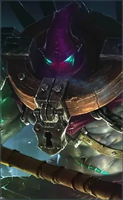

[Тир-лист](https://boostmlbb.ru/heroes/)

# Тэризла

C

ТанкБоецЛиния опыта

Победы

49,9%

Выбор

0,3%

Баны

0,1%

[Обзор](https://boostmlbb.ru/#overview)[Сборка](https://boostmlbb.ru/#build)[Как играть](https://boostmlbb.ru/#howto)[Навыки](https://boostmlbb.ru/#skills)[Контрпики](https://boostmlbb.ru/#draft)[Скины](https://boostmlbb.ru/#skins)[История](https://boostmlbb.ru/#lore)

## Обзор

### Характеристики

-   Живучесть**90**
-   Атака**30**
-   Эффекты**40**
-   Сложность**20**

-   Разрушительный урон
-   Массовый контроль

### Другие танки этой линии

[Маша](https://boostmlbb.ru/heroes/masha.html)[Алиса](https://boostmlbb.ru/heroes/alice.html)[Эсмеральда](https://boostmlbb.ru/heroes/esmeralda.html)[Глу](https://boostmlbb.ru/heroes/gloo.html)[Бартс](https://boostmlbb.ru/heroes/barats.html)[Уранус](https://boostmlbb.ru/heroes/uranus.html)[Хильда](https://boostmlbb.ru/heroes/hilda.html)[Гатоткача](https://boostmlbb.ru/heroes/gatotkaca.html)

### Места в рейтингах

-   [Лучшие бойцы MLBB**34 из 44**](https://boostmlbb.ru/heroes/best-fighter.html)
-   [Лучшие танки MLBB**19 из 25**](https://boostmlbb.ru/heroes/best-tank.html)

## Сборка

Сборка 1Сборка 2Сборка 3

Победы

57,1%

Выбор

14,0%

#### Основные предметы

-   [

    

    Топор войны

    ](https://boostmlbb.ru/items/war-axe.html)
-   [

    

    Крылья королевы

    ](https://boostmlbb.ru/items/queens-wings.html)
-   [

    

    Оракул

    ](https://boostmlbb.ru/items/oracle.html)

#### Заклинание

Вспышка

#### Эмблема и таланты

Эмблема бойца

-   

    Трепет

-   

    Кровавое пиршество

-   

    Отвага

Победы

59,5%

Выбор

5,1%

#### Основные предметы

-   [

    

    Топор войны

    ](https://boostmlbb.ru/items/war-axe.html)
-   [

    

    Господство льда

    ](https://boostmlbb.ru/items/dominance-ice.html)
-   [

    

    Крылья королевы

    ](https://boostmlbb.ru/items/queens-wings.html)

#### Заклинание

Вспышка

#### Эмблема и таланты

Эмблема бойца

-   

    Трепет

-   

    Кровавое пиршество

-   

    Отвага

Победы

57,0%

Выбор

3,7%

#### Основные предметы

-   [

    

    Топор войны

    ](https://boostmlbb.ru/items/war-axe.html)
-   [

    

    Крылья королевы

    ](https://boostmlbb.ru/items/queens-wings.html)
-   [

    

    Шипованная броня

    ](https://boostmlbb.ru/items/blade-armor.html)

#### Заклинание

Вспышка

#### Эмблема и таланты

Эмблема бойца

-   

    Трепет

-   

    Кровавое пиршество

-   

    Отвага

## Как играть за Тэризлу

### Комбо Тэризлы

#### В драке

1.  Ульт
2.  1
3.  2

В драке начните ультом и первым навыком, чтобы взять команду врага под контроль, и вторым многократно бейте стянутые цели.

#### На линии

1.  1
2.  2

На линии замедлите первым навыком и вторым наносите урон несколько раз.

### Когда сильнее всего

Сильнее в начале: на 10–12 минутах выигрывает 55,7%. Давите на линии, забирайте объекты и заканчивайте, пока преимущество не растаяло.

1.  **55,7**10–12
2.  **53,7**12–14
3.  **51,7**14–16
4.  **48,9**16–18
5.  **47,7**18–20
6.  **47,1**20+

Проценты побед по длине матча в минутах, все ранги. Пунктир: 50%

### Приоритет прокачки

1.  Область наказания
2.  Удар казни
3.  Удар мести

## Навыки

Пассивный**Тело кузнеца**1-й навык**Удар мести**2-й навык**Удар казни**Ультимейт**Область наказания**

Пассивный

### Тело кузнеца

Тэризла получает 1% доп. снижения урона (до 20 (+1 × ур. героя)%) за кажд. 2.5% потерянных ОЗ.

Он не может получать дополнительную скорость атаки и будет преобразовывать каждый 1% доп. скорости атаки в 1 ед. .

1-й навык

### Удар мести

Перезарядка **8.5 с**

Тэризла бьет молотом по земле, отправляя вперед разлом, который наносит 300 (+80% дополнительной физической атаки) единиц физического урона. При попадании в первую цель разлом впивается в нее, замедляя на 15%. Тэризла также получает 15% скорости передвижения на 3.5 сек.

Затем разлом взрывается, нанося 300 (+80% дополнительной физической атаки) (+20% от потерянных цели) единиц физического урона.

2-й навык

### Удар казни

Перезарядка **9 с**

Тэризла взмахивает молотом в веерообразной области перед собой. Этот навык можно использовать до 3 раз. Первые две атаки наносят 90 (+135% общей физической атаки) единиц физического урона каждая, а третья — 225 (+220% общей физической атаки) единиц физического урона. Пораженные враги также будут замедлены на 20% на 1.25 сек. (замедление может складываться).

Наносит только 80% урона миньонам.

Ультимейт

### Область наказания

Перезарядка **50 с**

Тэризла прыгает в указанную область, нанося 300 (+100% общей физической атаки) единиц физического урона и подбрасывая врагов на 0.6 сек. Затем он призывает эшафот и замедляет врагов на 25%. Эшафот протягивает к вражеским героям крюк в радиусе действия и притягивает их несколько раз, каждый раз нанося 150 (+30% общей физической атаки) единиц физического урона.

## Контрпики Тэризлы

### Кто контрит Тэризлу

[Аргус](https://boostmlbb.ru/heroes/argus.html)[Фовиус](https://boostmlbb.ru/heroes/phoveus.html)[Пополь и Купа](https://boostmlbb.ru/heroes/popol-and-kupa.html)[Одетта](https://boostmlbb.ru/heroes/odette.html)[Лолита](https://boostmlbb.ru/heroes/lolita.html)

### Кого контрит Тэризла

[Икс.Борг](https://boostmlbb.ru/heroes/x-borg.html)

## Скины Тэризлы

[Тиран порчи душИзысканный · 2025](https://boostmlbb.ru/skins/terizla/soulblight-tyrant.html)[Пламя судаДелюкс · 2024](https://boostmlbb.ru/skins/terizla/flames-of-judgement.html)[Ржавая развалинаОбычный · 2023](https://boostmlbb.ru/skins/terizla/rustwreck.html)[ВспышкаОбычный · 2023](https://boostmlbb.ru/skins/terizla/flare.html)[Великан с молотомИсключительный · 2020](https://boostmlbb.ru/skins/terizla/hammer-giant.html)[Страж бездныОбычный · 2019](https://boostmlbb.ru/skins/terizla/abyss-guard.html)

[Все 6 скинов Тэризлы: цены и как получить](https://boostmlbb.ru/skins/terizla.html)

## История

> Некогда эксцентричный талантливый кузнец, ставший мстителем Бездны.

[Читать полную историю ↗](https://play.mobilelegends.com/lore/hero/Terizla)Официальный сайт Mobile Legends [Характеристики на сайте игры ↗](https://www.mobilelegends.com/hero/detail?heroid=82)

**Поднимем ранг на герое «Тэризла»**Цена считается в калькуляторе

[Рассчитать цену](https://boostmlbb.ru/order.html?type=hero)

## Частые вопросы

Кто контрит Тэризлу в MLBB?

За последние 30 дней Тэризлу чаще всего обыгрывают Аргус, Фовиус, Пополь и Купа, Одетта и Лолита.

Как играть за Тэризлу?

В первую очередь качайте «Удар казни», ульт берите, как только доступен. Сильнее в начале: на 10–12 минутах выигрывает 55,7%. Давите на линии, забирайте объекты и заканчивайте, пока преимущество не растаяло. Комбо для драки: В драке начните ультом и первым навыком, чтобы взять команду врага под контроль, и вторым многократно бейте стянутые цели.

Какой процент побед у Тэризлы сейчас?

49,89% в Мифической славе за последние 7 дней и 50,60% на всех рангах за 30 дней, данные на 27 ноября 2026 года.

Какая роль и линия у Тэризлы?

Танк и боец, играет на линии опыта.

Стоит ли брать Тэризлу в текущей мете?

Тир C, 108-е место из 133 героев и 19-е среди танков. Тир учитывает, как часто героя берут и банят и как он выигрывает в Мифической славе за 7 дней: бан в 0,1% матчей, 49,9% побед. В профессиональных матчах за месяц героя драфтуют в 0,5% катков.

Какая сборка на Тэризлу лучшая?

Самая популярная сборка в рейтинге: ключевые предметы «Топор войны», «Крылья королевы» и «Оракул», эмблема бойца с талантами «Трепет», «Кровавое пиршество» и «Отвага» и заклинание «Вспышка». С ней выигрывают 57,11% матчей.
