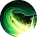

[Тир-лист](https://boostmlbb.ru/heroes/)[Новости и гайды](https://boostmlbb.ru/news/)

# Тэризла

C

ТанкБоецЛиния опыта

Некогда эксцентричный талантливый кузнец, ставший мстителем Бездны.

Победы

49,9%

все ранги 50,6%

Выбор

0,3%

все ранги 0,3%

Баны

0,1%

все ранги 0,2%

№92 в тир-листе · №14 среди танков · Мифическая слава, 7 дней, по 23 ноября

[Обзор](https://boostmlbb.ru/#overview)[Сборка](https://boostmlbb.ru/#build)[Навыки](https://boostmlbb.ru/#skills)[Контрпики](https://boostmlbb.ru/#draft)[История](https://boostmlbb.ru/#lore)

## Обзор

### Характеристики

-   Живучесть**90**
-   Атака**30**
-   Эффекты**40**
-   Сложность**20**

-   Разрушительный урон
-   Массовый контроль

### Победы по рангам, 30 дней

1.  **51,3%**Эпик
2.  **51,7%**Легенда
3.  **51,5%**Мифик
4.  **50,6%**Честь
5.  **49,5%**Слава

Пунктир: 50% побед

### Другие танки этой линии

[Маша](https://boostmlbb.ru/heroes/masha.html)[Глу](https://boostmlbb.ru/heroes/gloo.html)[Алиса](https://boostmlbb.ru/heroes/alice.html)[Бартс](https://boostmlbb.ru/heroes/barats.html)[Эдит](https://boostmlbb.ru/heroes/edith.html)[Хильда](https://boostmlbb.ru/heroes/hilda.html)[Эсмеральда](https://boostmlbb.ru/heroes/esmeralda.html)[Уранус](https://boostmlbb.ru/heroes/uranus.html)

## Сборка

Линия опыта · по данным рейтинговых матчей

Сборка 157,1%Сборка 259,8%Сборка 356,8%

### Предметы

Топор войны

Крылья королевы

Оракул

### Эмблема

Эмблема бойца

Трепет

Кровавое пиршество

Отвага

### Заклинание

Вспышка

Победы

57,1%

Выбор

16,1%

### Предметы

Топор войны

Господство льда

Крылья королевы

### Эмблема

Эмблема бойца

Трепет

Кровавое пиршество

Отвага

### Заклинание

Вспышка

Победы

59,8%

Выбор

5,1%

### Предметы

Топор войны

Крылья королевы

Господство льда

### Эмблема

Эмблема бойца

Трепет

Кровавое пиршество

Отвага

### Заклинание

Вспышка

Победы

56,8%

Выбор

2,3%

## Навыки

Прокачка**Область наказания**_›_**Удар казни**_›_**Удар мести**

Пассивный1-й навык2-й навыкУльтимейт

Пассивный

### Тело кузнеца

Тэризла получает 1% доп. снижения урона (до 20 (+1 × ур. героя)%) за кажд. 2.5% потерянных ОЗ.

Он не может получать дополнительную скорость атаки и будет преобразовывать каждый 1% доп. скорости атаки в 1 ед. .

1-й навык

### Удар мести

Перезарядка **8.5 с**

Тэризла бьет молотом по земле, отправляя вперед разлом, который наносит 300 (+80% дополнительной физической атаки) единиц физического урона. При попадании в первую цель разлом впивается в нее, замедляя на 15%. Тэризла также получает 15% скорости передвижения на 3.5 сек.

Затем разлом взрывается, нанося 300 (+80% дополнительной физической атаки) (+20% от потерянных цели) единиц физического урона.

2-й навык

### Удар казни

Перезарядка **9 с**

Тэризла взмахивает молотом в веерообразной области перед собой. Этот навык можно использовать до 3 раз. Первые две атаки наносят 90 (+135% общей физической атаки) единиц физического урона каждая, а третья — 225 (+220% общей физической атаки) единиц физического урона. Пораженные враги также будут замедлены на 20% на 1.25 сек. (замедление может складываться).

Наносит только 80% урона миньонам.

Ультимейт

### Область наказания

Перезарядка **50 с**

Тэризла прыгает в указанную область, нанося 300 (+100% общей физической атаки) единиц физического урона и подбрасывая врагов на 0.6 сек. Затем он призывает эшафот и замедляет врагов на 25%. Эшафот протягивает к вражеским героям крюк в радиусе действия и притягивает их несколько раз, каждый раз нанося 150 (+30% общей физической атаки) единиц физического урона.

## Контрпики и союзники

### Контрпики

Побеждают этого героя

[Аргус](https://boostmlbb.ru/heroes/argus.html)[Фовиус](https://boostmlbb.ru/heroes/phoveus.html)[Лолита](https://boostmlbb.ru/heroes/lolita.html)[Пополь и Купа](https://boostmlbb.ru/heroes/popol-and-kupa.html)[Одетта](https://boostmlbb.ru/heroes/odette.html)

### Слабые цели

Этот герой побеждает их

[Икс.Борг](https://boostmlbb.ru/heroes/x-borg.html)

### Союзники

Рост побед в паре, п. п.

[Сан**+2,3**](https://boostmlbb.ru/heroes/sun.html)[Ангела**+2,2**](https://boostmlbb.ru/heroes/angela.html)[Флорин**+1,6**](https://boostmlbb.ru/heroes/floryn.html)[Альфа**+1,5**](https://boostmlbb.ru/heroes/alpha.html)

## История

> Некогда эксцентричный талантливый кузнец, ставший мстителем Бездны.

[Читать полную историю ↗](https://play.mobilelegends.com/lore/hero/Terizla)Официальный сайт Mobile Legends

[Характеристики на сайте игры ↗](https://www.mobilelegends.com/hero/detail?heroid=82)

**Поднимем ранг на герое «Тэризла»**Цена считается в калькуляторе

[Рассчитать цену](https://boostmlbb.ru/order.html?type=hero)

## Частые вопросы

Кто контрпик для героя «Тэризла» в MLBB?

За последние 30 дней чаще всего героя обыгрывают Аргус, Фовиус, Лолита, Пополь и Купа и Одетта.

Какой процент побед у героя «Тэризла» сейчас?

49,88% в Мифической славе за последние 7 дней и 50,60% на всех рангах за 30 дней, данные на 23 ноября 2026 года.

Какая роль и линия у героя «Тэризла»?

Танк и боец, играет на линии опыта.

Силён ли герой «Тэризла» в текущей мете?

Тир C, 92-е место из 133 героев и 14-е среди танков. Тир учитывает, как часто героя берут и банят и как он выигрывает в Мифической славе за 7 дней: бан в 0,1% матчей, 49,9% побед.

Какая сборка на героя «Тэризла» лучшая?

Самая популярная сборка в рейтинге: ключевые предметы «Топор войны», «Крылья королевы» и «Оракул», эмблема бойца с талантами «Трепет», «Кровавое пиршество» и «Отвага» и заклинание «Вспышка». С ней выигрывают 57,09% матчей.
