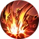
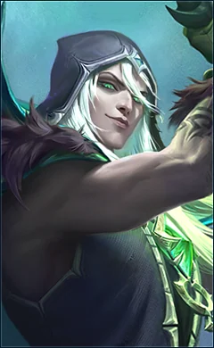

[Тир-лист](https://boostmlbb.ru/heroes/)[Предметы](https://boostmlbb.ru/items/)[Скины](https://boostmlbb.ru/skins/)[Новости и гайды](https://boostmlbb.ru/news/)

[Тир-лист](https://boostmlbb.ru/heroes/)

# Тамуз

C

БоецЛиния опытаЛес

Победы

48,3%

Выбор

0,6%

Баны

0,5%

[Обзор](https://boostmlbb.ru/#overview)[Сборка](https://boostmlbb.ru/#build)[Как играть](https://boostmlbb.ru/#howto)[Навыки](https://boostmlbb.ru/#skills)[Контрпики](https://boostmlbb.ru/#draft)[Скины](https://boostmlbb.ru/#skins)[История](https://boostmlbb.ru/#lore)

## Обзор

### Характеристики

-   Живучесть**70**
-   Атака**40**
-   Эффекты**20**
-   Сложность**60**

-   Преследование
-   Урон

### Победы по рангам, 30 дней

1.  **48,5%**Эпик
2.  **48,9%**Легенда
3.  **49,8%**Мифик
4.  **48,9%**Честь
5.  **48,5%**Слава

Пунктир: 50% побед

### Другие бойцы этой линии

[Фрейя](https://boostmlbb.ru/heroes/freya.html)[Аулус](https://boostmlbb.ru/heroes/aulus.html)[Пакито](https://boostmlbb.ru/heroes/paquito.html)[Сан](https://boostmlbb.ru/heroes/sun.html)[Лукас](https://boostmlbb.ru/heroes/lukas.html)[Су Ё](https://boostmlbb.ru/heroes/suyou.html)[Чичи](https://boostmlbb.ru/heroes/cici.html)[Сора](https://boostmlbb.ru/heroes/sora.html)

### Места в рейтингах

-   [Лучшие лесники MLBB**23 из 37**](https://boostmlbb.ru/heroes/best-jungle.html)
-   [Лучшие бойцы MLBB**29 из 44**](https://boostmlbb.ru/heroes/best-fighter.html)

## Сборка

Сборка 1Сборка 2

Победы

55,7%

Выбор

15,8%

#### Основные предметы

-   [

    

    Коса коррозии

    ](https://boostmlbb.ru/items/corrosion-scythe.html)
-   [

    

    Топор войны

    ](https://boostmlbb.ru/items/war-axe.html)
-   [

    

    Оракул

    ](https://boostmlbb.ru/items/oracle.html)

#### Заклинание

Месть

#### Эмблема и таланты

Эмблема бойца

-   

    Трепет

-   

    Кровавое пиршество

-   

    Временное правление

Победы

57,1%

Выбор

2,4%

#### Основные предметы

-   [

    

    Коса коррозии

    ](https://boostmlbb.ru/items/corrosion-scythe.html)
-   [

    

    Топор войны

    ](https://boostmlbb.ru/items/war-axe.html)
-   [

    

    Крылья королевы

    ](https://boostmlbb.ru/items/queens-wings.html)

#### Заклинание

Месть

#### Эмблема и таланты

Эмблема бойца

-   

    Трепет

-   

    Кровавое пиршество

-   

    Временное правление

## Как играть за Тамуза

### Комбо Тамуза

#### В драке

1.  1
2.  2
3.  Ульт
4.  Атака
5.  1
6.  Атака

В драке первым навыком ускорьтесь и займите позицию, вторым запрыгните в толпу. Ульт, атака и первый, соберите серпы и бейте дальше.

#### На линии

1.  1
2.  2
3.  Атака
4.  1
5.  Атака

На линии: первый навык, затем прыжок вторым, серпы вернутся и обновят первый. Атака, первый и повторное нажатие, чтобы забрать серпы.

### Когда сильнее всего

Сильнее в долгой игре: после 20-й минуты выигрывает 50,1%. Не рискуйте в начале, фармите и ввязывайтесь в драки вместе с командой.

1.  **47,6**10–12
2.  **48,3**12–14
3.  **49,0**14–16
4.  **49,7**16–18
5.  **49,9**18–20
6.  **50,1**20+

Проценты побед по длине матча в минутах, все ранги. Пунктир: 50%

### Приоритет прокачки

1.  Выжигающее инферно
2.  Горящие косы
3.  Топот Бездны

## Навыки

Пассивный**Великий лорд лавы**1-й навык**Горящие косы**2-й навык**Топот Бездны**Ультимейт**Выжигающее инферно**

Пассивный

### Великий лорд лавы

Базовые атаки Тамуза с вероятностью от 10% до 60% (в зависимости от "Ярости лавы") вызывают энергию лавы под целью, которая вырывается наружу после небольшой задержки, нанося 55 (+60% общей физической атаки)(+8 × ур. героя) единиц чистого урона. Базовые атаки, не вызвавшие энергию лавы, увеличивают "Ярость лавы" Тамуза.

Пока у Тамуза нет кос, он получает 25% к скорости передвижения. После возвращения кос его следующая базовая атака замедляет цель на 30% и гарантированно вызывает энергию лавы.

1-й навык

### Горящие косы

Тамуз бросает косы в указанном направлении. После прохождения определенного расстояния или попадания в первого вражеского героя они наносят 120 (+60% общей физической атаки) единиц физического урона. Затем косы замедляют ближайших врагов на 30% и наносят 45 (+20% дополнительной физической атаки) единиц физического урона кажд. 0.5 сек.

Через короткое время после отдаления от Тамуза или при достижении определенного расстояния косы возвращаются к нему, притягивая врагов на своем пути. Тамуз может двигаться к косам или использовать навык снова, чтобы вернуть их.

2-й навык

### Топот Бездны

Перезарядка **8 с**

Тамуз прыгает в указанную область, чтобы нанести 230 (+60% дополнительной физической атаки) единиц физического урона и замедлить врагов на 25% на 2 сек. во время приземления.

Если косы не в руках Тамуза, то они вернутся к нему, и навык "Горящие косы" немедленно сбросит свою перезарядку.

Ультимейт

### Выжигающее инферно

Перезарядка **38 с**

Тамуз извергает лаву изнутри, нанося 300 (+80% общей физической атаки) единиц физического урона ближайшим врагам и создавая обжигающую зону вокруг себя. Обжигающая зона длится 9 сек. и наносит врагам в области 30 (+10% дополнительной физической атаки) единиц физического урона кажд. 0.5 сек.

В это время Тамуз получает 800 (+50% доп. макс. ОЗ) , мгновенно лечится на ту же величину и получает 60% к скорости атаки. Каждый раз, когда его базовые атаки или косы наносят урон, он восстанавливает 1.5% от макс. ОЗ.

## Контрпики Тамуза

### Кто контрит Тамуза

[Алукард](https://boostmlbb.ru/heroes/alucard.html)[Алиса](https://boostmlbb.ru/heroes/alice.html)[Одетта](https://boostmlbb.ru/heroes/odette.html)[Сабер](https://boostmlbb.ru/heroes/saber.html)[Фарамис](https://boostmlbb.ru/heroes/faramis.html)

### Кого контрит Тамуз

[Ли Сун-Син](https://boostmlbb.ru/heroes/yi-sun-shin.html)[Чичи](https://boostmlbb.ru/heroes/cici.html)

## Скины Тамуза

[Анниги­ляторГрандиозный · 2025](https://boostmlbb.ru/skins/thamuz/the-annihilator.html)[Жнец бездныИсключительный · 2025](https://boostmlbb.ru/skins/thamuz/abyssal-reaper.html)[Освящённое пламяИсключительный · 2023](https://boostmlbb.ru/skins/thamuz/sanctified-flame.html)[Генерал КайГрандиозный · 2023](https://boostmlbb.ru/skins/thamuz/general-kai.html)[Владыка призраковОбычный · 2022](https://boostmlbb.ru/skins/thamuz/lord-of-wraith.html)[Жидкий огоньОбычный · 2019](https://boostmlbb.ru/skins/thamuz/liquid-fire.html)

[Все 6 скинов Тамуза: цены и как получить](https://boostmlbb.ru/skins/thamuz.html)

## История

> Верховный повелитель огненных демонов, жаждущий разжечь пламя Бездны через войну и жестокость.

[Читать полную историю ↗](https://play.mobilelegends.com/lore/hero/Thamuz)Официальный сайт Mobile Legends [Характеристики на сайте игры ↗](https://www.mobilelegends.com/hero/detail?heroid=72)

**Поднимем ранг на герое «Тамуз»**Цена считается в калькуляторе

[Рассчитать цену](https://boostmlbb.ru/order.html?type=hero)

## Частые вопросы

Кто контрит Тамуза в MLBB?

За последние 30 дней Тамуза чаще всего обыгрывают Алукард, Алиса, Одетта, Сабер и Фарамис.

Как играть за Тамуза?

В первую очередь качайте «Горящие косы», ульт берите, как только доступен. Сильнее в долгой игре: после 20-й минуты выигрывает 50,1%. Не рискуйте в начале, фармите и ввязывайтесь в драки вместе с командой. Комбо для драки: В драке первым навыком ускорьтесь и займите позицию, вторым запрыгните в толпу. Ульт, атака и первый, соберите серпы и бейте дальше.

Какой процент побед у Тамуза сейчас?

48,33% в Мифической славе за последние 7 дней и 48,90% на всех рангах за 30 дней, данные на 26 ноября 2026 года.

Какая роль и линия у Тамуза?

Боец, играет на линии опыта или в лесу.

Стоит ли брать Тамуза в текущей мете?

Тир C, 94-е место из 133 героев и 29-е среди бойцов. Тир учитывает, как часто героя берут и банят и как он выигрывает в Мифической славе за 7 дней: бан в 0,5% матчей, 48,3% побед. В профессиональных матчах за месяц героя драфтуют в 1,7% катков.

Какая сборка на Тамуза лучшая?

Самая популярная сборка в рейтинге: ключевые предметы «Коса коррозии», «Топор войны» и «Оракул», эмблема бойца с талантами «Трепет», «Кровавое пиршество» и «Временное правление» и заклинание «Месть». С ней выигрывают 55,67% матчей.
