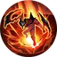
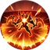

[Главная](https://boostmlbb.ru/) / [Герои](https://boostmlbb.ru/heroes/)

Тир C

# Тамуз

Боец · Линия опыта или лес

**№ 92 из 133 по доле побед**Все ранги · 30 дней по 23 ноября 2026 года

Победы

48,91%

Выбор

0,82%

Баны

1,59%

Преследование · Урон · Сложность 60/100

[Сборка](https://boostmlbb.ru/#build)[Контрпики и союзники](https://boostmlbb.ru/#draft)[Навыки](https://boostmlbb.ru/#skills)[Победы по рангам](https://boostmlbb.ru/#ranks)[История](https://boostmlbb.ru/#lore)

## Сборка

Самый частый выбор в рейтинге · Линия опыта

Ключевые предметы

Коса коррозииТопор войныКрылья королевы

Эмблема и таланты

Эмблема бойцаТрепетКровавое пиршествоВременное правление

Боевое заклинание

Месть

Побед с этой сборкой **57,34%**Выбирают в **2,40%** матчей

Другие сборки (2)

Ключевые предметы

Коса коррозииТопор войныКольцо героя

Эмблема и таланты

Эмблема бойцаТрепетКровавое пиршествоВременное правление

Боевое заклинание

Месть

Побед с этой сборкой **13,43%**Выбирают в **1,49%** матчей

Ключевые предметы

Коса коррозииТопор войныОракул

Эмблема и таланты

Эмблема бойцаТрепетКровавое пиршествоВременное правление

Боевое заклинание

Месть

Побед с этой сборкой **55,94%**Выбирают в **15,49%** матчей

## Контрпики и союзники

### Кто контрит

[Алукард](https://boostmlbb.ru/heroes/alucard.html)[Алиса](https://boostmlbb.ru/heroes/alice.html)[Одетта](https://boostmlbb.ru/heroes/odette.html)[Сабер](https://boostmlbb.ru/heroes/saber.html)[Дигги](https://boostmlbb.ru/heroes/diggie.html)

### Против кого силён

[Ли Сун-Син](https://boostmlbb.ru/heroes/yi-sun-shin.html)[Чичи](https://boostmlbb.ru/heroes/cici.html)

### Союзники

Прибавка к доле побед в одной команде

[Лапу-Лапу+2,89 п. п.](https://boostmlbb.ru/heroes/lapu-lapu.html)[Чонг+2,57 п. п.](https://boostmlbb.ru/heroes/yu-zhong.html)[Бенедетта+2,18 п. п.](https://boostmlbb.ru/heroes/benedetta.html)[Гвиневра+1,65 п. п.](https://boostmlbb.ru/heroes/guinevere.html)

## Навыки

Приоритет прокачки · Выжигающее инферно → Горящие косы → Топот Бездны

Пассивный**Великий лорд лавы**

Базовые атаки Тамуза с вероятностью от 10% до 60% (в зависимости от "Ярости лавы") вызывают энергию лавы под целью, которая вырывается наружу после небольшой задержки, нанося 55 (+60% общей физической атаки)(+8\*Hero Level) единиц чистого урона. Базовые атаки, не вызвавшие энергию лавы, увеличивают "Ярость лавы" Тамуза.
Пока у Тамуза нет кос, он получает 25% к скорости передвижения. После возвращения кос его следующая базовая атака замедляет цель на 30% и гарантированно вызывает энергию лавы.

1-й навык**Горящие косы**

Тамуз бросает косы в указанном направлении. После прохождения определенного расстояния или попадания в первого вражеского героя они наносят 120 (+60% общей физической атаки) единиц физического урона. Затем косы замедляют ближайших врагов на 30% и наносят 45 (+20% дополнительной физической атаки) единиц физического урона кажд. 0.5 сек.
Через короткое время после отдаления от Тамуза или при достижении определенного расстояния косы возвращаются к нему, притягивая врагов на своем пути. Тамуз может двигаться к косам или использовать навык снова, чтобы вернуть их.

2-й навык**Топот Бездны**

**Перезарядка 8 с**

Тамуз прыгает в указанную область, чтобы нанести 230 (+60% дополнительной физической атаки) единиц физического урона и замедлить врагов на 25% на 2 сек. во время приземления.
Если косы не в руках Тамуза, то они вернутся к нему, и навык "Горящие косы" немедленно сбросит свою перезарядку.

Ультимейт**Выжигающее инферно**

**Перезарядка 38 с**

Тамуз извергает лаву изнутри, нанося 300 (+80% общей физической атаки) единиц физического урона ближайшим врагам и создавая обжигающую зону вокруг себя. Обжигающая зона длится 9 сек. и наносит врагам в области 30 (+10% дополнительной физической атаки) единиц физического урона кажд. 0.5 сек.
В это время Тамуз получает 800 (+50% доп. макс. ОЗ) , мгновенно лечится на ту же величину и получает 60% к скорости атаки. Каждый раз, когда его базовые атаки или косы наносят урон, он восстанавливает 1.5% от макс. ОЗ.

## Победы по рангам

-   Эпик**48,50%**
-   Легенда**48,93%**
-   Мифический**49,80%**
-   Мифическая честь**48,88%**
-   Мифическая слава**48,57%**

## История

Верховный повелитель огненных демонов, жаждущий разжечь пламя Бездны через войну и жестокость.

[Читать историю](https://play.mobilelegends.com/lore/hero/Thamuz)[Карточка героя](https://www.mobilelegends.com/hero/detail?heroid=72)[MLBB Wiki](https://mobile-legends.fandom.com/wiki/Thamuz)

[Стоимость буста на герое](https://boostmlbb.ru/order.html?type=hero)

## Частые вопросы

Кто контрпик для героя «Тамуз» в MLBB?

За последние 30 дней чаще всего героя обыгрывают Алукард, Алиса, Одетта, Сабер и Дигги.

Какой процент побед у героя «Тамуз» сейчас?

48,91% за последние 30 дней на всех рангах и 48,57% в Мифической славе, данные на 23 ноября 2026 года.

Какая роль и линия у героя «Тамуз»?

Боец, играет на линии опыта или в лесу.

Силён ли герой «Тамуз» в текущей мете?

Тир C: 92-е место из 133 героев по проценту побед за 30 дней и 31-е среди бойцов.

Какая сборка на героя «Тамуз» лучшая?

Самая популярная сборка в рейтинге: ключевые предметы «Коса коррозии», «Топор войны» и «Крылья королевы», эмблема бойца с талантами «Трепет», «Кровавое пиршество» и «Временное правление» и заклинание «Месть». С ней выигрывают 57,34% матчей.
