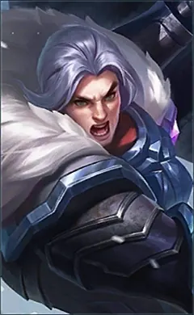

[Тир-лист](https://boostmlbb.ru/heroes/)

# Тигрил

B

ТанкРоум

Победы

45,1%

Выбор

1,7%

Баны

5,0%

[Обзор](https://boostmlbb.ru/#overview)[Сборка](https://boostmlbb.ru/#build)[Как играть](https://boostmlbb.ru/#howto)[Навыки](https://boostmlbb.ru/#skills)[Контрпики](https://boostmlbb.ru/#draft)[Скины](https://boostmlbb.ru/#skins)[История](https://boostmlbb.ru/#lore)

## Обзор

### Характеристики

-   Живучесть**80**
-   Атака**10**
-   Эффекты**100**
-   Сложность**10**

-   Массовый контроль

### Другие танки этой линии

[Кармилла](https://boostmlbb.ru/heroes/carmilla.html)[Белерик](https://boostmlbb.ru/heroes/belerick.html)[Атлас](https://boostmlbb.ru/heroes/atlas.html)[Глу](https://boostmlbb.ru/heroes/gloo.html)[Минотавр](https://boostmlbb.ru/heroes/minotaur.html)[Хуфра](https://boostmlbb.ru/heroes/khufra.html)[Хильда](https://boostmlbb.ru/heroes/hilda.html)[Гатоткача](https://boostmlbb.ru/heroes/gatotkaca.html)

### Места в рейтингах

-   [Лучшие танки MLBB**12 из 25**](https://boostmlbb.ru/heroes/best-tank.html)
-   [Лучшие роумеры MLBB**18 из 34**](https://boostmlbb.ru/heroes/best-roam.html)

## Сборка

Сборка 1Сборка 2Сборка 3

Победы

48,4%

Выбор

10,4%

#### Основные предметы

-   [

    

    Мимолетное время

    ](https://boostmlbb.ru/items/fleeting-time.html)
-   [

    

    Господство льда

    ](https://boostmlbb.ru/items/dominance-ice.html)
-   [

    

    Щит валькирии

    ](https://boostmlbb.ru/items/athenas-shield.html)

#### Заклинание

Вспышка

#### Эмблема и таланты

Эмблема танка

-   

    Ловкость

-   

    Второе дыхание

-   

    Ударная волна

Победы

49,5%

Выбор

6,4%

#### Основные предметы

-   [

    

    Господство льда

    ](https://boostmlbb.ru/items/dominance-ice.html)
-   [

    

    Мимолетное время

    ](https://boostmlbb.ru/items/fleeting-time.html)
-   [

    

    Щит валькирии

    ](https://boostmlbb.ru/items/athenas-shield.html)

#### Заклинание

Вспышка

#### Эмблема и таланты

Эмблема танка

-   

    Ловкость

-   

    Второе дыхание

-   

    Ударная волна

Победы

49,4%

Выбор

4,1%

#### Основные предметы

-   [

    

    Мимолетное время

    ](https://boostmlbb.ru/items/fleeting-time.html)
-   [

    

    Господство льда

    ](https://boostmlbb.ru/items/dominance-ice.html)
-   [

    

    Сияющая броня

    ](https://boostmlbb.ru/items/radiant-armor.html)

#### Заклинание

Вспышка

#### Эмблема и таланты

Эмблема танка

-   

    Ловкость

-   

    Второе дыхание

-   

    Ударная волна

## Как играть за Тигрила

### Комбо Тигрила

#### В драке

1.  2
2.  Ульт
3.  2
4.  1

В драке рваните вторым и ультом стяните врагов. Под конец контроля продлите его вторым и добавьте первый.

#### На линии

1.  2
2.  2
3.  1

На линии рывком второго подойдите и повторным нажатием подбросьте, первым добавьте урон.

### Когда сильнее всего

Сильнее в долгой игре: после 20-й минуты выигрывает 47,9%. Не рискуйте в начале, фармите и ввязывайтесь в драки вместе с командой.

1.  **43,0**10–12
2.  **44,1**12–14
3.  **45,4**14–16
4.  **46,3**16–18
5.  **47,0**18–20
6.  **47,9**20+

Проценты побед по длине матча в минутах, все ранги. Пунктир: 50%

### Приоритет прокачки

1.  Имплозия
2.  Атакующая волна
3.  Священный молот

## Навыки

Пассивный**Бесстрашие**1-й навык**Атакующая волна**2-й навык**Священный молот**Ультимейт**Имплозия**

Пассивный

### Бесстрашие

Тигрил получает 1 заряд "Бесстрашия" каждый раз, когда по нему попадает базовая атака. При 4 зарядах он расходует их, чтобы заблокировать следующую базовую атаку (включая атаки башен).

Он также получает 1 заряд "Бесстрашия" каждый раз, когда применяет навык.

Урон от миньонов не добавляет и не расходует заряды "Бесстрашия".

1-й навык

### Атакующая волна

Перезарядка **7 Mana Cost: 45 с**

Тигрил бьет молотом по земле, отправляя ударную волну, которая взрывается 3 раза в веерообразной области. Каждый взрыв наносит 270 (+70% общей физической атаки) единиц физического урона пораженным врагам и замедляет их на 20% / 40% / 60% на 1.5 сек.

2-й навык

### Священный молот

Перезарядка **16 Mana Cost: 70 с**

Тигрил бросается в указанном направлении, нанося (+100% общей физической атаки) единиц физического урона врагам по пути и толкая их до окончания рывка.

**Повторное использование:** Тигрил может снова использовать этот навык в течение 4 сек., нанося 280 (+60% общей физической атаки) единиц физического урона врагам перед собой и подбрасывая их на 0.6 сек.

Ультимейт

### Имплозия

Перезарядка **55 Mana Cost: 120 с**

Тигрил высвобождает силу своего молота, притягивая к себе ближайших врагов, нанося 600 (+130% общей физической атаки) единиц физического урона и оглушая их на 1.8 сек.

Первую фазу подготовки навыка можно прервать эффектами контроля, а вторую фазу можно прервать только подавлением.

## Контрпики Тигрила

### Кто контрит Тигрила

[Эстес](https://boostmlbb.ru/heroes/estes.html)[Зилонг](https://boostmlbb.ru/heroes/zilong.html)[Алукард](https://boostmlbb.ru/heroes/alucard.html)[Лесли](https://boostmlbb.ru/heroes/lesley.html)[Франко](https://boostmlbb.ru/heroes/franco.html)

### Кого контрит Тигрил

[Цзэтянь](https://boostmlbb.ru/heroes/zetian.html)[Алиса](https://boostmlbb.ru/heroes/alice.html)[Аулус](https://boostmlbb.ru/heroes/aulus.html)

## Скины Тигрила

[Небесный генерал2026](https://boostmlbb.ru/skins/tigreal/celestial-general.html)[Стальной стражОбычный · 2025](https://boostmlbb.ru/skins/tigreal/steel-guardian.html)[Паша правосудияИсключительный · 2024](https://boostmlbb.ru/skins/tigreal/pasha-of-justice.html)[Галакти­ческий маршалИсключительный · 2022](https://boostmlbb.ru/skins/tigreal/galactic-marshal.html)[Золотой баронИсключительный · 2021](https://boostmlbb.ru/skins/tigreal/gold-baron.html)[Рождённый светом: ЗащитникДелюкс · 2019](https://boostmlbb.ru/skins/tigreal/lightborn-defender.html)[Убийца змиевОбычный · 2018](https://boostmlbb.ru/skins/tigreal/wyrmslayer.html)[Павший стражОбычный · 2017](https://boostmlbb.ru/skins/tigreal/fallen-guard.html)[Тёмный стражОбычный · 2016](https://boostmlbb.ru/skins/tigreal/dark-guardian.html)

[Все 9 скинов Тигрила: цены и как получить](https://boostmlbb.ru/skins/tigreal.html)

## История

> Лидер Ордена Света, стоящий на страже Монийской империи.

[Читать полную историю ↗](https://play.mobilelegends.com/lore/hero/Tigreal)Официальный сайт Mobile Legends [Характеристики на сайте игры ↗](https://www.mobilelegends.com/hero/detail?heroid=6)

**Поднимем ранг на герое «Тигрил»**Цена считается в калькуляторе

[Рассчитать цену](https://boostmlbb.ru/order.html?type=hero)

## Частые вопросы

Кто контрит Тигрила в MLBB?

За последние 30 дней Тигрила чаще всего обыгрывают Эстес, Зилонг, Алукард, Лесли и Франко.

Как играть за Тигрила?

В первую очередь качайте «Атакующая волна», ульт берите, как только доступен. Сильнее в долгой игре: после 20-й минуты выигрывает 47,9%. Не рискуйте в начале, фармите и ввязывайтесь в драки вместе с командой. Комбо для драки: В драке рваните вторым и ультом стяните врагов. Под конец контроля продлите его вторым и добавьте первый.

Какой процент побед у Тигрила сейчас?

45,13% в Мифической славе за последние 7 дней и 45,32% на всех рангах за 30 дней, данные на 27 ноября 2026 года.

Какая роль и линия у Тигрила?

Танк, играет в роуме.

Стоит ли брать Тигрила в текущей мете?

Тир B, 69-е место из 133 героев и 12-е среди танков. Тир учитывает, как часто героя берут и банят и как он выигрывает в Мифической славе за 7 дней: бан в 5,0% матчей, 45,1% побед. В профессиональных матчах за месяц героя драфтуют в 0,0% катков.

Какая сборка на Тигрила лучшая?

Самая популярная сборка в рейтинге: ключевые предметы «Мимолетное время», «Господство льда» и «Щит валькирии», эмблема танка с талантами «Ловкость», «Второе дыхание» и «Ударная волна» и заклинание «Вспышка». С ней выигрывают 48,38% матчей.
