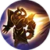

[Главная](https://boostmlbb.ru/) / [Герои](https://boostmlbb.ru/heroes/)

Тир B

# Уранус в Mobile Legends: сборка, контрпики и статистика

Танк, линия опыта. Выигрывает 49,34% матчей за последние 30 дней — 83-е место из 133 героев.

[Буст на этом герое](https://boostmlbb.ru/order.html?type=hero)[Все герои](https://boostmlbb.ru/heroes/)

Статистика герояТир B

**Уранус**Бан 0,33% · Выбор 0,31%

Контрпики

Победы за 30 дней**49,34%**

**49,34%**побед за 30 дней

**0,31%**выбирают в матчах

**0,33%**банят в матчах

**48,25%**побед в Мифической славе

## Сборка на героя «Уранус»

Самая популярная сборка для героя «Уранус» на роли линии опыта в рейтинговых матчах на всех рангах — по данным «Академии» в игре. Процент побед — в матчах именно с этой сборкой.

Ключевые предметы

Штормовой поясГосподство льдаОракул

Эмблема и таланты

Обычная эмблемаЛовкостьСтойкостьУдарная волна

Боевое заклинание

Восстановление

Побед с этой сборкой **60,19%**Выбирают в **3,01%** матчей

### Другие популярные варианты

-   ВосстановлениеОбычная эмблемаЛовкость · Стойкость · Ударная волна**58,65%**
-   ВосстановлениеОбычная эмблемаЛовкость · Стойкость · Ударная волна**56,37%**

## Навыки героя «Уранус»

Официальные описания навыков от MOONTON с перезарядкой и типом навыка.

Порядок прокачки: **Посвящение** → **Ионный предел** → **Превосходный страж**

-   

    **Сияние**Пассивный

    При каждом получении урона Уранус получает заряд "Сияния". Каждый заряд восстанавливает 1.2-11.2 ОЗ (увеличивается с уровнем) кажд. 0.8 сек. в течение 10 сек., максимум 20 зар.
    Базовые атаки Урануса наносят (+80% общей физической атаки) (+4-8 × заряды "Сияния") магического урона (увеличивается с уровнем).

-   

    **Ионный предел**1-й навыкПерезарядка 4 Mana Cost: 60 с

    Уранус высвобождает 2 энергетических лезвия, которые вращаются вокруг него, нанося 155 (+30% общей магической силы) (+6 × заряды "Сияния") магического урона пораженным врагам и замедляя их на 30% в течение 2 сек.
    Каждое лезвие может нанести урон одной и той же цели только один раз.

-   

    **Превосходный страж**2-й навыкПерезарядка 10 Mana Cost: 80 с

    Уранус совершает рывок в указанное место, нанося 80 (+20% общей магической силы) единиц магического урона врагам по пути и 160 (+80% общей магической силы) единиц магического урона врагам в этом месте и замедляя их на 25%. Также Уранус создает 300 (+200% общей магической силы) ед. щита на 4 сек.
    Щит взрывается по истечении времени действия или при разрушении, нанося 300 (+150% общей магической силы) единиц магического урона врагам поблизости.

-   

    **Посвящение**УльтимейтПерезарядка 42 Mana Cost: 100 с

    Уранус высвобождает энергию, накопленную в его теле, снимая с себя эффекты замедления, восстанавливая 200 ОЗ и получая 60% скорости передвижения на 8 сек. (спадает со временем).
    Уранус сразу получает 5 зарядов "Сияния", увеличивая получаемые щиты и регенерацию ОЗ на 20% на 8 сек.

## Роль и линия

Место считается по проценту побед за 30 дней среди героев той же роли или линии.

-   Роль**Танк**
-   Линия**Линия опыта**
-   Среди танков**16-е из 25**
-   На линии опыта**26-е из 42**
-   Специализация**Регенерация,**
-   Сложность**Низкая (20/100)**

## Кто контрит этого героя

Против этих героев «Уранус» проигрывает чаще всего. Под иконкой — их собственный процент побед. 3 из 5 контрпиков — бойцы.

[Аргус56,78%](https://boostmlbb.ru/heroes/argus.html)[Инь49,62%](https://boostmlbb.ru/heroes/yin.html)[Гатоткача45,35%](https://boostmlbb.ru/heroes/gatotkaca.html)[Дигги54,30%](https://boostmlbb.ru/heroes/diggie.html)[Грейнджер42,99%](https://boostmlbb.ru/heroes/granger.html)

## Против кого силён

Для этих героев «Уранус» — один из самых неудобных соперников.

[Дариус49,30%](https://boostmlbb.ru/heroes/dyrroth.html)[Кимми48,74%](https://boostmlbb.ru/heroes/kimmy.html)[Алдос51,86%](https://boostmlbb.ru/heroes/aldous.html)[Ло Йи47,35%](https://boostmlbb.ru/heroes/luo-yi.html)

## С кем играть в команде

С этими героями в одной команде «Уранус» выигрывает чаще. Число — прибавка к проценту побед в процентных пунктах.

[Ангела+3,52 п. п.](https://boostmlbb.ru/heroes/angela.html)[Альфа+1,58 п. п.](https://boostmlbb.ru/heroes/alpha.html)[Бэйн+1,50 п. п.](https://boostmlbb.ru/heroes/bane.html)[Сан+1,31 п. п.](https://boostmlbb.ru/heroes/sun.html)

## Процент побед по рангам

Лучший результат — на ранге «Эпик» (51,65%), слабее всего — «Мифическая слава» (48,25%). Данные за последние 30 дней.

-   Эпик**51,65%**
-   Легенда**50,82%**
-   Мифический**50,13%**
-   Мифическая честь**49,00%**
-   Мифическая слава**48,25%**

## Место в мете

«Уранус» — тир B в нашем тир-листе по проценту побед, 83-е место из 133 героев. Героя выбирают реже чем в 0,5% матчей, поэтому процент побед может заметно колебаться. В Мифической славе процент побед ниже: 48,25% против 49,34% на всех рангах, разница 1,09 п. п. Полный [тир-лист ноября](https://boostmlbb.ru/news/mlbb-meta-tier-list/) и [разбор патча](https://boostmlbb.ru/news/mlbb-current-patch/).

## Другие герои линии опыта

Самые сильные по проценту побед за последние 30 дней.

[Маша60,40%](https://boostmlbb.ru/heroes/masha.html)[Аргус56,78%](https://boostmlbb.ru/heroes/argus.html)[Сан53,72%](https://boostmlbb.ru/heroes/sun.html)[Аулус53,46%](https://boostmlbb.ru/heroes/aulus.html)[Глу53,45%](https://boostmlbb.ru/heroes/gloo.html)[Эдит52,67%](https://boostmlbb.ru/heroes/edith.html)

## История героя

«Страж, созданный из воздуха и молний, охраняющий Небесный дворец.»

Полная история героя «Уранус» — на официальном сайте лора MOONTON. Карточка героя с навыками и советами разработчиков — на mobilelegends.com, реплики, облики и история изменений — в MLBB Wiki.

[Читать историю](https://www.mobilelegends.com/hero/detail?heroid=59)[Карточка героя](https://www.mobilelegends.com/hero/detail?heroid=59)[MLBB Wiki](https://mobile-legends.fandom.com/wiki/Uranus)

## Буст на герое «Уранус»

Бустер играет только этим героем: вместе с рангом растёт и рейтинг героя.

[Рассчитать стоимость](https://boostmlbb.ru/order.html?type=hero)

Статистика — официальный рейтинг героев MOONTON (mobilelegends.com/rank) за последние 30 дней, обновление 23 ноября 2026 года, страница обновляется каждый день. Роли и линии — с официальной страницы героев. Сборки, навыки и союзники — данные «Академии» MOONTON через Rone Arena API (ridwaanhall / RoneAI).

## Частые вопросы

Кто контрпик для героя «Уранус» в MLBB?

За последние 30 дней чаще всего героя обыгрывают Аргус, Инь, Гатоткача, Дигги и Грейнджер.

Какой процент побед у героя «Уранус» сейчас?

49,34% за последние 30 дней на всех рангах и 48,25% в Мифической славе, данные на 23 ноября 2026 года.

Какая роль и линия у героя «Уранус»?

Танк, играет на линии опыта.

Силён ли герой «Уранус» в текущей мете?

Тир B: 83-е место из 133 героев по проценту побед за 30 дней и 16-е среди танков.

Какая сборка на героя «Уранус» лучшая?

Самая популярная сборка в рейтинге: ключевые предметы «Штормовой пояс», «Господство льда» и «Оракул», обычная эмблема с талантами «Ловкость», «Стойкость» и «Ударная волна» и заклинание «Восстановление». С ней выигрывают 60,19% матчей.

Редакция MLBB Boost · Обновлено 23 ноября 2026
