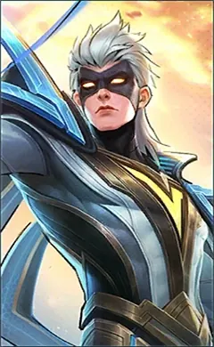

[Тир-лист](https://boostmlbb.ru/heroes/)[Предметы](https://boostmlbb.ru/items/)[Скины](https://boostmlbb.ru/skins/)[Новости и гайды](https://boostmlbb.ru/news/)

[Тир-лист](https://boostmlbb.ru/heroes/)

# Вэйл

C

МагСредняя линия

Победы

48,9%

Выбор

0,3%

Баны

0,1%

[Обзор](https://boostmlbb.ru/#overview)[Сборка](https://boostmlbb.ru/#build)[Как играть](https://boostmlbb.ru/#howto)[Навыки](https://boostmlbb.ru/#skills)[Контрпики](https://boostmlbb.ru/#draft)[Скины](https://boostmlbb.ru/#skins)[История](https://boostmlbb.ru/#lore)

## Обзор

### Характеристики

-   Живучесть**20**
-   Атака**100**
-   Эффекты**70**
-   Сложность**10**

-   Разрушительный урон
-   Массовый контроль

### Победы по рангам, 30 дней

1.  **51,5%**Эпик
2.  **50,9%**Легенда
3.  **50,6%**Мифик
4.  **49,6%**Честь
5.  **48,8%**Слава

Пунктир: 50% побед

### Другие маги этой линии

[Кимми](https://boostmlbb.ru/heroes/kimmy.html)[Эйдора](https://boostmlbb.ru/heroes/eudora.html)[Чжусинь](https://boostmlbb.ru/heroes/zhuxin.html)[Валир](https://boostmlbb.ru/heroes/valir.html)[Цзэтянь](https://boostmlbb.ru/heroes/zetian.html)[Ксавьер](https://boostmlbb.ru/heroes/xavier.html)[Лилия](https://boostmlbb.ru/heroes/lylia.html)[Люнокс](https://boostmlbb.ru/heroes/lunox.html)

### Места в рейтингах

-   [Лучшие маги MLBB**28 из 32**](https://boostmlbb.ru/heroes/best-mage.html)
-   [Лучшие мидеры MLBB**25 из 29**](https://boostmlbb.ru/heroes/best-mid.html)

## Сборка

Сборка 1Сборка 2Сборка 3

Победы

55,0%

Выбор

6,8%

#### Основные предметы

-   [

    

    Палочка гения

    ](https://boostmlbb.ru/items/genius-wand.html)
-   [

    

    Пылающий жезл

    ](https://boostmlbb.ru/items/glowing-wand.html)
-   [

    

    Божественный меч

    ](https://boostmlbb.ru/items/divine-glaive.html)

#### Заклинание

Вспышка

#### Эмблема и таланты

Эмблема убийцы

-   

    Разрыв

-   

    Мастер оружий

-   

    Смертельное воспламенение

Победы

52,0%

Выбор

2,6%

#### Основные предметы

-   [

    

    Пронзающий небеса

    ](https://boostmlbb.ru/items/sky-piercer.html)
-   [

    

    Палочка гения

    ](https://boostmlbb.ru/items/genius-wand.html)
-   [

    

    Божественный меч

    ](https://boostmlbb.ru/items/divine-glaive.html)

#### Заклинание

Огненный выстрел

#### Эмблема и таланты

Эмблема мага

-   

    Трепет

-   

    Мастер оружий

-   

    Нечестивая ярость

Победы

55,1%

Выбор

1,6%

#### Основные предметы

-   [

    

    Палочка гения

    ](https://boostmlbb.ru/items/genius-wand.html)
-   [

    

    Пылающий жезл

    ](https://boostmlbb.ru/items/glowing-wand.html)
-   [

    

    Божественный меч

    ](https://boostmlbb.ru/items/divine-glaive.html)

#### Заклинание

Огненный выстрел

#### Эмблема и таланты

Эмблема убийцы

-   

    Разрыв

-   

    Мастер оружий

-   

    Смертельное воспламенение

## Как играть за Вэйла

### Комбо Вэйла

#### В драке

1.  2
2.  Ульт
3.  1

В драке подбросьте линию врагов вторым навыком и добавьте ульт и первый.

#### На линии

1.  2
2.  1

На линии подбросьте вторым навыком и ударьте первым.

### Когда сильнее всего

Сильнее в долгой игре: на 18–20 минутах выигрывает 52,3%. Не рискуйте в начале, фармите и ввязывайтесь в драки вместе с командой.

1.  **46,1**10–12
2.  **49,2**12–14
3.  **50,7**14–16
4.  **51,9**16–18
5.  **52,3**18–20
6.  **52,0**20+

Проценты побед по длине матча в минутах, все ранги. Пунктир: 50%

### Приоритет прокачки

1.  Буря
2.  Лезвие ветра
3.  Порыв ветра

## Навыки

Пассивный**Голос ветра**1-й навык**Лезвие ветра**2-й навык**Порыв ветра**Ультимейт**Буря**

Пассивный

### Голос ветра

Вэйл получает 1 заряд "Голоса ветра" каждый раз, когда совершает убийство или ассист, который увеличивает его скорость передвижения на 8. Этот эффект может складываться до 10 раз.

1-й навык

### Лезвие ветра

Перезарядка **6 Mana Cost: 60 с**

Вэйл выпускает два лезвия ветра по левую и правую стороны от указанной области. Каждое лезвие наносит 250 (+80% общей магической силы) единиц магического урона пораженным врагам.

2-й навык

### Порыв ветра

Перезарядка **12 Mana Cost: 70 с**

Вэйл отправляет вихрь в указанном направлении, нанося 350 (+100% общей магической силы) единиц магического урона пораженным врагам и подбрасывая их на 0.8 сек. (Каждого врага можно подбросить только 1 р.) Когда вихрь достигнет пункта назначения, он остановится на 1.6 сек., непрерывно нанося в сумме 150 (+30% общей магической силы) единиц магического урона врагам в радиусе действия.

Ультимейт

### Буря

Перезарядка **36 Mana Cost: 120 с**

Вэйл призывает бурю в указанном месте, нанося в сумме 150 (+30% общей магической силы) единиц магического урона врагам в области, замедляя их на 20% и продолжительно притягивая их к центру бури. Через 1 сек. буря взорвется, нанося 900 (+240% общей магической силы) единиц магического урона.

Оставшиеся вихри также притянутся к центру.

## Контрпики Вэйла

### Кто контрит Вэйла

[Одетта](https://boostmlbb.ru/heroes/odette.html)[Эстес](https://boostmlbb.ru/heroes/estes.html)[Мелисса](https://boostmlbb.ru/heroes/melissa.html)[Рафаэль](https://boostmlbb.ru/heroes/rafaela.html)[Сильвана](https://boostmlbb.ru/heroes/silvanna.html)

### Кого контрит Вэйл

[Лапу-Лапу](https://boostmlbb.ru/heroes/lapu-lapu.html)[Халид](https://boostmlbb.ru/heroes/khaleed.html)

## Скины Вэйла

[Вальс на ветруИсключительный · 2026](https://boostmlbb.ru/skins/vale/windborne-waltz.html)[ГаараДелюкс · 2025](https://boostmlbb.ru/skins/vale/gaara.html)[Хранитель ветровДелюкс · 2025](https://boostmlbb.ru/skins/vale/keeper-of-the-winds.html)[Концерт светаИзысканный · 2024](https://boostmlbb.ru/skins/vale/concerto-of-light.html)[КаннагиОбычный · 2023](https://boostmlbb.ru/skins/vale/kannagi.html)[Снежная буряГрандиозный · 2023](https://boostmlbb.ru/skins/vale/blizzard-storm.html)[Высшая буряИзысканный · 2022](https://boostmlbb.ru/skins/vale/supernal-tempest.html)[Парящий дэватаИсключительный · 2021](https://boostmlbb.ru/skins/vale/soaring-devata.html)[Лазурные ветраОбычный · 2019](https://boostmlbb.ru/skins/vale/cerulean-winds.html)

[Все 9 скинов Вэйла: цены и как получить](https://boostmlbb.ru/skins/vale.html)

## История

> Наследник Ветреного форта, маг ветра.

[Читать полную историю ↗](https://kazukiofficial.com/stories/vale)Kazuki Official, английский [Характеристики на сайте игры ↗](https://www.mobilelegends.com/hero/detail?heroid=66)

**Поднимем ранг на герое «Вэйл»**Цена считается в калькуляторе

[Рассчитать цену](https://boostmlbb.ru/order.html?type=hero)

## Частые вопросы

Кто контрит Вэйла в MLBB?

За последние 30 дней Вэйла чаще всего обыгрывают Одетта, Эстес, Мелисса, Рафаэль и Сильвана.

Как играть за Вэйла?

В первую очередь качайте «Лезвие ветра», ульт берите, как только доступен. Сильнее в долгой игре: на 18–20 минутах выигрывает 52,3%. Не рискуйте в начале, фармите и ввязывайтесь в драки вместе с командой. Комбо для драки: В драке подбросьте линию врагов вторым навыком и добавьте ульт и первый.

Какой процент побед у Вэйла сейчас?

48,89% в Мифической славе за последние 7 дней и 50,12% на всех рангах за 30 дней, данные на 27 ноября 2026 года.

Какая роль и линия у Вэйла?

Маг, играет на средней линии.

Стоит ли брать Вэйла в текущей мете?

Тир C, 114-е место из 133 героев и 28-е среди магов. Тир учитывает, как часто героя берут и банят и как он выигрывает в Мифической славе за 7 дней: бан в 0,1% матчей, 48,9% побед. В профессиональных матчах за месяц героя драфтуют в 0,0% катков.

Какая сборка на Вэйла лучшая?

Самая популярная сборка в рейтинге: ключевые предметы «Палочка гения», «Пылающий жезл» и «Божественный меч», эмблема убийцы с талантами «Разрыв», «Мастер оружий» и «Смертельное воспламенение» и заклинание «Вспышка». С ней выигрывают 54,96% матчей.
