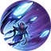

[Тир-лист](https://boostmlbb.ru/heroes/)[Предметы](https://boostmlbb.ru/items/)[Скины](https://boostmlbb.ru/skins/)[Новости и гайды](https://boostmlbb.ru/news/)

[Тир-лист](https://boostmlbb.ru/heroes/)

# Валентина

B

МагСредняя линия

Победы

44,6%

Выбор

0,2%

Баны

0,1%

[Обзор](https://boostmlbb.ru/#overview)[Сборка](https://boostmlbb.ru/#build)[Как играть](https://boostmlbb.ru/#howto)[Навыки](https://boostmlbb.ru/#skills)[Контрпики](https://boostmlbb.ru/#draft)[Скины](https://boostmlbb.ru/#skins)[История](https://boostmlbb.ru/#lore)

## Обзор

### Характеристики

-   Живучесть**50**
-   Атака**40**
-   Эффекты**40**
-   Сложность**80**

-   Разрушительный урон
-   Добивание

### Победы по рангам, 30 дней

1.  **42,4%**Эпик
2.  **42,3%**Легенда
3.  **42,8%**Мифик
4.  **44,1%**Честь
5.  **45,3%**Слава

Пунктир: 50% побед

### Другие маги этой линии

[Кимми](https://boostmlbb.ru/heroes/kimmy.html)[Эйдора](https://boostmlbb.ru/heroes/eudora.html)[Чжусинь](https://boostmlbb.ru/heroes/zhuxin.html)[Валир](https://boostmlbb.ru/heroes/valir.html)[Цзэтянь](https://boostmlbb.ru/heroes/zetian.html)[Лилия](https://boostmlbb.ru/heroes/lylia.html)[Ксавьер](https://boostmlbb.ru/heroes/xavier.html)[Люнокс](https://boostmlbb.ru/heroes/lunox.html)

### Места в рейтингах

-   [Лучшие маги MLBB**13 из 32**](https://boostmlbb.ru/heroes/best-mage.html)
-   [Лучшие мидеры MLBB**11 из 29**](https://boostmlbb.ru/heroes/best-mid.html)

## Сборка

Сборка 1Сборка 2Сборка 3

Победы

51,0%

Выбор

7,8%

#### Основные предметы

-   [

    

    Пылающий жезл

    ](https://boostmlbb.ru/items/glowing-wand.html)
-   [

    

    Жезл молний

    ](https://boostmlbb.ru/items/lightning-truncheon.html)
-   [

    

    Божественный меч

    ](https://boostmlbb.ru/items/divine-glaive.html)

#### Заклинание

Вспышка

#### Эмблема и таланты

Эмблема мага

-   

    Вдохновение

-   

    Благословение природы

-   

    Нечестивая ярость

Победы

49,2%

Выбор

5,6%

#### Основные предметы

-   [

    

    Пылающий жезл

    ](https://boostmlbb.ru/items/glowing-wand.html)
-   [

    

    Жезл молний

    ](https://boostmlbb.ru/items/lightning-truncheon.html)
-   [

    

    Божественный меч

    ](https://boostmlbb.ru/items/divine-glaive.html)

#### Заклинание

Вспышка

#### Эмблема и таланты

Эмблема мага

-   

    Вдохновение

-   

    Охотник за скидками

-   

    Нечестивая ярость

Победы

52,7%

Выбор

4,8%

#### Основные предметы

-   [

    

    Пылающий жезл

    ](https://boostmlbb.ru/items/glowing-wand.html)
-   [

    

    Жезл молний

    ](https://boostmlbb.ru/items/lightning-truncheon.html)
-   [

    

    Кровавые крылья

    ](https://boostmlbb.ru/items/blood-wings.html)

#### Заклинание

Вспышка

#### Эмблема и таланты

Эмблема мага

-   

    Вдохновение

-   

    Благословение природы

-   

    Нечестивая ярость

## Как играть за Валентину

### Комбо Валентины

#### В драке

1.  Ульт
2.  2
3.  1
4.  2
5.  1
6.  Ульт

Скопируйте ульт или вторым займите позицию. Первый, обновление вторым, страх и добивание скопированным ультом.

#### На линии

1.  1
2.  2
3.  2
4.  1

Тревожьте первым, вторым обновите его и тем же первым снова по врагу, чтобы напугать.

### Когда сильнее всего

Сила ровная всю игру, от 43,0% до 45,1%. Выбирайте драки по готовым предметам, а не по минутам.

1.  **43,0**10–12
2.  **43,8**12–14
3.  **44,1**14–16
4.  **44,3**16–18
5.  **43,6**18–20
6.  **45,1**20+

Проценты побед по длине матча в минутах, все ранги. Пунктир: 50%

### Приоритет прокачки

1.  Я — это ты
2.  Теневой удар
3.  Чародейская тень

## Навыки

Пассивный**Первобытная сила**1-й навык**Теневой удар**2-й навык**Чародейская тень**Ультимейт**Я — это ты**

Пассивный

### Первобытная сила

Валентина получает 8-50 дополнительного опыта (зависит от уровня) каждый раз, когда она наносит урон вражескому герою. Перезарядка: 2 сек.

Если уровень вражеского героя не превышает ее уровень, 30% нанесенного урона преобразуется в ее ОЗ.

1-й навык

### Теневой удар

Перезарядка **7 Mana Cost: 70 с**

Валентина использует "Теневой удар" в указанном направлении, нанося 475 (+145% общей магической силы) единиц магического урона пораженным врагам и замедляя их на 40% на 1 сек.

Пораженные вражеские герои получают метку "Теневой знак" на 4 сек. Враги с меткой, снова пораженные "Теневым ударом", повергаются в ужас на 1 сек. (цель можно повергнуть в ужас только один раз кажд. 4 сек.).

2-й навык

### Чародейская тень

Перезарядка **12 Mana Cost: 40 с**

Валентина бросается в указанном направлении, атакуя ближайших врагов 3 теневыми выстрелами, каждый из которых наносит 90 (+30% общей магической силы) единиц магического урона. Она может использовать этот навык снова в течение 6 сек. (тратится мана).

Каждый раз, когда теневой выстрел поражает врага, перезарядка "Теневого удара" сокращается на 1 сек.

Ультимейт

### Я — это ты

Перезарядка **55 с**

Валентина замедляет указанного вражеского героя на 70% на 0.5 сек. и получает возможность использовать его ультимейт. Применение вражеского ультимейта превращает ее в форму вражеского героя и позволяет ей унаследовать его тип базовой атаки на время до 12 сек. (ее обычные навыки остаются неизменными, если ультимейт врага не имеет эффекта превращения).

Уровень украденного ультимейта равен уровню собственного ультимейта Валентины, а его перезарядка составляет 120% от перезарядки цели (но не менее 10 сек.).

Если цель является героем с физическим уроном, Валентина получает (+100% общей магической силы) на время действия. Это нельзя использовать на вражеской Валентине.

## Контрпики Валентины

### Кто контрит Валентину

[Кармилла](https://boostmlbb.ru/heroes/carmilla.html)[Атлас](https://boostmlbb.ru/heroes/atlas.html)[Икс.Борг](https://boostmlbb.ru/heroes/x-borg.html)[Лукас](https://boostmlbb.ru/heroes/lukas.html)[Лолита](https://boostmlbb.ru/heroes/lolita.html)

### Кого контрит Валентина

[Дариус](https://boostmlbb.ru/heroes/dyrroth.html)[Сильвана](https://boostmlbb.ru/heroes/silvanna.html)[Джонсон](https://boostmlbb.ru/heroes/johnson.html)

## Скины Валентины

[Большой гала-вечерОбычный · 2025](https://boostmlbb.ru/skins/valentina/grand-gala.html)[Тёмный нексусДелюкс · 2024](https://boostmlbb.ru/skins/valentina/dark-nexus.html)[Небесная судьяИзысканный · 2023](https://boostmlbb.ru/skins/valentina/celestial-judicator.html)[Кибер-агентИсключительный · 2023](https://boostmlbb.ru/skins/valentina/cyber-agent.html)[Архима­гистрОбычный · 2022](https://boostmlbb.ru/skins/valentina/archmagister.html)[Сумеречная чаровницаОбычный · 2021](https://boostmlbb.ru/skins/valentina/twilight-charmer.html)

[Все 6 скинов Валентины: цены и как получить](https://boostmlbb.ru/skins/valentina.html)

## История

> Прежняя глава Дома Пэксли, которая не остановится ни перед чем, чтобы вернуть своего возлюбленного.

[Читать полную историю ↗](https://play.mobilelegends.com/lore/hero/Valentina)Официальный сайт Mobile Legends [Характеристики на сайте игры ↗](https://www.mobilelegends.com/hero/detail?heroid=110)

**Поднимем ранг на герое «Валентина»**Цена считается в калькуляторе

[Рассчитать цену](https://boostmlbb.ru/order.html?type=hero)

## Частые вопросы

Кто контрит Валентину в MLBB?

За последние 30 дней Валентину чаще всего обыгрывают Кармилла, Атлас, Икс.Борг, Лукас и Лолита.

Как играть за Валентину?

В первую очередь качайте «Теневой удар», ульт берите, как только доступен. Сила ровная всю игру, от 43,0% до 45,1%. Выбирайте драки по готовым предметам, а не по минутам. Комбо для драки: Скопируйте ульт или вторым займите позицию. Первый, обновление вторым, страх и добивание скопированным ультом.

Какой процент побед у Валентины сейчас?

44,64% в Мифической славе за последние 7 дней и 44,64% на всех рангах за 30 дней, данные на 25 ноября 2026 года.

Какая роль и линия у Валентины?

Маг, играет на средней линии.

Стоит ли брать Валентину в текущей мете?

Тир B, 55-е место из 133 героев и 13-е среди магов. Тир учитывает, как часто героя берут и банят и как он выигрывает в Мифической славе за 7 дней: бан в 0,1% матчей, 44,6% побед. В профессиональных матчах за месяц героя драфтуют в 32,8% катков.

Какая сборка на Валентину лучшая?

Самая популярная сборка в рейтинге: ключевые предметы «Пылающий жезл», «Жезл молний» и «Божественный меч», эмблема мага с талантами «Вдохновение», «Благословение природы» и «Нечестивая ярость» и заклинание «Вспышка». С ней выигрывают 51,00% матчей.
