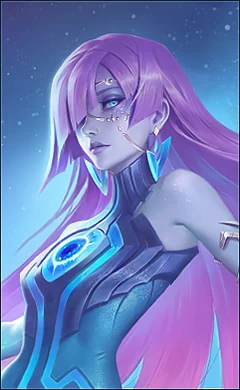
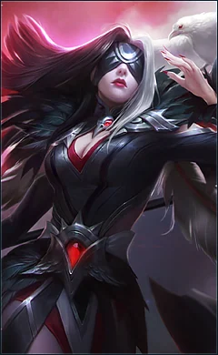
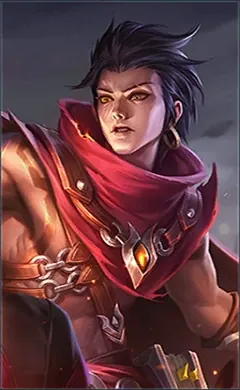

[Тир-лист](https://boostmlbb.ru/heroes/)[Предметы](https://boostmlbb.ru/items/)[Скины](https://boostmlbb.ru/skins/)[Новости и гайды](https://boostmlbb.ru/news/)

[Тир-лист](https://boostmlbb.ru/heroes/)

# Валир

A

МагСредняя линия

Победы

53,5%

Выбор

1,3%

Баны

4,1%

[Обзор](https://boostmlbb.ru/#overview)[Сборка](https://boostmlbb.ru/#build)[Как играть](https://boostmlbb.ru/#howto)[Навыки](https://boostmlbb.ru/#skills)[Контрпики](https://boostmlbb.ru/#draft)[Скины](https://boostmlbb.ru/#skins)[История](https://boostmlbb.ru/#lore)

## Обзор

### Характеристики

-   Живучесть**20**
-   Атака**70**
-   Эффекты**70**
-   Сложность**20**

-   Урон
-   Защита

### Победы по рангам, 30 дней

1.  **54,2%**Эпик
2.  **54,2%**Легенда
3.  **54,6%**Мифик
4.  **54,2%**Честь
5.  **53,7%**Слава

Пунктир: 50% побед

### Другие маги этой линии

[Кимми](https://boostmlbb.ru/heroes/kimmy.html)[Эйдора](https://boostmlbb.ru/heroes/eudora.html)[Чжусинь](https://boostmlbb.ru/heroes/zhuxin.html)[Цзэтянь](https://boostmlbb.ru/heroes/zetian.html)[Лилия](https://boostmlbb.ru/heroes/lylia.html)[Ксавьер](https://boostmlbb.ru/heroes/xavier.html)[Люнокс](https://boostmlbb.ru/heroes/lunox.html)[Валентина](https://boostmlbb.ru/heroes/valentina.html)

### Места в рейтингах

-   [Лучшие маги MLBB**6 из 32**](https://boostmlbb.ru/heroes/best-mage.html)
-   [Лучшие мидеры MLBB**4 из 29**](https://boostmlbb.ru/heroes/best-mid.html)

## Сборка

Сборка 1Сборка 2

Победы

59,4%

Выбор

24,0%

#### Основные предметы

-   [

    

    Пылающий жезл

    ](https://boostmlbb.ru/items/glowing-wand.html)
-   [

    

    Жезл снежной королевы

    ](https://boostmlbb.ru/items/ice-queen-wand.html)
-   [

    

    Фонарь желаний

    ](https://boostmlbb.ru/items/wishing-lantern.html)

#### Заклинание

Вспышка

#### Эмблема и таланты

Обычная эмблема

-   

    Вдохновение

-   

    Кровавое пиршество

-   

    Нечестивая ярость

Победы

60,7%

Выбор

3,3%

#### Основные предметы

-   [

    

    Пылающий жезл

    ](https://boostmlbb.ru/items/glowing-wand.html)
-   [

    

    Жезл снежной королевы

    ](https://boostmlbb.ru/items/ice-queen-wand.html)
-   [

    

    Кираса грубой силы

    ](https://boostmlbb.ru/items/brute-force-breastplate.html)

#### Заклинание

Вспышка

#### Эмблема и таланты

Обычная эмблема

-   

    Вдохновение

-   

    Кровавое пиршество

-   

    Нечестивая ярость

## Как играть за Валира

### Комбо Валира

#### В драке

1.  Ульт
2.  1
3.  1
4.  2
5.  1

В драке включите ульт, чтобы усилить навыки, и жгите врага первым. Если он идёт вплотную, оттолкните вторым и снова ударьте первым с большим уроном.

#### На линии

1.  1
2.  2
3.  1

На линии изматывайте врага первым навыком, пока здоровья не станет мало, затем оттолкните вторым и сразу добейте взрывным уроном первого.

### Когда сильнее всего

Сильнее в начале: на 10–12 минутах выигрывает 58,5%. Давите на линии, забирайте объекты и заканчивайте, пока преимущество не растаяло.

1.  **58,5**10–12
2.  **55,3**12–14
3.  **53,6**14–16
4.  **52,6**16–18
5.  **52,3**18–20
6.  **51,9**20+

Проценты побед по длине матча в минутах, все ранги. Пунктир: 50%

### Приоритет прокачки

1.  Пламя отмщения
2.  Взрывной огненный шар
3.  Жгучий поток

## Навыки

Пассивный**Испепеление**1-й навык**Взрывной огненный шар**2-й навык**Жгучий поток**Ультимейт**Пламя отмщения**

Пассивный

### Испепеление

Навыки Валира накладывают заряд "Поджога" на пораженных врагов, нанося магический урон в размере 1 (+0.2% общей магической силы)% от их каждую секунду в течение 3 сек.

При 3 зарядах происходит взрыв, который наносит магический урон в размере 5 (+1% общей магической силы)% от цели и оглушает ее на 1 сек.

Цель может быть оглушена навыками Валира только один раз кажд. 7 сек.

1-й навык

### Взрывной огненный шар

Перезарядка **1.5 Mana Cost: 45 с**

Валир запускает огненный шар, который взрывается при попадании в первую цель, нанося 235 (+80% общей магической силы) единиц магического урона и замедляя ее на 30% на 1 сек. Пламя, горящее на земле, взрывается через 1 сек., нанося 118 (+40% общей магической силы) единиц магического урона.

Валир накапливает 1 огненный шар кажд. 9 сек. (до 2). Попадание этим навыком во вражеского героя или легендарного монстра немедленно восстанавливает 1 заряд, а попадание в миньона восстанавливает 4 сек. времени накопления.

**Пламя отмщения:** увеличивает дальность применения "Взрывного огненного шара" на 30%.

2-й навык

### Жгучий поток

Перезарядка **13 Mana Cost: 75 с**

Валир выпускает поток пламени в указанном направлении, нанося 200 (+60% общей магической силы) единиц магического урона и отталкивая врагов к концу пути.

**Пламя отмщения:** поток образует стену пламени в конце пути, которая длится 4 сек., нанося 100 (+30% общей магической силы) единиц магического урона ближайшим врагам каждую 1 сек.

Враги, пораженные потоком или стеной пламени, замедляются на 25% на 1 сек.

Ультимейт

### Пламя отмщения

Перезарядка **36 Mana Cost: 100 с**

Валир снимает с себя все дебаффы и получает 40% скорости передвижения, которая снижается в течение 3 сек. В то же время он создает "Пламени отмщения" (4), которые усиливают "Взрывной огненный шар" и "Жгучий поток" на 9 сек.

## Контрпики Валира

### Кто контрит Валира

[Фредрин](https://boostmlbb.ru/heroes/fredrinn.html)[Алиса](https://boostmlbb.ru/heroes/alice.html)[Бальмонд](https://boostmlbb.ru/heroes/balmond.html)[Леоморд](https://boostmlbb.ru/heroes/leomord.html)[Хилос](https://boostmlbb.ru/heroes/hylos.html)

### Кого контрит Валир

[Госсен](https://boostmlbb.ru/heroes/gusion.html)[Новария](https://boostmlbb.ru/heroes/novaria.html)[Харли](https://boostmlbb.ru/heroes/harley.html)[Рафаэль](https://boostmlbb.ru/heroes/rafaela.html)[Кагура](https://boostmlbb.ru/heroes/kagura.html)[Кайя](https://boostmlbb.ru/heroes/kaja.html)[Хелкарт](https://boostmlbb.ru/heroes/helcurt.html)[Фаша](https://boostmlbb.ru/heroes/pharsa.html)[Дигги](https://boostmlbb.ru/heroes/diggie.html)[Матильда](https://boostmlbb.ru/heroes/mathilda.html)

## Скины Валира

[Кё КусанагиГрандиозный · 2024](https://boostmlbb.ru/skins/valir/kyo-kusanagi.html)[Феникс ИккиДелюкс · 2022](https://boostmlbb.ru/skins/valir/phoenix-ikki.html)[Лев ИккиГрандиозный · 2022](https://boostmlbb.ru/skins/valir/leo-ikki.html)[Призы­ватель сикигамиИсключительный · 2022](https://boostmlbb.ru/skins/valir/shikigami-sumonner.html)[Адское пламяВысший · 2022](https://boostmlbb.ru/skins/valir/infernal-blaze.html)[Повелитель демоновИзысканный · 2021](https://boostmlbb.ru/skins/valir/demonlord.html)[ДиктаторИсключительный · 2020](https://boostmlbb.ru/skins/valir/dictator.html)[Драконье пламяДелюкс · 2019](https://boostmlbb.ru/skins/valir/draconic-flame.html)[Искатель тайнОбычный · 2018](https://boostmlbb.ru/skins/valir/arcane-seeker.html)[Бледное пламяОбычный · 2018](https://boostmlbb.ru/skins/valir/pale-flame.html)

[Все 10 скинов Валира: цены и как получить](https://boostmlbb.ru/skins/valir.html)

## История

> Наследник Огненной глотки, маг огня.

[Читать полную историю ↗](https://kazukiofficial.com/stories/valir)Kazuki Official, английский [Характеристики на сайте игры ↗](https://www.mobilelegends.com/hero/detail?heroid=57)

**Поднимем ранг на герое «Валир»**Цена считается в калькуляторе

[Рассчитать цену](https://boostmlbb.ru/order.html?type=hero)

## Частые вопросы

Кто контрит Валира в MLBB?

За последние 30 дней Валира чаще всего обыгрывают Фредрин, Алиса, Бальмонд, Леоморд и Хилос.

Как играть за Валира?

В первую очередь качайте «Взрывной огненный шар», ульт берите, как только доступен. Сильнее в начале: на 10–12 минутах выигрывает 58,5%. Давите на линии, забирайте объекты и заканчивайте, пока преимущество не растаяло. Комбо для драки: В драке включите ульт, чтобы усилить навыки, и жгите врага первым. Если он идёт вплотную, оттолкните вторым и снова ударьте первым с большим уроном.

Какой процент побед у Валира сейчас?

53,46% в Мифической славе за последние 7 дней и 54,03% на всех рангах за 30 дней, данные на 26 ноября 2026 года.

Какая роль и линия у Валира?

Маг, играет на средней линии.

Стоит ли брать Валира в текущей мете?

Тир A, 20-е место из 133 героев и 6-е среди магов. Тир учитывает, как часто героя берут и банят и как он выигрывает в Мифической славе за 7 дней: бан в 4,1% матчей, 53,5% побед. В профессиональных матчах за месяц героя драфтуют в 40,7% катков.

Какая сборка на Валира лучшая?

Самая популярная сборка в рейтинге: ключевые предметы «Пылающий жезл», «Жезл снежной королевы» и «Фонарь желаний», обычная эмблема с талантами «Вдохновение», «Кровавое пиршество» и «Нечестивая ярость» и заклинание «Вспышка». С ней выигрывают 59,43% матчей.
